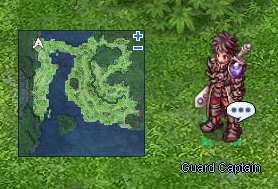
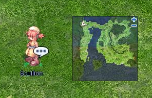
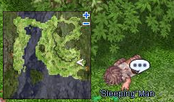

# 12th Anniversary Quest (June 2015)

<!-- Quest info -->
- **Item reward:** Red Beret, Sesame Pastry, All kind of +7 Stats Food, Bubble Gum Buff, Stats Buff

## Quest

1. Kill some of the insect monsters around geffen field to collect some Cookbooks or Badge then talk to Guard Captain in the top left corner of the map.

2. You can now accept killing mission and trade items dropped by the insects for contibution points.

3. Talk to Scullion, the little girl next to the Guard Captain and accept to help her find her father.

4. You will find Scullion's father in the lower right corner of the map (near the portal).

5. Return to Scullion and select the "Bad news" option. She will give you a hunting quest (kill one Maya) and reward you with 500 contribution points.(this part has a 24h cooldown)

Contribution points can be traded for the following :

*  Red Beret
*  Sesame Pastry
*  Whole Roast
*  Special Royal Jelly Herbal Tea
*  Soul Haunted Bread
*  Steamed Alligator with Vegetable
*  Sumptuous Feast
*  Assorted Shish Kebob
*  Bubble Gum Buff (30 minutes).
*  Stats Buff (30 minutes).
*  Upgrade attempt of the Red Beret (the item won't be destroyed of upgrade attempt failed).

---
**Categories:** [Quests](categories/Quests.md), [Temporary Event Quests](categories/Temporary_Event_Quests.md)
*Source: [iRO Wiki Classic](https://irowiki.org/classic/12th_Anniversary_Quest_%28June_2015%29) — GFDL 1.3+*
