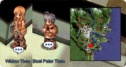
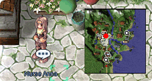
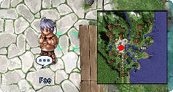
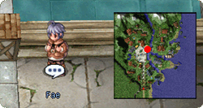
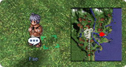

# 2017 St. Patrick's Day Event

<!-- Quest info -->
- **Level requirement:** ??
- **Item requirement:** 1 Bat Cage 1 Ectoplasm 1 Piece of Black Cloth 1 Iron
- **Items required:** Egg Shell
- **Item reward:** 1 [Named] St. Patrick's Hat 50 Green Ale
- **External:** <https://forums.warpportal.com/index.php?/topic/208933-2017-st-patricks-day-quest-guide/>
- **Window:** yes

1. Find **O'Reily** ([Hugel](Hugel.md) 94, 154) in Hugel. He needs our help! He had a fallout with his sister and asks us to help her.

1.   

1. Head over to the 2nd floor of the Hugel Inn and meet **Widow Thon** (hu_in01 252, 17) and her son **Baal Peter Thon** (hu_in01 257, 8).
  * Tell her you can help, and she will ask to you to examine her son. We are clueless so we need to find Nurse Anna. 

1.   

1. Speak to **Nurse Anna** ([Hugel](Hugel.md) 96, 167) in front of Hugel Grocery store.
  * Tell her, ***I need help for Mrs. Thon***
  * And Mrs. Thon child is ***Kind of Whiney***
  * She will recommend you approach Baal Peter Thon with an Egg Shell in your inventory. 

1.   

1. Talk to **Baal Peter Thon** with the Egg Shell in your inventory, he will teleport you to a a copy of Hugel map with monsters.
1. First off talk to **O'Riley** (hugel_us 96, 55) first. This is very important. This part of the quest is very wonky..

1.   

1. Head north, here we meet **Fae** (hugel_us 101, 139). He needs us to give him a Bat Cage.

1.   

1. Next is a **Fae** (hugel_us 117, 156) on the bridge. He needs one Ectoplasm

1.   

1. Finally the **Fae** (hugel_us 170, 136) under the airship. He needs one Piece of Black Cloth

1.   

1. After talking to the three, go back to **O'Riley**.
  * Tell him that you know that he knows the Fae.
  * He tells us that all we need to do is give one piece of Iron to Baal Peter Thon and he will be reverted to normal.
  * **Note**: If you don't get the option to say I know you know the Fae, try turning one of the items above back in then go talk to O'Riley again.
1. Bring the Iron to **Baal Peter Thon** (hu_in01 257, 8) and he will give you the of following:
  * [Named] St. Patrick's Hat and 50 Green Ale

---
**Categories:** [Quest Window Quests](categories/Quest_Window_Quests.md), [Temporary Event Quests](categories/Temporary_Event_Quests.md)
*Source: [iRO Wiki Classic](https://irowiki.org/classic/2017_St._Patrick%27s_Day_Event) — GFDL 1.3+*
