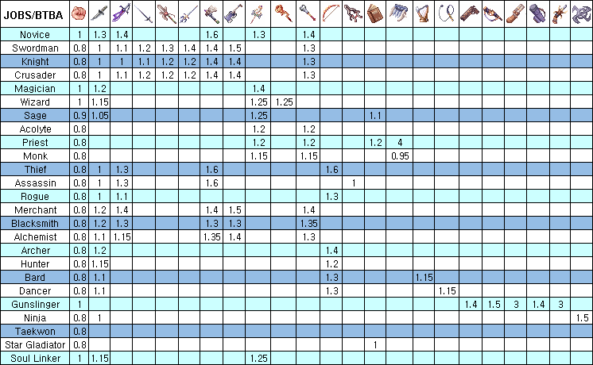
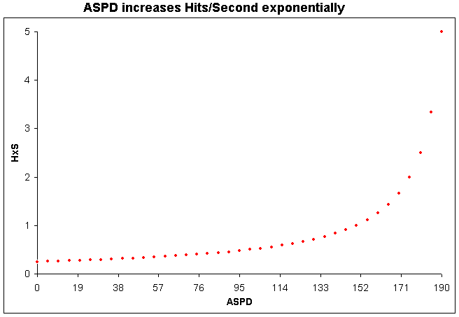

# ASPD

## What is ASPD?

ASPD is Attack Speed. It depends on the player's [class](Classes.md), equipped Weapon Type, Speed Modifiers, [AGI](Stats.md) and [DEX](Stats.md).

## ASPD Formula (0-190)

ASPD = 200-(WD-([WD*AGI/25]+[WD*DEX/100])/10)*(1-SM)

[ ] : to round the number to nearest integer

WD : Weapon Delay = 50*BTBA

## BTBA (Base Time Between Attacks (seconds))

**BTBA for Dual Wielding (Assassin)**

BTBA = 0.7*(BTBA1+BTBA2)

## SM (Speed Modifiers (Potions, Skills, Equipment))

To Increase ASPD, the following can be used:

*  **[ASPD Potion](ASPD_Potion.md)s**: Only the potion with greater effect will be put into consideration, they never stack to each other.

  Concentration Potion 0.1
  [Awakening Potion](ASPD_Potion.md) 0.15
  Berserk Potion 0.2
  Poison Bottle 0.25 (Only for Assassin Cross, other classes instantly die!)

*  **Skills**:

  [Last Stand](Last_Stand.md) 0.2
  [Adrenaline Rush](Adrenaline_Rush.md) 0.3 (Blacksmiths with maces or axes) or 0.25 (Other classes with maces or axes)
  [Twohand Quicken](Twohand_Quicken.md) 0.3
  [Spear Quicken](Spear_Quicken.md) 0.21 to 0.3
  [Frenzy](Frenzy.md) 0.3
  [Solar, Lunar and Stellar Shadow](Solar,_Lunar_and_Stellar_Shadow.md) 0.03 to 0.3
  [Stellar Protection](Stellar_Protection.md) (Level+DEX+LUK) / 1000
  [Study](Study.md) 0.005 to 0.05

*  **Equipment**:

  Assassin Dagger 0.02
  Masamune 0.02
  Flapping Angel Wings 0.03
  Muramasa 0.08
  Doppelganger Card 0.1
  Berserk Claw 0.12
  Heart Breaker 0.05
  Mjolnir 0.1
  Cecil Daemon Card 0.05
  Windhawk 0.05
  Berserk Guitar 1
  Librarian Glove 0.05
  Thief Figure 0.03
  [Kamaitachi](First_Wind.md) 0.03
  Jungle Carbine 0.1
  Thunder P 0.2
  Curved Sword 0.1
  Sage's Diary 0.05 if STR >= 50
  Seal of Continental Guard \[1\] 0.03
  Medal of Honor (Merchant Class) 0.1
  Assaulter Spear 0.2 for Crusader
  Wasteland's Outlaw 0.01 for each 14 AGI
  Hurricane Fury 0.01 for each weapon upgrade
  Ledger of Death 0.01 for each weapon upgrade
  Atroce Card chance gives 1 for 5 seconds when attacked
  Ixion Wings chance depending of refine gives 0.07 for 7 seconds when attacked
Combo Set Bison Horn + :Thorny Buckler 0.1

Combo Set Wanderer Card + :The Paper Card + :Shinobi Card + :Wild Rose Card + :Zhu Po Long Card 0.05

The following skills and equipments decrease ASPD:

*  **Skills**:

  [Slow Grace](Slow_Grace.md) -0.03 to -0.3
  [Defending Aura](Defending_Aura.md) -0.2 to 0
  [Gravitation Field](Gravitational_Field.md) -0.05 to -0.25
  [Peco Peco Ride](Peco_Peco_Ride.md) -0.5 [Cavalier Mastery](Cavalier_Mastery.md) -0.4 to 0
  [Longing for Freedom](Longing_for_Freedom.md) -0.4 to 0

*  **Equipment**:

  Pecopeco Hairband -0.1
  Doom Slayer -0.4
  Howard Alt-Eisen Card -0.05
  Long Barrel -0.03
  Lever Action Rifle -0.05

Speed Modifiers stacks by adding up all.

## Example

Lord Knight wielding a 2-Handed Sword (Base Time Between Attacks 1.1 second / 145 ASPD), and no AGI or DEX, stacking speed mods:
* Berserk Potion (0.2 IAS) + Twohand Quicken (0.3 IAS) + Frenzy (0.3 IAS) = 0.8 IAS
* Combining them together, attack interval becomes a whooping 0.22 seconds between attack (189 ASPD).
* To reach the attack speed cap (0.2 seconds per attack / 190 ASPD), a total of 23 points of AGI+DEX/4 equivalents.

## Hits per Second

Hits/Second = 1/TBA = 50/Delay = 50/(200-ASPD)

TBA : Time Between Attacks (seconds)

ASPD represents attack speed as a hyperbolic function (different from exponential function) that approaches infinity attacks/second as ASPD gets close to 200.

## ASPD in Stats Board

[ASPD]

---
**Categories:** [Mechanics](categories/Mechanics.md)
*Source: [iRO Wiki Classic](https://irowiki.org/classic/ASPD) — GFDL 1.3+*
