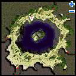

# Abyss Lake Entrance Guide

These steps must be done each time a player or party wishes to enter the Abyss Lake Dungeon. The following items are required to open the entrance portal once:

* 1 Dragon Canine
* 1 Dragon Scale
* 1 Dragon Tail

1. On Hugel Field 5 talk to the Column (hu fild05 168, 303). Insert the Dragon Body Parts and you will be warped to the cave entrance which is on the island in the center of the map. Choosing the other option will cause you to eat the parts and lose 10% [HP](Max_HP.md).
1. The entrance portal will only be open for 30 seconds. If you miss it you will have to bring more items and open the portal again.
1. When [Party](Party.md)ing, most the party members can [Teleport](Teleport.md) to the island, while someone waits next to the column with the parts to activate the portal. (Note: the map can not be [memoed](Warp_Portal.md))
1. To leave the center island, talk to the Column on the left side of the entrance.

---
**Categories:** [Dungeons](categories/Dungeons.md)
*Source: [iRO Wiki Classic](https://irowiki.org/classic/Abyss_Lake_Entrance_Guide) — GFDL 1.3+*
