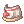
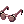
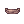
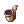
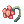
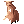
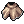
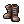
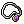

# Acolyte

<!-- Job info -->
- **Job name:** Acolyte
- **Job base:** Novice
- **Job type:** First
- **Changes at:** [Prontera](Prontera.md) Church
- **Skills:** 14
- **Skill points:** 81
- **Quest skills:** 1
- **STR:** 3
- **AGI:** 2
- **VIT:** 3
- **INT:** 3
- **DEX:** 3
- **LUK:** 4

## Overview

Living a life serving the Church, he/she sets out to join the adventurers recruited by King Tristan 3rd, in hope of finding new powers from within him/herself.

He/she sets out on the journey after getting permission from the head of the Church. Following teachings, he/she does not use weapons that can hurt others. Instead,

he/she is a supporter that uses skills when used on others, increases their fighting abilities and heals them as well.

## Jobchange Guide

<!-- Quest info -->
- **Level requirement:** None
- **Job level requirement:** 10
- **Class requirement:** Novice
- **Quest reward:** Jobchange to [Acolyte](Acolyte.md)
- **Cat:** no

1. Go to the [Prontera](Prontera.md) Church (234,314) in the northeastern corner of [Prontera](Prontera.md). Go to the room to the right hand side and talk to the Priest [NPC](NPC.md). He will ask you to go meet one of the following NPCs:

* **Note**: Once you talk to the Ascetic, you will be saved at their location. This means that if you die or use a Butterfly Wing, you will return to the NPC's spot instead of your previous save point.

2a. **Mother Marthilda** in *Morroc*: With the Episode 12 patch, this is no longer an easy NPC to reach. The easiest way to get to this Ascetic is to use the [Kafra](Kafra.md) teleport service to go to [Morroc](Morroc.md), and go out the exit to the north. You will then be on Sograt Desert 07. The NPC is located in the northwestern corner of the map (41, 355). To return to [Prontera](Prontera.md), use the [Kafra](Kafra.md) teleport service again, or you will have to attempt to cross the dangerous Dimensional Gorge map between Morroc and Prontera.

2b. **Father Yosuke** in *East Geffen*: Use the [Kafra](Kafra.md) teleport service to warp to [Geffen](Geffen.md) and walk 2 maps to the East to locate the NPC on Prontera Field 00. It is also possible to reach this NPC by traveling 1 map West, 1 map North, and 1 map West from [Prontera](Prontera.md). The NPC is located in the center of the map (208,218).

2c. **Father Rubalkabara** in *East Prontera*: The Ascetic to the East of Prontera is located in the northeastern corner of Prontera Field 03. This quest is actually one of the hardest of the three choices due to the Mandragora map (Prontera Field 02) you must pass through. Try not to hit any of the Yoyos. They will kill most Novices. Fly Wing from any Chocos, they will also kill most Novices.

3. Return to the Priest at the Church to change into an [Acolyte](Acolyte.md).

   **Note** : On Ymir server, there is now only one possible [NPC](NPC.md) you need to speak with in order to become an Acolyte and it's *Father Yosuke*.

## Builds

*See [Priest Builds](Priest.md) or [Monk Builds](Monk.md) for build strategies.*

*  Learn [Battle Mode](Basic_Game_Control.md) before turning Priest. The Acolyte skills probably won't fill up more than one hot key bar, but just getting used to [Battle mode](Basic_Game_Control.md)'s quirks will make the transition to [Priest](Priest.md) much easier.

*  If this is a starting character then one should consider getting [Warp Portal](Warp_Portal.md) early on as they can make a little extra money warping people to places like Louyang at a lower price than the NPC can (and still make profit since it only costs them 600z for the Blue Gem).

*  Making a high INT Acolyte isn't recommended for people who don't like to help others. If anyone sees an Acolyte sitting in town they will possibly ask them for [Buffs](Buffs.md), heals, and maybe if they have a warp to a certain map. The Acolyte of course don't have to do any of these things for strangers, but keep in mind that the way a person treats others is the treatment they get in return.

*  Acolytes are some of the most frequently [KSed](Kill_Steal.md) first classes. Unless the person [KSes](Kill_Steal.md) one repeatedly, try to just shrug it off.

## Support Priest (WoE)

## Stats

Can be the same as support PVM, if one wants to get lower VIT in order to protect against skills that pierce defense then they should vary their amounts of VIT and DEX.

Starting stats

*  [STR](Stats.md): 1
*  [AGI](Stats.md): 1
*  [VIT](Stats.md): 5
*  [INT](Stats.md): 9
*  [DEX](Stats.md): 4
*  [LUK](Stats.md): 9

Rough stats before Priest job change (bonuses not included). This will likely be around base level 65, possibly lower if the Acolyte levels on monsters with unusual base/job EXP ratios.

*  [STR](Stats.md): 1
*  [AGI](Stats.md): 1
*  [VIT](Stats.md): Low, just starting to add
*  [INT](Stats.md): Very high, but 99 isn't necessary
*  [DEX](Stats.md): 4
*  [LUK](Stats.md): 9

## Skills

Can be the exact same as PvM FS, but may consider working [Decrease AGI](Decrease_AGI.md) into build, and possibly not getting [Angelus](Angelus.md) until [Priest](Priest.md) or not at all.

## Support Priest (PVM)

## Stats

Starting stats

*  [STR](Stats.md): 1
*  [AGI](Stats.md): 1
*  [VIT](Stats.md): 9
*  [INT](Stats.md): 9
*  [DEX](Stats.md): 1
*  [LUK](Stats.md): 9

Rough stats before Priest job change (bonuses not included). This will likely be around base level 65, possibly lower if one levels on monsters with unusual base/job EXP ratios.

*  [STR](Stats.md): 1
*  [AGI](Stats.md): 1
*  [VIT](Stats.md): Low, just starting to add
*  [INT](Stats.md): Very high, possibly 99
*  [DEX](Stats.md): 1
*  [LUK](Stats.md): 9

Skills at job 50 (any FS PvM Acolyte not intending to go the entire 50 jobs should not bother making one at all, they can't hold a candle to job 50 Acolytes). These skills can be gotten in any order (outside of the prerequisites), but this is one common way. The number after the skill name indicates how many points to put into it, not necessarily the level to take the skill to.

## Skills

Also note that not all of these skills are a requirement for all PvM FS Acolytes, some people have different playing styles, but almost all of them are used as other Acolyte skill prerequisites, Priest skill prerequisites (these will be noted) or are just extremely useful.

Two skills that no two Acolytes turning Support Priest will ever agree on are [Cure](Cure.md) and [Decrease AGI](Decrease_AGI.md). One should do their research before choosing to get or not get either, as both options have pros and cons. If the Acolyte doesn't get [Cure](Cure.md) or [Decrease AGI](Decrease_AGI.md) then they'll be putting those points into [Angelus](Angelus.md).

* [Heal](Heal.md) 10
* [Divine Protection](Divine_Protection.md) 5
* [Blessing](Blessing.md) 10
* [Increase AGI](Increase_AGI.md) 1
* [Ruwach](Ruwach.md) 1
* [Teleport](Teleport.md) 2
* [Warp Portal](Warp_Portal.md) 2
* [Increase AGI](Increase_AGI.md) 10
* [Warp Portal](Warp_Portal.md) 4
* [Pneuma](Pneuma.md) 1
* [Cure](Cure.md) 1
* [Decrease AGI](Decrease_AGI.md) 1
* [Angelus](Angelus.md) 3
* [Aqua Benedicta](Aqua_Benedicta.md) 1

## Stats

* [STR](Stats.md): Increases [Weight Limit](Weight_Limit.md) and [ATK](Stats.md).
* [AGI](Stats.md): Increases [ASPD](ASPD.md) and [Flee](Stats.md).
* [VIT](Stats.md): Increases max[HP](Max_HP.md), HP regeneration, resistance against several [Status Effects](Status_Effects.md), Soft[DEF](DEF.md), Soft[MDEF](Stats.md) and the efficiency of healing items.
* [INT](Stats.md): Increases [MATK](Stats.md), max[SP](SP.md), SP regeneration, resistance against several [Status Effects](Status_Effects.md), Soft[MDEF](Stats.md), the efficiency of SP recovery items and the amount of your [Heal](Heal.md).
* [DEX](Stats.md): Increases [Hit](Stats.md), [ASPD](ASPD.md), and [ATK](Stats.md).
* [LUK](Stats.md): Increases [Critical](Stats.md), [ATK](Stats.md), [Perfect Dodge](Perfect_Dodge.md) and resistance against several [Status Effects](Status_Effects.md).

## Equipment

**Headgear - Upper**

*New Player to 500,000z*

*   Nurse Cap

*   Ribbon \[1\], compound with Willow Card or Elder Willow Card

*Several million zeny to work with*

*   +4 Turban \[1\], compound with Willow Card or Elder Willow Card, or Rideword Card

*   +4 Circlet \[1\], compound with same cards^

*   +4 Biretta \[1\], compound with same cards^

*   +4 Coif \[1\], compound with same cards^

*   +4 Coronet

*   +7 Monk Hat

*   +4 Corsair

*Zeny is no object*

*   +7-+9 Circlet \[1\], compound with Willow Card, Elder Willow Card, Rideword Card, or with Carat Card only if +9

*   +7-+9 Biretta \[1\], compound with same cards^

*   +7-+9 Coif \[1\], compound with same cards^

*   +4-+9 Renown Detective Cap \[1\], compound with same cards^

*   +9 Ribbon \[1\] compound with Carat card

*   +7 Corsair

*   +4-+7 Crown

*   +4-+7 Tiara

*   +4-+7 Spiky Band

**Headgear - Middle**

*New Player to 500,000z*

*   Mr. Smile (Middle & Lower)

*   Geek Glasses

*   Purple Glasses

*   Annoyed Mask (Middle & Lower)

*   Surprised Mask (Middle & Lower)

*   Poker Face (Middle & Lower)

*   Goblin Mask (Middle & Lower)

*   Goblin Leader Mask (Middle & Lower)

*   Mr. Scream (Middle & Lower)

*   Opera Masque (Middle & Lower)

*   Opera Phantom Mask

*   Angled Glasses

*   Mini Glasses

*Several Million to work with*

*   Alarm Mask

*   Blinker

*   Dark Blinder

*Zeny is no object*

*   Sunglasses \[1\], compound with any aforementioned cards, Carat Card will not get its SP bonus

*  Elven Ears \[1\], compound with any aforementioned cards, Carat Card will not get its SP bonus

*   Small Ribbons

**Headgear - Lower**

*All price ranges*
*  Well-Chewed Pencil

*   Cigarette

*   Pipe

*   Romantic Leaf

*   Romantic Flower

**Armor**

*New Player to 500,000z*

*   Silk Robe \[1\], compound with Baby Desert Wolf Card

*   Saint's Robe \[1\], compound with same card^

*Several Million to work with*

*   +7 Silk Robe \[1\], compound with Pupa Card or Roda Frog Card

*   +7 Saint's Robe \[1\], compound with same cards^

*Zeny is no object*

*   +9 Silk Robe \[1\], compound with Apocalipse Card

*   +9 Saint's Robe \[1\], compound with same card^

**Weapon**

*New Player to 500,000z*

*   [Mace \[3\]](Mace.md)

*   Arc Wand \[2\], compound with Fabre Cards

*   Survivor's Rod (INT version)

*   Evil Bone Wand

*   Wand of Occult

*Several million to work with*

*   Survivor's Rod \[1\] (INT version), compound with Fabre Card

*   Healing Staff \[1\] (an Overupgraded One)

*Zeny is no object*

*   Long Mace

**Shield**
(will eventually need a nearly complete set of racial bucklers, or a complete set of size bucklers)

*New Player to 500,000z*

*   Buckler \[1\], compound with Thief Bug Egg Card

*   Buckler \[1\], compound with Orc Warrior Card

*Several million to work with*

*   +4 Buckler \[1\], compound with Thara Frog Card

*   +4 Buckler \[1\], compound with Bigfoot Card

*   +4 Buckler \[1\], compound with Sky Petite Card

*   +4 Buckler \[1\], compound with Rafflesia Card

*Zeny is no object*

*   +4-+9 Buckler \[1\], compound with Khalitzberg Card

*   +4-+9 Buckler \[1\], compound with Penomena Card

*   +8-+9 Buckler \[1\], compound with Executioner Card

*   +8-+9 Buckler \[1\], compound with Ogretooth Card

*   +8-+9 Buckler \[1\], compound with Mysteltainn Card

*   +8-+9 Buckler \[1\], compound with Alice Card

**Garment**

*New Player to 500,000z*

*   Ragamuffin Manteau

*Several million to work with*

*   +4 Muffler \[1\], compound with Frilldora Card

*   +4 Muffler \[1\], compound with Raydric Card

*Zeny is no object*

*   +7 Heavenly Maiden Robe \[1\], compound with Raydric Card

**Foot Gear**

*New Player to 500,000z*

*   Sandals \[1\], compound with Freezer Card, Sohee Card, or Eggyra Card

*Several million to work with*

*   +7 Shoes \[1\], compound with Eggyra Card or Verit Card or Green Ferus Card

*Zeny is no object*

*   +9 Shoes \[1\], compound with Firelock Soldier Card

**Accessory**

*New Player to 500,000z*

*   Belt \[1\], compound with Muka Card or Spore Card

*   Celebrant's Mitten

*   Earring

*   Necklace

*Several million to work with*

*   Clip \[1\], compound with Alligator Card

*Zeny is no object*

*   Safety Ring

## Class Data

## Skills

*See [Priest Skills](Priest.md) or [Monk Skills](Monk.md) for second class skills.*

| Skill | Description | Levels | Type |
| --- | --- | --- | --- |
| [Angelus](Angelus.md) | Increase VIT DEF of the user and all party members nearby for 5–50% for 30–300 seconds. | 10 | Supportive |
| [Aqua Benedicta](Aqua_Benedicta.md) | Create 1 Holy Water while standing in shallow water. Each use consumes an Empty Bottle. | 1 | Active |
| [Blessing](Blessing.md) | For 60–240 seconds, increase a target's [STR](Stats.md), [DEX](Stats.md) and [INT](Stats.md) by 1–10. When used on [Undead](Undead.md) or [Demon](Demon.md)s, reduces their [DEX](Stats.md) and [INT](Stats.md) by 50%. | 10 | Supportive |
| [Cure](Cure.md) | Cures a target from Silence, Blind and Chaos statuses. | 1 | Supportive |
| [Decrease AGI](Decrease_AGI.md) | Attempts to lower a target's [AGI](Stats.md) by 3–12 with 42–60% chance of success. (30–120 seconds vs. monsters, 20–65 seconds vs. players) | 10 | Active |
| [Demon Bane](Demon_Bane.md) | Increases attack against against [Demon](Demon.md)s and [Undead](Undead.md) monsters by 3–30. | 10 | Passive |
| [Divine Protection](Divine_Protection.md) | Increases VIT defense against [Demon](Demon.md)s and [Undead](Undead.md) monsters by 3–30. | 10 | Passive |
| [Heal](Heal.md) | Restore a target's [HP](Max_HP.md), or damage [Undead](Undead.md) targets. (Base factor 12–84) | 10 | Supportive |
| [Increase AGI](Increase_AGI.md) | For 60–240 seconds, increase target's [AGI](Stats.md) by 3–12. | 10 | Supportive |
| [Pneuma](Pneuma.md) | Protects a 3×3 area from incoming ranged attacks. | 1 | Supportive |
| [Ruwach](Ruwach.md) | Reveal hidden enemies in a 5×5 area around the user and deal 145% MATK damage to them. | 1 | Offensive |
| [Signum Crusis](Signum_Crusis.md) | Decrease [Undead](Undead.md)-element and [Demon](Demon.md) monsters' [DEF](DEF.md) by 14–50% in a wide radius around the user, with 27–63% success chance. | 10 | Supportive |
| [Teleport](Teleport.md) | Instantly move to a random spot on the map or the user's save spot. Does not work in PvP environments. | 2 | Supportive |
| [Warp Portal](Warp_Portal.md) | Use a Blue Gemstone to open a portal to the user's save spot or an area memorized earlier for up to 8 players to pass through. (0–3 memo points, 10–25 seconds) | 4 | Supportive |

## Quest Skills

| Skill | Description | Levels | Type | Job Level Requirement | Quest |
| --- | --- | --- | --- | --- | --- |
| [Holy Light](Holy_Light.md) | [Holy](Holy.md)-element attack that deals 125% MATK damage to a single target. Cancels [Kyrie Eleison](Kyrie_Eleison.md) on target. | 1 | Offensive | 30 | [Holy Light Quest](Acolyte_Skill_Quest.md) |

## Job Bonuses

The Levels in which one receives a certain bonus
* Not accumulative
* Totals for Job Level 40 and 50 are listed for comparison

| Stat\Job Level | 1 | 2 | 3 | 4 | 5 | 6 | 7 | 8 | 9 | 10 | 11 | 12 | 13 | 14 | 15 | 16 | 17 | 18 | 19 | 20 | 21 | 22 | 23 | 24 | 25 |
| --- | --- | --- | --- | --- | --- | --- | --- | --- | --- | --- | --- | --- | --- | --- | --- | --- | --- | --- | --- | --- | --- | --- | --- | --- | --- |
| STR |   |   |   |   |   |   |   |   |   |   |   |   |   |   |   |   |   |   |   |   |   |   |   |   |   |
| AGI |   |   |   |   |   |   |   |   |   |   |   |   |   |   |   |   |   |   |   |   |   | +1 |   |   |   |
| VIT |   |   |   |   |   | +1 |   |   |   |   |   |   |   |   |   |   |   |   |   |   |   |   |   |   |   |
| INT |   |   |   |   |   |   |   |   |   | +1 |   |   |   |   |   |   |   |   |   |   |   |   |   |   |   |
| DEX |   |   |   |   |   |   |   |   |   |   |   |   |   | +1 |   |   |   |   |   |   |   |   |   |   |   |
| LUK |   | +1 |   |   |   |   |   |   |   |   |   |   |   |   |   |   |   | +2 |   |   |   |   |   |   |   |
| Stat\Job Level | 26 | 27 | 28 | 29 | 30 | 31 | 32 | 33 | 34 | 35 | 36 | 37 | 38 | 39 | 40 | 41 | 42 | 43 | 44 | 45 | 46 | 47 | 48 | 49 | 50 |
| STR | +1 |   |   |   |   |   |   |   |   |   |   |   |   |   | +1 |   | +2 |   |   |   |   |   |   | +3 | +3 |
| AGI |   |   |   |   |   |   |   |   |   |   |   |   |   |   | +2 |   |   |   |   |   |   |   |   |   | +2 |
| VIT |   |   |   |   | +2 |   |   |   |   |   |   |   |   |   | +2 |   |   |   | +3 |   |   |   |   |   | +3 |
| INT |   |   |   |   |   |   |   | +2 |   |   |   |   |   |   | +2 |   |   |   |   |   | +3 |   |   |   | +3 |
| DEX |   |   |   |   |   |   |   |   |   |   | +2 |   |   |   | +2 |   |   |   |   |   | +3 |   |   |   | +3 |
| LUK |   |   |   |   |   |   |   |   |   |   |   |   | +3 |   | +3 |   |   |   |   |   |   |   |   |   | +4 |

## ASPD

| Weapon | Base ASPD | Base Delay |
| --- | --- | --- |
| Unarmed | 160.1 |   |
| Mace | 140.2 |   |
| Rod | 140.2 |   |

## See Also

* [Acolyte Leveling Spots](Leveling_Spots.md)

## External Links

**Related pages:**

* [Acolyte](Acolyte.md)
* [Skills](Skills.md)
* [Angelus](Angelus.md)
* [Aqua Benedicta](Aqua_Benedicta.md)
* [Blessing](Blessing.md)
* [Cure](Cure.md)
* [Decrease AGI](Decrease_AGI.md)
* [Demon Bane](Demon_Bane.md)
* [Divine Protection](Divine_Protection.md)
* [Heal](Heal.md)
* [Holy Light](Holy_Light.md)
* [Increase AGI](Increase_AGI.md)
* [Pneuma](Pneuma.md)
* [Ruwach](Ruwach.md)
* [Signum Crusis](Signum_Crusis.md)
* [Teleport](Teleport.md)
* [Warp Portal](Warp_Portal.md)
* [Quests](Quests.md)
* [Acolyte Job Change Guide](Acolyte_Job_Change_Guide.md)
* [Acolyte Skill Quest](Acolyte_Skill_Quest.md)
* [Acolyte Training Quest](Acolyte_Training_Quest.md)
* [Weapons](Weapons.md)
* [Mace](Mace.md)
* [Rod](Rod.md)

**Related pages:**

* [Classes](Classes.md)
* [Novice](Novice.md)
* [High Novice](High_Novice.md)
* [Super Novice](Super_Novice.md)
* [Acolyte](Acolyte.md)
* [Archer](Archer.md)
* [High First Class](High_First_Class.md)
* [Mage](Mage.md)
* [Merchant](Merchant.md)
* [Swordman](Swordman.md)
* [Thief](Thief.md)
* [Priest](Priest.md)
* [Monk](Monk.md)
* [Hunter](Hunter.md)
* [Bard](Bard.md)
* [Dancer](Dancer.md)
* [Wizard](Wizard.md)
* [Sage](Sage.md)
* [Blacksmith](Blacksmith.md)
* [Alchemist](Alchemist.md)
* [Knight](Knight.md)
* [Crusader](Crusader.md)
* [Assassin](Assassin.md)
* [Rogue](Rogue.md)
* [Transcendent](Transcendent.md)
* [High Priest](High_Priest.md)
* [Champion](Champion.md)
* [Sniper](Sniper.md)
* [Minstrel](Minstrel.md)
* [Gypsy](Gypsy.md)
* [High Wizard](High_Wizard.md)
* [Scholar](Scholar.md)
* [Mastersmith](Mastersmith.md)
* [Biochemist](Biochemist.md)
* [Lord Knight](Lord_Knight.md)
* [Paladin](Paladin.md)
* [Assassin Cross](Assassin_Cross.md)
* [Stalker](Stalker.md)
* [Gunslinger](Gunslinger.md)
* [Ninja](Ninja.md)
* [TaeKwon Kid](TaeKwon_Kid.md)
* [TaeKwon Master](TaeKwon_Master.md)
* [Soul Linker](Soul_Linker.md)

---
**Categories:** [Acolyte](categories/Acolyte.md), [Classes](categories/Classes.md)
*Source: [iRO Wiki Classic](https://irowiki.org/classic/Acolyte) — GFDL 1.3+*
