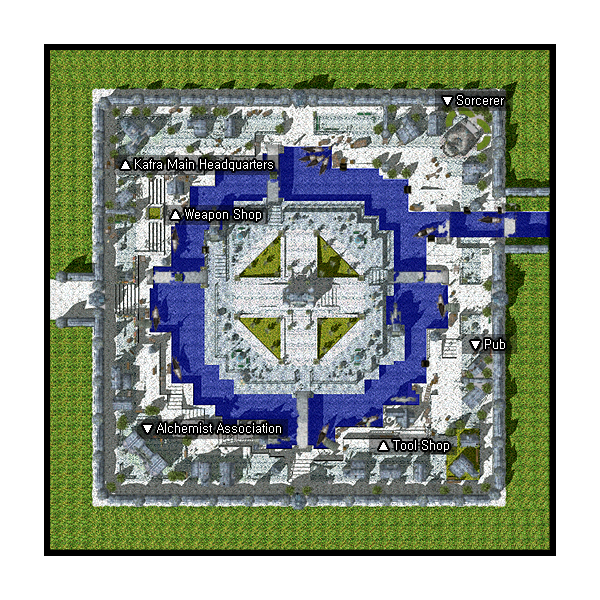

# Al De Baran

## About Al De Baran

Al De Baran is a peaceful town, home to the Alchemist guild. The adjoining guild map of Luina can be accessed from the western portal in town. To the north lies the cities of Juno, Einbroch, and Lighthalzen.

## Story

Al De Baran is the southern city at the end of the Schwarzwalds Republic, which lies on the northern side of the Mt. Mjolnir. The entrance, a beautiful canal that surrounds a clock tower, adds to the quaint environment of this small town. Al De Baran is famous for attracting [Alchemist](Alchemist.md)s who wish to further research this strange science. It is also known for its beautiful windmills, as well as for being the home of the [Kafra](Kafra.md) Headquarters.

## Guide

Note: The "Sorcerer" location is irrelevant, as the Santa NPC is the only person in the area. It is probably left over from an old update, and was never taken out.

## Structures

## Buildings

* 1 - Chemical Academy (54,66) and (66,54)
* 2 - Clock Tower (140,134)
* 3 - House #1 (90,234)
* 4 - House #2 (224,55)
* 5 - Item Shop (197,69) --- Guard's mark is off
* 6 - Kafra Main Office (52,217) and (62,228)
* 7 - Pub (232,106) --- Guard's mark is off
* 8 - Super Novice Society HQ (117,63)
* 9 - Weapon Shop (72,196)

## Billboards

* Al De Baran Bulletin (133,104) - Flavor Text
* Billboard (54,223) - Flavor Text
* Billboard (181,172) - Flavor Text
* Bulletin Board (146,106) - Gives background information on Al De Baran
* Bulletin Board (136,133) - Gives background information on Clock Tower
* Sign (217,222) - Flavor Text

## Guild Flags

* Hohenschwangau Guild Flag (149,97)
* Neuschwanstein Guild Flag (152,97)
* Nuemberg Guild Flag (134,97)
* Rothenburg Guild Flag (128,97)
* Wuerzburg Guild Flag (131,97)

## NPCs

## Regulars

Guide - Al De Baran Guard (139,63)
Guide - Al De Baran Guard (133,108)
  Show on minimap: Kafra Main Office, Weapon Shop, Sorcerer Guild (Closed), Pub, Item Shop, Chemical Academy
Kafra Employee (143,119)
  Save, Kafra storage (20z), Teleport service, Rent Cart, Reserve points
Kafra Employee - Kafra Leilah (Kafra Main Office)
  Save, Kafra storage (20z), Rent Cart
Repairman (Weapon Shop)
  Repair NPC
Missing NPCs
  Upgrading NPC
  Level 1/2 metal NPC
  Level 3/4 metal NPC
  Inn NPC
  PVP NPCs

## Store NPCs

Weapon Dealer (Weapon Shop)
  Knife, Cutter, Main Gauche, Dirk, Dagger, Stiletto, Gladius, Damascus
Armor Dealer (Weapon Shop)
  Helm, Buckler, Shield, Mantle, Coat, Padded Armor, Chain Mail, Full Plate, Manteau, Boots, Novice Armlet, Belt
Tool Dealer (Item Shop)
  Red Potion, Orange Potion, Yellow Potion, White Potion, Green Potion, Concentration Potion, Awakening Potion, Fly Wing, Butterfly Wing, Magnifier, Yggdrasil Leaf

## Trade NPCs

Kafra Employee (54,238)
  *[Super Novice](Super_Novice.md) Only, [Pushcart](Pushcart.md) skill required*
  Rent Cart for ???
Merchant (152,63)
  *Amount traded is selectable*
  Red Potion for 1 Worm Peeling
  Red Potion for 7 Feather of Birds
  Red Potion for 10 Jellopy
Smile Assistance - Smile Girl (136,135)
  Mr. Smile for 10 Clover, 10 Fluff, 10 Jellopy
Guild Dealer - Gever Al Sharp (Chemical Academy)
  *Amount traded is selectable for medicine bowls, max 100*
  Medicine Bowl - 8z (250z in Valkyrie)
  Potion Creation Guide for 100,000z
  Alcohol Creation Guide for 100,000z
  Bottle Grenade Creation Guide for 100,000z
  Acid Bottle Creation Guide for 100,000z
  Plant Bottle Creation Guide for 100,000z
  Glistening Coat Creation Guide for 100,000z
  Condensed Potion Creation Guide for 240,000z
Kafra Employee (Kafra Main Office)
  100 Points for 7 Potato
  200 Points for 15 Potato
  300 Points for 25 Potato
  400 Points for 35 Potato
  500 Points for 50 Potato
  600 Points for 60 Potato
  700 Points for 75 Potato
  800 Points for 85 Potato
  900 Points for 100 Potato
  1000 Points for 1st Kafra Lottery | Lottery Chance
  1100 Points for 7 Red Potion
  1300 Points for 15 Red Potion
  1500 Points for 25 Red Potion
  1700 Points for 35 Red Potion
  1900 Points for 50 Red Potion
  2100 Points for 60 Red Potion
  2300 Points for 75 Red Potion
  2500 Points for 85 Red Potion
  2800 Points for 100 Red Potion
  3000 Points for 2nd Kafra_Lottery | Lottery Chance
Kafra Employee (Kafra Main Office)
  5000 Points for 1st Kafra_Lottery | Lottery Chance
  7000 Points for 2nd Kafra_Lottery | Lottery Chance
  10000 Points for 3rd Kafra_Lottery | Lottery Chance
Kafra Service - Kafra Pavianne (Kafra Main Office)
  ?? for 1 Kafra Pass --- Refunding because Kafra Pass has no effect anymore
Monster Tamer - YuU (Pub)
  Skull Helm for 1 Bone Helm
  Monster Oxygen Mask for 1 Oxygen Mask
  Silk Ribbon for 1 Ribbon
  Stellar Hairpin for 1 Stellar
  Tiny Egg Shell for 1 Egg Shell
  Rocker Glasses for 2 Zargon, 1 Ribbon, 400z
Muscle Man (Chemical Academy)
  Alarm Mask for 3000 Clock Hand, 1 Mr.Scream
Trader (Pub)
  Doctor Band for 1 Red Bandana, 50 Iron, 1 Cracked Diamond, 3,500z
  Feather Bonnet for 1 Romantic Gent, 300 Feather of Birds, 500z
  Phantom of Opera for 20 Iron, 1 Singing Plant, 5,000z
  Sakkat for 120 Trunks, 10,000z

## Quest NPCs

Alchemist Guildsman - Parmy Gianino (Chemical Academy)
  [Alchemist](Alchemist.md) job change NPC
Chief Researcher - Nicholas Flamel (Chemical Academy)
  Part of Alchemist job change quest
Experiment Expert - Van Helmont (Chemical Academy)
  Part of Alchemist job change quest
Fastidious Alchemist - Raspuchin Gregory (Chemical Academy)
  Part of Alchemist job change quest
Master Alchemist - Vincent Carsciallo (Chemical Academy)
  Part of Alchemist job change quest
Studying Man - Darwin (Chemical Academy)
  Part of Alchemist job change quest
Tzerero (Super Novice Society HQ)
  [Super Novice](Super_Novice.md) job change NPC

## Travel NPCs

Kafra Employee (143,119)
  [Geffen](Geffen.md) - 1200z
  [Juno](Juno.md) - 1200z
  [Izlude](Izlude.md) - 1800z
  [Mt. Mjolnir Dead Pit](Mt._Mjolnir_Dead_Pit.md) - 1700z
Mr. Claus (223,222)
  [Lutie](Lutie.md) - Free

## Other NPCs

* Alchemy Guy - Chemirre (121,231)
* Bell Keeper (143,136)
* Bill Thayer (178,239)
* Canal Guy - Panama (46,129)
* Citizen - Gavin (212,122)
* Forest Guy - Isenberg (67,154)
* Forger Munster - Munster (113,70)
* Home Owner (197,228) --- *triggers when you step within one tile of (197,228)*
* Insect Guy - Stromme (159,242)
* Meteurengut (44,53)
* Joo Jahk (180,46)
* Lady - Emma Searth (66,213)
* Little Kid - Bebe (86,228)
* Phracon Guy - Joy (117,181)
* Shell Gathering Lady - Joanne (81,61)
* Slot Guy - Epthiel (90,170)
* Smithing Guy - Quatro (64,104)
* Sylvia (60,70)
* Town Girl - Nastasia (146,124)
* Young Man - Miller (49,93)
* Cipriano (Super Novice Society HQ)
* Esseray (Super Novice Society HQ)
* Harold (Super Novice Society HQ)
* Master (Pub)
* Kafra Jasmine (Kafra Main Office)
* Kafra Service - Kafra Blossom (Kafra Main Office)
* Kafra Service - Kafra Curly Sue (Kafra Main Office)
* Kafra Service - Kafra Roxie (Kafra Main Office)
* Lionel (House #2)
* Reynolds (House #1)

## Dungeon

## Clock Tower

**Related pages:**

* [Towns](Towns.md)
* [Rune-Midgarts Kingdom](Rune-Midgarts_Kingdom.md)
* [Alberta](Alberta.md)
* [Al De Baran](Al_De_Baran.md)
* [Archer Village](Archer_Village.md)
* [Comodo](Comodo.md)
* [Geffen](Geffen.md)
* [Izlude](Izlude.md)
* [Morroc](Morroc.md)
* [Payon](Payon.md)
* [Prontera](Prontera.md)
* [Umbala](Umbala.md)
* [Republic of Schwartzvald](Republic_of_Schwartzvald.md)
* [Einbech](Einbech.md)
* [Einbroch](Einbroch.md)
* [Hugel](Hugel.md)
* [Juno](Juno.md)
* [Lighthalzen](Lighthalzen.md)
* [Arunafeltz States](Arunafeltz_States.md)
* [Rachel](Rachel.md)
* [Veins](Veins.md)
* [Manuk](Manuk.md)
* [Amatsu](Amatsu.md)
* [Ayothaya](Ayothaya.md)
* [Kunlun](Kunlun.md)
* [Jawaii](Jawaii.md)
* [Louyang](Louyang.md)
* [Moscovia](Moscovia.md)
* [Nifflheim](Nifflheim.md)
* [Lutie](Lutie.md)

---
*Source: [iRO Wiki Classic](https://irowiki.org/classic/Al_De_Baran) — GFDL 1.3+*
