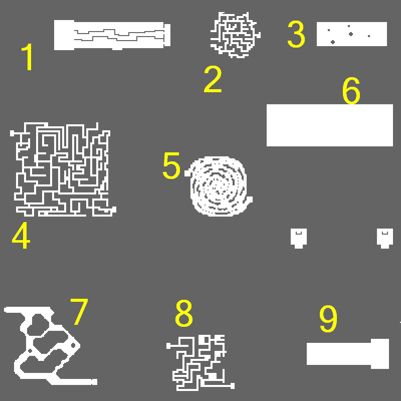

# Al de Baran Turbo Track

The **Al de Baran Turbo Track** is a Minigame can be accessed from Luina, one map west of [Al de Baran](Al_De_Baran.md) (alde_gld 183, 204). There is a [Kafra](Kafra.md) [NPC](NPC.md) (turbo_room 130, 92) in the lower right area of the Turbo Track. There is also a Turbo Track Merchant (turbo_room 124, 86) who sells items sold by a typical Tool Dealer.

## Rules

The purpose of the Al de Baran Turbo Track is to get past the obstacles and to try to get to the finish line as fast as you can. [Classes](Classes.md) that can mount a Peco Peco ([Knight](Knight.md), [Crusader](Crusader.md), [Paladin](Paladin.md) and [Lord Knight](Lord_Knight.md)) must get off their Peco Peco before entering the Turbo Track Arena. The [NPC](NPC.md) will ask you to get off your Peco Peco and will give you a ticket so that you can rent a Peco Peco again free of charge.

The winner of the race is the first person who reaches the finish line first. Once someone crosses the finish line, the race ends and everybody participating is automatically transported to the bottom left part of the Waiting Room. The time limit of one race is 15 minutes. If no one finishes within the allotted time, the race will end without a winner.

There are no character class or level requirements to participate in the Turbo Track. However, there is a participation fee of 1,000 [Zeny](Zeny.md).

## Restrictions

In Turbo Track, the following items are prohibited:
*  Green Potion
*  Panacea
*  Fly Wing

If you try to use them, they won't work until after you leave the race track.

The following skills are prohibited during a Turbo Track race:
*  [Snatch](Snatch.md)
*  [Teleport](Teleport.md)
*  [Warp Portal](Warp_Portal.md)
*  [Hiding](Hiding.md)
*  [Cloaking](Cloaking.md)
*  [Stealth](Stealth.md)
*  [Cure](Cure.md)
*  [Ice Wall](Ice_Wall.md)
*  [Frenzy](Frenzy.md)
*  [Basilica](Basilica.md)
*  [Sheltering Bliss](Sheltering_Bliss.md)
*  [Spear Dynamo](Spear_Dynamo.md)

## Game Modes

There are three different game modes available for races in the Turbo Track: Normal, Expert and Solo. Each kind of race has its own record. Records NPCs are located on both sides of the information booth and at the bottom left part where players are warped to.

## Normal Mode

Normal Mode is located in the upper left area. There is a limit of the amount of people who can enter; the limits are 4, 8, and 16 people. The Invisible Maze is a special course that is only available in 16 person races.

## Expert Mode

Expert Mode is located in the upper right area. Like Normal Mode, there is a limit of the amount of people who can enter; the limits are 4, 8, and 16 people. Expert Mode allows players to [PvP](PvP~d29d2.md). This is ideal for races between [parties](Party.md) or [guilds](Guild_System.md). The Invisible Maze is a special course that is only available in 16 person races.

## Solo Mode

Solo Mode is located in the upper left area with Normal Mode. In Solo Mode, only one person can enter, and you can experience every course.

## Game Courses

The Turbo Track consists of various courses, each of time having its own uniqueness.

## Part 1: Log Bridge

Players are to go across one of the three bridges. If someone falls, he/she will be transported back to the beginning. Hovering over a cell on the bridges will not show the cell. The middle log bridge is 1 cell narrower than the others, but offers a straighter route to the next course. Although the other log bridges are wider, they have the disadvantage of having twists and turns.

## Part 2: Cube Hills

Players are to reach the other side of the hill made of boxes. To oppose the progress of the participants, 5 special Munaks spawn here. Also, there are special "Warp Portals" hidden around the hill, which will a player somewhere else on the hill.

## Part 3: Cursed Desert

This course is a fascimile of part of the Sograt Desert. As players walk across the desert, they will suffer from random [status effects](Status_Effects.md) including:
* [Chaos](Status_Effects.md)
* [Curse](Status_Effects.md)
* [Frozen](Status_Effects.md)
* [Stun](Status_Effects.md)
* [Stone](Status_Effects.md)

Also, there is a chance that someone will automatically talk to a [Kafra](Kafra.md) [NPC](NPC.md).

## Part 4: Flasher Maze

Players will be [blinded](Status_Effects.md) in this part of the race. The exit is randomly located either in the top left or the bottom right of the map.

* **Note**: Wearing a Deviruchi Card, Evil Snake Lord Card, Blinker, or Dark Blinker will eliminate the effects of [Blind](Status_Effects.md).

## Part 5: Single Snail

Players will have to walk around the "snail." In Expert Mode, certain sections will allow players to perform long-range attacks to impede their opponents. There is a Warp Portal in the center of the snail which will teleport the player to a random spot.
* **Tip**: Having any speed enhancers will benefit here.

## Part 6: Snake Dice

Players must run through a long snake-like path to the end, while under attack from many Archer Skeletons. There is a Warp Portal in the center of the course which will teleport the player to a random spot.

## Part 7: Monsters

Players will face the following (special version) monsters on the way to the section's exit:
*  12 Munak
*  6 Bongun
*  2 Yao Jun

## Part 8: Invisible Maze

This maze appears as an empty rectangular room in-game, similar to the final part of the [Assassin](Assassin.md) job change quest. Players start form the top left side and the map, and must find their way to the exit portal at the bottom right corner of the map.

## Part 9: Finishing Line

All players' [HP](Max_HP.md) will decrease as they walk to the finish line. To win, they must talk to the [NPC](NPC.md). Only the person in first place is allowed to pass the Finish Line and win. The others will be trasported to the Waiting Room. In 8 and 16 person mode, the people first, second, and third are allowed to pass the finish line.

## Rewards

| **Rewards** | **Rewards** | **Rewards** | **Rewards** | **Rewards** | **Rewards** |
| --- | --- | --- | --- | --- | --- |
| Participation Bonus |  * 2 Turbo Track Points |  * 2 Turbo Track Points |  * 2 Turbo Track Points |  * 2 Turbo Track Points |  * 2 Turbo Track Points |
| Solo Mode |  * 10 Turbo Track Points if completed within time limit * 40 Turbo Track Points if in Top Record |  * 10 Turbo Track Points if completed within time limit * 40 Turbo Track Points if in Top Record |  * 10 Turbo Track Points if completed within time limit * 40 Turbo Track Points if in Top Record |  * 10 Turbo Track Points if completed within time limit * 40 Turbo Track Points if in Top Record |  * 10 Turbo Track Points if completed within time limit * 40 Turbo Track Points if in Top Record |
| Normal Mode | Normal Mode | Normal Mode | Expert Mode | Expert Mode | Expert Mode |
| 4 Participants |  * 20 Turbo Track Points |  * 20 Turbo Track Points | 4 Participants |  * 40 Turbo Track Points |  * 40 Turbo Track Points |
| 8 Participants | 1st Place |  * 30 Turbo Track Points | 8 Participants | 1st Place |  * 50 Turbo Track Points |
| 8 Participants | 2nd Place |  * 20 Turbo Track Points | 8 Participants | 2nd Place |  * 40 Turbo Track Points |
| 8 Participants | 3rd Place |  * 10 Turbo Track Points | 8 Participants | 3rd Place |  * 30 Turbo Track Points |
| 16 Participants | 1st Place |  * 40 Turbo Track Points | 16 Participants | 1st Place |  * 60 Turbo Track Points |
| 16 Participants | 2nd Place |  * 30 Turbo Track Points | 16 Participants | 2nd Place |  * 50 Turbo Track Points |
| 16 Participants | 3rd Place |  * 20 Turbo Track Points | 16 Participants | 3rd Place |  * 40 Turbo Track Points |

To exchange Turbo Track Points for the following various items, a player must talk to the Point Exchange Helper at the infomation booth(turbo_room 93, 117).

* 10 Turbo Track Points for 1 Free Ticket for Kafra Transportation
* 12 Turbo Track Points for 1 Level 5 Magic Scroll
* 40 Turbo Track Points for [Base Experience](Base_EXP_Chart.md) (varies):
  * Level 1-69: [Base EXP](Base_EXP_Chart.md) 3,000
  * Level 70-79: [Base EXP](Base_EXP_Chart.md) 9,000
  * Level 80-89: [Base EXP](Base_EXP_Chart.md) 10,000
  * Level 90-99: [Base EXP](Base_EXP_Chart.md) 30,000
* 150 Turbo Track Points for 1 3carat Diamond
* 350 Turbo Track Points for 1 Gift Box
* 400 Turbo Track Points for 1 Speed Potion

**Related pages:**

* [Al de Baran Turbo Track](Al_de_Baran_Turbo_Track.md)
* [Hugel Minigames](Hugel_Minigames.md)
* [Izlude Arena](Izlude_Arena.md)

---
**Categories:** [Minigames](categories/Minigames.md)
*Source: [iRO Wiki Classic](https://irowiki.org/classic/Al_de_Baran_Turbo_Track) — GFDL 1.3+*
