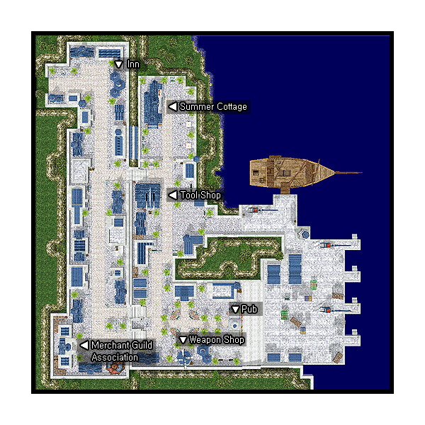

# Alberta

## About Alberta

Alberta is home to [Merchant](Merchant.md) guild. It is also the gateway to many of the "cultural towns" such as [Amatsu](Amatsu.md), [Kunlun](Kunlun.md), [Louyang](Louyang.md), [Ayothaya](Ayothaya.md), [Moscovia](Moscovia.md), as well as Turtle Island and the Sunken Ship.

## Story

The port city Alberta where the ocean breeze is always pleasing. The Merchant Guild is also located here. However, you can't find many merchants here because most of the trades that are done here are between in larger cities... A ship that sunk with a large amount of treasure was found recently attracting much interest.

## Guide

## Structures

***Image Required***

## Buildings

* 1 - Empty Ship (179,165) and (170,169)
* 2 - Empty Ship Cabin (208,173)
* 3 - Hairdresser Salon (135,37)
* 4 - Inn (63,233)
* 5 - Merchant Guild (35,42)
* 6 - Summer Cottage (101,221) and (93,203)
* 7 - Tool Shop (100,153)
* 8 - Weapon shop (117,40)

## Billboards

* Billboard (37,39) - Flavor text
* Billboard (35,241) - Flavor text
* Bulletin Board (111,59) - Gives background information on Alberta
* Sign (149,54) - Flavor text
* Sign (99,151) - Flavor text
* Sign (196,152) - Flavor text

## NPCs

## Regulars

Guides - Alberta Guide (23,238)
Guides - Alberta Guide (120,60)
  Show on minimap: Merchant Guild, Weapon Shop, Tool Shop, Inn, Forge
Kafra Employee (28,229)
Kafra Employee (113,60)
  Save, Kafra storage (50z), Teleport service, Rent cart, Reserve points, Kafra location
Inn Employee - Employee Jennie (Inn)
  Save, Rest (5000z)
PvP NPCs
  PVP Narrator (Inn)
  Gate Keeper (Inn)
Fredrik - Fredrik Hermanthorn (Merchant Guild)
  Upgrading NPC
Kahlamanlith (Merchant Guild)
  Level 1/2 metal NPC
Xenophon - Xenophon Zolotas (Merchant Guild)
  Level 3/4 metal NPC
Repairman (Merchant Guild)
  Repair NPC

## Store NPCs

Armor Dealer (Weapon shop)
  Guard, Buckler, Sandals, Shoes, Boots, Hood, Muffler, Manteau, Glasses, Sunglasses, Diver Goggles, Cap, Cotton Shirts, Jacket, Adventurer's Suit, Silk Robe, Wooden Mail, Silver Robe, Mantle, Coat, Padded Armor, Chain Mail, Novice Armlet
Item Collector (Tool shop)
  Scell, Monster's Feed
Tool Dealer (Tool shop)
  Arrow, Magnifier, Red Potion, Orange Potion, Yellow Potion, White Potion, Green Potion, Concentration Potion, Awakening Potion, Fly Wing, Butterfly Wing, Geek Glasses
Weapon Dealer (Weapon shop)
  Arrow, Silver Arrow, Sword, Falchion, Blade, Knife, Cutter, Main Gauche, Rod, Bow, Axe, Battle Axe, Hammer, Buster, Two-handed Axe

## Trade NPCs

Elin (117,135)
  1 Candy for Poring Doll
  7 Banana Juice for Rocker Doll
  1 Candy Cane for Chonchon Doll
  1 Candy Cane for Puppet
  5 Well-baked Cookie for Spore Doll
  3 Piece of Cake for Smokie Doll
  1 Yggdrasil Seed for Yoyo Doll
  2 Mastela Fruit for Osiris Doll
  5 Panacea for Baphomet Doll
Hat store girl - Tempestra (136,79)
  *Requires one Yellow Potion per conversation*
  Mage Hat for 1 Wizard Hat, 400 Dragon Scale, 50 Mould Powder, 1 Elder Willow Card
  Magician Hat for 1 Wizard Hat, 450 Ancient Lips, 1200 Solid Shell
  Hat of the Sun God for 1 Emblem of the Sun God, 10 Gold, 40 Steel, 50 Coal, 2 Oridecon
  Sunday Hat for 250 Fabric, 1 Hat[1], 1 Cap[1], 600 Soft Feather
Kafra Employee - Kafra (26,229)
  Bunny Band for 1 Four Leaf Clover, 1 Pearl, 1 Kitty Band, 100 Feather
Phelix (190,173)
  1 Carrot for 3 Jellopy
  1 Red Potion for 10 Jellopy
Roving Hair Dresser - Rui Vishop (141,33)
  Random hair change for 199,800z
Smile Assistance - Smile Girl (113,53)
  Mr. Smile for 10 Clover, 10 Fluff, 10 Jellopy
Stylish Merchant - Zic (120,53)
  Bao Bao for 1 Silk Ribbon, 50 Heroic Emblem
  Crescent Hairpin for 1 Heart Hairpin, 10 Steel
  Fashionable Glasses for 1 Jack be Dandy, 1 Scarlet Dyestuffs
  Heart Hairpin for 1200 Coral Reef
Cherokee (Summer Cottage)
  Antlers for 20 Evil Horn
Grampa (Inn)
  Boys Cap for 10 Tiger's Footskin
Hair Dresser - Veronica (Hairdresser Salon)
  Hair style change for 3 Counteragent, 3 Mixture, 100 Daenggie, 100 Short Daenggie, 100 Black Hair, 100 Golden Hair, 100 Glossy Hair, 99,800z
Monster Tamer - Iwado (Tool shop)
  Monster Juice for 1 Animal Gore, 2 Apple
  Singing Flower for 1 Singing Plant
  Wild Flower for 1 Fancy Flower, 1 Clover
Pharmacist - Old Pharmacist (Merchant Guild)
  Red Potion for 2 Red Herb, 1 Empty Bottle, 2z
  Orange Potion for 1 Red Herb, 1 Yellow Herb, 1 Empty Bottle, 5z
  Yellow Potion for 2 Yellow Herb 1 Empty Bottle, 10z
  White Potion for 2 White Herb, 1 Empty Bottle, 20z
  Blue Potion for 2 Blue Herb, 1 Empty Bottle, 30z
  Green Potion for 2 Green Herb, 1 Empty Bottle, 3z

## Quest NPCs

Charlron (119,221)
  Teaches Change Cart
Gershaun (232,106)
  Teaches Cart Revolution
Necko (83,96)
  Teaches Crazy Uproar
Tourist (43,244)
   ??
Grandpa Turtle (Inn)
  Part of Turtle Island Entrance Quest
Guildsman - Geschupenschte (Weapon shop)
  Part of Blacksmith job change quest
Louitz - Merchant Louitz (Summer Cottage)
  Part of Hair Styling/Dye Quests
Merchant - Chief Manhsoo (Merchant Guild)
  Merchant job change NPC
Merchant Guildsman
  Union Staff Kay (Merchant Guild) - Part of Merchant job change quest

## Travel NPCs

Aibakthing (247,42)
  [Ayothaya](Ayothaya.md) - 10,000z
Fisk (189,151)
  Sunken Ship - 250z
  [Izlude](Izlude.md) - 500z
Girl (245,45)
  [Louyang](Louyang.md) - 10,000z
Kafra Employee (28,229) and (113,60)
  [Payon](Payon.md) - 1200z
  [Morroc](Morroc.md) - 1800z
  [Prontera](Prontera.md) - 1800z
Kunlun Envoy - Wa Bai Hu (245,69)
  [Kunlun](Kunlun.md) - 10,000z
Paul (195,151)
  Sunken Ship - 200z
Sailor - Gotanblue (247,122)
  *Requires you to do Turtle Island Entrance Quest to use*
  Turtle Island - 10,000z
Sea Captain - Walter Moers (245,93)
  [Amatsu](Amatsu.md) - 10,000z
Akagi (30, 63)
  [Amatsu](Amatsu.md) - Free (Job Level 10 [Novice](Novice.md)s only)

## Other NPCs

* Crusader - Jack O (196,146)
* Drunken Old Man - Deagle (131,139)
* Fabian (97,51)
* Grandma Alma (93,174)
* Kinsey (91,70)
* Shakir (58,80)
* Sonya (62,156)
* Steinar (53,39)
* Turtle Island Scholar - Jornadan Niliria (248,89)
* Chad (Inn)

**Related pages:**

* [Towns](Towns.md)
* [Rune-Midgarts Kingdom](Rune-Midgarts_Kingdom.md)
* [Alberta](Alberta.md)
* [Al De Baran](Al_De_Baran.md)
* [Archer Village](Archer_Village.md)
* [Comodo](Comodo.md)
* [Geffen](Geffen.md)
* [Izlude](Izlude.md)
* [Morroc](Morroc.md)
* [Payon](Payon.md)
* [Prontera](Prontera.md)
* [Umbala](Umbala.md)
* [Republic of Schwartzvald](Republic_of_Schwartzvald.md)
* [Einbech](Einbech.md)
* [Einbroch](Einbroch.md)
* [Hugel](Hugel.md)
* [Juno](Juno.md)
* [Lighthalzen](Lighthalzen.md)
* [Arunafeltz States](Arunafeltz_States.md)
* [Rachel](Rachel.md)
* [Veins](Veins.md)
* [Manuk](Manuk.md)
* [Amatsu](Amatsu.md)
* [Ayothaya](Ayothaya.md)
* [Kunlun](Kunlun.md)
* [Jawaii](Jawaii.md)
* [Louyang](Louyang.md)
* [Moscovia](Moscovia.md)
* [Nifflheim](Nifflheim.md)
* [Lutie](Lutie.md)

---
*Source: [iRO Wiki Classic](https://irowiki.org/classic/Alberta) — GFDL 1.3+*
