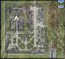
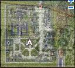
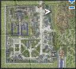
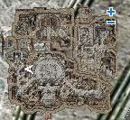

# Alchemist Skill Quest

## Bioethics Quest

<!-- Quest info -->
- **Level requirement:** None
- **Class requirement:** Alchemist
- **Items required:** Geek Glasses, Grampa Beard
- **Quest reward:** Learn [Bioethics](Bioethics.md)

1. Head to the [Lighthalzen](Lighthalzen.md) Main Office; it’s located in the 11 o'clock direction. Then locate Soldier Reagen Baler. Coordinates for Reagen Baler: [lhz_in01: 35, 225] - Talk to him whilst wearing Geek Glasses and a Grampa Beard (both can be purchased in Lighthalzen) in order to gain access to the Bio-Life Lab.

2. There will be 4 portals upon entering the Bio-Life Lab. Enter the 1 o'clock portal and locate Kellasus. Coordinates for Kellasus: [lhz_in01: 224, 140] Talk to him until he finds you irritating.

3. Locate Skrajjad, who is right below Kellasus. Coordinates for Skrajjad: [lhz_in01: 225, 122] Talk to him, and he will request you locate Keshibien.

4. Locate Keshibien, who is to the left of Kellasus. Coordinates for Keshibien: [lhz_in01: 204, 138] Talk to him, and he will ask you to find Broncher in Lighthalzen.

5. Go to the Lighthalzen Restaurant(in iRO its the Hotel enter the right portal which is a bar), which is located right above the center Kafra, and find Broncher in the right room. Coordinates for Broncher: [lhz_in02: 278, 273] Talk to him, and learn about the Homunculus.

6. Return to Kellasus and speak with him. Tell him that you have learned the details of the Homunculus, and you will have to answer three of his questions. The answers are Vaporize, Embryo, and Homunculus Resurrection. (euRO: "Sabbath", "Germination Breed" and "Resurrect Homunculus".)

7. Find Kellasus' family (specifically, his son Koring), and speak with them. The house is in the 1 o'clock direction in Lighthalzen, right behind the Police Department. Coordinates for Koring: [lhz_in03: 106, 34]

8. Return to Kellasus once again. Talk to him, and there should be a new option available: "I want to talk about something else." Then, proceed to talk to him until you have gained the [Bioethics](Bioethics.md) skill.

## Resistance Potions Guide Quest

<!-- Quest info -->
- **Level requirement:** None
- **Job level requirement:** 40
- **Class requirement:** Alchemist
- **Item requirement:** 5 Yellow Gemstone, 4 Empty Potion Bottle, 10 Moth Dust, 10 Heart of Mermaid, 20 Maneater Blossom, 1 Geek Glasses
- **Quest reward:** Ability to Create Elemental Resistance Potions

*Note: This is not an actual skill quest. The quest only rewards those who complete it with the guide. The potions it enables to be created are made through [Prepare Potion](Prepare_Potion.md).*

1. Go to [Juno](Juno.md), and enter the building on the left side of the central area.

2. Talk to the Pisruik in the back of the room, he'll ask you to collect some items:

*  5 Yellow Gemstones
*  4 Empty Potion Bottles
*  10 Moth Dust
*  10 Hearts of Mermaid

3. Bring them to him, and he'll quiz you on what items he asked you to bring, then give him the items.

4. He then asks you to bring 20 Maneater Blossoms.

5. After giving them to him, he will break his glasses, and ask you bring bring him a pair he can use in place.

6. Bring him 1 pair of Geek Glasses.

7. After that you're done and he gives you the Elemental Potion Manual.

**Related pages:**

* [Alchemist](Alchemist.md)
* [Biochemist](Biochemist.md)
* [Skills](Skills.md)
* [Acid Terror](Acid_Terror.md)
* [Aid Berserk Potion](Aid_Berserk_Potion.md)
* [Aid Potion](Aid_Potion.md)
* [Alchemical Weapon](Alchemical_Weapon.md)
* [Axe Mastery](Axe_Mastery.md)
* [Biochemical Helm](Biochemical_Helm.md)
* [Bomb](Bomb.md)
* [Potion Research](Potion_Research.md)
* [Prepare Potion](Prepare_Potion.md)
* [Spiritual Potion Creation (variant 1)](Spiritual_Potion_Creation_(variant_1).md)
* [Spiritual Potion Creation (variant 2)](Spiritual_Potion_Creation_(variant_2).md)
* [Spiritual Potion Creation (variant 3)](Spiritual_Potion_Creation_(variant_3).md)
* [Summon Flora](Summon_Flora.md)
* [Summon Marine Sphere](Summon_Marine_Sphere.md)
* [Synthesized Shield](Synthesized_Shield.md)
* [Synthetic Armor](Synthetic_Armor.md)
* [Homunculus](Homunculus_System.md)
* [Bioethics](Bioethics.md)
* [Biotechnology](Biotechnology.md)
* [Call Homunculus](Call_Homunculus.md)
* [Creature Creation](Creature_Creation.md)
* [Cultivation](Cultivation.md)
* [Drillmaster](Drillmaster.md)
* [Flame Control](Flame_Control.md)
* [Heal Homunculus](Heal_Homunculus.md)
* [Homunculus Resurrection](Homunculus_Resurrection.md)
* [Vaporize](Vaporize.md)
* [Acid Bomb](Acid_Bomb.md)
* [Aid Condensed Potion](Aid_Condensed_Potion.md)
* [Alchemy](Alchemy.md)
* [Cultivate Plant](Cultivate_Plant.md)
* [Full Chemical Protection](Full_Chemical_Protection.md)
* [Potion Synthesis](Potion_Synthesis.md)
* [Quests](Quests.md)
* [Alchemist Job Change Guide](Alchemist_Job_Change_Guide.md)
* [Alchemist Skill Quest](Alchemist_Skill_Quest.md)
* [Rebirth Walkthrough](Rebirth_Walkthrough.md)
* [Weapons](Weapons.md)
* [Axe](Axe.md)
* [Dagger](Dagger.md)
* [Mace](Mace.md)
* [One Handed Sword](One_Handed_Sword.md)

---
**Categories:** [Alchemist](categories/Alchemist.md), [Quests](categories/Quests.md), [Skill Quests](categories/Skill_Quests.md)
*Source: [iRO Wiki Classic](https://irowiki.org/classic/Alchemist_Skill_Quest) — GFDL 1.3+*
