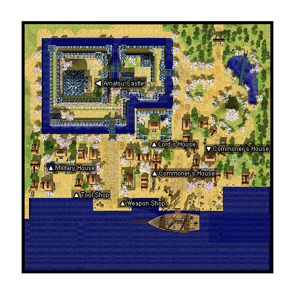

# Amatsu

## About Amatsu

Amatsu is quite a beautiful city, done in the style of old Japan. Amatsu has one dungeon and one field map. It can be accessed from [Alberta](Alberta.md) via an NPC on the docks; there is a 10,000 Zeny fee.

## Story

The tale unfolded in [Alberta](Alberta.md)… a tale that told of a sailor whose ship ran into a raging storm. The ship drifted off-course and he found himself lying on the banks of an unknown village. The kind natives took him in, fed him, and nursed him back to health. As he explored the place, he felt awed by the exotic beauty of the land, which later came to be known as Amatsu. Straw huts line the streets and exquisite cherry blossoms gave the atmosphere a pinkish-white glow. At the center is a shrine that sits partially underwater, surrounded by lush pine and bamboo trees. At the East stood the magnificent Lakeside Castle, where most of the village treasures - books and historical valuables - are contained. Years later, he returned to his homeland, [Alberta](Alberta.md). His love for Amatsu was immortalized in his journals and maps. Upon his death, people who admired his sense of adventure submitted his written accounts to King Tristan III. The King, whose curiosity was then piqued by the thought of a new potential trading ally, announced to all adventurers that he would reward those who could bring him valuable information about this new eastern land. The route to Amatsu was dangerous, and yet seafarers braved the wild winds and murderous storms, hoping to bring glory home. Their persistence prevailed and a few years later, Rune-Midgard and Amatsu began trading with each other.

## Quests

Quests added with the Amatsu update can be found [here](Quests.md).

## Guide

## Dungeon

* Tatami Maze, Underground Shrine
*[image not archived: Amatsu-dungeon 22.jpg‎]*

Deep in the heart of the Lakeside Castle lays a shadowy secret. Rumor has it that there is a hidden entrance that leads to a mysterious series of dungeons. The first of these is the Tatami Dungeon, a deceptive labyrinth of endless tatami and rows upon rows of rooms. None of what you see here are real, but many have been misled to believe otherwise and have since been aimlessly walking into dead ends.

The second is the Underground Battle Field, a cavern where many battles have taken place. And the last is the Haunted Shrine, also known as the Underground Shrine. There have been rumors (in hushed tones) on what lies in the Haunted Shrine, but no one has ever discovered what it was. All that is known is that the place has been sealed, and the ominous aura it exudes could ward off even the most courageous of warriors.
The last level of the dungeon is where the MVP Boss Incantation Samurai or Samurai Specter resides.

## Structures

## Buildings

* Bar (216,116)
* House #1 (178,138)
* House #2 (247,160)
* House #3 (52,147)
* Lord's House (168,181}
* Palace (86,235)
* Tool Shop (95,117)
* Weapon Shop (131,117)

## Billboards

* None

## NPCs

## Regulars

Amatsu Guide - Amachang (207,89)
Guide Man (251, 283)
  Show on minimap: Palace, Weapon Shop, Tool Shop, Bar
Kafra Employee (102,149)
  Save, Kafra storage (80z), Rent Cart, Reserve points
Missing NPCs
  Inn NPC, PVP NPCs, Upgrading NPC, Level 1/2 metal NPC, Level 3/4 metal NPC, Repair NPC

## Store NPCs

Weapon Dealer (Weapon Shop)
  Main Gauche, Stiletto, Blade, Ring Pommel Saber, Katana, Bastard Sword, Pike, Partizan, Hammer, Chain
Armor Dealer (Weapon Shop)
  Bandana, Sandals, Shoes, Hood, Muffler, Guard, Buckler, Adventure's Suit, Silk Robe, Silver Robe, Wooden Mail, Belt
Tool Dealer (Tool Shop)
  Arrow, Iron Arrow, Magnifier, Red Potion, Orange Potion, Yellow Potion, White Potion, Green Potion, Concentration Potion, Awakening Potion, Fly Wing, Butterfly Wing, Trap

## Trade NPCs

Alchemist - Laspuchin Gregory (Palace, 2nd floor)
  Rough Wind for 12 Great Nature or 12 Mystic Frozen or 12 Flame Heart
  Flame Heart for 8 Rough Wind or 8 Great Nature or 8 Mystic Frozen
  Mystic Frozen for 8 Flame Heart or 8 Rough Wind or 8 Great Nature
  Great Nature for 8 Mystic Frozen or 8 Flame Heart or 8 Rough Wind
Soldier - Jiro (Palace, 1st floor)
  *Must complete [Amatsu Dungeon Entrance Quest](Amatsu_Dungeon_Entrance_Quest.md) first and not carry Feudal Lord Permit*
  Feudal Lord Permit for 10,000 Zeny
Sushi Master (Inn)
  *Not while doing [Sashimi Knife Quest](Sashimi_Knife_Quest.md), see quest page*
  10 Sushi for 700z
  1 Sushi for 74z
  10 Raw Fish for 350z
  1 Raw Fish for 37z

## Quest NPCs

Gate Soldier (164,174)
  [Amatsu Dungeon Entrance Quest](Amatsu_Dungeon_Entrance_Quest.md)
Gate Soldier (171,174)
  [Amatsu Dungeon Entrance Quest](Amatsu_Dungeon_Entrance_Quest.md)
Kouji (189, 166)
  [Amatsu Dungeon Entrance Quest](Amatsu_Dungeon_Entrance_Quest.md)
Publisher (223,236)
  [Dokebi Battle Quest](Dokebi_Battle_Quest.md)
Grandma (Lord's House)
  [Amatsu Dungeon Entrance Quest](Amatsu_Dungeon_Entrance_Quest.md)
Lord of Palace - Ishida Yoshinaga (Palace, 4th floor)
  [Amatsu Dungeon Entrance Quest](Amatsu_Dungeon_Entrance_Quest.md)
Sushi Master - Magumagu (Inn)
  [Sashimi Knife Quest](Sashimi_Knife_Quest.md)

## Travel NPCs

Sea Captain - Walter Moers (194,79)
  [Alberta](Alberta.md) - free
Soldier - Jyuro (Palace, 5th floor)
  *Must complete [Amatsu Dungeon Entrance Quest](Amatsu_Dungeon_Entrance_Quest.md) first and carry the Feudal Lord Permit*
  Amatsu Dungeon - Free

## Background NPCs

* [Tree] Bonubonu (283,203) --- *Is actually a sea otter sprite, so you have to click just below the NPC to get conversation instead of attack cursor*
* [Tree] Drama Teacher - Garakame sensei (243,202)
* Drunken Man - Kosake (185,115)
* Gate Soldier (112,164)
* Gate Soldier (119, 164)
* Grandma - Hatsue (217,179)
* John (179,107)
* Jyaburo (287,266)
* [Tree] Legendary Tree (262,197)
* Mimi (205, 163)
* [Tree] Propose Girl - Hutari Shioko (269, 221)
* [Tree] Veterinarian - Sakura Seiichi (274,178)
* Well-side Maiden - Yuuko (230, 160)
* Gate Soldier (Palace, 1st floor)
* Gate Soldier (Palace, 1st floor)
* Soldier - Ichiro (Palace, 1st floor)
* Soldier - Shiro (Palace, 2nd floor)
* Soldier - Shichiro (Palace, 2nd floor)
* Soldier - Goro (Palace, 3rd floor)
* Soldier - Rokuro (Palace, 3rd floor)
* Soldier - Saburo (Palace, 3rd floor)
* Soldier - Kyuro (Palace, 4th floor)
* Soldier - Hachiro (Palace, 4th floor)

## Other

Legendary Tree
  The legendary tree doesn't actually speak. Instead, it mirrors the last conversation you had with the NPCs surrounding the hill. There are four different reactions, and another if you haven't spoken to any of them yet.

**Related pages:**

* [Towns](Towns.md)
* [Rune-Midgarts Kingdom](Rune-Midgarts_Kingdom.md)
* [Alberta](Alberta.md)
* [Al De Baran](Al_De_Baran.md)
* [Archer Village](Archer_Village.md)
* [Comodo](Comodo.md)
* [Geffen](Geffen.md)
* [Izlude](Izlude.md)
* [Morroc](Morroc.md)
* [Payon](Payon.md)
* [Prontera](Prontera.md)
* [Umbala](Umbala.md)
* [Republic of Schwartzvald](Republic_of_Schwartzvald.md)
* [Einbech](Einbech.md)
* [Einbroch](Einbroch.md)
* [Hugel](Hugel.md)
* [Juno](Juno.md)
* [Lighthalzen](Lighthalzen.md)
* [Arunafeltz States](Arunafeltz_States.md)
* [Rachel](Rachel.md)
* [Veins](Veins.md)
* [Manuk](Manuk.md)
* [Amatsu](Amatsu.md)
* [Ayothaya](Ayothaya.md)
* [Kunlun](Kunlun.md)
* [Jawaii](Jawaii.md)
* [Louyang](Louyang.md)
* [Moscovia](Moscovia.md)
* [Nifflheim](Nifflheim.md)
* [Lutie](Lutie.md)

---
*Source: [iRO Wiki Classic](https://irowiki.org/classic/Amatsu) — GFDL 1.3+*
