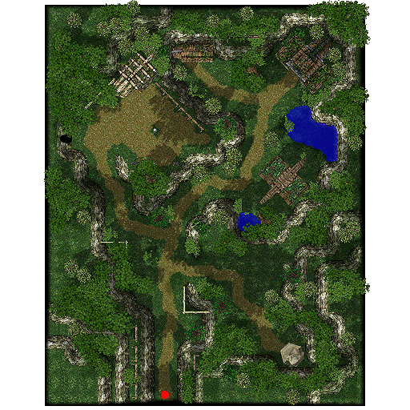

# Archer Village

## General

Above and behind [Payon](Payon.md) lies the serene Archer Village. The Archer guild, from which the place takes its name, is located in the northeast. [Novice](Novice.md)s come here to become [Archer](Archer.md)s. The entrance to Payon Cave is found in the northwest, a place of evil where many [Demon](Demon.md) and [Undead](Undead.md) monsters roam. Another Archer Village attraction is the Buddha statue in the southeast.

## Guide

## Structures

## Buildings

*  1 - Archer Guild (143,163)
*  2 - Empty House (92,168)
*  3 - Tool Shop (73,154)

## Billboards

*  Bulletin Board (79,31) - Gives background information on Archer Village
*  Bulletin Board (39,134) - Gives background information on Payon Cave

## NPCs

## Regulars

 Guide - Payon Guide (85,30)    Show on minimap: Archer Guild, Tool Shop, Payon Cave
 Kafra Employee (55,123)    Kafra storage (90z), Rent Cart, Reserve points
 Missing NPCs    Upgrading NPC, Level 1/2 metal NPC, Level 3/4 metal NPC, Repair NPC, Inn NPC, PVP NPCs

## Store NPCs

 Tool Dealer (Tool Shop)    Arrow, Silver Arrow, Magnifier, Red Potion, Orange Potion, Yellow Potion, White Potion, Green Potion, Concentration Potion, Awakening Potion, Fly Wing, Butterfly Wing, Trap

## Trade NPCs

 [Bugs] Boy - Young Man (Archer Guild)    Oxygen Mask for 5 Ora Ora

## Quest NPCs

 Dollshoi - Mage Guildsman (122,100)    Part of [Mage](Mage.md) job change quest
 Archer Guildsman (Archer Guild)    [Archer](Archer.md) job change NPC

## Travel NPCs

None

## Other NPCs

*  Archer Joe (77,131)

## Other

## Bug Problem

The young man has a insect problem - his house is infested with thief bugs. Unlike other "problems" encountered in the game, this one has a very real manifestation. The room contains 7 Thief Bugs on a ~20 minute respawn timer.

**Related pages:**

* [Towns](Towns.md)
* [Rune-Midgarts Kingdom](Rune-Midgarts_Kingdom.md)
* [Alberta](Alberta.md)
* [Al De Baran](Al_De_Baran.md)
* [Archer Village](Archer_Village.md)
* [Comodo](Comodo.md)
* [Geffen](Geffen.md)
* [Izlude](Izlude.md)
* [Morroc](Morroc.md)
* [Payon](Payon.md)
* [Prontera](Prontera.md)
* [Umbala](Umbala.md)
* [Republic of Schwartzvald](Republic_of_Schwartzvald.md)
* [Einbech](Einbech.md)
* [Einbroch](Einbroch.md)
* [Hugel](Hugel.md)
* [Juno](Juno.md)
* [Lighthalzen](Lighthalzen.md)
* [Arunafeltz States](Arunafeltz_States.md)
* [Rachel](Rachel.md)
* [Veins](Veins.md)
* [Manuk](Manuk.md)
* [Amatsu](Amatsu.md)
* [Ayothaya](Ayothaya.md)
* [Kunlun](Kunlun.md)
* [Jawaii](Jawaii.md)
* [Louyang](Louyang.md)
* [Moscovia](Moscovia.md)
* [Nifflheim](Nifflheim.md)
* [Lutie](Lutie.md)

---
*Source: [iRO Wiki Classic](https://irowiki.org/classic/Archer_Village) — GFDL 1.3+*
