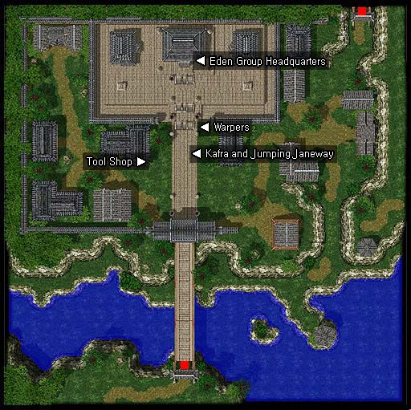

# Asgard Training Village

## About Asgard

Asgard is a place accessible from around the game by talking to any of the Asgard Teleporter Valkyries around the world.

It’s a custom town using the old Payon map that was created for this server where players can have a centralised place to go. It is the home of [Jumping Janeway](Jumping_Janeway.md) home and has a handful of other useful NPCs or resources for players. North up the steps you can find the entrance to Eden (90, 163).

## Guide

## NPCs

## Regulars

Kafra Employee (88, 114)

## Store NPCs

Tool dealer (71, 116)
  Arrow, Magnifier, Red Potion, Orange Potion, Yellow Potion, White Potion, Green Potion, Concentration Potion, Awakening Potion, Fly Wing, Butterfly Wing, Trap, Monocle
Melee Weapon Dealer (24, 172)
Ranged Weapon Dealer (27, 172)
Magic and Ninja Weapons (30, 172)
Armor Dealer (30, 174)

## Quest NPCs

[Jumping Janeway](Jumping_Janeway.md) (90, 123)
  Start and end point of the Jumping Janeway quest line
Doctor Jonze (82, 124)
  [Asgard Training Village Beginner Equipment](Asgard_Training_Village_Beginner_Equipment.md) quest

## Travel NPCs

Dungeon Warpers (90, 134)
  [Payon](Payon.md), Pyramids, [Einbech](Einbech.md), Glast Heim, Clock Tower ([Al De Baran](Al_De_Baran.md))
Hunt Event Warper (108, 116)
  Ice Dungeon (3rd floor), Abyss Lake (before 3rd floor entrance)

## Other NPCs

First class guides (38, 130)
  These NPCs will teleport you to the location of each first class job change quest
Primo d'Buffer (75, 107)
  Awards players with VIP +3 stat food effects and a low level agility up

---
*Source: [iRO Wiki Classic](https://irowiki.org/classic/Asgard_Training_Village) — GFDL 1.3+*
