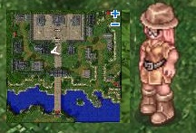
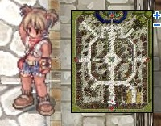
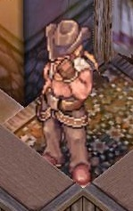
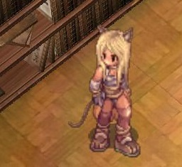
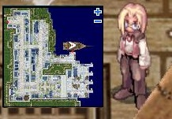
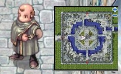
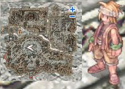

# Asgard Training Village Beginner Equipment

<!-- Quest info -->
- **Level requirement:** None
- **Item requirement:** None
- **Items required:** None
- **Item reward:** Assorted beginner gear, Armor, Accessory, Shoes, Garment and Helm

1. Speak to Doctor Jonze (82, 124) in [Asgard](Asgard_Training_Village.md), she asks you if you want a free set of armor and offers to send you to Prontera to speak with her sister.

2. Speak to her sister Laura Krofft (162, 43). She asks you if you want to help her test some armor they found out in the desert and sends you to Morroc.

3. Enter the building (83, 52) in Morroc and speak to Nabin Frake.

4. Speaking to him will give you a Cursed Armor (+200hp, +100sp and 50% more effectiveness with Novice Potions, Red Potions and Orange Potions).

5. Speak to him two more times and he informs you that another piece of the armor set has been found in Payon and to visit his contact there.

6. Enter the castle in the North part of Payon 156, 244. Take the first portal to the left and speak to Lexis Lugar by the bookcase.

7. She hands you a Cursed Ring (+4 stats, bonus decreases by 1 every 10 job levels) and tells you to see Doctor Jonze again.

8. Speak to Doctor Jonze in [Asgard](Asgard_Training_Village.md) again and she asks you to go to the ship in Alberta. Find Robby Freenan (197, 171) in Alberta.

9. Speak to him and he will give you Cursed Shoes (+200hp, +10sp recovery, 5% chance to drop Fly Wing when killing a monster).

10. Speak to him again and he will ask you if you're ready to continue and if you know about garments. He then asks you to visit Aldebaran.

11. In Aldebaran to the left of the tower, speak to 'Vanilla' Typhoon (129, 141) and he will give you a Cursed Manteau and 5 Free Ticket for Kafra Transportation.

Its effects vary depending on your class:
*  Novice class - +100 hp
*  Mage class - skill sp cost reduced by 10%
*  Aco class - +50% sp recovery
*  Thief class - +10 flee
*  Merchant class - increase potion recovery by 20%
*  Swordsman class - +200 hp
*  Archer class - +10 crit
*  Soul Linker (possibly all expanded? confirmation needed) - +100hp

12. Speak to 'Vanilla' Typhoon again and he will let you know it's time to start the final part. He instructs you to go visit Tommy Shavaunte south of the Kafra in Juno and gives you 5 tickets for the Airship in Izlude.

13. Head to Juno and visit Tommy Shavaunte (152, 178), he gives you the Cursed Helm.

It takes the top/middle headgear slot and gives the player 150hp and 40sp. If used with the armor it provides level 1 hide or 10 flee for Thief classes.

---
**Categories:** [Quests](categories/Quests.md)
*Source: [iRO Wiki Classic](https://irowiki.org/classic/Asgard_Training_Village_Beginner_Equipment) — GFDL 1.3+*
