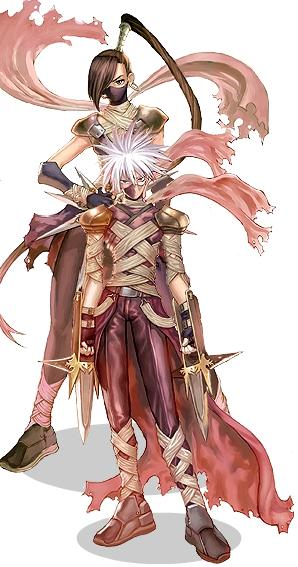

# Assassin

<!-- Job info -->
- **Job name:** Assassin
- **Job base:** Thief
- **Job type:** 2-1
- **Changes at:** Sograt Desert 16
- **Skills:** 10
- **Skill points:** 85
- **Quest skills:** 2
- **STR:** 6
- **AGI:** 10
- **VIT:** 2
- **INT:** 4
- **DEX:** 8
- **LUK:** 0

## Overview

Assassins (and their transcended [Assassin Cross](Assassin_Cross.md)) are the only class able to equip a weapon in each hand and the exclusive users of [Katar](Katar.md) weapons. Assassins have a variety of damage dealing and poisoning skills. The Assassin are the only class who can walk slightly faster than any other class ingame as long as they leveled the proper skill ([Thief](Thief.md)'s [Improve Dodge](Improve_Dodge.md)). The Katar wielding Assassins also receive double the normal amount of critical hit rate. Therefore, whatever amount of critical rate Assassins have, it would always be doubled.

## Jobchange Guide

*See [Assassin Job Change Guide](Assassin_Job_Change_Guide.md) for detailed information.*

Changing into an Assassin from a [Thief](Thief.md) requires the player to complete a number of tasks:
*  A Written Test
*  An Assassination Test
*  An Endurance Test
*  A Maze test

After completing these tests, the player will be transformed into an Assassin. All this takes place inside the Assassin Guild in the Morroc Desert (moc fild16 xx, yy).

## Builds

*As a note of clarification, most Assassin stat builds are very similar to one another. For example, the terms 'equip critical', and 'DD' describe **equipment** preferences, but the actual stats of these two builds are similar.*

The skills which most Assassins will get is very similar, because of the relative weakness of the poison skills, and the small number of available assassin skills:
* [Righthand Mastery](Righthand_Mastery.md) 5
* [Lefthand Mastery](Lefthand_Mastery.md) 5
* [Katar Mastery](Katar_Mastery.md) 10 (for [Katar](Katar.md) builds - though many DD sins max this as well to increase damage from Sonic Blow and Grim Tooth)
* [Sonic Blow](Sonic_Blow.md) 10
* [Grimtooth](Grimtooth.md) 5
* [Enchant Poison](Enchant_Poison.md)
This leaves 5-15 points to use for poison skills, depending on the level of Enchant Poison and Cloaking.

## Standard Katar build

*  [STR](Stats.md): 90-99
*  [AGI](Stats.md): 99
*  [DEX](Stats.md): 25-35
*  [LUK](Stats.md): 30-40
*  [INT](Stats.md): 1
*  [VIT](Stats.md): 1

This is a standard katar build among assassins. As an assassin you wont be needing much INT, not until you become an assassin cross with an SD or SB build. The 1 Vit is optional, with this build you barely get hit in the first place and if you run into a big group of mobs its easy to either cloak, back slide, or even fly wing. Also equipping a sidewinder card adds a good amount of a damage increase.

## Equip Critical

*  [STR](Stats.md): 100-120
*  [AGI](Stats.md): 80-100
*  [VIT](Stats.md): 20-40
*  [DEX](Stats.md): 25-40
*  [LUK](Stats.md): 20ish
*  [INT](Stats.md): 1ish

This build is very similar to that of a Dual Dagger Assassin, the difference being that they use Katars with cards that add to the critical rate of attacks.

**Examples of Useful Cards:**

*  Soldier Skeleton Cards: (+9 [CRIT](Stats.md))
*  +7 [CRIT](Stats.md) vs. [Race](Race.md), +10% crit damage cards (commonly referred to as "Racial Crit" cards
*  Kobold Cards: (+1 [STR](Stats.md), +4 [CRIT](Stats.md))
*  Zhu Po Long Card

## Natural Critical

Natural Critical Assassins are built almost the same as the Equipment Critical Assassins but with less DEX, more LUK (around 50-60), and sometimes less STR. They're equipped with damage cards (i.e. Hydra, Santa Poring, etc) instead of critical rate enhancement cards for the Equipment Critical Assassins.

## Dual Dagger

*  [STR](Stats.md): 110-120
*  [AGI](Stats.md): 80-90+
*  [DEX](Stats.md): 40-60+
*  [VIT](Stats.md): 1-40
*  [INT](Stats.md): 1+
*  [LUK](Stats.md): 1

This is the fastest build for leveling an Assassin. Note that the stats are similar to those of an equip crit build, and a dual dagger assassin could pick up the gear of an equip crit sin and have comparable performance. The weapons used vary based on what map the player is leveling on. A WOE Dual Dagger Assassin would have less agi and more vit.

**Common Dagger Set-up:**

*  Triple Size Carded Gladius or elemental Damascus on the right-hand, Quad Damage Carded Main Gauche on the left-hand. The ideal combination for a map with low-defense monsters is Triple Size Carded Gladius + Quad Race/Element Carded Main Gauche + correct endow.
*  [Ice Pick](Ice_Pick.md) on the right-hand, Quad Damage/Double Damage Double Size Carded Main Gauche on the left-hand (for high DEF monsters, notably including the monsters in Ice Dungeon, and the Emperium during WoE).

**Example of Useful Cards:**

*  Hydra Cards: (+20% damage to [Demi Human](Demi_Human.md))
*  Skel Worker Cards: (+5 [ATK](Stats.md), +15% damage to Medium [Size](Size.md))
*  Andre Cards: (+20 [ATK](Stats.md))
*  Zipper Bear Cards: (+30 [ATK](Stats.md), Drain 1 SP from its owner on each attack)

## Equipment

## Headgear

*Top Headgears:*
Feather Beret
Chick Hat
Beret
Gemmed Sallet \[1\]
Ghost Bandana
Hot-Blooded HeadBand
Incubus Horn
Orc Helm \[1\]
Poo Poo Hat
Zealotous Mask
Marionette Doll \[1\]
Alice Doll Hat \[1\]

*Middle Headgears:*
Alarm Mask
Angel Wing Ears
Blinker
Dark Blinder
Evil Wing Ears
Masquerade
Oxygen Mask
Sunglasses \[1\]

*Lower Headgears:*
Gangster Mask
Pirate Dagger

## Armor

*  Thief Clothes \[1\]: Extremely light, but limited to the [Thief](Thief.md) class and rare. Think carefully before compounding a pair of these with a useful card. (+6 [DEF](DEF.md), +1 [AGI](Stats.md), 10 weight)
*  Chain Mail \[1\]: Very heavy but gives more [DEF](DEF.md) than Thief Clothes and are quite common. (+8 [DEF](DEF.md), 330 weight). Since assassins usually get high STR, thus having large weight limit, this is the most common choice of armor.
*  Mantles/Formal Suits/Cotton Shirts/Coats: Useful for different elemental armor, so they are all on different hotkeys. Mink Coats can also be used but they are very heavy.

## Weapon

*  Ice Pick: Primary weapon for Dual Dagger Emperium-breaking and leveling on high [DEF](DEF.md) monsters.
*  Jur [3]: Katar-type weapon with many slots. Normally compounded with +[CRIT](Stats.md) cards. (125 [ATK](Stats.md))
*  Specialty Jur [4]: Katar-type weapon with more slots than a normal Jur. (90 [ATK](Stats.md))
*  Infiltrator [1]: (140 [ATK](Stats.md), +3 [DEF](DEF.md), +5% [FLEE](FLEE.md), +2 [Perfect Dodge](Perfect_Dodge.md), +50% damage to [Demi Human](Demi_Human.md))
*  Main Gauche [4]: Left-hand Dagger due to the number of slots. Best used with damage-factor cards. (43 [ATK](Stats.md))
*  Knife [4]: Good for status weapons.
*  Gladius [3]: (105 [ATK](Stats.md))
*  Damascus: Indestructible. Best dagger to be made elemental. (118 [ATK](Stats.md))
*  Brave Carnage Katar and Valorous Carnage Katar: great PVP weapons obtainable from [Battlegrounds](Battlegrounds.md)

## Shield

Buckler \[1\]
[Guard \[1\]](Guard.md)
Stone Buckler \[1\]
Valkyrja's Shield \[1\]

Wearing shield's while leveling is not necessary, unless it is for mobbing purposes and/or WoE/PvP.

## Garment

*  Hood [1]: Has the lowest defense value but is very inexpensive and readily available. Very useful for putting in inexpensive [Flee](Stats.md) increasing cards (+5 [Flee](Stats.md) tolerance cards / Condor Card) until better garments become available.
*  Muffler [1]: Has a higher defense value than a slotted hood, but is more expensive. (+2 [DEF](DEF.md))
*  Manteau [1]: Best choice of garment in terms of availability and [DEF](DEF.md), but is even more expensive. (+4 [DEF](DEF.md))
*  Vali's Manteau: although non-slotted, a decent substitute for Raydric Card. (+4 [DEF](DEF.md) -15% Damage from Neutral)
*  Skin of Ventus [1]: good Flee stacking garment, especially if carded. (+2 [DEF](DEF.md) +2 [MDEF](Stats.md) +10 [Flee](Stats.md) +200 [HP](Max_HP.md))

## Footgear

Boots \[1\]
Shoes \[1\]
Vidar's Boots

## Accessories

*  Brooch [1]: +1 [AGI](Stats.md)
*  Rosary [1]: +3 [MDEF](Stats.md), +1 LUK
*  Ring [1]: +1 [STR](Stats.md)
*  Clip [1]: +10 SP
*  Nile Rose [1]: +10 HP
*  The Sign: +5% damage to all attacks
*  Medal of Honor (Thief type): obtained from [Battlegrounds](Battlegrounds.md)

## Equipment Sets

A lot of Critical Build Assassins choose to use the Morrigane's Equipment Set:
Morrigane's Helm
Morrigane's Manteau
Morrigane's Belt
Morrigane's Pendant

Another PVP oriented set is obtainable from [Battlegrounds](Battlegrounds.md):
Assassin Robe \[1\]
Captain's Manteau \[1\]
Battle Greaves \[1\]

## Class Data

## Skills

*See [Thief Skills](Thief.md) for first class skills.*

| Skill | Description | Levels | Type |
| --- | --- | --- | --- |
| [Cloaking](Cloaking.md) | Allows the character to disappear instantaneously and still move. [Movement Speed](Movement_Speed.md) is dependant on skill level. | 10 | Active |
| [Enchant Poison](Enchant_Poison.md) | Imbues the characters weapon with the [Poison](Poison.md) element causing each attack to be [Poison](Poison.md) element damage and to have a chance to inflict the Poison status. | 10 | Active |
| [Grimtooth](Grimtooth.md) | An attack using a katar that hits a 3x3 area from up to 7 cells away while Hidden. | 5 | Offensive |
| [Katar Mastery](Katar_Mastery.md) | Increases the damage done with Katar weapons by up to 30. | 10 | Passive |
| [Righthand Mastery](Righthand_Mastery.md) | Recovers up to 100% of the dual weilding damage penalty for the right hand. | 5 | Passive |
| [Lefthand Mastery](Lefthand_Mastery.md) | Recovers up to 80% of the dual weilding damage penalty for the left hand. | 5 | Passive |
| [Poison React](Poison_React.md) | Counters a [Poison](Poison.md) element attack with a one time physical attack for up to 400% damage. Also has a chance to counter non-[Poison](Poison.md) element attacks with level 5 [Envenom](Envenom.md) up to 5 times. | 10 | Offensive |
| [Sonic Blow](Sonic_Blow.md) | Deal up to 800% physical damage with a katar weapon with up to a 30% chance to [Stun](Status_Effects.md) the target. | 10 | Offensive |
| [Venom Dust](Venom_Dust.md) | Use a Red Gemstone to create a 2x2 Poison cloud for up to 50 seconds. | 10 | Active |
| [Venom Splasher](Venom_Splasher.md) | Use a Red Gemstone to turn the target into a "Poison Bomb" to deal up to 1000% damage after a delay. | 10 | Offensive |

## Quest Skills

| Skill | Description | Levels | Type | Job Level Requirement | Quest |
| --- | --- | --- | --- | --- | --- |
| [Sonic Acceleration](Sonic_Acceleration.md) | Increases damage and hit rate of Sonic Blow. | 1 | Passive | 40 | [Sonic Acceleration Quest](Assassin_Skill_Quest.md) |
| [Venom Knife](Venom_Knife.md) | Throws a venom knife at a target and inflict the [poison](Status_Effects.md) status ailment. | 1 | Offensive | None | [Venom Knife Quest](Assassin_Skill_Quest.md) |

## Soul Link

*See [Assassin Spirit](Assassin_Spirit.md)*

## Job Bonus

| Stat\Amount | +1 | +2 | +3 | +4 | +5 | +6 | +7 | +8 | +9 | +10 |
| --- | --- | --- | --- | --- | --- | --- | --- | --- | --- | --- |
| STR | 11 | 25 | 27 | 32 | 45 | 48 |   |   |   |   |
| AGI | 1 | 2 | 3 | 15 | 16 | 17 | 18 | 19 | 20 | 21 |
| VIT | 6 | 8 |   |   |   |   |   |   |   |   |
| INT | 4 | 14 | 38 | 42 |   |   |   |   |   |   |
| DEX | 9 | 24 | 30 | 31 | 40 | 41 | 46 | 50 |   |   |
| LUK |   |   |   |   |   |   |   |   |   |   |

## ASPD

## Dual Wielding Interface

In the equipment window (ALT+Q) the righthand weapon is in the left column, next to the sprite's right hand, and the lefthand weapon is in the right column, next to the sprite's left hand.  If the character has no weapons or shields equipped, then the first single-handed weapon equipped goes into the right hand.  If any weapon is in the right hand (including a katar) then the next single-handed weapon equipped goes onto the left hand.  This means that if you have a katar equipped, the first single-handed weapon you equip goes onto the left hand (also un-equipping the katar) and the second one goes onto the right hand, while if you start out empty handed the first equipped goes onto the right hand and the second onto the left hand.

## External Links

**Related pages:**

* [Assassin](Assassin.md)
* [Assassin Cross](Assassin_Cross.md)
* [Skills](Skills.md)
* [Cloaking](Cloaking.md)
* [Enchant Poison](Enchant_Poison.md)
* [Grimtooth](Grimtooth.md)
* [Katar Mastery](Katar_Mastery.md)
* [Lefthand Mastery](Lefthand_Mastery.md)
* [Righthand Mastery](Righthand_Mastery.md)
* [Poison React](Poison_React.md)
* [Sonic Acceleration](Sonic_Acceleration.md)
* [Sonic Blow](Sonic_Blow.md)
* [Venom Dust](Venom_Dust.md)
* [Venom Knife](Venom_Knife.md)
* [Venom Splasher](Venom_Splasher.md)
* [Advanced Katar Mastery](Advanced_Katar_Mastery.md)
* [Create Deadly Poison](Create_Deadly_Poison.md)
* [Enchant Deadly Poison](Enchant_Deadly_Poison.md)
* [Hallucination Walk](Hallucination_Walk_(Unimplemented).md)
* [Meteor Assault](Meteor_Assault.md)
* [Soul Destroyer](Soul_Destroyer.md)
* [Quests](Quests.md)
* [Assassin Job Change Guide](Assassin_Job_Change_Guide.md)
* [Assassin Skill Quest](Assassin_Skill_Quest.md)
* [Rebirth Walkthrough](Rebirth_Walkthrough.md)
* [Weapons](Weapons.md)
* [Dagger](Dagger.md)
* [Katar](Katar.md)
* [One Handed Sword](One_Handed_Sword.md)

**Related pages:**

* [Classes](Classes.md)
* [Novice](Novice.md)
* [High Novice](High_Novice.md)
* [Super Novice](Super_Novice.md)
* [Acolyte](Acolyte.md)
* [Archer](Archer.md)
* [High First Class](High_First_Class.md)
* [Mage](Mage.md)
* [Merchant](Merchant.md)
* [Swordman](Swordman.md)
* [Thief](Thief.md)
* [Priest](Priest.md)
* [Monk](Monk.md)
* [Hunter](Hunter.md)
* [Bard](Bard.md)
* [Dancer](Dancer.md)
* [Wizard](Wizard.md)
* [Sage](Sage.md)
* [Blacksmith](Blacksmith.md)
* [Alchemist](Alchemist.md)
* [Knight](Knight.md)
* [Crusader](Crusader.md)
* [Assassin](Assassin.md)
* [Rogue](Rogue.md)
* [Transcendent](Transcendent.md)
* [High Priest](High_Priest.md)
* [Champion](Champion.md)
* [Sniper](Sniper.md)
* [Minstrel](Minstrel.md)
* [Gypsy](Gypsy.md)
* [High Wizard](High_Wizard.md)
* [Scholar](Scholar.md)
* [Mastersmith](Mastersmith.md)
* [Biochemist](Biochemist.md)
* [Lord Knight](Lord_Knight.md)
* [Paladin](Paladin.md)
* [Assassin Cross](Assassin_Cross.md)
* [Stalker](Stalker.md)
* [Gunslinger](Gunslinger.md)
* [Ninja](Ninja.md)
* [TaeKwon Kid](TaeKwon_Kid.md)
* [TaeKwon Master](TaeKwon_Master.md)
* [Soul Linker](Soul_Linker.md)

---
**Categories:** [Assassin](categories/Assassin.md), [Classes](categories/Classes.md)
*Source: [iRO Wiki Classic](https://irowiki.org/classic/Assassin) — GFDL 1.3+*
