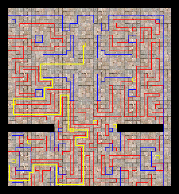

# Assassin Job Change Guide

<!-- Quest info -->
- **Level requirement:** None
- **Job level requirement:** 40
- **Class requirement:** Thief
- **Item reward:** Dagger -OR- Katar (See Below)
- **Quest reward:** Jobchange to [Assassin](Assassin.md)

1.  Journey to the Assassin's Guild, found in moc fild16 (205, 296), two maps South and two maps East of [Morroc](Morroc.md). The entrance to the guild is located near the center on the upper portion of the island.

2. Talk to the Guildsman NPC (in_moc_16 19, 33), who allows would-be Assassins into a room with another NPC as long as they are [Thieves](Thief.md) at Job level 40 or above.

3. Walk near the Guildsman at (in_moc_16 25, 90). After signing up, access to the next room will be granted.

4. Once inside the room, walk forward, and hidden NPC will reveal himself. He will ask the player 10 questions about [Thief](Thief.md) and Assassin knowledge ranging from skills to cards to equipment. Nine out of ten questions must be answered correctly in order to proceed.
* **Note:** If you are Job Level 50, you only have to do one set of questions.

**Set 1**
1.  *Choose the correct amount of the maximum dodge rate increase from the 'Increase Dodge' skill when at level 10.* **30**
1.  *Choose a monster which  detects hiding/cloaking Thieves and Assassins.* **Andre**
1.  *Choose a group of weapons that cannot be used by an Assassin at once.* **Katar + Maingauche**
1.  *Choose the town where Thieves can change their jobs.* **Morocc**
1.  *Choose a card that does not affect the AGI stat.* **Whisper Card**
1.  *Choose the correct specialty of the Assassin class.* ***any answer is correct***
1.  *Choose the maximum AGI bonus an Assassin can get at job level 50.* **10**
1.  *Choose the item that an Assassin cannot equip.* **Helm**
1.  *Choose the job change item for Thief.* **Orange Gooey Mushroom** or **Orange Net Mushroom**
1.  *Choose a card that would typically benefit an Assassin the least.* **Elder Willow card**

**Set 2**
1.  *Choose the skill that is not required to learn Grimtooth.* **Level 2 Right hand Mastery**
1.  *What property does Enchant Poison possess?* **Poison**
1.  *How does Level 4 'Right hand Mastery' work?* **Recover 90% of damage decrement**
1.  *What is the item required for using Venom Dust?* **Red Gemstone**
1.  *Which skill can you learn when you reach Level 5 Enchant Poison?* **Venom Dust**
1.  *Among the following skills, which allows you to become invisible while moving?* **Cloaking**
1.  *From the following, choose the thing unrelated to using Venom Splasher.* **Red Gemstone**
1.  *Which monster is weak to a weapon with Vadon card (20% damage on Fire monster).* **Elder Willow**
1.  *How much SP does Double Attack use?* **It's a passive skill and doesn't use SP.**
1.  *What is the best elemental Main Gauche to use when hunting in Izlude dungeon?* **Wind Main Gauche**

**Set 3**
1.  *Which monster drops a slotted Katar?* **Desert Wolf**
1.  *Which monster a slotted Jur?* **Martin**
1.  *Which class is allowed to craft elemental weapons?* **Blacksmith**
1.  *Choose a weapon which is not Katar class.* **Gladius**
1.  *What property do Izlude dungeon monsters possess?* **Water**
1.  *Which monster cannot be a Cute Pet?* **Roda Frog**
1.  *Choose a monster that Fire property daggers work the best on.* **Hammer Goblin**
1.  *Choose the non-elemental Katar.* **Infiltrator**
1.  *Which is the uncommon monster?* **Ghostring**
1.  *Choose the monster that is not Undead.* **Spore**

5. After the quiz, enter the pub for the next test. Wait your turn if someone else is already in the test area. You'll then be sent to a room filled with Porings, Drops, Lunatics and Poporings. You must kill 6 monsters of the exact name given by the announcer in three minutes.

The name will usually be "Target Monster" or "Job Change Test Monster" but may vary in different versions of RO. The target monsters also always consist of 3 Porings, 1 Drops, 1 Lunatic and 1 Poporing. **Killing monsters other than the targets or falling into traps results in failing and being teleported back to the entrance NPC.** Killing all target monsters will automatically kill every other monster in the room and open a portal for the next test.

You should turn off the "snap to monster" and "snap to item" options during this test, since having them on will interfere with hovering your mouse pointer over exactly the monster you want.

6. In the next area, you must run to the other side of a room filled with Mummies and Hydras. Stopping to attack monsters is not necessary. Getting to the sides of the room and going as quickly as possible is highly recommended to avoid getting mobbed.  This part of the test can be made easier through good use of [Hide](Hiding.md), and is trivial if the player has a Frilldora-carded garment.

Once you reach the NPC at the end of the room, all monsters will die and the you may proceed to the next room. Dying results in failing the test and you will be teleported to  the entrance of the guild and must retake the test. If you die, it is not required to use healing items as the entrance NPC will heal the you back to full health.

7. You will then be sent to a series of rooms that look exactly the same. There is no significance to those other than walking through the portals until reaching a large room with invisible walls. You must traverse through the invisible maze and go beside the Assassin Master at the bottom left corner of the room.

There may be blocked paths but eventually you can reach the NPC through trial and error.

If you hover your mouse pointer over a piece of floor, there will be nothing if there's an invisible wall there, but there'll be a green-square-corners "cross-hair" if it's a walkable floor.  You can use this to work your way backwards from where you want to go.

8. Talk to the NPC and he will talk and ask a few questions about the pride and honor in being an Assassin. Successful [Thieves](Thief.md) are then be rewarded with a Dagger or Katar-class Weapon (depending on Job Level) or a weapon of choice (Job 50), as well as a Necklace of Oblivion (Warning: Do not sell this last item).

9. You will be sent back to the entrance of the Assassin's Guild. Present the Necklace of Oblivion to the Entrance NPC to be changed into an Assassin.

## Rewards

Depending on the character's [Job Level](Levels.md), one of the following [Weapons](Weapons.md) will be rewarded.

## Job 40~49

* Main Gauche \[3\]
* Jur \[2\]
* Stiletto \[2\]
* Knife \[3\]
* [Katar \[1\]](Katar.md)

## Job 50

* Jur \[3\]
* [Katar \[2\]](Katar.md)
* Main Gauche \[4\]
* Gladius \[3\]

**Related pages:**

* [Assassin](Assassin.md)
* [Assassin Cross](Assassin_Cross.md)
* [Skills](Skills.md)
* [Cloaking](Cloaking.md)
* [Enchant Poison](Enchant_Poison.md)
* [Grimtooth](Grimtooth.md)
* [Katar Mastery](Katar_Mastery.md)
* [Lefthand Mastery](Lefthand_Mastery.md)
* [Righthand Mastery](Righthand_Mastery.md)
* [Poison React](Poison_React.md)
* [Sonic Acceleration](Sonic_Acceleration.md)
* [Sonic Blow](Sonic_Blow.md)
* [Venom Dust](Venom_Dust.md)
* [Venom Knife](Venom_Knife.md)
* [Venom Splasher](Venom_Splasher.md)
* [Advanced Katar Mastery](Advanced_Katar_Mastery.md)
* [Create Deadly Poison](Create_Deadly_Poison.md)
* [Enchant Deadly Poison](Enchant_Deadly_Poison.md)
* [Hallucination Walk](Hallucination_Walk_(Unimplemented).md)
* [Meteor Assault](Meteor_Assault.md)
* [Soul Destroyer](Soul_Destroyer.md)
* [Quests](Quests.md)
* [Assassin Job Change Guide](Assassin_Job_Change_Guide.md)
* [Assassin Skill Quest](Assassin_Skill_Quest.md)
* [Rebirth Walkthrough](Rebirth_Walkthrough.md)
* [Weapons](Weapons.md)
* [Dagger](Dagger.md)
* [Katar](Katar.md)
* [One Handed Sword](One_Handed_Sword.md)

---
**Categories:** [Assassin](categories/Assassin.md), [Job Change Guide](categories/Job_Change_Guide.md), [Thief](categories/Thief.md)
*Source: [iRO Wiki Classic](https://irowiki.org/classic/Assassin_Job_Change_Guide) — GFDL 1.3+*
