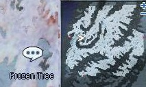

# Attitude to the New World

<!-- Quest info -->
- **Level requirement:** 70
- **Item requirement:** 1 Empty Bottle, 1 Strong Vine, 5 Holy Water, 30 Sticky Mucus, 20 Horn of Hillslion
- **Quests required:** [Onward to the New World Quest](Onward_to_the_New_World_Quest.md)
- **Base EXP reward:** 1,500,000 or 2,500,000
- **Window:** yes

1.  Speak to Rumis Block (mid camp 188, 254), he tells you he hates the New World and loathes his job.
1.  Speak to Camp Guard (mid camp 336,171).  You must not be helping Diego with the posts or delivering the final packing in the [New Surroundings](New_Surroundings.md) quest. Go and kill a Nephentes and bring back a Strong Vine to help Rumis realize these monsters aren't so scary.
  * Note: if you have other quests that require trips into the New World Maps, you will need to finish those first.
1.  Return to Rumis Block with 1 Strong Vine, he thanks you and asks for further help. He needs some supplies to prepare a Nephentes specimen.
  * 1 Empty Bottle
  * 5 Holy Water
  * 30 Sticky Mucus
1.  Rumis asks you to deliver his specimen to his brother Terris Block (mid camp 240, 270).
1.  After some conversation, Terris asks you to talk to 30 or so of the pretty girls to the west.
  * Kill 30 Pinguicula.
1.  Once the Pinguicula have been dispatched, Terris tells you that Cornus have been destroying his climate monitors. Has asks to to teach them a lesson.
  * Kill 10 Cornus.
1.  Return to Terris, He tells you he suspects the land to the west is cultivated. He hands you a Decaying Stem and asks you to meet him near the mushroom west of the bridge.
1.  Walk over the end of the bridge and he will appear. Talk to him and plant the Decaying Stem in the dirt (mid camp 52, 148).
1.  After the Sprout comes to life talk to Terris again. Terris asks you to inform Rumis of his success.
1.  Rumis has already heard, and strives to make his own discovery. Rumis asks you to meet him at the end of the east bridge to escort him to study a one of the new species.
1.  Walk past (man fild01 55, 259), and Rumis tells you to head towards the tree slightly southeast.
1.  Talk to the Frozen Tree (man fild01 92, 229), Rumis climbed the tree because monsters were looking at him. He asks you to hunt 20 Horn of Hillslion.

1.   

1.  Return to the tree with 20 horn. Rumis sees nothing particularly interesting about them, but he has gained the confidence to come to his tree alone next time. He asks you to talk to him back at the camp.
1.  Lumis heard about someone being attacked to the east, he asks you to go investigate if the natives are hostile.
  * Kill 10 Tatacho.
1.  Return to Rumis, he thanks your for your help.
  * This marks the end of the displayed quests, and you gain 1,500,000 [Base EXP](Base_EXP_Chart.md).
1. Additionally if you bring Rumis one Horn of Tendrilion you will gain 1,000,000 more [Base EXP](Base_EXP_Chart.md). This marks the end of this quest.
  * **Note**: This last step needs to be completed if you are using this quest as one of your pre-requisites to [Report from the New World](Report_from_the_New_World.md).

---
**Categories:** [Ash Vacuum Quests](categories/Ash_Vacuum_Quests.md), [Base Experience Reward](categories/Base_Experience_Reward.md), [New World Quests](categories/New_World_Quests.md), [Quest Window Quests](categories/Quest_Window_Quests.md)
*Source: [iRO Wiki Classic](https://irowiki.org/classic/Attitude_to_the_New_World) — GFDL 1.3+*
