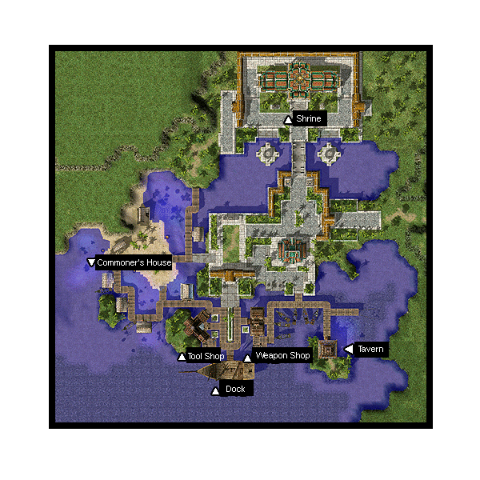

# Ayothaya

## About Ayothaya

Designed after Ancient Thai style. Ayothaya is a magnificent city off the coast of the [Rune-Midgarts Kingdom](Rune-Midgarts_Kingdom.md).
A peaceful village located in a deep forest near the river. Many houses are built on stilts above the calm waters. At the north end of the village lies a golden shrine, adorned with precious jewels and guarded by grand statues. However, just nearby is an ancient ruin, and within its depths dwell monsters never before seen in Midgard..
To access the dungeon, you must complete a quest. To get to Ayothaya, you must pay the NPC at the docks in [Alberta](Alberta.md) 10,000 Zeny.

## Story

After the cities of [Amatsu](Amatsu.md), [Kunlun](Kunlun.md) and [Louyang](Louyang.md) were discovered, the coffers of Rune-Midgard’s Treasury gained tremendously as the trickle of profit from foreign commerce grew into a torrent of zeny. Rune-Midgard’s wise and benevolent ruler, King Tristan III, was pleased. Recognizing the profit from exploration, King Tristan III decreed that whoever discovers more unknown lands would be richly rewarded. One adventurer heeded the king's proclamation and discovered a village. That village is Ayothaya. Ayothaya is linked via an ocean route to
[Amatsu](Amatsu.md), [Kunlun](Kunlun.md) and [Louyang](Louyang.md) it was only a matter of time before it would be discovered by the adventurers of Rune-Midgard. There, the explorers found a society adhering to a religion which glorifies nature and stressed harmony with the earth and its people.

The people of Midgard were first attracted to Ayothaya for its shrines of gold and emerald, but later found themselves charmed by the houses and structures built just above the calm waters. They were further awed by the craftsmanship of Ayothaya’s “floating markets”. These onboard boats sell various produce like fish and shrimps, and some of them even offer delicious culinary masterpieces of the land. The people of Ayothaya are devoutly religious people, believing in living peacefully with nature as well as their fellow men. It is no wonder that the Ayothayans found no trouble in accepting strangers and outside cultural influences. Many locals welcomed visitors from Rune-Midgard.

Yet, despite the seemingly peaceful and tranquil atmosphere of the village, there lies a dark brooding secret among its residents. A dreadful legend haunts Ayothaya, one describing the existence of a nearby ancient ruin. Here, a terrible man-eating beast is rumored to dwell. This legendary creature’s tale soon found its way among the adventurers of Rune-Midgard. Intrigued by the legend, they decide to explore the ruins and learn about the truth behind it once and for all…

## Quests

Ayothayans are peaceful but not lazy; religious but not over-zealous; gentle but not powerless.
They are very hospitable and are willing to help out strangers venturing into their village.

Adventurers can seek out the village shaman to know the story of the Sa-mhing Tiger and gain access to the ruins where it is said to reside. Find the renowned cook of Ayothaya and have a taste of the famous Ayothayan specialty
Tom Yum Goong, said to be one of the most delicious food in the world. There is also a village girl who is trying to find an engagement ring that her fiancé threw away. Help her out and she might have a reward waiting for you.

Quests added with the Ayothaya update can be found [here](Quests.md).

## Guide

**Related pages:**

* [Towns](Towns.md)
* [Rune-Midgarts Kingdom](Rune-Midgarts_Kingdom.md)
* [Alberta](Alberta.md)
* [Al De Baran](Al_De_Baran.md)
* [Archer Village](Archer_Village.md)
* [Comodo](Comodo.md)
* [Geffen](Geffen.md)
* [Izlude](Izlude.md)
* [Morroc](Morroc.md)
* [Payon](Payon.md)
* [Prontera](Prontera.md)
* [Umbala](Umbala.md)
* [Republic of Schwartzvald](Republic_of_Schwartzvald.md)
* [Einbech](Einbech.md)
* [Einbroch](Einbroch.md)
* [Hugel](Hugel.md)
* [Juno](Juno.md)
* [Lighthalzen](Lighthalzen.md)
* [Arunafeltz States](Arunafeltz_States.md)
* [Rachel](Rachel.md)
* [Veins](Veins.md)
* [Manuk](Manuk.md)
* [Amatsu](Amatsu.md)
* [Ayothaya](Ayothaya.md)
* [Kunlun](Kunlun.md)
* [Jawaii](Jawaii.md)
* [Louyang](Louyang.md)
* [Moscovia](Moscovia.md)
* [Nifflheim](Nifflheim.md)
* [Lutie](Lutie.md)

---
*Source: [iRO Wiki Classic](https://irowiki.org/classic/Ayothaya) — GFDL 1.3+*
