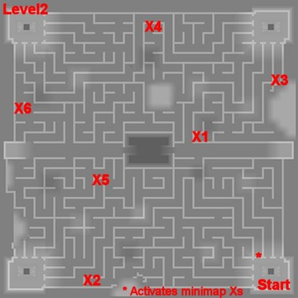

# Ayothaya Dungeon Entrance Quest

<!-- Quest info -->
- **Level requirement:** None
- **Job level requirement:** None
- **Item requirement:** 3 Spool, 1 Solid Husk, 3 Holy Water, 3 Needle Packet, 1 Yggdrasil Leaf
- **Item reward:** Holy Threads, Holier Threads, 1 Old Blue Box
- **Quest reward:** Access to maps ayo fild02, ayo dun01, and ayo dun02

**NOTE: This page is not for the RESTART server. Use the [renewal guide](http://irowiki.org/wiki/Ayothaya_Dungeon_Entrance_Quest) for that.**

1. In [Ayothaya](Ayothaya.md), find Dusit, he can be found at (82, 132) the far left beach area. He'll talk about a tiger and say "Yes, you believe in man-eating tigers." He will then tell you to go to Boonthon.

2. Boonthon can be found inside the house at (65, 104). Just go south from Dustit and loop around to the left and up along the wooden walkways. She'll ask you for items to make a holy thread after you talk to her telling her you want to find the tiger.

* 1 Solid Husk
* 1 Holy Water
* 1 Needle Packet
* 1 Spool

3. Bring these and she'll give you the Holy Threads which allow you to go to level 1 of the dungeon.

4. Go outside of her house and to the far east onto the field map. continue east to an [NPC](NPC.md) that asks you if you really want to go down there, (128, 197) say yes and you'll be moved to the bottom of the valley.

5. Go to the temple, and go in.

6. Here you'll find the mapless maze. There's also a drop down pool, avoid walking into these, since they kill you if you fall down them, and you do lose EXP. You'll see 3 possible paths facing North and 3 to the West, the North facing one farthest to the West will cause a popup NPC dialogue to activate and start flashing crosses on the minimap.

7. These are hidden panels along the way, you'll need to press them in order!

*  Note: Using a Fly Wing or [Teleporting](Teleport.md) will **cancel** the crosses so you'd best have a good memory or reactivate them after each one you find.
*  Note2: **If you Teleport around, it is possible that you land in a drop down pool!** and then you'll lose experience.

Map of Crosses (Approximate):

<small>Note: The dark zone in center is only a pool of water</small>

Once you activate all 6, return to Boomthon. She will make Holier Threads for you, and asks for these items:

*  2 Needle Packet
*  2 Holy Water
*  2 Spool
*  1 Yggdrasil Leaf

8. After making the Holier Threads, you're able to return to the maze and access level 2!

9. Once you make it down to level 2, head for (268, 107). Talk to the npc tile to be given 1 Old Blue Box.

10. After collecting the Old Blue Box, head back to Boomthon, you will be told that because of your adventurous spirit, you should keep it.

---
**Categories:** [Ayothaya Quests](categories/Ayothaya_Quests.md), [Quests](categories/Quests.md)
*Source: [iRO Wiki Classic](https://irowiki.org/classic/Ayothaya_Dungeon_Entrance_Quest) — GFDL 1.3+*
