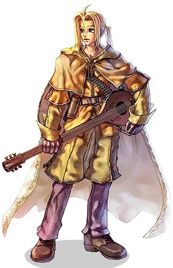

# Bard

<!-- Job info -->
- **Job base:** Archer
- **Job type:** 2-2
- **Changes at:** [Comodo](Comodo.md)
- **Skills:** 18
- **Skill points:** 91
- **Quest skills:** 1
- **STR:** 2
- **AGI:** 7
- **VIT:** 3
- **INT:** 5
- **DEX:** 9
- **LUK:** 4

## Overview

After a life of plucking their bows, many [Archer](Archer.md)s feel the itch to strum strings of a different kind. The Bards of Ragnarok Online are the right choice for the idealists among Archers who wish to change the world with their poetry.

The voice of a Bard is laden with magical harmonies, singing hymns that invoke the ancient Gods of Asgard to [instill fear](Pang_Voice.md) in the hearts of his enemies and inspire his comrades to victory with songs of [eternal youth](Song_of_Lutie.md) and [glorious charges](Impressive_Riff.md). Where their female counterparts, the [Dancer](Dancer.md)s, are more bent on disruption, Bards specialize in support, which make them central in all defensive strategies during the War of Emperium.

Supporting with a Bard or Dancer requires a different approach than other classes. Music-based buffs are mostly percentual values, as opposed to the absolute values of [Priest](Priest.md) buffs, and require careful strategy and positioning, but playing as an [Archer](Archer.md) should already provide some experience in this respect. Despite their supportive role, one should not forget that Bards are also capable of dealing good quantities of damage, one of their main advantages over [Hunter](Hunter.md)s is their immense SP pool which allows them to continually use [Double Strafe](Double_Strafe.md) instead of normal attacks, ensuring a very nice damage output.

In general, there are 2 types of skills for both [Dancer](Dancer.md)s and a Bards; skills which can be sung or danced without a partner of the opposite gender and those where the player needs another Bard or [Dancer](Dancer.md) respectively.

As a Bard, only [Instrument](Instrument.md)s, [Dagger](Dagger.md)s, and [Bow](Bow.md)s are available for weapons, whereas [Dancer](Dancer.md)s can use [Whip](Whip.md)s instead of [Instrument](Instrument.md)s.

*  When armed with an [Instrument](Instrument.md):
  * Bow skills ([Double Strafe](Double_Strafe.md), [Arrow Shower](Arrow_Shower.md), [Arrow Repel](Arrow_Repel.md)) cannot be used
  * Performance Skills, as well as [Amp](Amp.md) and [Encore](Encore.md) are available
  * Instrument skills ([Melody Strike](Melody_Strike.md)) can be used

[Unbarring Octave](Unbarring_Octave.md) and [Pang Voice](Pang_Voice.md) are usable regardless of weapons.

## Jobchange Guide

*See [Bard Job Change Guide](Bard_Job_Change_Guide.md) for detailed information.*

In order to become a Bard, one must go to [Comodo](Comodo.md) and look for the Roaming Bard. The applicant has to perform various tasks:

*  Item Collection
*  [Making friends with Mr. Snowman](Snowysnow_Quest.md) in [Lutie](Lutie.md)
*  Singing Test

Once these have been completed, the applicant will be made a bard by the Roaming Bard.

## Builds

## Battle

* 99 DEX
* 80 VIT
* 50 AGI
* 9 INT
* 1 STR
* 1 LUK

A well-rounded build due to the 80/50 distribution of VIT and AGI. Apparently quite a popular choice in iRO, it works great for both battle *and* support circumstances, though it's lacking the int of a full support build.

## WoE

* 90 DEX
* 90 VIT
* 30 AGI
* 25 INT
* 20 STR
* 1 LUK

The standard build for the WoE-happy Bard. Dex is for MS/SA with status cards, VIT is good for staying alive during support situations, and the agi helps improve "Impressive Riff".

## AGI Battle/ Riff Support

* 91 DEX
* 1-20 VIT
* 85-90 AGI
* 40 INT
* 1 or 8 STR
* 1 LUK

This build provides great flee and SP regen for  leveling w/double strafe, an unsrupassed riff performance and moderate strings performance for support.  It sacrifices WoE survivability for leveling speed, good support, and near immunity to acid bomb.

## Skills

* 1 Amp
* 1 Encore
* 10 Music Lessons
* 5 Melody Strike
* 5 Unbarring Octave
* 3 Unchained Serenade
* 10 Impressive Riff
* 1 Classical Pluck
* 10 Magic Strings
* 3 <Insert any song/duet here>

## Tactics

Dagger switching, or Dagger Amping is a popular technique used among Bards and Minstrels to stop a song.  By switching to a dagger while performing a song, the song is immediately interrupted.  While is has the same effect as [Amp](Amp.md), switching weapons can be done at any time, where as [Amp](Amp.md) requires both SP and can only be used 5 seconds after the song has started.  Although it is also possible of to cancel a song by equipping a Bow, changing to a Dagger has the advantage that the bard's shield does not become unequipped in the process.

Flashing is a tactic used to make full use of the bard.  The bard casts a song for an instant, then dagger or bow switches to a damage or status dealing configuration to participate in combat.  This works because a song's effect stays on players for about 20 sec after a person leaves the song's AoE.  One can also flash by moving around a large formation of players with a single song up.

## Equipment

Presented here are just suggestions to what a player may find useful to kill, survive and win in a tough environment.

## Headgear

Top Headgear

*  Cap [1] - +4 DEF. It is usually easy to find an overupgraded cap to put a card in for defensive or offensive purposes.
  * Cards: Depending on what you're doing, PVP/WoE/PVM the cards in headgear will differ. For leveling purposes more INT or SP helps the player to kill more monsters. Carat Card, +2 INT and +150 SP if the headgear is upgraded to +9 or higher. Willow Card, +80 SP. Elder Willow Card, +2 INT. If you are in a situation where you could be affected by status effects a card that reduces that chance, or makes you immune to it could be more useful. Nightmare, immune to sleep and +1 AGI, and Marduk, immune to silence are helpful.
*  Apple of Archer - 0 DEF and +3 DEX. Not recommended in PVP/WoE environment, but for MVP and leveling to reach a new dex bonus AoA is very useful. With it's +3 DEX on headgear, this is a must-have for all Bards, even if it is not part of their build to reach a new DEX bonus. You never know when you may have ot use a different Armor/Accesory combo and have to use the AoA to reach the next dex bonus.
*  Poo Hat - 10% less from demi-humans. If you don't need an AoA for your dex, Poo Hat is great for PVP and WoE.
*  Ghost Bandana - +2 AGI.. If you are an AGI Bard this is useful, it obviously depends on your build.

Middle Headgear

*  Binoculars - +1 DEF and +1 DEX, not bad but slotted sunnies are almost always better, unless you need the binocs to hit your dex bonus.
*  Sunglasses [1] - The only slotted middle headgear in the game.
  * Cards: The same cards mentioned above with the exception of the Carat card as it would be cheaper to get an Elder Willow card, and you cannot get the bonus from the card as Sunglasses cannot be upgraded.
*  Masquerade - 0 DEF Increases damage to Demihuman monsters by 3%.
*  Zealotus Mask - +3 DEF Increases damage to Demihuman monsters by 5% and reduces damage from Demihuman monsters by 5%. This headgear also takes up the upper headgear slot.

Lower Headgear

*  Gangster Mask - 0 DEF, adds 15% resistance to Silence status.

## Weapons

There are 3 types of weapons that bards can use. [Dagger](Dagger.md)s, [Bow](Bow.md)s and [Instrument](Instrument.md)s. Daggers serve a limited usefulness, a common Knife is usually carried for its use in the dagger-stopping method to cancel songs. Instruments are needed to perform the songs and duets that the bard class can do. Bows are used mainly for leveling purposes.

## Class Data

Note: The [iRO Bard Skill Section](http://iro.ragnarokonline.com/game/jobbarskill.asp) is very outdated. Do not be surprised if some of the skill descriptions differ from the website contents (i.e. [Acoustic Rhythm](Acoustic_Rhythm.md)), they have been contrasted with the ingame descriptions and the more up-to-date [Korean website](http://guide.ragnarok.co.kr/jobbarskill.asp).

## Skills

*See [Archer Skills](Archer.md) for first class skills.*

## Solo Skills

| Skill | Description | Levels | Type |
| --- | --- | --- | --- |
| [Amp](Amp.md) | Cancels active Performance Skill the caster is performing. | 1 | Active |
| [Encore](Encore.md) | Recast the last Performance Skill that was cast at half of the [SP](SP.md) cost. | 1 | Active |
| [Impressive Riff](Impressive_Riff.md) | Increases [ASPD](ASPD.md) of all players in the 7x7 area of effect. | 10 | Active |
| [Magic Strings](Magic_Strings.md) | Reduces [Cast Time](Skills.md) and [Cast Delay](Skills.md) of skills used inside the 7x7 area of effect. | 10 | Active |
| [Melody Strike](Melody_Strike.md) | Use an instrument-class weapon to do ranged damage to a single target. | 5 | Offensive |
| [Music Lessons](Music_Lessons.md) | Increases damage with Instruments, [Movement Speed](Movement_Speed.md) while singing and the effect of certain Performance Skills. | 10 | Passive |
| [Perfect Tablature](Perfect_Tablature.md) | Raises [Flee](Stats.md) Rate and [Perfect Dodge](Perfect_Dodge.md) of all players in the 7x7 area of effect. | 10 | Active |
| [Song of Lutie](Song_of_Lutie.md) | Increases the the [Max HP](Max_HP.md) of all players in the area of effect. | 10 | Active |
| [Unbarring Octave](Unbarring_Octave.md) | [Freeze](Status_Effects.md) monsters and [Party](Party.md) members within caster's view by chance. | 5 | Active |
| [Unchained Serenade](Unchained_Serenade.md) | Hits enemies in a 9x9 area with a slow sonic attack, piercing their [Defense](DEF.md). | 5 | Offensive |

## Ensemble Skills

Ensemble skills can only be performed when a Bard and Dancer are in the same party and standing beside each other. When an Ensemble skill is performed by a Bard and Dancer, the lower level of Acoustic Rhythm is performed. (i.e. when a Bard that has learned Acoustic Rhythm Lv.5 performs the skill with a Dancer that has only learned Acoustic Rhythm Lv.3, the Bard and Dancer will perform Acoutic Rhythm Lv.3)

| Skill | Description | Levels | Type |
| --- | --- | --- | --- |
| [Acoustic Rhythm](Acoustic_Rhythm.md) | Increases resistance against all Elements and Status Effects of [Party](Party.md) members within the 9x9 area of influence. | 5 | Active |
| [Battle Theme](Battle_Theme.md) | Party members within this skill's 9x9 area will have increased [ATK](Stats.md) and [DEF](DEF.md) for the skill's duration. | 5 | Active |
| [Classical Pluck](Classical_Pluck.md) | Casts a 9x9 area around the caster where all skills are disabled. | 1 | Active |
| [Down Tempo](Down_Tempo.md) | Reduces all [DEF](DEF.md) derived from the [VIT](Stats.md) stat to 0 for all enemies within the 9x9 area of effect. | 1 | Active |
| [Harmonic Lick](Harmonic_Lick.md) | Provides a bonus of armor piercing damage (ignores DEF) to all players within the 9x9 area of effect, as long as they're wielding level 4 weapons. | 5 | Supportive |
| [Lullaby](Lullaby.md) | Sing a dreamy song to put enemies in a 9x9 area to sleep. | 1 | Active |
| [Mental Sensing](Mental_Sensing.md) | Increases the [EXP](Experience.md) earned from monsters killed in the affected 9x9 area. | 5 | Active |
| [Power Cord](Power_Cord.md) | Cast a 9x9 cell area around the casters that nullifies item costs for most skills. | 1 | Active |

## Quest Skills

| Skill | Description | Levels | Type | Job Level Requirement | Quest |
| --- | --- | --- | --- | --- | --- |
| [Pang Voice](Pang_Voice.md) | The Bard screams out at a single target, attempting to inflict [Chaos](Status_Effects.md) status effect. | 1 | Active | 40 | [Pang Voice Quest](Bard_Skill_Quest.md) |

## Soul Link

*See [Bard and Dancer Spirits](Bard_and_Dancer_Spirits.md).*

| Skill | Description | Levels | Type |
| --- | --- | --- | --- |
| [Slow Grace](Slow_Grace.md) | (If level 10 [Impressive Riff](Impressive_Riff.md) is learned) Decrease attack and movement speed of all enemies within the 7x7 area of effect. | 10 | Active |
| [Lady Luck](Lady_Luck.md) | (If level 10 [Magic Strings](Magic_Strings.md) is learned) Improves [CRIT](Stats.md) rate of all players within the 7x7 area of effect. | 10 | Active |
| [Focus Ballet](Focus_Ballet.md) | (If level 10 [Perfect Tablature](Perfect_Tablature.md) is learned) Improves [HIT](Stats.md) of all players within the 7x7 area of effect. | 10 | Active |
| [Gypsy's Kiss](Gypsy's_Kiss.md) | (If level 10 [Song of Lutie](Song_of_Lutie.md) is learned) Increase [max SP](Max_SP.md) and SP regeneration while reducing the SP consumption of all players within the 7x7 area of effect. | 10 | Active |

## Unimplemented Skills

| Skill | Description | Levels | Type |
| --- | --- | --- | --- |
| [Ragnarok](Ragnarok.md) | Randomly casts spells in the area of effect for 60 seconds. | Unknown | Offensive |

## Job Bonuses

| Stat\Amount | +1 | +2 | +3 | +4 | +5 | +6 | +7 | +8 |
| --- | --- | --- | --- | --- | --- | --- | --- | --- |
| STR | 3 | 28 |   |   |   |   |   |   |
| AGI | 2 | 10 | 11 | 24 | 30 | 35 | 48 |   |
| VIT | 17 | 33 | 43 |   |   |   |   |   |
| INT | 5 | 13 | 21 | 40 | 47 |   |   |   |
| DEX | 7 | 15 | 16 | 19 | 32 | 38 | 46 | 50 |
| LUK | 6 | 9 | 20 | 41 |   |   |   |   |

## ASPD

| Weapon | Base ASPD | Base Delay |
| --- | --- | --- |
| Unarmed |   |   |
| Dagger |   |   |
| Bow |   |   |
| Instrument |   |   |

## External Links

*  [Skill Simulator](http://web.hc.keio.ac.jp/~fk061999/himeyasha/skill3/index.html)
*  [General Stat Calculator](http://ro.doddlercon.com/calc/calcx.html)

**Related pages:**

* [Bard](Bard.md)
* [Minstrel](Minstrel.md)
* [Skills](Skills.md)
* [Amp](Amp.md)
* [Encore](Encore.md)
* [Impressive Riff](Impressive_Riff.md)
* [Slow Grace](Slow_Grace.md)
* [Magic Strings](Magic_Strings.md)
* [Lady Luck](Lady_Luck.md)
* [Melody Strike](Melody_Strike.md)
* [Music Lessons](Music_Lessons.md)
* [Pang Voice](Pang_Voice.md)
* [Perfect Tablature](Perfect_Tablature.md)
* [Focus Ballet](Focus_Ballet.md)
* [Song of Lutie](Song_of_Lutie.md)
* [Gypsy's Kiss](Gypsy's_Kiss.md)
* [Unbarring Octave](Unbarring_Octave.md)
* [Unchained Serenade](Unchained_Serenade.md)
* [Ensemble Skill](Ensemble_Skill.md)
* [Acoustic Rhythm](Acoustic_Rhythm.md)
* [Battle Theme](Battle_Theme.md)
* [Classical Pluck](Classical_Pluck.md)
* [Down Tempo](Down_Tempo.md)
* [Harmonic Lick](Harmonic_Lick.md)
* [Lullaby](Lullaby.md)
* [Mental Sensing](Mental_Sensing.md)
* [Power Cord](Power_Cord.md)
* [Ragnarok](Ragnarok.md)
* [Arrow Vulcan](Arrow_Vulcan.md)
* [Marionette Control](Marionette_Control.md)
* [Tarot Card of Fate](Tarot_Card_of_Fate.md)
* [Longing for Freedom](Longing_for_Freedom.md)
* [Hermode's Rod](Hermode's_Rod.md)
* [Sheltering Bliss](Sheltering_Bliss.md)
* [Quests](Quests.md)
* [Bard Job Change Guide](Bard_Job_Change_Guide.md)
* [Bard Skill Quest](Bard_Skill_Quest.md)
* [Rebirth Walkthrough](Rebirth_Walkthrough.md)
* [Weapons](Weapons.md)
* [Bow](Bow.md)
* [Instrument](Instrument.md)

**Related pages:**

* [Classes](Classes.md)
* [Novice](Novice.md)
* [High Novice](High_Novice.md)
* [Super Novice](Super_Novice.md)
* [Acolyte](Acolyte.md)
* [Archer](Archer.md)
* [High First Class](High_First_Class.md)
* [Mage](Mage.md)
* [Merchant](Merchant.md)
* [Swordman](Swordman.md)
* [Thief](Thief.md)
* [Priest](Priest.md)
* [Monk](Monk.md)
* [Hunter](Hunter.md)
* [Bard](Bard.md)
* [Dancer](Dancer.md)
* [Wizard](Wizard.md)
* [Sage](Sage.md)
* [Blacksmith](Blacksmith.md)
* [Alchemist](Alchemist.md)
* [Knight](Knight.md)
* [Crusader](Crusader.md)
* [Assassin](Assassin.md)
* [Rogue](Rogue.md)
* [Transcendent](Transcendent.md)
* [High Priest](High_Priest.md)
* [Champion](Champion.md)
* [Sniper](Sniper.md)
* [Minstrel](Minstrel.md)
* [Gypsy](Gypsy.md)
* [High Wizard](High_Wizard.md)
* [Scholar](Scholar.md)
* [Mastersmith](Mastersmith.md)
* [Biochemist](Biochemist.md)
* [Lord Knight](Lord_Knight.md)
* [Paladin](Paladin.md)
* [Assassin Cross](Assassin_Cross.md)
* [Stalker](Stalker.md)
* [Gunslinger](Gunslinger.md)
* [Ninja](Ninja.md)
* [TaeKwon Kid](TaeKwon_Kid.md)
* [TaeKwon Master](TaeKwon_Master.md)
* [Soul Linker](Soul_Linker.md)

---
**Categories:** [Bard](categories/Bard.md), [Classes](categories/Classes.md)
*Source: [iRO Wiki Classic](https://irowiki.org/classic/Bard) — GFDL 1.3+*
