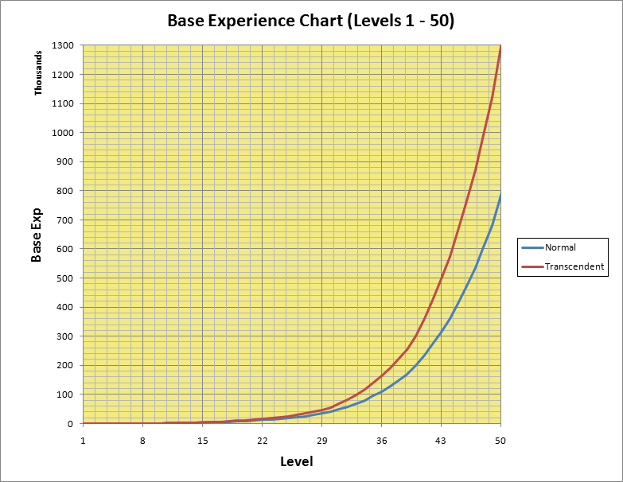
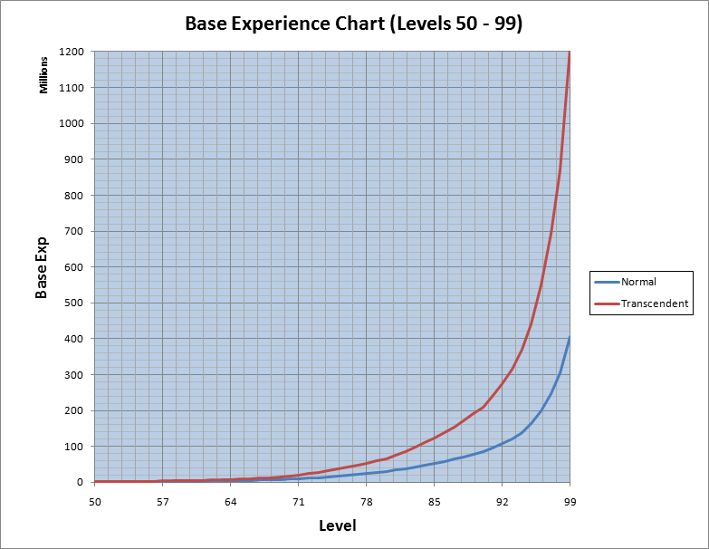

# Base EXP Chart

<big>**This page shows the [Base Level](Levels.md) [Experience](Experience.md) requirements for all [Classes](Classes.md).**</big>

**Base Experience Chart - Normal**

| Column 1 | Column 2 | Column 3 | Column 4 |
| --- | --- | --- | --- |
| **Current Level** | **Total EXP** | **EXP to next Level** | **Rise %** |
| 1 | 0 | 9 |   |
| 2 | 9 | 16 | 77.8% |
| 3 | 25 | 25 | 56.3% |
| 4 | 50 | 36 | 44.0% |
| 5 | 86 | 77 | 113.9% |
| 6 | 163 | 112 | 45.5% |
| 7 | 275 | 153 | 36.6% |
| 8 | 428 | 200 | 30.7% |
| 9 | 628 | 253 | 26.5% |
| 10 | 881 | 320 | 26.5% |
| 11 | 1,201 | 385 | 20.3% |
| 12 | 1,586 | 490 | 27.3% |
| 13 | 2,076 | 585 | 19.4% |
| 14 | 2,661 | 700 | 19.7% |
| 15 | 3,361 | 830 | 18.6% |
| 16 | 4,191 | 970 | 16.9% |
| 17 | 5,161 | 1,120 | 15.5% |
| 18 | 6,281 | 1,260 | 12.5% |
| 19 | 7,541 | 1,420 | 12.7% |
| 20 | 8,961 | 1,620 | 14.1% |
| 21 | 10,581 | 1,860 | 14.8% |
| 22 | 12,441 | 1,990 | 7.0% |
| 23 | 14,431 | 2,240 | 12.6% |
| 24 | 16,671 | 2,504 | 11.8% |
| 25 | 19,175 | 2,950 | 17.8% |
| 26 | 22,125 | 3,426 | 16.1% |
| 27 | 25,551 | 3,934 | 14.8% |
| 28 | 29,485 | 4,474 | 13.7% |
| 29 | 33,959 | 6,889 | 54.0% |
| 30 | 40,848 | 7,995 | 16.1% |
| 31 | 48,843 | 9,174 | 14.7% |
| 32 | 58,017 | 10,425 | 13.6% |
| 33 | 68,442 | 11,748 | 12.7% |
| 34 | 80,190 | 13,967 | 18.9% |
| 35 | 94,157 | 15,775 | 12.9% |
| 36 | 109,932 | 17,678 | 12.1% |
| 37 | 127,610 | 19,677 | 11.3% |
| 38 | 147,287 | 21,773 | 10.7% |
| 39 | 169,060 | 30,543 | 40.3% |
| 40 | 199,603 | 34,212 | 12.0% |
| 41 | 233,815 | 38,065 | 11.3% |
| 42 | 271,880 | 42,102 | 10.6% |
| 43 | 313,982 | 46,323 | 10.0% |
| 44 | 360,305 | 53,026 | 14.5% |
| 45 | 413,331 | 58,419 | 10.2% |
| 46 | 471,750 | 64,041 | 9.6% |
| 47 | 535,791 | 69,892 | 9.1% |
| 48 | 605,683 | 75,973 | 8.7% |
| 49 | 681,656 | 102,468 | 34.9% |
| 50 | 784,124 | 115,254 | 12.5% |
| 51 | 899,378 | 128,692 | 11.7% |
| 52 | 1,028,070 | 142,784 | 11.0% |
| 53 | 1,170,854 | 157,528 | 10.3% |
| 54 | 1,328,382 | 178,184 | 13.1% |
| 55 | 1,506,566 | 196,300 | 10.2% |
| 56 | 1,702,866 | 215,198 | 9.6% |
| 57 | 1,918,064 | 234,879 | 9.1% |
| 58 | 2,152,943 | 255,341 | 8.7% |
| 59 | 2,408,284 | 330,188 | 29.3% |
| 60 | 2,738,472 | 365,914 | 10.8% |
| 61 | 3,104,386 | 403,224 | 10.2% |
| 62 | 3,507,610 | 442,116 | 9.6% |
| 63 | 3,949,726 | 482,590 | 9.2% |
| 64 | 4,432,316 | 536,948 | 11.3% |
| 65 | 4,969,264 | 585,191 | 9.0% |
| 66 | 5,554,455 | 635,278 | 8.6% |
| 67 | 6,189,733 | 687,211 | 8.2% |
| 68 | 6,876,944 | 740,988 | 7.8% |
| 69 | 7,617,932 | 925,400 | 24.9% |
| 70 | 8,543,332 | 1,473,746 | 59.3% |
| 71 | 10,017,078 | 1,594,058 | 8.2% |
| 72 | 11,611,136 | 1,718,928 | 7.8% |
| 73 | 13,330,064 | 1,848,355 | 7.5% |
| 74 | 15,178,419 | 1,982,340 | 7.2% |
| 75 | 17,160,759 | 2,230,113 | 12.5% |
| 76 | 19,390,872 | 2,386,162 | 7.0% |
| 77 | 21,777,034 | 2,547,417 | 6.8% |
| 78 | 24,324,451 | 2,713,878 | 6.5% |
| 79 | 27,038,329 | 3,206,160 | 18.1% |
| 80 | 30,244,489 | 3,681,024 | 14.8% |
| 81 | 33,925,513 | 4,022,472 | 9.3% |
| 82 | 37,947,985 | 4,377,024 | 8.8% |
| 83 | 42,325,009 | 4,744,680 | 8.4% |
| 84 | 47,069,689 | 5,125,440 | 8.0% |
| 85 | 52,195,129 | 5,767,272 | 12.5% |
| 86 | 57,962,401 | 6,204,000 | 7.6% |
| 87 | 64,166,401 | 6,655,464 | 7.3% |
| 88 | 70,821,865 | 7,121,664 | 7.0% |
| 89 | 77,943,529 | 7,602,600 | 6.8% |
| 90 | 85,546,129 | 9,738,720 | 28.1% |
| 91 | 95,284,849 | 11,649,960 | 19.6% |
| 92 | 106,934,809 | 13,643,520 | 17.1% |
| 93 | 120,578,329 | 18,339,300 | 34.4% |
| 94 | 138,917,629 | 23,836,800 | 30.0% |
| 95 | 162,754,429 | 35,658,000 | 49.6% |
| 96 | 198,412,429 | 48,687,000 | 36.5% |
| 97 | 247,099,429 | 58,135,000 | 19.4% |
| 98 | 305,234,429 | 99,999,998 | 72.0% |
| 99 | 405,234,427 |   |   |

**Base Experience Chart - Transcendent**

| Column 1 | Column 2 | Column 3 | Column 4 |
| --- | --- | --- | --- |
| **Current Level** | **Total EXP** | **EXP to next Level** | **Rise %** |
| 1 | 0 | 10 |   |
| 2 | 10 | 18 | 80.0% |
| 3 | 28 | 28 | 55.6% |
| 4 | 56 | 40 | 42.9% |
| 5 | 96 | 85 | 112.5% |
| 6 | 181 | 123 | 44.7% |
| 7 | 304 | 168 | 36.6% |
| 8 | 472 | 220 | 31.0% |
| 9 | 692 | 278 | 26.4% |
| 10 | 970 | 400 | 43.9% |
| 11 | 1,370 | 481 | 20.3% |
| 12 | 1,851 | 613 | 27.4% |
| 13 | 2,464 | 731 | 19.2% |
| 14 | 3,195 | 875 | 19.7% |
| 15 | 4,070 | 1,038 | 18.6% |
| 16 | 5,108 | 1,213 | 16.9% |
| 17 | 6,321 | 1,400 | 15.4% |
| 18 | 7,721 | 1,575 | 12.5% |
| 19 | 9,296 | 1,775 | 12.7% |
| 20 | 11,071 | 2,268 | 27.8% |
| 21 | 13,339 | 2,604 | 14.8% |
| 22 | 15,943 | 2,786 | 7.0% |
| 23 | 18,729 | 3,136 | 12.6% |
| 24 | 21,865 | 3,506 | 11.8% |
| 25 | 25,371 | 4,130 | 17.8% |
| 26 | 29,501 | 4,796 | 16.1% |
| 27 | 34,297 | 5,508 | 14.8% |
| 28 | 39,805 | 6,264 | 13.7% |
| 29 | 46,069 | 9,645 | 54.0% |
| 30 | 55,714 | 12,392 | 28.5% |
| 31 | 68,106 | 14,220 | 14.8% |
| 32 | 82,326 | 16,159 | 13.6% |
| 33 | 98,485 | 18,209 | 12.7% |
| 34 | 116,694 | 21,649 | 18.9% |
| 35 | 138,343 | 24,451 | 12.9% |
| 36 | 162,794 | 27,401 | 12.1% |
| 37 | 190,195 | 30,499 | 11.3% |
| 38 | 220,694 | 33,748 | 10.7% |
| 39 | 254,442 | 47,342 | 40.3% |
| 40 | 301,784 | 58,160 | 22.9% |
| 41 | 359,944 | 64,711 | 11.3% |
| 42 | 424,655 | 71,573 | 10.6% |
| 43 | 496,228 | 78,749 | 10.0% |
| 44 | 574,977 | 90,144 | 14.5% |
| 45 | 665,121 | 99,312 | 10.2% |
| 46 | 764,433 | 108,870 | 9.6% |
| 47 | 873,303 | 118,816 | 9.1% |
| 48 | 992,119 | 129,154 | 8.7% |
| 49 | 1,121,273 | 174,196 | 34.9% |
| 50 | 1,295,469 | 213,220 | 22.4% |
| 51 | 1,508,689 | 238,080 | 11.7% |
| 52 | 1,746,769 | 264,150 | 11.0% |
| 53 | 2,010,919 | 291,427 | 10.3% |
| 54 | 2,302,346 | 329,640 | 13.1% |
| 55 | 2,631,986 | 363,155 | 10.2% |
| 56 | 2,995,141 | 398,116 | 9.6% |
| 57 | 3,393,257 | 434,526 | 9.1% |
| 58 | 3,827,783 | 472,381 | 8.7% |
| 59 | 4,300,164 | 610,848 | 29.3% |
| 60 | 4,911,012 | 731,828 | 19.8% |
| 61 | 5,642,840 | 806,448 | 10.2% |
| 62 | 6,449,288 | 884,232 | 9.6% |
| 63 | 7,333,520 | 965,180 | 9.2% |
| 64 | 8,298,700 | 1,073,896 | 11.3% |
| 65 | 9,372,596 | 1,170,382 | 9.0% |
| 66 | 10,542,978 | 1,270,556 | 8.6% |
| 67 | 11,813,534 | 1,374,422 | 8.2% |
| 68 | 13,187,956 | 1,481,976 | 7.8% |
| 69 | 14,669,932 | 1,850,800 | 24.9% |
| 70 | 16,520,732 | 3,389,616 | 83.1% |
| 71 | 19,910,348 | 3,666,333 | 8.2% |
| 72 | 23,576,681 | 3,953,534 | 7.8% |
| 73 | 27,530,215 | 4,251,217 | 7.5% |
| 74 | 31,781,432 | 4,559,382 | 7.2% |
| 75 | 36,340,814 | 5,129,260 | 12.5% |
| 76 | 41,470,074 | 5,488,173 | 7.0% |
| 77 | 46,958,247 | 5,859,059 | 6.8% |
| 78 | 52,817,306 | 6,241,919 | 6.5% |
| 79 | 59,059,225 | 7,374,168 | 18.1% |
| 80 | 66,433,393 | 9,570,662 | 29.8% |
| 81 | 76,004,055 | 10,458,427 | 9.3% |
| 82 | 86,462,482 | 11,380,262 | 8.8% |
| 83 | 97,842,744 | 12,336,168 | 8.4% |
| 84 | 110,178,912 | 13,326,144 | 8.0% |
| 85 | 123,505,056 | 14,994,907 | 12.5% |
| 86 | 138,499,963 | 16,130,400 | 7.6% |
| 87 | 154,630,363 | 17,304,200 | 7.3% |
| 88 | 171,934,563 | 18,516,326 | 7.0% |
| 89 | 190,450,889 | 19,766,760 | 6.8% |
| 90 | 210,217,649 | 29,216,160 | 47.8% |
| 91 | 239,433,809 | 34,949,880 | 19.6% |
| 92 | 274,383,689 | 40,930,560 | 17.1% |
| 93 | 315,314,249 | 55,017,900 | 34.4% |
| 94 | 370,332,149 | 71,510,400 | 30.0% |
| 95 | 441,842,549 | 106,974,000 | 49.6% |
| 96 | 548,816,549 | 146,061,000 | 36.5% |
| 97 | 694,877,549 | 174,405,000 | 19.4% |
| 98 | 869,282,549 | 343,210,000 | 96.8% |
| 99 | 1,212,492,549 |   |   |

**Related pages:**

* [Levels](Levels.md)
* [Experience](Experience.md)
* [Quest Table](Quest_Table.md)
* [Base EXP Chart](Base_EXP_Chart.md)
* [Job EXP Chart](Job_EXP_Chart.md)
* [Party](Party.md)
* [Guild System](Guild_System.md)
* [Homunculus System](Homunculus_System.md)
* [Leveling Spots](Leveling_Spots.md)
* [Mage Leveling](Mage_Leveling.md)
* [Crusader Leveling](Crusader_Leveling.md)
* [Rogue Leveling](Rogue_Leveling.md)
* [Stalker Leveling](Stalker_Leveling.md)
* [Wizard Leveling](Wizard_Leveling.md)

---
**Categories:** [General Information](categories/General_Information.md), [Mechanics](categories/Mechanics.md)
*Source: [iRO Wiki Classic](https://irowiki.org/classic/Base_EXP_Chart) — GFDL 1.3+*
