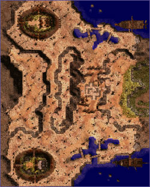
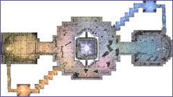
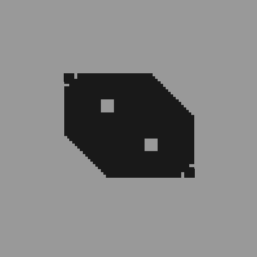

# Battlegrounds

## Overview

Battlegrounds is a [PVP](PvP~d29d2.md) system in which two teams compete towards specific objectives in various arenas, and has unique equipment and consumable rewards for participation.  To enter the Battlegrounds atrium, speak to one of the following Maroll Battle Recruiters:

* [Prontera](Prontera.md): (123, 83)
* [Geffen](Geffen.md): (109, 66)
* [Al De Baran](Al_De_Baran.md): (146, 109)
* [Payon](Payon.md): (189, 105)
* [Morroc](Morroc.md): (moc_ruins 75, 162)
* [Lighthalzen](Lighthalzen.md): (153, 86)
* [Rachel](Rachel.md): (149,138)

To leave the atrium, players can talk to the Teleporter NPC who will send them back to the town they entered from.

## System

All battlegrounds have the same basic set of rules.

*  The three PVP battlegrounds are Tierra Valley, Flavius, and Kreiger Von Midgard (KVM). Tierra Valley and KVM are single round, and Flavius is best two out of three.
*  The matches have various player number requirements; enough players must be assembled before matches can begin.
*  Players must be level 80 or higher in order to sign up with a specific recruiter [NPC](NPC.md) for Flavius or Tierra. KVM has 3 level divisions 80+, 60-80 and below 60.
*  After signing up with the specific NPC, players are moved to a special waiting area until the match begins.
*  Participation in battlegrounds is rewarded with various emblems or points, with the number gained depending on if you win or lose. These emblems or points can be exchanged for various rewards.
*  When a player dies in Tierra or Flavius match, there is a delay before that player can re-enter the match. If a player dies in KVM match, they have to wait till the match is over.
*  There are limits in place to participation in battlegrounds. Once you sign up for a battleground, there is a 5 minute delay before you can sign up for another match.
*  The battlegrounds follow [War of Emperium](War_of_Emperium.md) mechanics rather than [PVP](PvP~d29d2.md) mechanics.
*  Skill that cannot be used in War of Emperium cannot be used in the battlegrounds (such as [Ice Wall](Ice_Wall.md), [Teleport](Teleport.md), and [Warp Portal](Warp_Portal.md) are prohibited). The TaeKwon skills [Sprint](Sprint.md) and [Leap](Leap.md) also cannot be used.
*  A [Kafra](Kafra.md) NPC is located in the atrium who offers Storage and [Cart](Pushcart.md) Rental services.
*  A Repair NPC is also located in the atrium.

## Teams

The two teams are based on that of two characters: Prince Croix, and General Guillaume, who are battling for control of the Maroll Kingdom.

* To play for the Croix team, talk to the Croix Army officers on the *South* side of the atrium that corresponds to the desired arena.
* To play for the Guillaume team, talk to the Guilliaume Army officers on the *North* side of the atrium that corresponds to the desired arena.

Each team **must** have the required amount of players, or the battle will not begin.  **Caution:** As there are two Flavius and two Tierra Gorge arenas, it is important to make sure that the participating teams are in the same instance's opposing chatrooms when attempting to participate, or the battle will not start. In the case of KVM, the participants need to make sure that they are within the same level range, as the recruiter NPC automatically transports a player to an appropriate lobby depending on their [Base Level](Levels.md).

## Battlechat

To talk with your team during the match, use the */battlechat* command.  All text typed in battlechat will appear purple, and you will **only** be able to talk to your team when in battlechat.  Party, guild, and open chat will not work until battlechat is deactivated.

## Tierra Gorge

*  Two forts are arranged at the north and south end of the map.
*  Each fort has a storehouse that must be defended, and by destroying the opposing team's store you win the match.
*  There is a third base at the center of the map. If your team occupies this point, you will be able to spawn here instead of farther back, along with receiving 3 guardians to fight alongside you.
*  There is a series of back routes that are blocked by barricades. By destroying these barricades your team can gain an advantage.
*  There is a 25 second wait period for players who are killed in battle until they respawn on the map.
*  The cooldown period during which a player cannot participate in another Tierra Gorge battle is shown in a player's Quest Window.
*  The winning team receives 3 Bravery Badges, and the losing team 1.

## Flavius

*  Victory is obtained by destroying the opposing team's crystal.
*  The crystal for each team is protected by 2 guardians that must be defeated before the crystal can be attacked.
*  When the crystal is destroyed, your team gains one point. Your team wins if you obtain two points.
*  Skills cannot be used on crystals.
*  The cooldown period during which a player cannot participate in another Flavius battle is shown in a player's Quest Window.
*  The winning team receives 12 Valor Badges, and the losing team 4.
*  If there is a tie, both teams receive 4 Valor Badge.

## Kreiger Von Midgard (KVM)

*  In order to win, one team must reduce the other team's points to 0. In other words, it's a death match battle with survivors being the winners.
  * Each team starts with 1 point per player on the team.
  * Each team loses 1 point when a player dies.
*  Players have 5 minutes to decide the outcome of the match. If one team is not completely victorious after 5 minutes, that with most players standing wins.
*  After victory or defeat, players will be warped to a spot to collect their rewards and exit the map. This must be done within 30 seconds or the player will be forcibly ejected from the arena.
*  KVM Points are distributed as follows:
  * Levels 79 and below: Winning - 2 points, Losing - 0 points.
  * Levels 80+: Winning - 5 points, Losing - 1 point.

## Battlegrounds Items

Valor Badges and Bravery Badges are the two reward items that can be obtained in battlegrounds. They can be traded in for a variety of different equipment. Tierra Gorge rewards you with Bravery Badges, and Flavius rewards you with Valor Badges. KVM battlegrounds use Reward Points instead of badges.

Possible Rewards:

The equipment may have either the prefix Valor or Bravery depending on which medals are used to obtain them.  Not *all* equipment can be obtained by both badges. Different badges cannot be mixed to pay for one item; you must pay the full badge price with one type of badge only. (The NPC will ask which type of badge you wish to exchange.) KVM Reward Points can only be used to purchase items from the KVM Logistics Officer, and Badges can only be used to purchase items from Erundek. All battlegrounds equipment is character bound (except iRO, which can be placed into storage).

## Weapons

*  Any Type: 100 Badges (Valor or Bravery) / 2,000 KVM Reward Points (KVM Items Only)

## Armor

*  Armor: 80 Badges / 840 KVM Reward Points (KVM Items Only)
*  Garment: 50 Badges / 630 KVM Reward Points (KVM Items Only)
*  Shoes: 50 Badges / 580 KVM Reward Points (KVM Items Only)
*  Accessory: 500 Badges / 1,200 KVM Reward Points (KVM Items Only)

## Consumables

*  Tasty White Ration: 10 Badges
*  Tasty Pink Ration: 10 Badges
*  Military Ration A: 5 Badges
*  Military Ration B: 10 Badges
*  Military Ration C: 10 Badges

---
*Source: [iRO Wiki Classic](https://irowiki.org/classic/Battlegrounds) — GFDL 1.3+*
