# Biolabs Entrance Quest

<!-- Quest info -->
- **Level requirement:** 60
- **Item requirement:** 20 Jellopy
- **Item reward:** Laboratory Pass
- **Quest reward:** Access to the Biolabs Dungeon

## Quest

1. Proceed to the 3 o'clock direction of [Lighthalzen](Lighthalzen.md). There, you'll see a guard who stops you from moving into the slum area. Fear not, just talk to him continuously and you'll eventually make it into the slums.

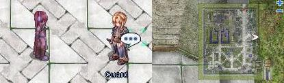

*  Note: To access the slum, either wait for any alert to cease (Mobsters in town are all killed (yellow text)), or do the [Friendship Quest](Friendship_Quest.md).

2. Proceed on and meet Fishbone (340,224). Talk to him continuously to find out that he's actually an ex-researcher.

3. Talk to him again and again, you'll be pleading with him till he eventually asks for an offer of 20 Jellopy for an exchange of information.

4. Once you've passed him the Jellopies, ask him to send you to the maze.

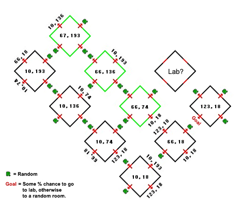

*  This is a map of the cuberoom maze (unless its changed). The portals marked R moves you to a random one of the three green marked rooms. You'll actually start in one of those 3 rooms too. To make it slightly more random, the exit portal doesn't always actually take you out of the maze, you may have to work your way back again.

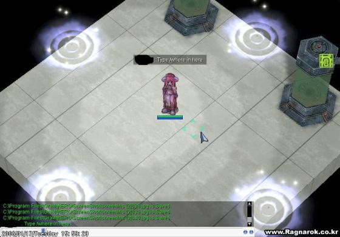

5. Type /where in there, until you get to a room with any of these coordinates: [67,193] go to direction 12, 3, 9, 12, 9 (o'clock), or [66,136] go to direction 3, 12, 6, 6, 9 (o'clock), or [67,74] go to direction 6, 3, 9, 6, 9 (o'clock). You'll be sent to a room with documents all over.

*  However, sometimes when it is bugged and you don't get to the next room but just remain in maze, just repeat this step. Second time will be successful.

[123,18] is the last room where you go to 9 o'clock direction as shown on the picture.

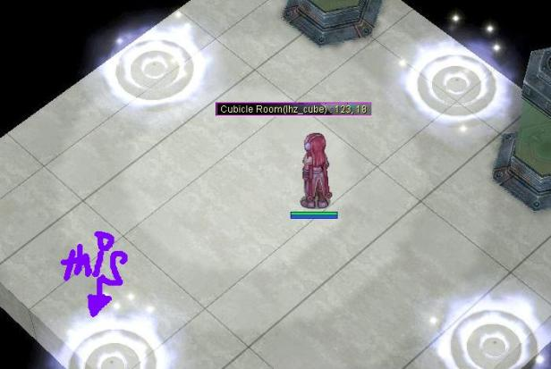

6. Examine the Bed, you'll get a *Short Stick* if you checked under the bed.

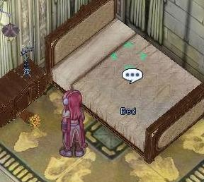

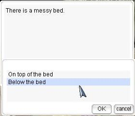

7. Examine the Desk (under the Desk), you'll get another *Short Stick*. The two rods will become a *Long Stick* automatically.

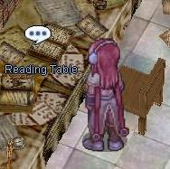

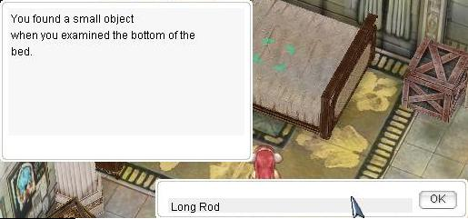

Use the *Long Stick* on the Bed (under the Bed) and obtain a *Cube*.

8. Examine the Goblet on the table beside the bookshelf. Check its contents, you'll obtain a *Rusty Key*.

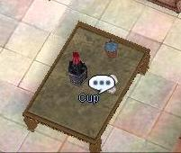

9. Move towards the wall at the desk. You'll see a cabinet of Chemicals. Examine it and type in *Rusty Key* and you'll get a *Green Key*.

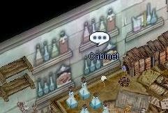

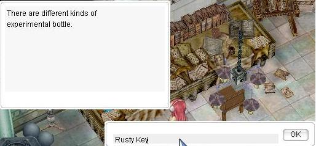

10. Move to the Cabinet on the right of the room. Examine it and type in *Green Key*. You'll obtain a *Polygon*.

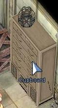

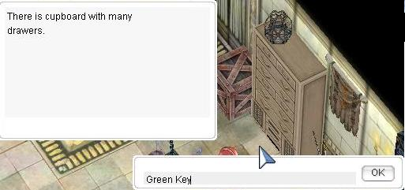

11. Next, examine the Bundles of Files on the ground. You'll obtain a *Red Key*.

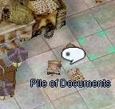

12. Examine the Drawer next to the Bed and type in *Red Key*, you'll obtain a *Jackknif*e.

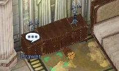

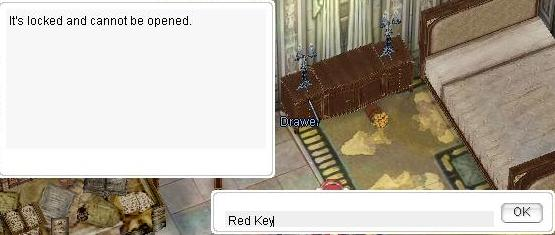

13. Examine the Painting above the Desk. You'll select the option to move it. Type in *Jackknife*. You'll obtain a set of numbers. Write these down or take a screenshot.

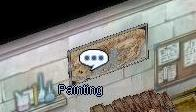

14. Now, move on the the right hand corner of the room to find a Chest. Take the *Axe* in it.

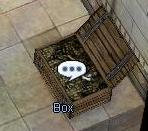

15. Move to the Barrel and examine it. Type in *Axe*.

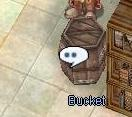

16. Examine the Barrel again. It asks for 9 numbers. (4 9 3 7 6 2 8 6 6) On iRO servers enter the 9 single digit numbers from step 13 one at a time, in the order they appeared on the wall.

*  Note: On other servers this puzzle is different. See [Variations](Biolabs_Entrance_Quest.md) if the code obtained in step 13 consisted of 9 different 2 digit numbers. Also, note that even if your server has the 9 single digit numbers version just like iRO, the numbers might not be the same as the numbers for iRO listed above.

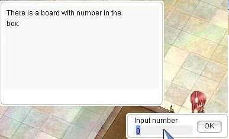

17. Now, examine the Power Generator. Type in *Yellow Key*.

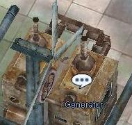

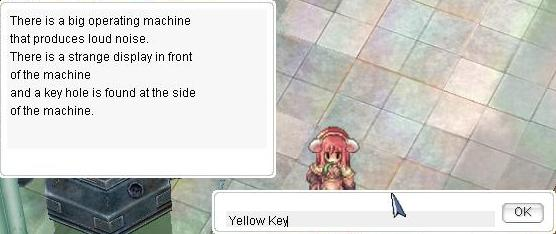

18. Then, move to the Status Light beside the Bed. Break it and you'll obtain a *Black Key*.

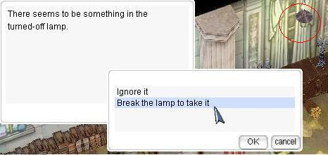

19. Examine the huge Experiment Tube on the left hand side of the room and type in Black Key. you'll get an *Oval*.

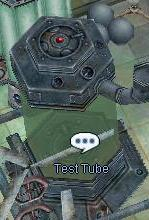

20. Go to the Box beside the Cabinet. Examine it and you'll have these 3 options:

*  Oval Shape
*  Polygon Shape
*  Square Shape

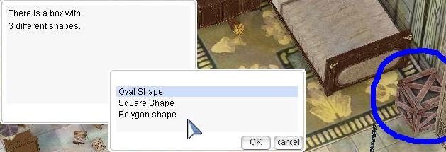

For each of the following shapes, type in:

*  Oval
*  Cube
*  Polygon

21. After typing those in, examine the Box again. You'll eventually get a Laboratory Permit!

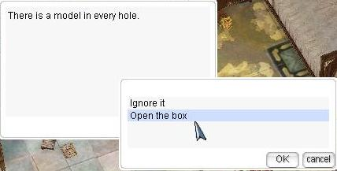

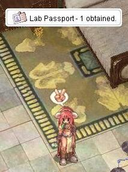

22. Go back to the Experiment Tube, and examine it again. Type in Laboratory Permit.

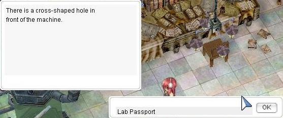

*  You'll get 2 options. Choose the *go down* option.

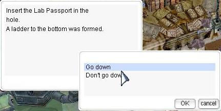

And there you are, walk up straight and go through the portal. After you've get out, you'll find yourself beside the Underwater Tunnel.

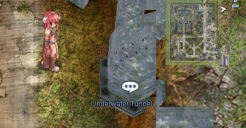

Hence, the very next time you want to ever meet the doppels again, just go down from the Sewer Pipe (lighthalzen 311,302) and walk up straight. You'll eventually reach the lower parts of the sewers.

## Variations

## Step 16 on non-iRO servers

Examine the Barrel again. It asks for 9 numbers. The key to this puzzle are the numbers you obtained in step 13. Take the second digit of each number and arrange them in order from 1-9. The code will be the each of the first digits.

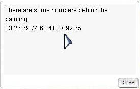

Example: Code on the wall: **53 86 49 34 18 21 77 92 65**

Numbers in Order by second digit: **21 92 53 34 65 86 77 18 49**

Code to unlock the box: **2 9 5 3 6 8 7 1 4**

Type in the numbers you got (Remember everyones code will be different. Only use the numbers you got from the picture on the wall.), one at a time. You'll then obtain a *Yellow Key*.

---
**Categories:** [Lighthalzen Quests](categories/Lighthalzen_Quests.md), [Quests](categories/Quests.md)
*Source: [iRO Wiki Classic](https://irowiki.org/classic/Biolabs_Entrance_Quest) — GFDL 1.3+*
