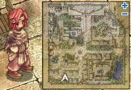
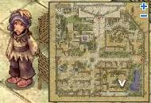
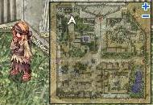
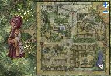
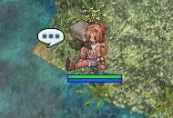
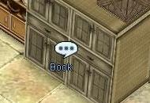
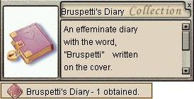

# Bruspetti Quest

<!-- Quest info -->
- **Level requirement:** 50
- **Item requirement:** 1 Knife [3]
- **Quests required:** [Friendship Quest](Friendship_Quest.md)
- **Base EXP reward:** -------------------- * Level 50-75 = 450,000 Exp * Level 76-90 = 850,000 Exp * Level 91-99 = 1,300,000 Exp
- **Window:** yes

1. Talk to Katinshuell (ra_in01 235,194) inside the building at (rachel 81, 36).

2. Talk to Mr. Shendar (ra_in01 250,19) inside the building at (rachel 217, 60).

3. Talk to Lachellen at (rachel 73, 244). She mentions how jealous she is of Bruspetti and her new boyfriend.

4. Talk to Katinshuell again, who says he broke up with his girlfriend.

5. Talk to Mr. Shendar once more, who talks about how he misses his daughter.

6. Travel to Lighthalzen, and enter the Hotel at (lighthalzen 158, 129) and go to the first room to the left upstairs at (lhz_in02 235,200) and walk around the bed, and you smell the scent of roses.

7. Go back to Rachel, and talk to Lachellen again. She isn't surprised, and says Bruspetti was traveling to Lighthalzen. She suggests you visit the place where she and her boyfriend often went.

8. Go to the lower right corner in Rachel, and walk along the Spring until you get to (265, 47). A grandmother will warn you about slipping into the water.

 

9. Go back to Mr. Shendar, and he's amazed Bruspetti went to Lighthalzen. He then struggles with the decision whether or not to invade her privacy by reading her diary.

10. Click on the "Book" close to Mr. Shendar (ra_in01 253, 24).

11. Talk to Katinshuell again, and when he asks what you want to ask him about, type "Bruspetti" then ask about "Lighthalzen" and finally "Freya's Spring"

12. Talk to Lachellen again, and when she asks if she can help with anything, type "Freya's Spring"

13. Head to the Spring again, and talk to the Grandma (rachel 266, 35).

14. Go back to Mr. Shendar, and he starts beating you up, thinking you're Bruspetti's boyfriend (Your [HP](Max_HP.md) will drop to ~50% if full, but be careful). After realizing who you are and apologizing, he allows you to help and read Bruspetti's diary.

15. On the shelf near Mr. Shendar (ra_in01 253, 24) obtain Bruspetti's Diary.

16. Go back to Katinshuell, and confront him with the truth about his relationship with Bruspetti. Confront him in this order:

* Lighthalzen
* Recent Break-up
* Freya's Spring

17. **Make sure you have a Knife [3] in your inventory before talking to Katinshuell**. After the confrontation, Katinshuell says that Bruspetti drowned herself in Freya's Spring. Talk to him again, and you go through entries in the diary. He then explains how he killed Digotz, and, indirectly, Bruspetti.  After you talk to him the last time, the knife[3] will disappear out of your inventory.

18. Return to the Spring, and talk to the Grandma, then walk over the spot that previously triggered the dialogue box to the north of her. After closing it the first time, talk to it again, and receive some Experience.

*  [Gained Experience]
  * Level 50-75 = 450,000 Exp
  * Level 75-90 = 850,000 Exp
  * Level 91-99 = 1,300,000 Exp

---
**Categories:** [Base Experience Reward](categories/Base_Experience_Reward.md), [Quest Window Quests](categories/Quest_Window_Quests.md), [Quests](categories/Quests.md), [Rachel Quests](categories/Rachel_Quests.md)
*Source: [iRO Wiki Classic](https://irowiki.org/classic/Bruspetti_Quest) — GFDL 1.3+*
