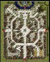

# Card Trade-In Mini Event (2008/07/29) ~ (2008/08/12)

> **Note:** Not implemented on iRO Classic.

## Overview

A 2 week mini-event in [Prontera](Prontera.md).

Talk to Putty (prontera, 115,90), who allows you to exchange any 1 normal (non-miniboss/[MVP](MVP.md)) card for 1 point.

| Points | Item |
| --- | --- |
| 100 | 1 Old Card Album |
| 50 | 20 Yggdrasilberry |
| 20 | 10 Blue Potion |
| 1 | 4 Honey |

---
**Categories:** [Temporary Event Quests](categories/Temporary_Event_Quests.md)
*Source: [iRO Wiki Classic](https://irowiki.org/classic/Card_Trade-In_Mini_Event_%282008/07/29%29_~_%282008/08/12%29) — GFDL 1.3+*
