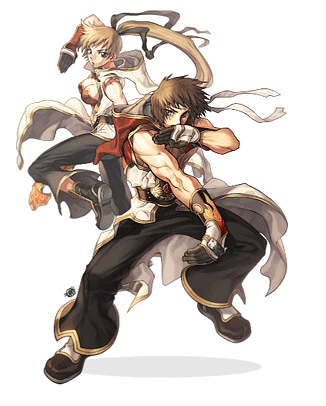

# Champion

<!-- Job info -->
- **Job base:** Monk
- **Job type:** 2-2 Transcendent
- **Changes at:** [Juno](Juno.md)
- **Skills:** 21
- **Skill points:** 194
- **Quest skills:** 3
- **STR:** 9
- **AGI:** 9
- **VIT:** 7
- **INT:** 7
- **DEX:** 10
- **LUK:** 3

## Overview

Though the force of his punches are feared far and wide, the [Monk](Monk.md) realizes that he has neglected something very important—his spirit remains unsatisfied. Thus his body and spirit are not yet in harmony. Through rigorous training and intense dedication, the [Monk](Monk.md) will finally tap into the strength of his entire being and become a Champion!

A **Champion** is the Transcendent variant of [Monk](Monk.md). Known for the one-hit skill, [Guillotine Fist](Guillotine_Fist.md). Champions are even deadlier in close range combat due to their boosted [SP](SP.md) count and [STR](Stats.md). Champions get mostly new combo-skills as their transcendental skills. Combo skills are mostly used for PvM but still can wreck havoc in [PvP](PvP~d29d2.md) if executed properly.

The most loved boost is probably the new skill [Zen](Zen.md) and the increase in [HP](Max_HP.md) and SP since [Guillotine Fist](Guillotine_Fist.md) relies on the [STR](Stats.md) and SP count of the caster. With 69 skill points to allocate, Champions can now have the most commonly used (PvP wise) skills maxed. Although the new skills are disappointing for those who are [PvP](PvP~d29d2.md) oriented, the 69 skill points to allocate makes up for it and makes them able to get all offensive spirit skills maxed **and** get [Snap](Snap.md) at the same time.

## Jobchange Guide

## Builds

Champions are a [STR](Stats.md)/[VIT](Stats.md)/[DEX](Stats.md) class thanks to gear that greatly outweighs the need for high [INT](Stats.md).  80 [VIT](Stats.md) is common for Champions that really want to focus on maximizing [DEX](Stats.md), but 90+ [VIT](Stats.md) is more viable due to all the sources of [Stun](Status_Effects.md) in WoE and PvP.  Once episode 12 is released on iRO Classic, [INT](Stats.md) will be a thing of the past thanks to Diabolus Robe and Diabolus Ring granting extremely high SP.  Any Champion still interested in [INT](Stats.md) is likely going to be using Orlean's Glove for [DEX](Stats.md).

## STR/DEX/VIT PVP/WoE

*  [STR](Stats.md): 100-110
*  [AGI](Stats.md): 1
*  [VIT](Stats.md): 90
*  [INT](Stats.md): 1-30
*  [DEX](Stats.md): 130-150
*  [LUK](Stats.md): 1

Weapons: Brave Battlefield Morning Star, [Berserk](Berserk.md)

A tanky [Monk](Monk.md) and Champion build suited for [WoE](War_of_Emperium.md) where [Dazzler](Dazzler.md) and [Meteor Storm](Meteor_Storm.md) are issues.  The main difference between a [WoE](War_of_Emperium.md) and a pure [PvP](PvP~d29d2.md) build is more VIT in order to account for Stun.  100 [STR](Stats.md) is the lowest a Champion should have, with reasonable means to hit 110.  This can be achieved with 2x Mantis Carded Ring\[1\]s, an Alice Doll, and the Brave Battlefield Morning Star.  The [STR](Stats.md) gear will allow you to easily kill [Swordsman](Swordman.md) classes, especially under the effect of [Gypsy's Kiss](Gypsy's_Kiss.md).

The [VIT](Stats.md) allows for easy [Snap](Snap.md)ping through precasts during [WoE](War_of_Emperium.md).  Utilizing the [Berserk](Berserk.md) will allow a Champion to further increase their [ASPD](ASPD.md), enabling even faster [Snap](Snap.md)ping.

A PvP-oriented Champ does not need different stats; rather, changing their gears to focus on DEX is all that is necessary.

Commonly used equipment
Headgear:
Feather Beret for damage reduction.
Alice Doll with an Incubus Card for increased damage.
Sunglasses \[1\] with either an Incubus Card for damage or a Nightmare Card for Sleep immunity.
Well-Chewed Pencil for Dexterity.
Ramen Hat for Dexterity.

Armor:
Medic's Robe with a DEX enchantment, carded with either a Marc Card or Evil Druid Card, depending on if the user is wearing the entire Battlegrounds set or not.
Valkryja's Shield carded with a Thara Frog Card.
Commander's Manteau carded with a Raydric Card or a Noxious Card
Morpheus' Shawl to increase the damage of [Guillotine Fist](Guillotine_Fist.md).
Combat Boots carded with a Verit Card or a Sohee Card. If the shoes are +9, a Firelock Soldier Card works well.  If using this, an Evil Druid Carded Medic's Robe is advised against, as the Ghost Property Proc from the Battlegrounds set will override your Freeze immunity.
 Variant Shoes are the preferred foot gear due to the 20% increase to HP and SP.

Accessories:
Glove\[1\] for [DEX](Stats.md).
Orlean's Glove for [DEX](Stats.md).
Ring\[1\] carded with a Mantis Card for [STR](Stats.md).

Accessory Cards:
Smokie Card for [Hiding](Hiding.md), which allows the player to dodge many forms of incoming damage, namely [Guillotine Fist](Guillotine_Fist.md).  It also makes it harder to focus fire the player with skills like [Acid Bomb](Acid_Bomb.md) and [Jupitel Thunder](Jupitel_Thunder.md).
Horong Card for [Sight](Sight.md).  While Champion's do learn [Ruwach](Ruwach.md), [Sight](Sight.md)'s superior range and lack of a proc animation make it a far better choice.  [Ruwach](Ruwach.md) just causes position lag and makes it difficult to use [Guillotine Fist](Guillotine_Fist.md) due to the short range.
Zerom Card for [DEX](Stats.md).  For use in a corresponding [DEX](Stats.md) increasing Accessory.

## STR/INT MVP

*  [STR](Stats.md): 120+ (As much as possible)
*  [AGI](Stats.md): 1
*  [VIT](Stats.md): 1-50 (up to you)
*  [INT](Stats.md): 50+ (up to you)
*  [DEX](Stats.md): 1-100 (up to you)
*  [LUK](Stats.md): 1

Weapons: [Card](Card_System.md)ed [Mace](Mace.md)

Made to exploit the [SP](SP.md) and [STR](Stats.md) of a Champion, this build's primary objective is damage only. Usually combined with [Lex Aeterna](Lex_Aeterna.md), [MVP](MVP.md)s with [HP](Max_HP.md) lower than 300-400k will kneel.

A Phen Card compounded clip or [Morpheus's Equip Set](Equipment_Sets.md) is a must for [MVP](MVP.md)ing with this build.

Choosing INT over DEX will ramp up the damage, but may not necessarily be better.  A Champ with 120 DEX dealing 200k per fist will outkill a Champ doing 300k per fist with 1 DEX, because they can cast so much faster.  It will also allow them to easily get first hit for loot priority.

## STR/AGI Combo

*  [STR](Stats.md): 100-120
*  [AGI](Stats.md): 80-100
*  [VIT](Stats.md): 20-50
*  [INT](Stats.md): 30-60
*  [DEX](Stats.md): 40-75
*  [LUK](Stats.md): 1

Weapons: [Knuckles](Knuckle.md)

Mostly made for solo leveling fun, this build's aim is not the [Guillotine Fist](Guillotine_Fist.md) damage, but the [ASPD](ASPD.md) and massive combo skill damages.

[AGI](Stats.md) and [STR](Stats.md) is prioritized for higher damage per second, [INT](Stats.md) is for [SP](SP.md) regen and count while [DEX](Stats.md) is for [Hit](Stats.md) or even [Guillotine Fist](Guillotine_Fist.md) cast time if one plans to have it.

Regardless of its [PvM](PvM~a1fb2.md) approach, this stat combination could also compete with the other builds and thus **Full Combo-Asura** builds are born which fuses the most damaging combo skills and [Guillotine Fist](Guillotine_Fist.md).

**Full Combo-Asura** builds are flashy due to their ability to chain almost all combos to [Guillotine Fist](Guillotine_Fist.md).

*See below for the combo possibilities.*

*  [Trifecta Blow](Raging_Trifecta_Blow.md) => [Quadruple Blow](Raging_Quadruple_Blow.md) => [Raging Thrust](Raging_Thrust.md) => [Guillotine Fist](Guillotine_Fist.md)
*  [Trifecta Blow](Raging_Trifecta_Blow.md) => [Quadruple Blow](Raging_Quadruple_Blow.md) => [Raging Thrust](Raging_Thrust.md) => [Chain Crush Combo](Chain_Crush_Combo.md)
*  [Trifecta Blow](Raging_Trifecta_Blow.md) => [Quadruple Blow](Raging_Quadruple_Blow.md) => [Raging Thrust](Raging_Thrust.md) => [Chain Crush Combo](Chain_Crush_Combo.md) => [Guillotine Fist](Guillotine_Fist.md)
*  [Trifecta Blow](Raging_Trifecta_Blow.md) => [Quadruple Blow](Raging_Quadruple_Blow.md) => [Raging Thrust](Raging_Thrust.md) => [Glacier Fist](Glacier_Fist.md) => [Chain Crush Combo](Chain_Crush_Combo.md)
*  [Trifecta Blow](Raging_Trifecta_Blow.md) => [Quadruple Blow](Raging_Quadruple_Blow.md) => [Raging Thrust](Raging_Thrust.md) => [Glacier Fist](Glacier_Fist.md) => [Chain Crush Combo](Chain_Crush_Combo.md) => [Glacier Fist](Glacier_Fist.md)
*  [Trifecta Blow](Raging_Trifecta_Blow.md) => [Quadruple Blow](Raging_Quadruple_Blow.md) => [Raging Thrust](Raging_Thrust.md) => [Glacier Fist](Glacier_Fist.md) => [Chain Crush Combo](Chain_Crush_Combo.md) => [Guillotine Fist](Guillotine_Fist.md)

## Equipment

For the most part, Champions utilize the same gear as their non-trans counterpart [Monk](Monk.md). A few notable (and expensive) exceptions to this are:

*  Variant Shoes
*  Diabolus Robe & Diabolus Ring
*  Nidhoggur's Shadow Garb

## Class Data

## Skills

*For more information about [Monk](Monk.md) skills, click [here](Monk.md).*

| Skill | Description | Levels | Type |
| --- | --- | --- | --- |
| [Raging Palm Strike](Raging_Palm_Strike.md) | While in the fury state, deals up to 700% atk and knocks target back 3 cells. | 5 | Offensive |
| [Glacier Fist](Glacier_Fist.md) | Deals up to 540% atk with a chance to immobilize target for 1 second. | 5 | Offensive |
| [Chain Crush Combo](Chain_Crush_Combo.md) | In the delay after [Glacier Fist](Glacier_Fist.md) or [Raging Thrust](Raging_Thrust.md), deal up to 1400% damage over 5 hits. | 10 | Offensive |
| [Zen](Zen.md) | Summon 5 Spirit Spheres at once. | 1 | Active |

## Job Bonuses

| Stat\Amount | +1 | +2 | +3 | +4 | +5 | +6 | +7 | +8 | +9 | +10 |
| --- | --- | --- | --- | --- | --- | --- | --- | --- | --- | --- |
| STR | 1 | 9 | 17 | 27 | 37 | 48 | 59 | 65 | 66 |   |
| AGI | 4 | 12 | 20 | 21 | 29 | 45 | 52 | 62 | 70 |   |
| VIT | 3 | 15 | 24 | 39 | 42 | 58 | 68 |   |   |   |
| INT | 2 | 11 | 33 | 47 | 56 | 64 | 69 |   |   |   |
| DEX | 6 | 16 | 22 | 30 | 38 | 44 | 50 | 53 | 60 | 67 |
| LUK | 13 | 34 | 46 |   |   |   |   |   |   |   |

## ASPD

## See Also

## External Links

*  [Jobinfo](http://iro.ragnarokonline.com/game/Jobchampion.asp) at the iRO Site
*  [Character Stat Calc](http://rode.doddlercon.com/db/calc/index.php) by Doddler
*  [Skilltree](http://web.hc.keio.ac.jp/~fk061999/himeyasha/skill3/chp.html) at Himeyasha's Skill Simulator
*  [Guillontine Fist Damage Calc](http://simn.de/asura/new/) by Simn (Asura damage against players in [PvP](PvP~d29d2.md) or [WoE](War_of_Emperium.md))

**Related pages:**

* [Monk](Monk.md)
* [Champion](Champion.md)
* [Skills](Skills.md)
* [Excruciating Palm](Excruciating_Palm.md)
* [Flee (Skill)](Flee_(Skill).md)
* [Fury](Fury.md)
* [Guillotine Fist](Guillotine_Fist.md)
* [Iron Fists](Iron_Fists.md)
* [Mental Strength](Mental_Strength.md)
* [Occult Impaction](Occult_Impaction.md)
* [Raging Quadruple Blow](Raging_Quadruple_Blow.md)
* [Raging Thrust](Raging_Thrust.md)
* [Raging Trifecta Blow](Raging_Trifecta_Blow.md)
* [Root](Root.md)
* [Snap](Snap.md)
* [Spiritual Bestowment](Spiritual_Bestowment.md)
* [Spiritual Cadence](Spiritual_Cadence.md)
* [Spiritual Sphere Absorption](Spiritual_Sphere_Absorption.md)
* [Summon Spirit Sphere](Summon_Spirit_Sphere.md)
* [Spirit Sphere](Spirit_Sphere.md)
* [Throw Spirit Sphere](Throw_Spirit_Sphere.md)
* [Chain Crush Combo](Chain_Crush_Combo.md)
* [Glacier Fist](Glacier_Fist.md)
* [Raging Palm Strike](Raging_Palm_Strike.md)
* [Zen](Zen.md)
* [Quests](Quests.md)
* [Monk Job Change Guide](Monk_Job_Change_Guide.md)
* [Monk Skill Quest](Monk_Skill_Quest.md)
* [Rebirth Walkthrough](Rebirth_Walkthrough.md)
* [Weapons](Weapons.md)
* [Mace](Mace.md)
* [Knuckle](Knuckle.md)

**Related pages:**

* [Classes](Classes.md)
* [Novice](Novice.md)
* [High Novice](High_Novice.md)
* [Super Novice](Super_Novice.md)
* [Acolyte](Acolyte.md)
* [Archer](Archer.md)
* [High First Class](High_First_Class.md)
* [Mage](Mage.md)
* [Merchant](Merchant.md)
* [Swordman](Swordman.md)
* [Thief](Thief.md)
* [Priest](Priest.md)
* [Monk](Monk.md)
* [Hunter](Hunter.md)
* [Bard](Bard.md)
* [Dancer](Dancer.md)
* [Wizard](Wizard.md)
* [Sage](Sage.md)
* [Blacksmith](Blacksmith.md)
* [Alchemist](Alchemist.md)
* [Knight](Knight.md)
* [Crusader](Crusader.md)
* [Assassin](Assassin.md)
* [Rogue](Rogue.md)
* [Transcendent](Transcendent.md)
* [High Priest](High_Priest.md)
* [Champion](Champion.md)
* [Sniper](Sniper.md)
* [Minstrel](Minstrel.md)
* [Gypsy](Gypsy.md)
* [High Wizard](High_Wizard.md)
* [Scholar](Scholar.md)
* [Mastersmith](Mastersmith.md)
* [Biochemist](Biochemist.md)
* [Lord Knight](Lord_Knight.md)
* [Paladin](Paladin.md)
* [Assassin Cross](Assassin_Cross.md)
* [Stalker](Stalker.md)
* [Gunslinger](Gunslinger.md)
* [Ninja](Ninja.md)
* [TaeKwon Kid](TaeKwon_Kid.md)
* [TaeKwon Master](TaeKwon_Master.md)
* [Soul Linker](Soul_Linker.md)

---
**Categories:** [Champion](categories/Champion.md), [Classes](categories/Classes.md)
*Source: [iRO Wiki Classic](https://irowiki.org/classic/Champion) — GFDL 1.3+*
