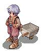
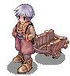
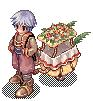
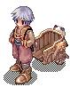
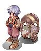

# Change Cart

<!-- Skill info -->
- **Class:** Merchant
- **Type:** Active
- **Levels:** 1
- **Quest:** Merchant Skill Quest#Change Cart Quest
- **SP cost:** 40

## Description

Change Cart enables [Merchant](Merchant.md) Class characters to change their [Pushcart](Pushcart.md)`s appearance. Higher leveled characters will have access to a greater variety of Pushcart looks. If the skill is cast before a Pushcart is equipped, the new Pushcart appearance becomes active once the Pushcart is equipped. When a Pushcart is removed and re-equipped, it will return to its default appearance.

| Unlock [Base Level](Levels.md) | Cart | Cart Image |
| --- | --- | --- |
| 1 | Default: Metal |  |
| 41 | Wooden Cart |  |
| 66 | Flower (Salad) Cart |  |
| 81 | Panda Cart |  |
| 91 | Ramen Cart |  |

**Related pages:**

* [Merchant](Merchant.md)
* [Skills](Skills.md)
* [Cart Revolution](Cart_Revolution.md)
* [Change Cart](Change_Cart.md)
* [Crazy Uproar](Crazy_Uproar.md)
* [Discount](Discount.md)
* [Enlarge Weight Limit](Enlarge_Weight_Limit.md)
* [Item Appraisal](Item_Appraisal.md)
* [Mammonite](Mammonite.md)
* [Overcharge](Overcharge.md)
* [Pushcart](Pushcart.md)
* [Vending](Vending.md)
* [Quests](Quests.md)
* [Merchant Job Change Guide](Merchant_Job_Change_Guide.md)
* [Merchant Skill Quest](Merchant_Skill_Quest.md)
* [Merchant Training Quest](Merchant_Training_Quest.md)
* [Weapons](Weapons.md)
* [Axe](Axe.md)
* [Dagger](Dagger.md)
* [Mace](Mace.md)
* [One Handed Sword](One_Handed_Sword.md)

---
**Categories:** [Active Skills](categories/Active_Skills.md), [Merchant](categories/Merchant.md), [Quest Skills](categories/Quest_Skills.md)
*Source: [iRO Wiki Classic](https://irowiki.org/classic/Change_Cart) — GFDL 1.3+*
