# Christmas Event (2007/12/18) ~ (2008/01/04)

> **Note:** Not implemented on iRO Classic.

<!-- Quest info -->
- **Item requirement:** 10 Candy Cane, 10 Well-baked Cookie
- **Item reward:** Santa's Bag, Santa Beard, Louise's Beauty Coupon

Christmas Decoration Snow, Carol in town:

[Alberta](Alberta.md), [Al De Baran](Al_De_Baran.md), [Geffen](Geffen.md), [Izlude](Izlude.md), [Prontera](Prontera.md), Prontera Church, [Lutie](Lutie.md), [Hugel](Hugel.md)

## Finding Yulia's Hat

1. Look for Examiner ([Prontera](Prontera.md) 47, 329) near the Knight's Chivalry in [Prontera](Prontera.md).

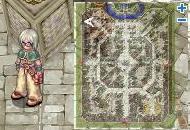

2. He is investigating a case, if player select to help him, the [NPC](NPC.md) will appoint players to go [Lutie](Lutie.md).

3. Look for Staff Igor (xmas 196, 245) in Lutie, near a big sleigh outside Santa's House. If one asks about the case, the NPC will reveal the location of another Staff, named Yorg.

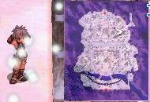

4. Look for Pack Staff Yorg inside Santa's house (xmas_in 92, 96). Say "Excuse me" and he will tell you that he saw ‘Some Shadows’ and he will reveal the location of Boris and Linus.

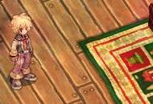

5. Proceed to meet Gen Staff Boris inside Toy Factory level 1 (xmas dun01 213, 83). Talk to him and he will request you to look for Linus (see next step).

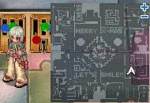

6. Continue the quest by visiting Div Staff Linus in Toy Factory level 1, east of the level 2 entrance portal (xmas dun01 152, 129).

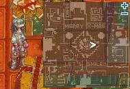

7. Complete the conversation with Linus and return to Boris. He will tell you about Yulia.

8. Look for Kid Yulia in Lutie, near south portal (xmas 143, 44).

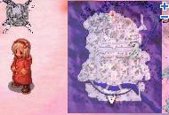

9. Players are required to bring 10 Candy Cane and 10 Well-baked Cookie for her.

10. Once she obtains the sweets, she will give the direction of the robber who stole her Hat and ran off to Toy Factory level 2. Direction could either be:

North

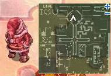

North-East

East

West

South-East. (players are advised to read the conversation carefully)

11. Proceed to the direction told by Yulia, and search for the robber (in xmas dun02). Talk to the Santa NPC and 3 Antonio will spawn. Defeat them all. Talk to the Santa again to obtain Yulia's hat (non-equippable Sunday Hat).

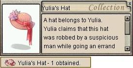

12. Bring the hat back to Yulia in [Lutie](Lutie.md) then proceed to [Prontera](Prontera.md) to close the case.

13. Talk to the Examiner and one will receive a single Santa's Bag.

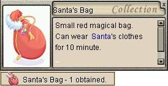

*  This quest is not repeatable.

## Case of the Bobbed Haircuts

Upon completion of Quest 1, talk to NPC Knight Examiner @ [Prontera](Prontera.md) (60, 342) to activate Quest 2.

1. Look for NPC Knight Examiner (prontera 60, 342).

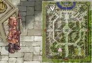

2. Listen to the conversation, proceed to the [Morroc](Morroc.md) Inn ([Morroc](Morroc.md) 199,64) and go upstairs to the right to hear Kage (morocc_in 116, 127).

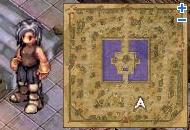

3. Return to Knight Examiner and he will request you to look for these NPCs in order:

a. Irine, near the [Prontera](Prontera.md) Item Shop ([Prontera](Prontera.md) 128, 212);

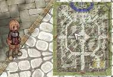

b. Ling, near the [Payon](Payon.md) middle sidewalk ([Payon](Payon.md) 139, 218);

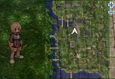

c. Lumi, west of the [Comodo](Comodo.md) [Kafra](Kafra.md) ([Comodo](Comodo.md) 144, 160);

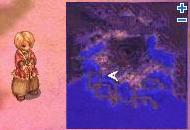

d. Lastly, find Ayuma east of the north portal in [Geffen](Geffen.md) ([Geffen](Geffen.md) 143, 196).

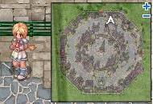

4. After listening to all four [NPC](NPC.md)s, return to Knight Examiner in [Prontera](Prontera.md) and he will ask you to look for Kage again.

5. Female characters will be ambushed as they approach Kage's room in the [Morroc](Morroc.md) Inn. Their hair will be cut short just like all the victims.

6. Talk to Kage, look at the conversation carefully as you would have to find the clue within it. *Tips: The answer of middle part is [Kafra Warps]

7. In this section Female characters will receive Louise's Beauty Coupon, and Male characters will need to go on to the next step.

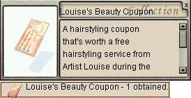

8. Return to Knight Examiner to end the quest. All characters will receive Santa Beard upon completion of the quest.

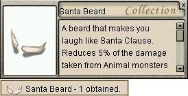

9. If a male character brings a flower for the NPC, he will be given Louise's Beauty Coupon. Note: 'Flower' can be purchased from Flower Girl NPC in Prontera.

*  This quest is not repeatable.

## Bonus Quest 1

*  Louise Kim in Santa's House of Lutie (xmas_in 89, 92)

Free hairstyling service, if players bring along the 'Louise's Beauty Coupon' from Quest 2.

## Bonus Quest 2

*  Santa Claus @ prontera 156 268

Santa Claus will ask players to deliver presents instead of him. You will be randomly assigned 1 from 5 locations. Equipping 'Santa Beard' is a necessary when you deliver presents to the children. Without the Santa Beard, the kids will step on your toes!

*  This quest is repeatable .

Related NPC location:

*  Silver @ [Lighthalzen](Lighthalzen.md) (141, 97)

*  Bathornby @ [Al De Baran](Al_De_Baran.md) (176, 145)

*  Bisun @ [Payon](Payon.md) (190, 222)

*  Neona @ [Comodo](Comodo.md) (241, 178)

*  Iddas @ [Lutie](Lutie.md) (172, 135)

Item Drops:

* Candy Cane x5

* Caviar Pancake

* Chocolate x3

* Chocolate Tart

* Cookie Bag

* Honey Pancake

* Jam Pancake

* Mushroom Pancake

* Old Navy Box

* Santa Bag

* Santa Hat

* Sour Cream Pancake

* Well Baked Cookie x5

* White Chocolate x2

The "Pancake" items appear identical to Royal Jelly except in appearance.

The item Old Navy Box drops two items when opened.

---
**Categories:** [Temporary Event Quests](categories/Temporary_Event_Quests.md)
*Source: [iRO Wiki Classic](https://irowiki.org/classic/Christmas_Event_%282007/12/18%29_~_%282008/01/04%29) — GFDL 1.3+*
