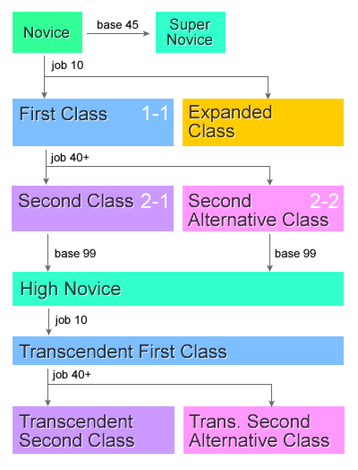

# Classes

| Column 1 | Column 2 |
| --- | --- |
| **Novice** | **Transcendent Novice** |
| [Novice](Novice.md) | [High Novice](High_Novice.md) |

| Column 1 | Column 2 | Column 3 | Column 4 | Column 5 | Column 6 | Column 7 |
| --- | --- | --- | --- | --- | --- | --- |
| **First Class** | **First Class** | **First Class** | **First Class** | **First Class** | **First Class** | **Transcendent First Class** |
| [Swordman](Swordman.md) | [Mage](Mage.md) | [Archer](Archer.md) | [Merchant](Merchant.md) | [Thief](Thief.md) | [Acolyte](Acolyte.md) | [High First Class](High_First_Class.md) |

| Column 1 | Column 2 | Column 3 | Column 4 | Column 5 |
| --- | --- | --- | --- | --- |
| **First Class** | **Second Class (2-1)** | **Second Class (2-2)** | **Transcendent Second Class (2-1)** | **Transcendent Second Class (2-2)** |
| Swordman | [Knight](Knight.md) | [Crusader](Crusader.md) | [Lord Knight](Lord_Knight.md) | [Paladin](Paladin.md) |
| Mage | [Wizard](Wizard.md) | [Sage](Sage.md) | [High Wizard](High_Wizard.md) | [Scholar](Scholar.md) |
| Archer | [Hunter](Hunter.md) | [Bard](Bard.md)/[Dancer](Dancer.md) | [Sniper](Sniper.md) | [Minstrel](Minstrel.md)/[Gypsy](Gypsy.md) |
| Merchant | [Blacksmith](Blacksmith.md) | [Alchemist](Alchemist.md) | [Mastersmith](Mastersmith.md) | [Biochemist](Biochemist.md) |
| Thief | [Assassin](Assassin.md) | [Rogue](Rogue.md) | [Assassin Cross](Assassin_Cross.md) | [Stalker](Stalker.md) |
| Acolyte | [Priest](Priest.md) | [Monk](Monk.md) | [High Priest](High_Priest.md) | [Champion](Champion.md) |

| Column 1 | Column 2 | Column 3 | Column 4 | Column 5 |
| --- | --- | --- | --- | --- |
| **Expanded Classes** | **Expanded Classes** | **Expanded Classes** | **Expanded Classes** | **Expanded Classes** |
| [TaeKwon Kid](TaeKwon_Kid.md) | [TaeKwon Kid](TaeKwon_Kid.md) | [Ninja](Ninja.md) | [Gunslinger](Gunslinger.md) | [Super Novice](Super_Novice.md) |
| [Soul Linker](Soul_Linker.md) | [TaeKwon Master](TaeKwon_Master.md) | [Ninja](Ninja.md) | [Gunslinger](Gunslinger.md) | [Super Novice](Super_Novice.md) |

## About Classes

In Ragnarok Online, a character's abilities and skills are defined by their class (also known as job). Characters start out as Novices, then once they reach job level 10 they can choose between a variety of first job classes. Once they then reach at least Job Level 40 they can then change to a second class job, either 2-1 or 2-2. Then after reaching Base Level 99 and Job Level 50 as a second class they can choose to transcend and start the process again, being rewarded with a more powerful, [Transcendent](Transcendent.md) character. Alternatively, from Novice, players can choose to become the ultimate Novice, the Super Novice, or explore one of the Expanded classes.

---
**Categories:** [Classes](categories/Classes.md), [General Information](categories/General_Information.md)
*Source: [iRO Wiki Classic](https://irowiki.org/classic/Classes) — GFDL 1.3+*
