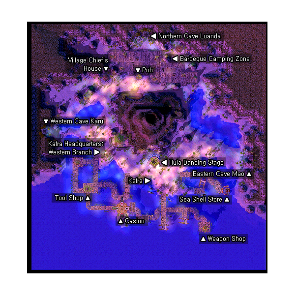

# Comodo

## About Comodo

Sitting in a cave, Comodo is home to the [Dancer](Dancer.md) and [Bard](Bard.md) guilds. It is the RO equivalent to Las Vegas, with gambling, colored lights, and partying everywhere.

## Story

South of [Prontera](Prontera.md), and past [Morroc](Morroc.md) further east in the desert exists a pleasant beach and the city Comodo. Comodo is famous for having all sorts of entertainment, certainly breaking the laws of the [Rune-Midgarts Kingdom](Rune-Midgarts_Kingdom.md). But because it is so far from the capital, Prontera, the laws are not enforced as strictly.

## Guide

## Structures

## Buildings

* 1 - Beach House (270,272)
* 2 - Casino (140,112), (125,98) and (154,97)
* 3 - Chief's House (115,290)
* 4 - Deck House #1 (145,327)
* 5 - Deck House #2 (193,294)
* 6 - Deck House #3 (237,297)
* 7 - Kafra Corp. Western Branch (129,194)
* 8 - Tool Shop (93,128)
* 9 - Weapon Shop (265,75)
* x - Dancer Stage '--- *has no entrance, only accessible through Bor Robin*

## Billboards

* Billboard (210,148) - Gives background information on Comodo

## NPCs

## Regulars

Guide - Native Kokomo (322,178)
Guide - Native Nutcoco (176,350)
Guide - Native Papaya (37,219)
  Show on minimap: Casino, Hula Dancing Stage, Weapon and Armor Shop, Tool Shop, Tourist Shop, Kafra Corp. Western Branch, Chief's House, Pub, Camp Ground
Kafra Employee (195,150)
  Save, Kafra storage (80z), Teleport service, Rent Cart, Reserve points
Missing NPCs
  Upgrading NPC, Level 1/2 metal NPC, Level 3/4 metal NPC, Repair NPC, Inn NPC, PVP NPCs

## Store NPCs

Souvenir Merchant (296,125)
  Clam Shell, Crab Shell
Armor Dealer (Weapon Shop)
  Cap, Helm, Buckler, Shield, Boots, Muffler, Manteau, Adventurer's Suit, Silk Robe, Mantle, Coat, Thief Clothes, Padded Armor, Chain Mail, Full Plate
Tool Dealer (Tool Shop)
  Iron Arrow, Red Potion, Orange Potion, Yellow Potion, White Potion, Concentration Potion, Awakening Potion, Berserk Potion, Fly Wing, Butterfly Wing, Magnifier, Trap
Weapon Dealer (Weapon Shop)
  Mandolin, Lute, Guitar, Rope, Whip, Wire Whip, Rante Whip, Javelin, Spear, Pike, Guisarme, Glaive, Partizan, Trident, Hallberd, Lance

## Trade NPCs

Hair Ornament Girl - (228,159)
  Cross Hat for 1 Rosary, 500 Destroyed Armor
  Bulb Band 1 Circlet[1], 20 Glass Bead for
  Stripe Hairband for 1500 Worn-out Prison Uniform
  Blue Hairband for 1 Bandana, 1 Cobaltblue Dyestuffs, 300 Anolian Skin
Kachua - (219,158)
  Random weapon for 1 3 Carat Diamond
  Random armor for 1 3 Carat Diamond
  Random garment for 1 3 Carat Diamond
  Random headgear for 1 3 Carat Diamond
  Random footgear for 1 3 Carat Diamond
  Random shield for 1 3 Carat Diamond
Meruntei - (237,217)
  Indian Headband for 1 Indian Fillet, 1 Striped Hairband, 10 PecoPeco Feather and 10,000z
Munak's Grandma (112,182)
  Her Heart for 1 Daenggie, 1 Girl's Diary
Old Man - Elder Creek (68,195)
  Old Blue Box for 50 Cyfar, 10 Brigan, 15 Clam Shell, 10 Crab Shell (Quest has been removed)
Traveler - Isac Mari (273,137)
  Mine Helmet for 1 Safety Helmet, 1 Candle, 1 Crystal Mirror, 25 Steel
  Parcel Hat for 150 Fabric, 100 Resin, 1 Cobaltblue Dyestuffs
  Grief for Greed for 1 Circlet[1], 1 Gold, 20 Steel, 80 Feather, 800 Sticky Mucus
  Opera Phantom Mask for 1 Opera Masque, 50 Horrendous Hair

## Quest NPCs

Bismarc (158,342)
  Part of [Blacksmith job change quest](Blacksmith_Job_Change_Guide.md)
Roaming Bard - Lalo (226,123)
  [Bard](Bard.md) job change NPC
Aile (Dancer Stage)
  [Dancer](Dancer.md) job change NPC
Bijou (Dancer Stage)
  Part of [Dancer job change quest](Dancer_Job_Change_Guide.md)

## Travel NPCs

Bor Robin (193,151)
  Dancer Stage - Free
[Kafra](Kafra.md) Employee (195,150)
  [Morroc](Morroc.md) - 1800z
  Pharos Lighthouse - 1200z
  [Umbala](Umbala.md) - 1800z

## Other NPCs

* BBQ Boy (213,310)
* BBQ Boy - Rinta (221,310)
* BBQ MAMA (215,307)
* BBQ PAPA (216,310)
* BBQ Visitor - Razy (218,309)
* Camp Ground Boy - Rochito (206,310)
* Camp Ground Boy - Rotute (209,314)
* Camping Maiden - Emralhandas (209,305)
* Camping Youth - Rockha (204,310)
* Devellin (204,148)
* Haith (171,137) --- *Buying the "information" costs 1,000z.*
* Hullaris (187,153)
* Kichiri (169,284)
* La Ed (170,137) --- *Buying the "information" costs 1,000z.*
* Magatu (163,280)
* Rakusa (164,291)
* Sonotora - Athena Sonotora (180,153)
* Suspicious Guy - Cain (210,154) --- *Buying his tip costs 500z.*
* TORUNA (88,97)
* Won (232,87)
* Chief - Tausupa (Chief's House)
* Deniroz (Casino)
* G. J (Casino)
* Iriya (Deck House 2)
* Kafra Employee - Kafra Misty (Kafra Corp. Western Branch)
* Loyar (Casino)
* Man - Royal Myst (Casino)
* Manzi (Casino)
* Martine (Casino)
* Moo (Casino)
* Niels (Deck House 2)
* Roberto (Casino)
* Scoursege (Casino)
* Shalone (Casino)
* Stonae (Casino)

**Related pages:**

* [Towns](Towns.md)
* [Rune-Midgarts Kingdom](Rune-Midgarts_Kingdom.md)
* [Alberta](Alberta.md)
* [Al De Baran](Al_De_Baran.md)
* [Archer Village](Archer_Village.md)
* [Comodo](Comodo.md)
* [Geffen](Geffen.md)
* [Izlude](Izlude.md)
* [Morroc](Morroc.md)
* [Payon](Payon.md)
* [Prontera](Prontera.md)
* [Umbala](Umbala.md)
* [Republic of Schwartzvald](Republic_of_Schwartzvald.md)
* [Einbech](Einbech.md)
* [Einbroch](Einbroch.md)
* [Hugel](Hugel.md)
* [Juno](Juno.md)
* [Lighthalzen](Lighthalzen.md)
* [Arunafeltz States](Arunafeltz_States.md)
* [Rachel](Rachel.md)
* [Veins](Veins.md)
* [Manuk](Manuk.md)
* [Amatsu](Amatsu.md)
* [Ayothaya](Ayothaya.md)
* [Kunlun](Kunlun.md)
* [Jawaii](Jawaii.md)
* [Louyang](Louyang.md)
* [Moscovia](Moscovia.md)
* [Nifflheim](Nifflheim.md)
* [Lutie](Lutie.md)

---
*Source: [iRO Wiki Classic](https://irowiki.org/classic/Comodo) — GFDL 1.3+*
