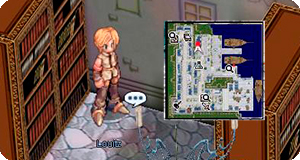
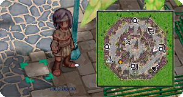
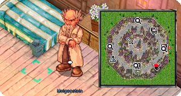

# Counteragent and Mixture Quest

<!-- Quest info -->
- **Level requirement:** N/A (None?)
- **Item requirement:** 1 Detrimindexta -OR- 1 Karvodailnirol, and 1 Alcohol, 1 Empty Bottle
- **Zeny requirement:** 3,000 -OR- 4,000 [Zeny](Zeny.md)
- **Item reward:** 1 Counteragent -OR- 1 Mixture (Repeatable)

1. With Detrimindexta, Karvodailnirol and Alcohol in the inventory, go to [Alberta](Alberta.md). Enter the Manor near the top of the map (12 o'clock), and head to the second floor. Speak to Louitz, found in the last room upstairs by the bookshelf. He will mention "Morgenstein".

2. Head to [Geffen](Geffen.md), and talk with Aure Dupon, located to the left of the east [Kafra](Kafra.md). He'll also refer to Morgenstein.

3. Enter the former [Blacksmith](Blacksmith.md) Guild and head upstairs. Talk to Morgenstein at the third floor. After talking twice, he will offer to make a Counteragent or Mixture.

**Related pages:**

* [Items](Items.md)
* [Armor](Armor.md)
* [Headgear](Headgears.md)
* [Weapons](Weapons.md)
* [Weapon Materials](Weapon_Materials.md)
* [Garments](Garments.md)
* [Footgear](Footgear.md)
* [Accessories](Accessories.md)
* [Equipment Sets](Equipment_Sets.md)
* [Skill Equipment](Skill_Equipment.md)
* [Cards](Card_System.md)
* [Card Reference](Card_Reference.md)
* [Card Sets](Card_Sets.md)
* [Item Mixing](Item_Mixing.md)
* [Juice Ingredients](Juice_Ingredients.md)
* [Potion Ingredients](Potion_Ingredients.md)
* [Dye Ingredients](Dye_Ingredients.md)
* [Tame Ingredients](Tame_Ingredients.md)
* [Headgear Ingredients](Headgear_Ingredients.md)
* [Headgear Quests](Headgear_Quests.md)
* [Pet Equipment](Pet_Equipment.md)
* [Counteragent and Mixture Quest](Counteragent_and_Mixture_Quest.md)
* [Quest Items](Quest_Items.md)
* [Healing Items](Healing_Items.md)
* [Autocast](Autocast.md)

---
**Categories:** [Item Mixing](categories/Item_Mixing.md)
*Source: [iRO Wiki Classic](https://irowiki.org/classic/Counteragent_and_Mixture_Quest) — GFDL 1.3+*
