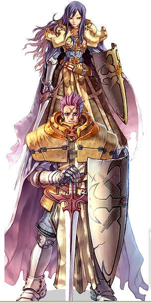

# Crusader

<!-- Job info -->
- **Job type:** 2-2
- **Job base:** Swordman
- **Changes at:** [Prontera](Prontera.md) Castle
- **Skills:** 18
- **Skill points:** 132
- **Quest skills:** 1
- **STR:** 7
- **AGI:** 2
- **VIT:** 7
- **INT:** 6
- **DEX:** 3
- **LUK:** 5

## Overview

Crusaders are a fine blend of physical strength and faith-driven magic prowess, making them a versatile class. They are capable of melee combat with a spear or a sword and shield, of playing a supportive role in parties with beneficial magic skills, and of sacrificing their health to wield powerful holy magic.

## Jobchange Guide

*See [Crusader Job Change Guide](Crusader_Job_Change_Guide.md) for detailed information.*

Changing into a Crusader from a [Swordman](Swordman.md) requires the player to complete a number of tasks:
*  Item Collection
*  Endurance Test
*  Written Test
*  Battle Test

After completing these tests, the player will be transformed into a Crusader. Most of this takes place inside of the [Prontera](Prontera.md) Castle.

## Builds

There are a few primary builds of Crusaders:
*  Grand Cross, which deals Holy magic damage to the enemy.
*  Sacrifice, which allows the crusader to take damage in place of an ally.
*  Shield, which deals ranged damage from afar.
*  Spear, which deals rapid melee damage at close range.

## [Grand Cross](Grand_Cross.md)

Stat Build

*  [STR](Stats.md): Low - Moderate
*  [AGI](Stats.md): None
*  [VIT](Stats.md): Low - Moderate
*  [INT](Stats.md): Very High
*  [DEX](Stats.md): Moderate - High
*  [LUK](Stats.md): None

Skill Build: (Job 42 Swordsman)

*  [Increase HP Recovery](Increase_HP_Recovery.md) 10
*  [Bash](Bash.md) 10
*  [Provoke](Provoke.md) 10
*  [Endure](Endure.md) 10
*  [Magnum Break](Magnum_Break.md) at least 1 (Cut a little in [Provoke](Provoke.md), as it's quite useful.)

(Crusader)

*  [Faith](Faith.md) 10
*  [Holy Cross](Holy_Cross.md) 6
*  [Grand Cross](Grand_Cross.md) 10
*  [Cure](Cure.md) 1
*  [Divine Protection](Divine_Protection.md) 3
*  [Demon Bane](Demon_Bane.md) 5
*  [Heal](Heal.md) 10
*  [Peco Peco Ride](Peco_Peco_Ride.md) 1
*  [Cavalier Mastery](Cavalier_Mastery.md) 3

[Grand Cross](Grand_Cross.md), which is often abbreviated [GC](Grand_Cross.md), is a skill that relies on both the Crusader's ATK and MATK to deal damamge to the enemy.
Just as Grand Cross relies both on ATK and MATK to deal damage, the damage from the ATK portion is reduced by the enemy's DEF, while the MATK portion is reduced by the enemy's MDEF.

*  **Strength** is important due to the fact that it adds damage to the skill and also increases carrying capacity. Strength gives a noticably smaller bonus to GC damage than Intelligence however.

*  **Vitality** is important due to the fact that GC Crusaders tend to mob enemies to level, however the HP casting cost of Grand Cross increases as max HP increases.

*  **Intelligence** is very important for a Grand Cross Crusader, and many players get 9x base intelligence, many even maxing it. There are a number of reasons for this:
  * It is the primary source of damage output
  * It provides needed SP Regeneration
  * It increases the effectiveness of [Heal](Heal.md)
  * It increases the effectiveness of SP Recovery Items

*  **Dexterity** is important to a Grand Cross Crusader because it controls the speed of the cast. Most GC Saders will balance both this and their strength after finishing their Intelligence. It is not uncommon for a player to have a build that is very high in both Intelligence and Dexterity, and have little points allocated elsewhere.

## [Shield](Shield_Boomerang.md)

Stat Build

*  [STR](Stats.md): High
*  [AGI](Stats.md): Low - Moderate
*  [VIT](Stats.md): High
*  [INT](Stats.md): Moderate
*  [DEX](Stats.md): None - Moderate
*  [LUK](Stats.md): None

Skill Build: (Job 43 - 50 Swordsman)

*  [Increase HP Recovery](Increase_HP_Recovery.md) 10
*  [Bash](Bash.md) 10
*  [Provoke](Provoke.md) 10
*  [Endure](Endure.md) 10
*  [Magnum Break](Magnum_Break.md) at least 1 (Cut a little in [Provoke](Provoke.md) or [Endure](Endure.md), as it's quite useful.)

(Crusader)

*  [Faith](Faith.md) 10
*  [Guard](Guard.md) 5
*  [Smite](Smite.md) 3
*  [Shield Boomerang](Shield_Boomerang.md) 5
*  [Shield Reflect](Shield_Reflect.md) 10
*  [Defending Aura](Defending_Aura.md) 5
*  [Peco Peco Ride](Peco_Peco_Ride.md) 1
*  [Cavalier Mastery](Cavalier_Mastery.md) 5

This will cause you to end up with 5 skill points remaining. Thoe skill points can be allocated into a higher level of guard if you find yourself needing to tank things or you like the skill, or you can max out [Smite](Smite.md) in order to stun people in WoE, and place the remaining points in either [Guard](Guard.md) or [Cure](Cure.md).

For a crusader that will level using a Soul-Link and [Shield Boomerang](Shield_Boomerang.md), it may be possible to forgo getting dexterity in favor of more agility or vitality, as [Shield Boomerang](Shield_Boomerang.md) never misses when under the influence of a Soul-Link.

[Magnum Break](Magnum_Break.md) is used as an AoE skill in WoE and PvP in conjunction with a weapon such as Sword Breaker or Mail Breaker to spread status or to knock people out of [Cloak](Cloaking.md). It is not generally used for damage purposes.

In order to gain the best DPS with a Soul-Link, 182 attack speed is the ideal. This has to do with the animation delay of the skill. Nothing more than 182 attack speed will help when using Linked Shield Boomerang.

## [Sacrifice](Sacrifice.md)/[VIT](Stats.md)/[WoE](War_of_Emperium.md)

Stat Build

*  [STR](Stats.md): Low - Moderate
*  [AGI](Stats.md): Low - Moderate
*  [VIT](Stats.md): High - Maximum
*  [INT](Stats.md): Low - Moderate
*  [DEX](Stats.md): High - Maximum
*  [LUK](Stats.md): None

Skill Build (Job 46 - 50 Swordsman)

*  [Increase HP Recovery](Increase_HP_Recovery.md) 10
*  [Bash](Bash.md) 10
*  [Provoke](Provoke.md) 10
*  [Endure](Endure.md) 10
*  [Magnum Break](Magnum_Break.md) 1

(Crusader)

*  [Faith](Faith.md) 10
*  [Holy Cross](Holy_Cross.md) 6
*  [Grand Cross](Grand_Cross.md) 4
*  [Guard](Guard.md) 10
*  [Smite](Smite.md) 3
*  [Shield Boomerang](Shield_Boomerang.md) 3
*  [Shield Reflect](Shield_Reflect.md) 8
*  [Sacrifice](Sacrifice.md) 5

This build is generally reliant on parties for leveling, as they typically have low strength and intelligence. This is not a soloing character, however it is probably the most useful of all of the crusader builds for WoE. It utilizes high vitality and high dexterity to quickly cast [Sacrifice](Sacrifice.md) on any characters that would make good use of more HP or an uninterruptable cast time.

## [Agility Spear Crusader](Spear_Quicken.md)

Stat Build

*  [STR](Stats.md): Moderate - High
*  [AGI](Stats.md): High - Maximum
*  [INT](Stats.md): Low - Moderate
*  [VIT](Stats.md): Low - Moderate
*  [DEX](Stats.md): Low - Moderate
*  [LUK](Stats.md): Low

Skill Build (Job 42 Swordsman)

*  [Increase HP Recovery](Increase_HP_Recovery.md) 10
*  [Bash](Bash.md) 10
*  [Provoke](Provoke.md) 10
*  [Endure](Endure.md) 10
*  [Magnum Break](Magnum_Break.md) 1

(Crusader with unused skill points)
*   [Faith](Faith.md) 10
*   [Holy Cross](Holy_Cross.md) 10
*   [Spear Mastery](Spear_Mastery.md) 10
*   [Spear Quicken](Spear_Quicken.md) 10
*   [Peco Peco Ride](Peco_Peco_Ride.md) 1
*   [Cavalier Mastery](Cavalier_Mastery.md) 5

Some builds will occasionally forsake the PecoPeco Riding and Holy Cross skills in order to get a high level of Heal.

This build emphasizes doing powerful normal attacks at a rapid rate. Leveling spots include places such as Byalan Island and Ice Dungeon, as well as any map that standard melee characters level at. The class plays similar to the more familiar Agility Knight.

## Equipment

| Grand Cross: | Shield: |
| --- | --- |
| Upper: | Upper: |
| Helm \[1\] | Helm \[1\] |
| Beret | Beret |
| Feather Beret | Feather Beret |
| Dress Hat \[1\] | Dress Hat \[1\] |
| Cute Ribbon | Alice Doll \[1\] |
| Grand Circlet | - |
| Mid: | Mid: |
| Robo Eye | Robo Eye |
| Sunglasses \[1\] | Sunglasses \[1\] |
| Fin Helm | Fin Helm |
| - | Masquerade |
| Lower: | Lower |
| Evolved Pipe | Evolved Pipe |
| Iron Cain | Iron Cain |
| Pirate Dagger | - |
| Armor: | Armor: |
| Glittering Jacket \[1\] | Glittering Jacket \[1\] |
| Formal Suit | Formal Suit |
| Odin's Blessing | Odin's Blessing |
| Weapon: | Weapon: |
| Haedonggum \[2\] | Blade \[4\] |
| Flamberge \[2\] | Main Gauche \[4\] |
| Tsurugi \[2\] | Mailbreaker |
| - | Swordbreaker |
| Shield: | Shield: |
| [Shield \[1\]](Shield.md) | Cross Shield \[1\] |
| Sacred Mission \[1\] | Stone Buckler \[1\] |
| Stone Buckler \[1\] | - |

| Useful GC Cards: | Useful Shield Cards: |
| --- | --- |
| Headgear: | Headgear: |
| Elder Willow Card | Cramp |
| Isilla Card | Vanberk Card |
| Incubus Card | Incubus Card |
| Willow Card | Willow Card |
| Permeter Card | Permeter Card |
| Armor: | Armor: |
| Angeling Card | Mineral Card |
| Archdam Card | Archdam Card |
| Marc Card | Marc Card |
| Porcellio Card | Pasana Card |
| - | Dokebi Card |
| - | Swordfish Card |
| - | Roda Frog Card |
| Weapon: | Weapon: |
| Andre Card | Anacondaq Card |
| Wolf Card | Hydra Card |
| Zipper Bear Card | Orc Lady Card |
| Zenorc Card | Vadon Card |
| Shield: | Shield: |
| Thara Frog Card | Thara Frog Card |
| - | Tamruan Card |
| Garment: | Garment: |
| Raydric Card | Raydric Card |
| Accessory: | Accessory: |
| Heater Card | Heater Card |
| Zerom Card | Mantis Card |
| - | Tarou Card |

## Class Data

## Skills

*See [Swordsman Skills](Swordman.md) for first class skills.*

| Skill | Description | Levels | Type |
| --- | --- | --- | --- |
| [Cavalier Mastery](Cavalier_Mastery.md) | Reduces the 50% [ASPD](ASPD.md) penalty when riding a PecoPeco. | 5 | Passive |
| [Cure](Cure.md) | Cures the target from [Silence](Status_Effects.md), [Chaos](Status_Effects.md) and [Blind](Status_Effects.md) status effects. | 1 | Supportive |
| [Defending Aura](Defending_Aura.md) | Reduce incoming ranged damage; protects [Party](Party.md) members via [Sacrifice](Sacrifice.md). | 5 | Supportive |
| [Demon Bane](Demon_Bane.md) | Increases attack against against [Demon](Demon.md)s and [Undead](Undead.md) monsters by up to 30. | 10 | Passive |
| [Divine Protection](Divine_Protection.md) | Increases VIT defense against [Demon](Demon.md)s and [Undead](Undead.md) monsters by up to 30. | 10 | Passive |
| [Faith](Faith.md) | Increases Max HP and resistance to Holy-property attacks. | 10 | Passive |
| [Grand Cross](Grand_Cross.md) | Summons a Grand Cross around the caster, damaging the caster and enemies with [Holy](Holy.md) property waves. | 10 | Offensive |
| [Guard](Guard.md) | Blocks physical attacks with a Shield by chance for 300 seconds. | 10 | Supportive |
| [Heal](Heal.md) | Restore a target's [HP](Max_HP.md), or damage [Undead](Undead.md) targets. | 10 | Supportive |
| [Holy Cross](Holy_Cross.md) | Summon a holy cross that inflicts [Holy](Holy.md) damage on a target, blinding it by chance. | 10 | Offensive |
| [Peco Peco Ride](Peco_Peco_Ride.md) | Enables [Knight](Knight.md)s or Crusaders to ride a Peco Peco. | 1 | Passive |
| [Resistant Souls](Resistant_Souls.md) | Temporarily increase resistance against [Demon](Demon.md) race and [Holy](Holy.md) property attacks. | 5 | Supportive |
| [Sacrifice](Sacrifice.md) | Protects a [Party](Party.md) member by taking all of the damage inflicted on said party member. | 5 | Supportive |
| [Shield Boomerang](Shield_Boomerang.md) | Throw your shield at an enemy, dealing damage based on ATK and the shield's properties. | 5 | Offensive |
| [Shield Reflect](Shield_Reflect.md) | Reflect a fraction of the damage received back at an enemy. | 10 | Supportive |
| [Smite](Smite.md) | Hurl your shield at an enemy, dealing damage based on ATK and knocking them back. | 5 | Offensive |
| [Spear Mastery](Spear_Mastery.md) | Adds +4 [ATK](Stats.md) (+5 while on a PecoPeco) per skill level to Spear weapons. | 10 | Passive |
| [Spear Quicken](Spear_Quicken.md) | Temporarily increase [Attack Speed](ASPD.md) when using a Two-Handed Spear. | 10 | Supportive |

## Quest Skills

| Skill | Description | Levels | Type | Job Level Requirement | Quest |
| --- | --- | --- | --- | --- | --- |
| [Shrink](Shrink.md) | Adds a chance to knock back opponents when you successfully block an attack with Guard. | 1 | Active | None | [Shrink Quest](Crusader_Skill_Quest.md) |

## Soul Link

*See [Crusader Spirit](Crusader_Spirit.md).*

## Job Bonuses

| Stat Bonus | +1 | +2 | +3 | +4 | +5 | +6 | +7 | +8 | +9 | +10 | +11 | +12 |
| --- | --- | --- | --- | --- | --- | --- | --- | --- | --- | --- | --- | --- |
| STR | 7 | 11 | 17 | 23 | 25 | 32 | 48 | - | - | - | - | - |
| AGI | 30 | 36 | - | - | - | - | - | - | - | - | - | - |
| VIT | 12 | 15 | 22 | 40 | 41 | 46 | 50 | - | - | - | - | - |
| INT | 9 | 20 | 21 | 35 | 38 | 44 | - | - | - | - | - | - |
| DEX | 14 | 28 | 34 | - | - | - | - | - | - | - | - | - |
| LUK | 1 | 2 | 3 | 4 | 5 | - | - | - | - | - | - | - |

## ASPD

## See Also

*  [Crusader Leveling](Crusader_Leveling.md)

## External Links

*  [GC Damage Calculator](http://jetlogs.org/sandbox/gc.php) - compares base Grand Cross damage amongst different weapons

**Related pages:**

* [Crusader](Crusader.md)
* [Paladin](Paladin.md)
* [Skills](Skills.md)
* [Cavalier Mastery](Cavalier_Mastery.md)
* [Cure](Cure.md)
* [Defending Aura](Defending_Aura.md)
* [Demon Bane](Demon_Bane.md)
* [Divine Protection](Divine_Protection.md)
* [Faith](Faith.md)
* [Grand Cross](Grand_Cross.md)
* [Guard](Guard.md)
* [Heal](Heal.md)
* [Holy Cross](Holy_Cross.md)
* [Peco Peco Ride](Peco_Peco_Ride.md)
* [Resistant Souls](Resistant_Souls.md)
* [Sacrifice](Sacrifice.md)
* [Shield Boomerang](Shield_Boomerang.md)
* [Shrink](Shrink.md)
* [Smite](Smite.md)
* [Spear Mastery](Spear_Mastery.md)
* [Spear Quicken](Spear_Quicken.md)
* [Battle Chant](Battle_Chant.md)
* [Gloria Domini](Gloria_Domini.md)
* [Martyr's Reckoning](Martyr's_Reckoning.md)
* [Rapid Smiting](Rapid_Smiting.md)
* [Quests](Quests.md)
* [Crusader Job Change Guide](Crusader_Job_Change_Guide.md)
* [Crusader Skill Quest](Crusader_Skill_Quest.md)
* [Rebirth Walkthrough](Rebirth_Walkthrough.md)
* [Weapons](Weapons.md)
* [One Handed Sword](One_Handed_Sword.md)
* [Spear](Spear.md)
* [Two Handed Sword](Two_Handed_Sword.md)

**Related pages:**

* [Classes](Classes.md)
* [Novice](Novice.md)
* [High Novice](High_Novice.md)
* [Super Novice](Super_Novice.md)
* [Acolyte](Acolyte.md)
* [Archer](Archer.md)
* [High First Class](High_First_Class.md)
* [Mage](Mage.md)
* [Merchant](Merchant.md)
* [Swordman](Swordman.md)
* [Thief](Thief.md)
* [Priest](Priest.md)
* [Monk](Monk.md)
* [Hunter](Hunter.md)
* [Bard](Bard.md)
* [Dancer](Dancer.md)
* [Wizard](Wizard.md)
* [Sage](Sage.md)
* [Blacksmith](Blacksmith.md)
* [Alchemist](Alchemist.md)
* [Knight](Knight.md)
* [Crusader](Crusader.md)
* [Assassin](Assassin.md)
* [Rogue](Rogue.md)
* [Transcendent](Transcendent.md)
* [High Priest](High_Priest.md)
* [Champion](Champion.md)
* [Sniper](Sniper.md)
* [Minstrel](Minstrel.md)
* [Gypsy](Gypsy.md)
* [High Wizard](High_Wizard.md)
* [Scholar](Scholar.md)
* [Mastersmith](Mastersmith.md)
* [Biochemist](Biochemist.md)
* [Lord Knight](Lord_Knight.md)
* [Paladin](Paladin.md)
* [Assassin Cross](Assassin_Cross.md)
* [Stalker](Stalker.md)
* [Gunslinger](Gunslinger.md)
* [Ninja](Ninja.md)
* [TaeKwon Kid](TaeKwon_Kid.md)
* [TaeKwon Master](TaeKwon_Master.md)
* [Soul Linker](Soul_Linker.md)

---
**Categories:** [Classes](categories/Classes.md), [Crusader](categories/Crusader.md)
*Source: [iRO Wiki Classic](https://irowiki.org/classic/Crusader) — GFDL 1.3+*
