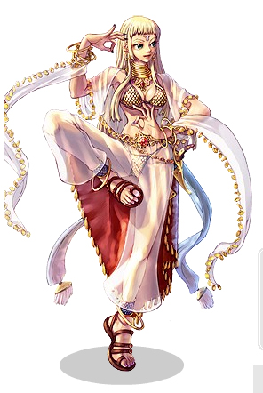

# Dancer

<!-- Job info -->
- **Job name:** Dancer
- **Job base:** Archer
- **Job type:** 2-2
- **Changes at:** [Comodo](Comodo.md)
- **Skills:** 18
- **Skill points:** 91
- **Quest skills:** 1
- **STR:** 2
- **AGI:** 7
- **VIT:** 3
- **INT:** 5
- **DEX:** 5
- **LUK:** 8

## Overview

Rhythm and balance are qualities cultivated by all [Archer](Archer.md)s, however, only the truly talented are allowed to learn the secret steps of the Dancers. These scantily clad seductresses gain the power to influence the minds of allies and enemies alike.

It is said that time [slows down](Slow_Grace.md) when a Dancer starts to move her hips to the sound of some mysterious tune; that those watching may [lose control](Charming_Wink.md) of their bodies and find their magic reserves either [greatly improved](Gypsy's_Kiss.md) or [gone altogether](Hip_Shaker.md). Where their male counterparts, the [Bard](Bard.md)s, are more bent on support, Dancers specialize at disruptive maneuvers, which make them an invaluable asset in the War of Emperium.

Supporting with a Bard or Dancer requires a different approach than other classes. Music-based buffs are mostly percentual values, as opposed to the absolute values of [Priest](Priest.md) buffs, and require careful strategy and positioning, but playing as an [Archer](Archer.md) should already provide some experience in this respect. Despite their supportive role, one should not forget that Dancers are also capable of dealing good quantities of damage, one of their main advantages over [Huntresses](Hunter.md) is their immense SP pool which allows them to continually use [Double Strafe](Double_Strafe.md) instead of normal attacks, ensuring decent damage output.

To understand how to build a [Bard](Bard.md) or Dancer, knowledge of all their skills is needed. Dancer and [Bard](Bard.md) skills are, in comparison to other classes, very stat dependent. In general, there are 2 types of skills for both a Dancer and a [Bard](Bard.md); skills which can be sung or danced without a partner of the opposite gender and those where the player needs another [Bard](Bard.md) or Dancer respectively.

As a Dancer, only whips, daggers and bows are available for weapons, whereas Bards can use instruments instead of whips.

*  When armed with a [Whip](Whip.md):
  * Bow skills ([Double Strafe](Double_Strafe.md), [Arrow Shower](Arrow_Shower.md), [Arrow Repel](Arrow_Repel.md)) cannot be used
  * [Performance Skills](categories/Performance_Skills.md), as well as [Amp](Amp.md) and [Encore](Encore.md) are available
  * Whip skills ([Slinging Arrow](Slinging_Arrow.md), [Arrow Vulcan](Arrow_Vulcan.md)) can be used
  * Whip damage depends on the Dancer's [Dex](Stats.md), NOT [Str](Stats.md). Just like it does for [bows](Bow.md)
[Unbarring Octave](Unbarring_Octave.md), [Dazzler](Dazzler.md), [Pang Voice](Pang_Voice.md) and [Charming Wink](Charming_Wink.md) are usable regardless of weapons.

## Jobchange Guide

*See [Dancer Job Change Guide](Dancer_Job_Change_Guide.md) for detailed information.*

Changing into a Dancer from an [Archer](Archer.md) requires the player to complete a number of tasks:
*  Item Collection
*  Written Test
*  Dance Test

After completing these tests, the player will be transformed into a Dancer. This takes place in [Comodo](Comodo.md).

## Builds

## PvM

*  STR: 1
*  AGI: 80-99
*  VIT: 1
*  INT: 9-53
*  DEX: 99
*  LUK: 1

[PvM](PvM~a1fb2.md) builds of a Dancer echo the [DEX](Stats.md)/[AGI](Stats.md) [Hunter](Hunter.md) build. However, decreasing Agi in order to increase [INT](Stats.md) will allow you to [Double Strafe](Double_Strafe.md) more often as well as regenerate SP faster than a Hunter with the same stat build.

## WoE

[WoE](War_of_Emperium.md) Builds don't need high [DEX](Stats.md), but you may want to speed up your path to [Gypsy](Gypsy.md) with having the ability to gain levels on your own. The other 2 stats that are needed are [INT](Stats.md) and [VIT](Stats.md). [INT](Stats.md) allows the skill [Dazzler](Dazzler.md) to be used more due to increased total [SP](SP.md) of the dancer, while [VIT](Stats.md) gives more [HP](Max_HP.md) allowing the dancer to survive longer as well as less chance to get stunned plus a higher pot efficiency. Both are needed, and should be planned according to a specific skill build selected.
This means if you plan to be the main Dancer for [Classical Pluck](Classical_Pluck.md) then get high [VIT](Stats.md). If you will use [Dazzler](Dazzler.md) and [Slow Grace](Slow_Grace.md) quite often then get more [INT](Stats.md) or even [DEX](Stats.md) to increase [Slow Grace](Slow_Grace.md)'s effect.

## Tactics

Hotkey a dagger and whip or 2 of same whip to stop and change songs fast instead of waiting for Amp.

## Equipment

This is no where close to a complete list of equipment that is required or suggested. This list is not based around any mini boss or MvP drops.

## Upper Headgear

Besides the "kawaii" headgear you have taking up almost all of your storage, these are some of the basics that are suggested to have for a Dancer.

*  Ramen Hat (+4 Dex) (Kafra Shop item) - Suggested for PvM but not WoE/PvP.
*  Apple of Archer (+3 Dex) - Suggested for PvM but not WoE/PvP.
*  Wise Headgear [1] (+80 SP) (Willow Card) - More SP to use skills and increase overall SP regeneration.
*  Erudite Headgear [1] (+2 Int) - More Int for SP regeneration or to increase effect of [Gypsy's Kiss](Gypsy's_Kiss.md).
*  Peerless Headgear [1] (Immune to [Silence](Status_Effects.md)) - An option to prevent people from silencing you if you don't want to carry Green Potions, but involves giving up better headgear options.
*  Poo Poo Hat (10% decrease from demi-human attacks) - Use for WoE.
*  Beret (10% decrease from demi-human attacks) - Use for WoE/PvP.
*  Feather Beret (+1 MDEF and 10% decrease from demi-human attacks) - Use for WoE/PvP.

## Middle Headgear

Some of these headgear take up both the middle and lower slots.

*  Opera Masque (+1 Def) - If you're not using a Binocular, you might as well use some DEF to decrease the physical damage you recieve.
*  Binoculars (+1 Dex) - A headgear that can be used to replace tights if applicable.
*  Robo Eyes (+1 Dex, +2% damage) - The Kafra Shop replacement for Binoculars.
*  Masquerade (3% more damage against demi-humans)
*  Evolved Ribbons (+5 Flee) - Extra flee to help Agi/Dex Dancers flee monsters.
*  Alarm Mask (+2 Def) - If you're not using a Binocular, you might as well use some DEF to decrease the physical damage you recieve.
*  Red Glasses (+5 MDEF) - Great to use to add to your MDEF if you're about to rush a precast in WoE.

## Lower Headgear

* Evolved Pipe (+1 Vit and reduces damage from Brute class monsters by 5%) - More vit to try and gain [Stun](Status_Effects.md) and [Silence](Status_Effects.md) immunity and less damage from Brute class monsters when leveling.
* Gangster Mask (15% resistance to Silence) - Helpful if you're not immune to silence using a Marduk Card or having 100 total vit.

## Armor

The primary armor for Dancers is Tights [1], but they can also wear general purpose armors such as Mantle [1], Coat [1], or Formal Suit [1]. Tights are suggested because of their +1 Dex, but can be replaced with other armors that Dancers can wear if needed. A Pantie can also be used as a cheap armor that can be used in combination with the Undershirt garment as a PvM gear, but serves little purpose in PvP/WoE asides from gaining extra [ASPD](ASPD.md). Panties can be slotted using the Socket Enchant System.

Useful armor cards for a Dancer include:
*  Pupa Card - +700 HP, an ideal card for Agi/Dex Dancers who need the extra HP to survive longer.
*  Peco Peco Card - +10% HP, a more effective card then the Pupa for characters with over 7,000 HP.
*  Marc Card - Grants immunity to the [Frozen](Status_Effects.md) status, making it a staple card in PvP/WoE.

There are other specific armor cards out there that are beneficial (or sometimes not beneficial depending on the situation) such as those that change the element of the player (Swordfish Card, Dokebi Card, Pasana Card, etc) and those that cause status effects to your enemies under certain conditions (Dark Frame Card, Demon Fungus Card, Brilight Card, etc.)

## Garment

Mufflers are suggested because they are easily obtainable. Other options include:
*  Heavenly Maiden's Robe [1] - 1 more DEF than Mufflers.
*  Undershirt - Combined with the Pantie armor, this makes a cheap alternative to expensive +Flee garments for PvM. Undershirts can also be slotted using the Socket Enchant System.
*  Vali's Manteu - A cheaper but slightly less effective alternative to a Raydric Card.

Useful garment cards for a Dancer include:
*  Whisper Card - This card gives +20 Flee, making it a useful leveling card for Agi/Dex Dancers.
*  Dragon Tail Card - This card gives +10 Flee and +5% damage with Double Strafe and Arrow Shower. This card can be useful for trying to reach the amount of damage needed to one or two-shot monsters using Double Strafe.
*  Raydric Card - The 20% neutral property resistance makes this card a great general purpose card for non-Flee characters, especially in PvM. It can also be useful in PvP/WoE, but not without its pros and cons.
*  Noxious Card - A specialized PvP/WoE card that gives 10% neutral property resistance and 10% long range damage resistance, though it may be worth considering holding off on this card until becoming a Gypsy and using a Valkyrian Manteau for it. Noxious is strong because it can help against attacks that aren't neutral element, including magic.

There are other specific garments out there that are beneficial such as those that give resistance to certain elements (Jakk Card, Marse Card, etc).

## Footgear

Boots are suggested because they're the footgear with the highest defense that Dancers can wear.

*  +9 Superior Footgear [1] (Firelock Soldier Card) (+2 Str and, if upgraded to +9, 10% more HP and SP) - More HP to live longer and more SP to use skills and increase overall SP regeneration.
*  Green Footgear [1] (Martyr Card) (+1 Agi and 10% more HP) - More HP to live longer and +1 Agi for Agi/Dex Dancers.
*  Soul-Enchanted Footgear [1] (Sohee Card) (15% more SP and increase SP recovery by 3%) - More SP to use skills and increase overall SP regeneration.

The above three footgear can be substituted for other footgear such as those that gives the player more experience for killing a certain race of monsters (Am Mut Card, Mini Demon Card, etc.)

## Accessory

*  Nimble Glove [1] (+4 Dex) (90+ base level) or Nimble Clip [1] (+3 Dex) (no level restriction) (both are Zerom Cards) - Suggested to gain more dex for leveling or even for PvP/WoE.
*  Earring (+2 Int) - More Int for SP regeneration.
*  Rosary of Four Leaf Clover - (+3 MDEF, +1 Luk) (5% less damage from long ranged physical attacks) (Alligator Card) - Ideal for WoE/PvP because of the MDEF and the decrease from long ranged physical attacks.

## Shield

Unlike [Hunters](Hunter.md), Dancers can wear bucklers with one-handed weapons.

*  Guard [1] - A general purpose shield for if you plan to share your shields with [Mage](Mage.md)-class characters.
*  Buckler [1] - A shield which is slightly better then a Guard, but not as flexible between classes.
*  Valkyrja's Shield [1] - This shield has some of the best stats for an all-class shield and is often preferred for WoE because of its elemental resistances and MDEF.

If the player plans to take part in PvP/WoE, they should look into obtaining a Thara Frog Card, as the 30% damage reduction makes a huge difference. There are other specific shield cards that can be beneficial to a Dancer as well, for reducing damage from monters (Penomena Card, Flame Skull Card, Teddy Bear Card, etc.)

## Weapon

Dancers are allowed to use shields with [Whip](Whip.md)s. However they are not allowed to used shields with [Bow](Bow.md)s as bows take up both the right and left hand slots.

*  Rope [4] - The basic 4-slotted whip for Dancers.
  * Double Bloody Double Boned Rope [4] (2x Hydra Card, 2x Skeleton Worker Card) - Can be used for leveling at Bathories or even used to attack players in PvP/WoE. Note that this weapon has been outdated by the newer [Battlegrounds](Battlegrounds.md) weapons.
  * Solid Triple Vital Rope [4] (Golem Card, 3x Fabre Card) - Suggested for a Dancer dancing [Classical Pluck](Classical_Pluck.md) with a [Bard](Bard.md) in order to avoid from letting players break your whip and to increase your vit and your HP by 300.
  * Quadruple [Status Effect](Status_Effects.md) Rope [4] (any status effect card; Marina Card, Savage Bebe Card, Plankton Card, Magnolia Card, etc.) Sling Arrow can still be used during performance skills, so it's possible to try to inflict status effects on enemies while performing using a weapon like this.
*  Composite Bow [4] - The bow which is used for maximum damage with Double Strafe for leveling. Double Double card combinations offer the best damage, but suffer the drawback of working on only a select few monsters. They can also be carded with four status effect cards for inflicting status effects from a distance.
*  Gakkung Bow [2] - Is a cheaper alternative to the Composite Bow that can be good for making more general-purpose bows, as it only requires two cards, but has the drawback of dealing less damage then a specialized Composite Bow.
*  Arbalest [2] and Luna Bow [2] can also be used similar to the Gakkung Bow.

## Arrows

* PvM: Be prepared for any element that may be present on the map you choose to farm/MvP/level on.

* PvP/WoE: Obtaining status arrows depends on how much zeny you have, how much zeny you are willing to spend if it comes to that point, what items you have access to, and what you plan to do in PvP/WoE.

  * [Stun](Status_Effects.md) and [Silence](Status_Effects.md) (known in-game as Mute Arrows) Arrows/Bows work well against Casters such as the [Wizard](Wizard.md) Class and the [Sage](Sage.md) Class (excluding full support build Sages/Scholars) as they do enough VIT to become immune. As a Dancer, these arrows don't serve as much purpose since Dazzler can be used to inflict Stun to more targets at once, and is more reliable then Silence which can be cured with a simple Green Potion.

  * [Curse](Status_Effects.md)d Arrows/bows work well against players since it greatly lowers their walking speed. These arrows and bows work well against low-VIT support characters by preventing them from escaping from your allies, and can also hinder mid-VIT characters. Against high-VIT characters, who you're likely to run into a lot of during WoE, Slow Grace is a guaranteed way to slow their speed.

  * [Sleep](Status_Effects.md) Arrows/bows work well against low Int and low Luk type characters. These are ideal against full support [Scholar](Scholar.md)s, Agi/Dex [Hunter](Hunter.md)s, and melee classes such as [Assassin Cross](Assassin_Cross.md)es and [Knight](Knight.md)s.

  * [Frozen](Status_Effects.md) Arrows/bows may work better using Arrow Shower and Arrow Showering a group of players closely packed, but most of the time, players are wearing Unfrozen armor in WoE and PvP.

## Class Data

## Skills

*See [Archer Skills](Archer.md) for first class skills.*

Note: The [iRO Dancer Skill Section](http://iro.ragnarokonline.com/game/jobdanskill.asp) is very outdated. Do not be surprised if some of the skill descriptions differ from the website contents (i.e. [Acoustic Rhythm](Acoustic_Rhythm.md)), they have been contrasted with the ingame descriptions and the more up-to-date [Korean website](http://guide.ragnarok.co.kr/jobdanskill.asp).

## Solo Skills

| Skill | Description | Levels | Type |
| --- | --- | --- | --- |
| [Amp](Amp.md) | Cancels active Performance Skill the caster is performing. | 1 | Active |
| [Dance Lessons](Dance_Lessons.md) | Increases the damage inflicted with Whip class weapons, and enhance the quality of Dance and Ensemble skills. | 10 | Passive |
| [Dazzler](Dazzler.md) | Inflicts [Stun](Status_Effects.md) effect on monsters and party members within caster's view by chance. | 5 | Active |
| [Encore](Encore.md) | Recast the last Performance Skill that was cast at half of the [SP](SP.md) cost. | 1 | Active |
| [Focus Ballet](Focus_Ballet.md) | Improves [HIT](Stats.md) of all players within the 7x7 area of effect. | 10 | Active |
| [Gypsy's Kiss](Gypsy's_Kiss.md) | Increase [Max SP](Max_SP.md) and SP regeneration while reducing the SP consumption of all players within the 7x7 area of effect. | 10 | Active |
| [Hip Shaker](Hip_Shaker.md) | Deplete [SP](SP.md) of all targets within the 7x7 area of effect. | 5 | Active |
| [Lady Luck](Lady_Luck.md) | Improves [CRIT](Stats.md) rate of all players within the 7x7 area of effect. | 10 | Active |
| [Slinging Arrow](Slinging_Arrow.md) | Slings an arrow at an enemy with a whip. | 5 | Offensive |
| [Slow Grace](Slow_Grace.md) | Decrease attack and movement speed of all enemies within the 7x7 area of effect. | 10 | Active |

## Ensemble Skills

Ensemble skills can only be performed when a Bard and Dancer are in the same party and standing beside each other. When an Ensemble skill is performed by a Bard and Dancer, the lower level of Acoustic Rhythm is performed. (i.e. when a Bard that has learned Acoustic Rhythm Lv.5 performs the skill with a Dancer that has only learned Acoustic Rhythm Lv.3, the Bard and Dancer will perform Acoutic Rhythm Lv.3)

| Skill | Description | Levels | Type |
| --- | --- | --- | --- |
| [Acoustic Rhythm](Acoustic_Rhythm.md) | Create a 9x9 area that gives Fire, Water, and status effect resistance to [Party](Party.md) Members within range. | 5 | Active |
| [Battle Theme](Battle_Theme.md) | Party members within this skill's 9x9 area will have increased [ATK](Stats.md) and [DEF](DEF.md) for the skill's duration. | 5 | Active |
| [Classical Pluck](Classical_Pluck.md) | Create a 9x9 area where all players and non-boss monsters cannot use skills. | 1 | Active |
| [Down Tempo](Down_Tempo.md) | Reduces all [DEF](DEF.md) derived from the [VIT](Stats.md) stat to 0 for all enemies within the 9x9 area of effect. | 1 | Active |
| [Harmonic Lick](Harmonic_Lick.md) | Provides a bonus of DEF-ignoring damage to all players within the 9x9 area of effect, as long as they're wielding level 4 weapons. | 5 | Supportive |
| [Lullaby](Lullaby.md) | Sing a dreamy song to put enemies in a 9x9 area to sleep. | 1 | Active |
| [Mental Sensing](Mental_Sensing.md) | Increases the [EXP](Experience.md) earned from monsters killed in the 9x9 area of effect. | 5 | Active |
| [Power Cord](Power_Cord.md) | Cast a 9x9 cell area around the casters that nullifies item costs for most skills. | 1 | Active |

## Quest Skills

| Skill | Description | Levels | Type | Job Level Requirement | Quest |
| --- | --- | --- | --- | --- | --- |
| [Charming Wink](Charming_Wink.md) | Wink at a specific target, charming them for 10 seconds. | 1 | Active | 40 | [Charming Wink Quest](Dancer_Skill_Quest.md) |

## Soul Link

*See [Bard and Dancer Spirits](Bard_and_Dancer_Spirits.md).*

| Skill | Description | Levels | Type |
| --- | --- | --- | --- |
| [Impressive Riff](Impressive_Riff.md) | (If level 10 [Slow Grace](Slow_Grace.md) is learned) Increases [ASPD](ASPD.md) of all players in the 7x7 area of effect. | 10 | Active |
| [Magic Strings](Magic_Strings.md) | (If level 10 [Lady Luck](Lady_Luck.md) is learned) Reduces [Cast Time](Skills.md) and [Cast Delay](Skills.md) of skills used inside the 7x7 area of effect. | 10 | Active |
| [Perfect Tablature](Perfect_Tablature.md) | (If level 10 [Focus Ballet](Focus_Ballet.md) is learned) Raises [Flee](Stats.md) Rate and [Perfect Dodge](Perfect_Dodge.md) of all players in the 7x7 area of effect. | 10 | Active |
| [Song of Lutie](Song_of_Lutie.md) | (If level 10 [Gypsy's Kiss](Gypsy's_Kiss.md) is learned) Increases the the [Max HP](Max_HP.md) of all players in the area of effect. | 10 | Active |

## Unimplemented Skills

| Skill | Description | Levels | Type |
| --- | --- | --- | --- |
| [Ragnarok](Ragnarok.md) | Randomly casts spells in the area of effect for 60 seconds. | Unknown | Offensive |

## Job Bonuses

| Stat\Amount | +1 | +2 | +3 | +4 | +5 | +6 | +7 | +8 |
| --- | --- | --- | --- | --- | --- | --- | --- | --- |
| STR | 3 | 28 |   |   |   |   |   |   |
| AGI | 2 | 10 | 11 | 24 | 30 | 35 | 48 |   |
| VIT | 17 | 33 | 43 |   |   |   |   |   |
| INT | 5 | 13 | 21 | 40 | 47 |   |   |   |
| DEX | 6 | 9 | 16 | 20 | 41 |   |   |   |
| LUK | 1 | 7 | 15 | 19 | 32 | 38 | 46 | 50 |

## ASPD

| Weapon | Base ASPD |
| --- | --- |
| Unarmed | 160.1 |
| Dagger | 145.2 |
| Bow | 135.2 |
| Whip | 142.7 |

## External Links

*  [Skill Simulator](http://web.hc.keio.ac.jp/~fk061999/himeyasha/skill3/index.html)
*  [General Stat Calculator](http://calcx.wushuang.ws/)

**Related pages:**

* [Dancer](Dancer.md)
* [Gypsy](Gypsy.md)
* [Skills](Skills.md)
* [Amp](Amp.md)
* [Charming Wink](Charming_Wink.md)
* [Dance Lessons](Dance_Lessons.md)
* [Dazzler](Dazzler.md)
* [Encore](Encore.md)
* [Focus Ballet](Focus_Ballet.md)
* [Perfect Tablature](Perfect_Tablature.md)
* [Gypsy's Kiss](Gypsy's_Kiss.md)
* [Song of Lutie](Song_of_Lutie.md)
* [Hip Shaker](Hip_Shaker.md)
* [Lady Luck](Lady_Luck.md)
* [Magic Strings](Magic_Strings.md)
* [Slinging Arrow](Slinging_Arrow.md)
* [Slow Grace](Slow_Grace.md)
* [Impressive Riff](Impressive_Riff.md)
* [Ensemble Skill](Ensemble_Skill.md)
* [Acoustic Rhythm](Acoustic_Rhythm.md)
* [Battle Theme](Battle_Theme.md)
* [Classical Pluck](Classical_Pluck.md)
* [Down Tempo](Down_Tempo.md)
* [Harmonic Lick](Harmonic_Lick.md)
* [Lullaby](Lullaby.md)
* [Mental Sensing](Mental_Sensing.md)
* [Power Cord](Power_Cord.md)
* [Ragnarok](Ragnarok.md)
* [Arrow Vulcan](Arrow_Vulcan.md)
* [Marionette Control](Marionette_Control.md)
* [Tarot Card of Fate](Tarot_Card_of_Fate.md)
* [Longing for Freedom](Longing_for_Freedom.md)
* [Hermode's Rod](Hermode's_Rod.md)
* [Sheltering Bliss](Sheltering_Bliss.md)
* [Quests](Quests.md)
* [Dancer Job Change Guide](Dancer_Job_Change_Guide.md)
* [Dancer Skill Quest](Dancer_Skill_Quest.md)
* [Rebirth Walkthrough](Rebirth_Walkthrough.md)
* [Weapons](Weapons.md)
* [Bow](Bow.md)
* [Whip](Whip.md)

**Related pages:**

* [Classes](Classes.md)
* [Novice](Novice.md)
* [High Novice](High_Novice.md)
* [Super Novice](Super_Novice.md)
* [Acolyte](Acolyte.md)
* [Archer](Archer.md)
* [High First Class](High_First_Class.md)
* [Mage](Mage.md)
* [Merchant](Merchant.md)
* [Swordman](Swordman.md)
* [Thief](Thief.md)
* [Priest](Priest.md)
* [Monk](Monk.md)
* [Hunter](Hunter.md)
* [Bard](Bard.md)
* [Dancer](Dancer.md)
* [Wizard](Wizard.md)
* [Sage](Sage.md)
* [Blacksmith](Blacksmith.md)
* [Alchemist](Alchemist.md)
* [Knight](Knight.md)
* [Crusader](Crusader.md)
* [Assassin](Assassin.md)
* [Rogue](Rogue.md)
* [Transcendent](Transcendent.md)
* [High Priest](High_Priest.md)
* [Champion](Champion.md)
* [Sniper](Sniper.md)
* [Minstrel](Minstrel.md)
* [Gypsy](Gypsy.md)
* [High Wizard](High_Wizard.md)
* [Scholar](Scholar.md)
* [Mastersmith](Mastersmith.md)
* [Biochemist](Biochemist.md)
* [Lord Knight](Lord_Knight.md)
* [Paladin](Paladin.md)
* [Assassin Cross](Assassin_Cross.md)
* [Stalker](Stalker.md)
* [Gunslinger](Gunslinger.md)
* [Ninja](Ninja.md)
* [TaeKwon Kid](TaeKwon_Kid.md)
* [TaeKwon Master](TaeKwon_Master.md)
* [Soul Linker](Soul_Linker.md)

---
**Categories:** [Classes](categories/Classes.md), [Dancer](categories/Dancer.md)
*Source: [iRO Wiki Classic](https://irowiki.org/classic/Dancer) — GFDL 1.3+*
