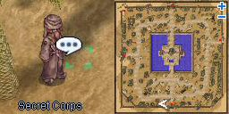
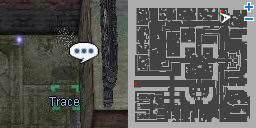
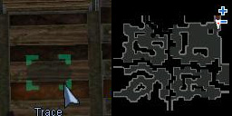
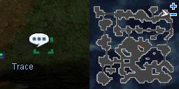
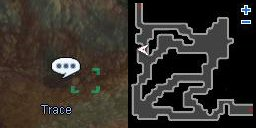
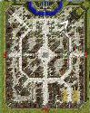

# Easter Event Quest (2008/03/18) ~ (2008/03/25)

> **Note:** Not implemented on iRO Classic.

<!-- Quest info -->
- **Level requirement:** None/Unknown
- **Item requirement:** 43 Holy Egg
- **Base EXP reward:** Varies
- **Item reward:** 2 Gift Box

## Ancient Heroes

1.  Speak with Cantankerous Geezer at any of the following locations:
  * [Prontera](Prontera.md) 108, 96
  * [Al De Baran](Al_De_Baran.md) 132, 116
  * [Geffen](Geffen.md) 133, 63
1.  Talk to Secret Corps (Corps Member) [Morroc](Morroc.md) 131, 26 with at least 1 Holy Egg in your inventory.

1.   

1.  He asks you to bring him 10 Holy Eggs in order for you to join his organization.
  * Receive 2 Gift Box after bringing him the 10 Holy Egg.
1.  He now asks for 33 Holy Egg.
1.  After returning with 33 holy eggs, he directs you to a dungeon determined by a player's level.
  * Levels 81~99: Glast Heim Underprison (gl_prison 157, 176)

  * Levels 61~80: Mjolnir Dead Pit (mjo_dun03 308 256)

  * Levels 41~60: Undersea Tunnel (iz_dun02 340, 346)

  * Levels 1~40: Payon Cave (pay_dun00 22 127)

1.  After using the Eggs on the Trace, return to the Corps Member and inform him of the results.
  * Levels 1~40 receive 993 [Base Experience](Base_EXP_Chart.md).
  * Levels 81~98 receive 1,250,000 [Base Experience](Base_EXP_Chart.md).
  * Levels 61~80 receive 750,000 [Base Experience](Base_EXP_Chart.md).
  * Levels 41~60 receive 300,000 [Base Experience](Base_EXP_Chart.md).

## Holy Egg Preparation

| Column 1 | Column 2 | Column 3 | Column 4 |
| --- | --- | --- | --- |
| Holy Egg | 1 White Herb 1 Yellow Herb 1 Green Herb 1 Holy Water 1 Chicken Egg | Sister Nerlen  Prontera   ([Prontera](Prontera.md) 230 312) |  |

* Note: Chicken Eggs can be purchased from the Egg Salesman at [Prontera](Prontera.md) 111, 99 for 500 [Zeny](Zeny.md) each

---
**Categories:** [Base Experience Reward](categories/Base_Experience_Reward.md), [Temporary Event Quests](categories/Temporary_Event_Quests.md)
*Source: [iRO Wiki Classic](https://irowiki.org/classic/Easter_Event_Quest_%282008/03/18%29_~_%282008/03/25%29) — GFDL 1.3+*
