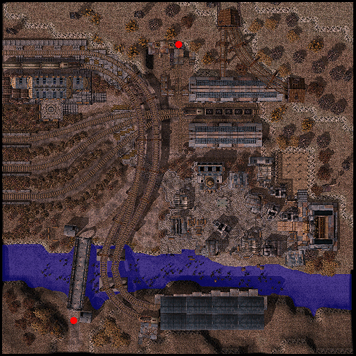

# Einbech

## About Einbech

Einbech is the sister city to [Einbroch](Einbroch.md). It can be acccessed via walking through many fields, or taking the train from Einbroch for 200 Zeny. Einbech holds the entrance to the Mine Dungeon.

## Story

The Republic of Schwaltzvald`s scientific community has long been a national source of pride. [Juno](Juno.md), its capital city that majestically floats amongst the clouds, is a testament to its achievements in science, as well as ancient relic research. Countless brilliant innovators fill the pages of Schwaltzvalt history, but perhaps one of the most influential figures is Lowin Ard Strahenstein, the scientist accredited with inventing the steam engine and starting the Schwaltzvalt Republic`s Industrial Age. Steam engines were eventually mass produced and distributed all over the Republic, as they revolutionized transportation and the manufacturing industry. Recognizing the growing value of the resources used for manufacturing and fueling the steam engines, many wealthy merchants seized the opportunity to invest their capital in Einbech, a small mining town located near an abundant mineral supply southwest of Juno. Their financial support resulted in a surge in the mining industry and the growth of Einbech into a large village. Strahenstein made further innovations to his existing steam engine technology and introduced the high-pressure steam engine. The increased power output of these new engines made deep mining, the refinement of intensified iron, and large scale manufacturing possible. Now that this improved machinery existed, Einbech`s investors began pouring their money into an empty lot near Einbech, building factories to refine minerals mined in Einbech and manufacture a greater variety of products. As more people moved to this area and an extensive railroad network was built to connect it to Einbech, the manufacturing district rapidly developed into the modern city known as [Einbroch](Einbroch.md).

## Guide

## Dungeon

## Mine Dungeon

At the northern portion of Einbech lies an abandoned mine. The workers have long left these mines fearing for their lives. The mines of Einbech are filled with new and unusual monsters. Catch a glimpse of Metaling, the metallic versions of the cute Poring. Brave explorers can also fight Obsidians and Minerals, mutated stones that originated from the pollution and waste from the city. There is also the Waste Stove, an enraged cooking device bent on revenge for being abandoned by its uncaring owner.

If you delve deep inside the dungeon you might also encounter RSX-0806, a steam-powered juggernaut Boss Monster that can destroy anything in its path.

**Related pages:**

* [Towns](Towns.md)
* [Rune-Midgarts Kingdom](Rune-Midgarts_Kingdom.md)
* [Alberta](Alberta.md)
* [Al De Baran](Al_De_Baran.md)
* [Archer Village](Archer_Village.md)
* [Comodo](Comodo.md)
* [Geffen](Geffen.md)
* [Izlude](Izlude.md)
* [Morroc](Morroc.md)
* [Payon](Payon.md)
* [Prontera](Prontera.md)
* [Umbala](Umbala.md)
* [Republic of Schwartzvald](Republic_of_Schwartzvald.md)
* [Einbech](Einbech.md)
* [Einbroch](Einbroch.md)
* [Hugel](Hugel.md)
* [Juno](Juno.md)
* [Lighthalzen](Lighthalzen.md)
* [Arunafeltz States](Arunafeltz_States.md)
* [Rachel](Rachel.md)
* [Veins](Veins.md)
* [Manuk](Manuk.md)
* [Amatsu](Amatsu.md)
* [Ayothaya](Ayothaya.md)
* [Kunlun](Kunlun.md)
* [Jawaii](Jawaii.md)
* [Louyang](Louyang.md)
* [Moscovia](Moscovia.md)
* [Nifflheim](Nifflheim.md)
* [Lutie](Lutie.md)

---
*Source: [iRO Wiki Classic](https://irowiki.org/classic/Einbech) — GFDL 1.3+*
