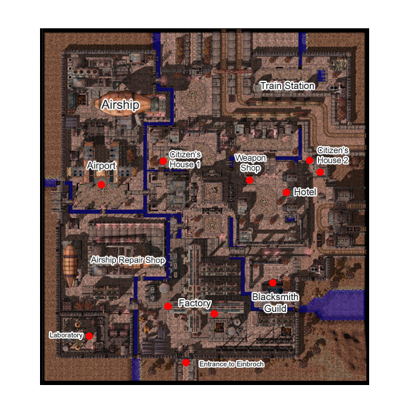

# Einbroch

## About Einbroch

Polluted city in the [Republic of Schwartzvald](Republic_of_Schwartzvald.md). Einbroch can't be accessed via teleporting, you must take the Airship or walk. There is also no teleporting or fly-winging allowed inside the town, so having [Increase AGI](Increase_AGI.md) really helps.

## Story

The Schwartzvald Republic 's scientific community has long been a source of pride for its citizens. Juno, the magnificent floating City of Wisdom , is a testament to the republic's achievements in science, as well as its research in ancient artifacts. Countless brilliant innovators and scholars fill the pages of Schwartzvald history, but perhaps the most revered of them is Strahlenstein, the leading advocate for the development of the steam engine. With his research, the minerals that fuel the engines were discovered and thus dawned Schwartzvald's Industrial Age

Soon, steam engines were mass produced and distributed all over the republic. Recognizing the growing demand for resources used in manufacturing and fueling the steam engines, many merchants seized the opportunity to invest their capital in [Einbech](Einbech.md), a small mining town located near an abundant mineral supply southwest of [Juno](Juno.md). Their financial support gave rise to a boom in the mining industry and the small town of [Einbech](Einbech.md) developed into a large city.

Strahlenstein continued his research in steam engine technology and eventually devised a way to produce more powerful engines. The increased power output of these new engines made it possible to extract various metals and minerals that were previously impossible to mine. With this technology, people began investing their resources in a vacant piece of land near [Einbech](Einbech.md), building factories to refine minerals located there and manufacture a slew of new technological products. As more people moved to this area, an extensive railroad network was laid to meet the demands of the population. Eventually, this small community rapidly grew and was named the city of Einbroch.

## Quests

Einbroch offers new quests with engaging storylines to keep the adventurers of Midgard busy. Most of them are centered around the lives of the various citizens of Einbroch and [Einbech](Einbech.md). Not only will you be able to help them by doing the quests, you can also receive cool rewards like items and experience points in the process.
Play the part of matchmaker for two star-crossed lovers in Einbroch,
Find Uwe Kliene, a chef renowned all over Rune-Midgard, and discover the secret of his cooking,
Intervene to reunite Kain Himere, a crewman on the [Airship](Airship.md), and his long forgotten daughter
or be a good samaritan and help a needy man and his sick wife.

Quests added with the Einbroch update can be found [here](Quests.md).

## Guide

The denizens of Einbroch are divided into extremes of wealth and status. The rich hold all the power and live in comfort. These are the ones that lord over and supervise the many workers that keep the machinery and vital services of the city running. There are those in the lower ranks that work to raise their status. Yet some are just hopeless and have no choice but to continue the hard labor just to survive.

When in [Einbech](Einbech.md) or Einbroch, take the time to talk to the various [NPC](NPC.md)s and learn more about their culture and lives.

## Dungeon

* **Kiel Hyre Dungeon**

A factory that lies a few maps away from Einbroch.
K.H. Corporation has prospered for 32 years, now under the direction of a man only of young business genius Kiel Hyre. What once began as a small Einbroch factory became a huge enterprise in the Schwarzvald Republic specializing in Guardian research and producing many robots made for domestic usage such as household maids.
Its size is rivaled only by the great [Rekenber Corporation](Rekenber_Corporation.md).
K.H. Corp now and days provides a wide array of social welfare to those across Schwarzvald, and maintains residence and an academy for those less fortunate. By all accounts, K.H. Corp is a shining light of Schwarzvald.
But Kiel Hyre himself has his own secrets. What kind of research might he be hiding?

A dungeon filled with robotic like monsters and exploding bombs.The master of this dungeon resides at level 2.
He is none other than Kiel, the spirit of the son of the master of the factory. He appears to be possessed by a demon that looks like one of Picasso's abstract paintings. A more powerful form of Kiel also exists in this dungeon, known as "Kiel D-01". He is a more robotic version of the original, and is a lighter shade of color.

Kiel Hyre Dungeon can be access via quest: [Kiel Hyre Quest](Kiel_Hyre_Quest.md)

**Related pages:**

* [Towns](Towns.md)
* [Rune-Midgarts Kingdom](Rune-Midgarts_Kingdom.md)
* [Alberta](Alberta.md)
* [Al De Baran](Al_De_Baran.md)
* [Archer Village](Archer_Village.md)
* [Comodo](Comodo.md)
* [Geffen](Geffen.md)
* [Izlude](Izlude.md)
* [Morroc](Morroc.md)
* [Payon](Payon.md)
* [Prontera](Prontera.md)
* [Umbala](Umbala.md)
* [Republic of Schwartzvald](Republic_of_Schwartzvald.md)
* [Einbech](Einbech.md)
* [Einbroch](Einbroch.md)
* [Hugel](Hugel.md)
* [Juno](Juno.md)
* [Lighthalzen](Lighthalzen.md)
* [Arunafeltz States](Arunafeltz_States.md)
* [Rachel](Rachel.md)
* [Veins](Veins.md)
* [Manuk](Manuk.md)
* [Amatsu](Amatsu.md)
* [Ayothaya](Ayothaya.md)
* [Kunlun](Kunlun.md)
* [Jawaii](Jawaii.md)
* [Louyang](Louyang.md)
* [Moscovia](Moscovia.md)
* [Nifflheim](Nifflheim.md)
* [Lutie](Lutie.md)

---
*Source: [iRO Wiki Classic](https://irowiki.org/classic/Einbroch) — GFDL 1.3+*
