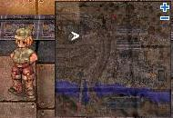
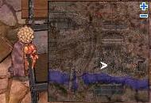
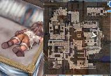
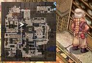
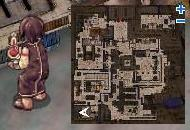
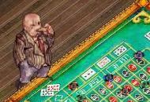

# Einbroch Murder Quest

<!-- Quest info -->
- **Level requirement:** None
- **Quests required:** [Factory Quest](Factory_Quest.md)
- **Base EXP reward:** * Level 01-69 = 100,000 Exp * Level 70-79 = 300,000 Exp * Level 80-89 = 500,000 Exp * Level 90-99 = 700,000 Exp
- **Job EXP reward:** * Level 01-69 = 80,000 Exp * Level 70-79 = 100,000 Exp * Level 80-89 = 300,000 Exp * Level 90-99 = 500,000 Exp

1. Go to [Einbech](Einbech.md). When you step off the train there is a Young Man (einbech 58 209)

who talks about depressed guy in pub. Go talk to Buender Hikeman behind the tavern (einbech 164 102).

He will mistake you for a killer. Talk to him again, and ask him how he escaped. He'll rant and pass out.

2. Now head to [Einbroch](Einbroch.md). At the second floor of the Hotel (einbroch 252 200), in the south eastern room there is a Sick Old Man - Shinokas (ein_in01 231, 161) in bed. Ask him if he always lived in [Einbroch](Einbroch.md) and you'll find out he is hiding something. Keep badgering him about the mine collapse and eventually you'll get the option to ask about Hikeman. He will slip up and reveal he really was part of that incident.

Talk to him again and he asks you to search the Kappelthaine Manor (einbroch 126 229) for more information about the ore. Talk to the maid there and she denies any ore.

*  Note: To talk to [NPC](NPC.md)s in the Kappelthaine Manor, immediately move into the south room upon entering. The father will kick you out of the house if you go near him, so you have to talk to the three [NPC](NPC.md)s in the room (two are for another quest) through the walls.

3. Return to Shinokas and he'll ask you to search the factory next. Talk to Zelmeto (ein_in 67, 247) (and finish the Einbroch Factory Maintenance quest up to the part where one must hand him spare parts if you haven't already) in the factory and return to Shinokas. He gives you the option of where you think it may be hidden.

4. If you pick Laboratory (Southwest Einbroch - einbroch 53, 51), you have to 'sneak in'. The door at the laboratory will now request a password...you have to type in the nonesense that it tells you. OR you can just copy/paste the correct combination in. Following is the full list of pairings(one is used twice):

- burrdingdingdilidingdingphoohudaambandoorabambarambambamburanbamding
- burapaphurarlandreamduranbatuhiwooikabamturubamdingding

- belief love luck grimace sweat rush folktale rodimus optimus burnblebe
- LiGhTsPeEd RiGhT SPEed leFT TURn RiGhT BuRn OrIGInAL GaNgSteR SmACk

- You give me no choice. I guess it's time for me to reveal my secret...
- fReeDoM eCstAcy JoUrnaLiSm ArMpit DisCoverY hEaDaChE MoonbeAmS jUsTiCE

- Coboman no chikara-yumei na chikara-daiookii na chikara da ze! COBO ON
- hfjdkeldjshfjdjeiskdlefvbd

- I'm the King of all Weirdos! Now you know of my true power. Obey~!
- uNflAPPaBLe LoVaBLe SeCreTs AnD BoWLiNg aGaINST tHe KarMA of YoUtH

- By the power of p-po-poi-po-poi-poin-poing GOD-POING. I NEVER LOSE!
- uNflAPPaBLe LoVaBLe SeCreTs AnD BoWLiNg aGaINST tHe KarMA of YoUtH

- ...silence. quiet benevolence... soul mate... wonder. enigma... cloud.
- opeN,Open!op3n.openOpen0p3nOpEn0pen`open'0Pen open?open!111OPENSESAME

5. Talk to the scientist inside, and he will tell you the head of the lab is on the [Airship](Airship.md) flirting with some lady. While here, click on the small "Unknown Stuff" in the middle of the room at the center of the machine.

6. Take the [Airship](Airship.md) and go downstairs (airplane 34 77). The scientist (Drunken Old Man) is throwing dice and losing badly. Talk to the Apple Merchant, buy 100 apples, then talk to the scientist. He'll use them to gamble another round and lose even more. The key here is his swearing his luck on Ymir's Heart. Keep giving him apples and eventually he will win, and tell you about Ymir's Heart.

7. Return to Shinokas, tell him about Ymir's Heart in the dialog that appears, and he'll die telling you of his regret.

8. Go back to Einbech and inform Hikeman of Shinokas's death for some [EXP](Experience.md).

*  Experience amounts received:
  * Level 01-69 = 100,000 [Base EXP](Base_EXP_Chart.md)/80,000 [Job EXP](Job_EXP_Chart.md)
  * Level 70-79 = 300,000 [Base EXP](Base_EXP_Chart.md)/100,000 [Job EXP](Job_EXP_Chart.md)
  * Level 80-89 = 500,000 [Base EXP](Base_EXP_Chart.md)/300,000 [Job EXP](Job_EXP_Chart.md)
  * Level 90-99 = 700,000 [Base EXP](Base_EXP_Chart.md)/500,000 [Job EXP](Job_EXP_Chart.md)

---
**Categories:** [Base Experience Reward](categories/Base_Experience_Reward.md), [Einbroch Quests](categories/Einbroch_Quests.md), [Job Experience Reward](categories/Job_Experience_Reward.md), [Quests](categories/Quests.md)
*Source: [iRO Wiki Classic](https://irowiki.org/classic/Einbroch_Murder_Quest) — GFDL 1.3+*
