# Emotes

## Ragnarok Online Emotes

| Command | Image | Description | Usage |
| --- | --- | --- | --- |
| /bawi   Ctrl + = |  | Bawi / Rock | Used in "rock, paper, scissors", or to indicate raising of the fist. |
| /bo   Ctrl + \ | 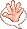 | Bo / Paper | Used in "rock, paper, scissors" and in greetings/farewells. |
| /gawi   Ctrl + - |  | Gawi / Scissors | Used in "rock, paper, scissors" and in greetings/farewells. |
| /! |  | Exclamation mark | Often used when surprised. |
| /? |  | Question mark | Often used when in question. |
| /ho | 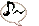 | Music note | Often used when 'whistling bored'. |
| /lv |  | Beating heart | Often used when you're in love. |
| /lv2 |  | Exploding heart | Simply a different version of the above /lv. |
| /swt |  | Sweat drop | Anime-styled sweat drop. Usable for any purpose. |
| /ic | 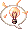 | Light bulb | Used when you've finally figure something out. |
| /an | 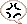 | Anger vein | Anime-styled anger vein. Use when angry. |
| /ag |  | Storm cloud | The symbol of true frustration. Use when moody. |
| /$ |  | Dollar sign | Use when you've just gained a lot of money, or going to get a lot of it. |
| /... |  | Three dots | Use when speechless. |
| /thx | 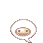 | Thank you! | Use when thanking someone, |
| /wah | 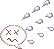 | Look of panic | Use when utterly confused and\|/or panicking |
| /sry |  | Sorry look | Use when sorry for doing something bad. |
| /heh |  | Laughing face | Multiple uses from simply laughing at a joke to mocking someone. |
| /swt2 | 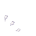 | Explosive sweat | Used when in panic. |
| /hmm |  | Thinking face | Used when pondering an unfathomable situation or incident, or when thinking abou something. |
| /no1 |  | Thumbs up and a wink | A praising gesture. |
| /ok |  | Head bobbing up and down | Used when agreeing. |
| /omg | 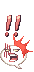 | Shocked face! | Used when expressing utter disgust or shock. |
| /oh |  | Sign with a red circle | Used when saying "Oh!". |
| /X |  | Sign with a red X | Used when saying "No.". |
| /hlp | 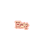 | Four Help signs pop above you | Used when desperately asking for help. |
| /go | 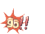 | Explosive Go! sign | Used to commence an action or event. |
| /sob | 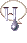 | Crying face | Used when sad. |
| /gg |  | Evil giggling face | A laugh with bad intentions in mind. |
| /kis |  | A kiss with a heart facing right | Used when kissing someone on your right side. |
| /kis2 |  | A kiss facing left | Used when kissing someone on your left side. |
| /pif | 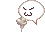 | A pif. | Used when blowing smoke into someones face or right after finishing a "supposedly difficult" task |
| /?? |  | Shaking head | Used when disagreeing. |
| /bzz  or /e1 | 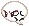 | Angry face with an anger vein | Used when expressing directed anger. |
| /rice  or /e2 |  | Drooly face | Used when drooling about something (or someone) delicious. |
| /awsm  or /e3 |  | Eyes popping hearts | Used when totally ogling someone irresistibly sexy. |
| /meh  or /e4 |  | Flapping tongue | Used when licking someone on your left or saying "So what?" |
| /shy  or /e5 |  | Blushing | Used when blushing or saying "Tsk tsk." |
| /pat  or /e6 |  | A hand petting | Used when comforting someone beside you. |
| /mp  or /e7 | 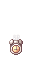 | A clock with SP appears | Used when signaling that the user is low on SP. |
| /slur  or /e8 | 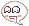 | A lustful face with drool | Used when you have the desire to eat someone. |
| /com  or /e9 |  | A finger directing something to come towards you | Can also mean the user is 'fingering' someone. |
| /yawn  or /e10 |  | A big yawny face | Used to express boredom. |
| /grat  or /e11 | 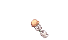 | A glittery explosion with the word Congratulations! | Used when congratulating someone. |
| /hp  or /e12 | 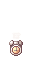 | A clock with HP appears | Used when signaling that the user is low on HP. |
| /fsh  or /e13 |  | Shiny eyes | can be used when you see something you always want to have. |
| /spin  or /e14 | 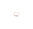 | Dizzy look with drool | Used when dizzy. |
| /sigh  or /e15 | 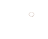 | An exhaling puff | Used when tired. |
| /dum  or /e16 | 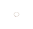 | A blank expression | Used when dumbstruck. |
| /crwd  or /e17 | 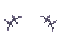 | Expression of loud clamoring | Used when 'making loud noises'. However spamming seems alot louder. |
| /desp /otl  or /e18 |  | A stick person falling on hands and knees | Everyone's favorite emote. However its an anime expression of giving up. |
| /dice  or /e19 | 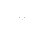 | A dice roll | It rolls random numbers from 1-6. |
| /e20 | 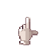 | A finger pointing upward. |   |
| /hum  or /e27 |  | An annoyed expression. |   |
| /abs  or /e28 | 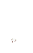 | An emotion usually seen in humorous anime when you've done something very wrong, you then falls down and your soul comes out as if you die from embarassment/being frightened. Basically just a different version of the /panic shown below. | ? |
| /oops  or /e29 |  | An eyepopping and red faced emotion. | Used to convey embarrasment at making a mistake. |
| /spit  or /e30 |  | A mouth spitting/throwing up. | Used when something is so disgusting that you throw up. |
| /ene  or /e31 | 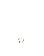 | A "blessed" face | ? |
| /panic  or /e32 | 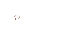 | A frightful face. | Used when something absolutely horrible has happened. |
| /whisp  or /e33 |  | A spinning whisper face. |   |

## See also

* [Basic Game Control](Basic_Game_Control.md)

---
**Categories:** [General Information](categories/General_Information.md)
*Source: [iRO Wiki Classic](https://irowiki.org/classic/Emotes) — GFDL 1.3+*
