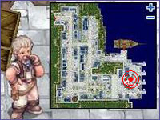

# Endless Tower

## Overview

The Endless Tower is an increasingly difficult set of challenges. Participating parties make their way up the 100 floor tower, with a special boss encounter against Entweihen Knothen on the 100th floor, and Naght Sieger afterwards.  These battles function similar to the [Izlude Arena](Izlude_Arena.md), with players being required to defeat all monsters on a particular floor before the door to the next can open.  Once on a floor, players are unable to go backwards; thus the only ways to leave the tower are to die and respawn, leave the Party, log out, use a Butterfly Wing, or walk into a [Warp Portal](Warp_Portal.md).

The following skills are disabled inside the tower:
*  [Teleport](Teleport.md)
*  [Ice Wall](Ice_Wall.md)
*  [Snatch](Snatch.md)
*  [Fiber Lock](Fiber_Lock.md)
*  [Leap](Leap.md)

There are no item use limitations, although items that cast one of the restricted skills will fail (such as Fly Wing).  Usage of the [Kafra Shop](Kafra_Shop.md) item Token of Siegfried is still possible within the dungeon.

* **Note**: A memorial dungeon instance cannot be created during the 6 hours preceeding [War of Emperium](War_of_Emperium.md), until War of Emperium is over.

## Quest

> **Repeatable** — cooldown: 6 day, 20 hour

<!-- Quest info -->
- **Level requirement:** 50
- **Party requirement:** Yes
- **Zeny requirement:** 10,000 (Per Person)
- **Quest reward:** Access to the Endless Tower

1. In [Alberta](Alberta.md), talk to Captain Janssen (214, 77) and donate 10,000 [Zeny](Zeny.md).

2. Listen to him and agree to be his first mate so he will bring you to the Endless Tower Island.

3. After reaching the island, your party leader must speak with the Tower Protection Stone. They then must generate the Endless Tower Dungeon instance.

4. After an instance is created, the party will have 5 minutes to enter the dungeon, or else the dungeon will be destroyed. If the dungeon is destroyed, the party leader will not be make a new instance for 6 days 20 hours. A party may leave the tower, but they must return to the tower in 5 minutes. The party will have 4 hours to finish the dungeon. If in 4 hours they do not finish, all players in the dungeon will be warped out and sent back to their save points.

* **Note:** A window will appear showing pertinent time limits for the dungeon.  If it is closed, it can be opened again using the shortcut Alt+B.

* **Warning: If any party member leaves their party while inside the dungeon, they will be kicked out and sent back to their save point! However, they can be reinvited to the party and reenter the tower.**

* **Warning: Taming any monster or killing the last monster on a floor with a [mercenary](Mercenary_System.md) will cause the instance to not register the kill, and the portal to the next floor will not open.**

Each party member used to be given 1 Ashes of Darkness upon completing floors 25, 50, 75 and 99. Ashes of Darkness no longer serve any purpose. They cannot be dropped, traded, [Mailed](Mail_System.md) or placed in [Cart](Pushcart.md)s and have 0 weight **but can be sold to an NPC or placed in [Kafra](Kafra.md) storage.**

If a player is forced to leave the tower, they can re-enter by talking to the stone on the Misty Island again. The exit portal on the 1st floor will warp the player to the floor after the most recent boss floor they have cleared. However, the portal does not correctly warp a player to 26, 51, or 76; the player should use the Immortal Braizer instead to get to those floors.

The Endless Tower instance lasts until the party either gives up or runs out of time, after which time all players will be teleported out of the dungeon.

There is no limit on how many instances a party can create within the 4 hour limit. A new instance can be created under a different party leader if the previous instance was destroyed. Once the time limit is up, there is a 6 day 20 hour cooldown period for all party members in which they cannot enter a new Endless Tower instance. However, additional instances will not allow access to additional MVPs.

## Floors

Blue text denotes a [Mini-Boss](Boss_Protocol.md).

Red text denotes an [MVP](MVP.md) monster.

| Floors | Floors |
| --- | --- |
| Floor Number | Monster Spawn |
| **Floor 1** | 15 Metaling  5 Drops   5 Marin   5 Poporing   5 Poring   1 Mastering |
| **Floor 2** | 20 Desert Wolf   10 Baby Desert Wolf   1 Vagabond Wolf |
| **Floor 3** | 5 Archer Skeleton   5 Orc Skeleton   5 Pirate Skeleton   5 Soldier Skeleton   5 Skel Worker   5 Skeleton |
| **Floor 4** | 15 Argiope   5 Argos   5 Hornet   5 Mantis   5 Rocker   1 Vocal |
| **Floor 5** | 15 Female Thief Bug   15 Male Thief Bug   15 Thief Bug   5 Thiefbug Egg   1 Golden Thiefbug |
| **Floor 6** | 5 Dragon Egg 5 Pecopeco Egg 5 Pupa 5 Thiefbug Egg |
| **Floor 7** | 15 Anopheles 15 Drainlair 15 Explosion 15 Familiar |
| **Floor 8** | 15 Cruiser 15 Firelock Soldier |
| **Floor 9** | 15 Golem 15 Obsidian 10 Stapo |
| **Floor 10** | 25 Giant Hornet 20 Hornet 1 Mistress |
| **Floor 11** | 15 Dryad 15 Hermit Plant 15 Parasite 15 Rafflesia |
| **Floor 12** | 25 Demon Pungus 25 Punk |
| **Floor 13** | 15 Bongun 15 Yao Jun 10 Munak |
| **Floor 14** | 15 High Orc 10 Orc Archer 10 Orc Lady 5 Orc Baby 5 Orc Warrior |
| **Floor 15** | 15 Andre 15 Deniro 15 Piere 5 Ant Egg 1 Phreeoni 1 Maya |
| **Floor 16** | 10 Archer Skeleton 10 Gargoyle 10 Orc Archer 10 Raydric Archer |
| **Floor 17** | 15 Strouf 10 Baphomet Jr. 10 Merman 5 Hill Wind (Spear) |
| **Floor 18** | 25 Cramp 15 Tarou |
| **Floor 19** | 10 Deviace 10 Megalodon 10 Phen 10 Swordfish |
| **Floor 20** | 50 Pirate Skeleton  1 Drake |
| **Floor 21** | 10 Plasma (Purple) 10 Plasma (Yellow) 5 Plasma (Blue) 5 Plasma (Green) 5 Plasma (Red) |
| **Floor 22** | 15 Drosera 15 Flora 15 Hydra 15 Muscipular 15 Mandragora 15 Rafflesia |
| **Floor 23** | 15 Penomena 10 Marse 10 Obeaune 10 Swordfish 5 Hydra |
| **Floor 24** | 15 Carat 15 Joker 10 Jakk |
| **Floor 25** | 15 Cat o' Nine Tails 15 Ninetails 1 Moonlight Flower |
| **Floor 26** | 10 Enchanted Peach Tree 10 Gibbet 10 Stone Shooter 10 Wooden Golem 5 Elder Willow |
| **Floor 27** | 10 Goblin Archer 10 Goblin (Dagger) 5 Goblin (Axe) 5 Goblin (Flail) 5 Goblin (Hammer) 5 Goblin (Morning Star) |
| **Floor 28** | 30 Arclouse 15 Neraid 15 Pest 10 Kukre |
| **Floor 29** | 10 Dark Frame 10 Heirozoist 10 The Paper 10 Whisper 5 Lude 5 Quve |
| **Floor 30** | 30 Evil Nymph 1 White Lady |
| **Floor 31** | 20 Gig 15 Iron Fist 10 Argiope 5 Scorpion |
| **Floor 32** | 10 Goblin Archer 10 Goblin (Dagger) 5 Goblin (Axe) 5 Goblin (Flail) 5 Goblin (Hammer) 5 Goblin (Morning Star) 1 Goblin Leader |
| **Floor 33** | 15 Kobold Archer 15 Kobold (Axe) 10 Kobold (Hammer) 5 Kobold (Morning Star) 1 Kobold Leader |
| **Floor 34** | 20 Flame Skull 10 Giant Whisper 10 Whisper |
| **Floor 35** | 10 Freezer 10 Heater 10 Permeter 10 Assaulter 10 Solider 1 Turtle General |
| **Floor 36** | 30 Anolian 10 Alligator 10 Grove |
| **Floor 37** | 30 Alarm 10 Clock 10 Tower Keeper |
| **Floor 38** | 25 Deathword 25 Rideword |
| **Floor 39** | 10 Evil Nymph 10 Mao Guai 10 Zhu Po Long 10 Taoist Hermit 5 Jing Guai |
| **Floor 40** | 10 Miyabi Doll 10 Shinobi 10 Tengu 5 Firelock Soldier 5 Karakasa 1 Samurai Specter |
| **Floor 41** | 50 Kraben |
| **Floor 42** | 20 Sleeper 10 Mi Gao 10 Sting 5 Hode 5 Sandman |
| **Floor 43** | 40 Side Winder 10 Medusa 5 Anacondaq 5 Boa |
| **Floor 44** | 20 Baphomet Jr. 20 Hatii Babe  10 Baby Desert Wolf 10 Savage Babe 1 Baby Orc |
| **Floor 45** | 15 Mummy 15 Ancient Mummy 15 Verit 1 Osiris |
| **Floor 46** | 20 Beholder 20 Seeker |
| **Floor 47** | 20 Deleter (Sky) 10 Deleter (Earth) 10 Petite (Sky) 10 Petite (Earth) |
| **Floor 48** | 10 Ancient Mimic 10 Ancient Mummy 10 Ancient Worm |
| **Floor 49** | 20 Grizzly 7 Leib Olmai 5 Bigfoot 5 Sasquatch 5 Zipper Bear |
| **Floor 50** | 10 Anubis 10 Matyr 10 Marduk 1 Amon Ra 1 Pharaoh |
| **Floor 51** | 20 Diabolic 20 Mini Demon 10 Deviruchi |
| **Floor 52** | 20 Harpy 10 Blood Butterfly 10 Gargoyle 10 Grand Peco 5 Hill Wind 5 Hill Wind (Spear) |
| **Floor 53** | 30 Shinobi 25 Assaulter |
| **Floor 54** | 10 Chepet 10 Marionette 10 Miyabi Doll |
| **Floor 55** | 25 Medusa 15 Isis 15 Sidewinder 1 Evil Snake Lord |
| **Floor 56** | 15 Ice Titan 10 Freezer 10 Gazeti 10 Hatii Babe 10 Snowier |
| **Floor 57** | 25 Metaling 5 Drops 5 Marin 5 Poporing 1 Mastering 1 Ghostring 1 Angeling 1 Deviling 1 Arc Angeling |
| **Floor 58** | 20 Phendark 10 Rybio 10 Zombie Prisoner 5 Injustice 5 Skel Prisoner |
| **Floor 59** | 30 Ancient Mimic 20 Mimic 10 Mystcase |
| **Floor 60** | 10 Egnigem Cenia 10 Errende Ebecee 10 Kavatch Icarus 10 Laurell Weinder 10 Whickebine Tres 10 Armeyer Dinze 1 Doppelganger 1 Egigem Cenia (Boss) |
| **Floor 61** | 10 Agav 10 Echio 10 Mobster 10 Pasana 5 Isilla 5 Vanberk |
| **Floor 62** | 35 Wanderer |
| **Floor 63** | 20 Ragged Zombie 10 Zombie Master 5 Orc Zombie 5 Zombie Prisoner 5 Zombie |
| **Floor 64** | 30 Ungoliant 2 Ancient Worm 2 Caterpillar 2 Creamy Fear 2 Giant Hornet 2 Killer Mantis |
| **Floor 65** | 20 Galion 1 Atroce |
| **Floor 66** | 20 Incubus 20 Aliot 10 Injustice |
| **Floor 67** | 10 Acidus (Blue) 10 Acidus (Gold) 10 Mutant Dragonoid 5 Deleter (Sky) 5 Petite (Sky) |
| **Floor 68** | 18 Stalactic Golem 10 Ice Titan 10 Lava Golem 5 Golem 5 Wooden Golem |
| **Floor 69** | 20 Dame of Sentinel 10 False Angel 10 Baroness of Retribution 10 Lady Solace 10 Mistress of Shelter |
| **Floor 70** | 20 Orc Baby 1 Orc Hero 1 Orc Lord |
| **Floor 71** | 20 Incubus 20 Nightmare Terror 20 Succubus 5 Nightmare |
| **Floor 72** | 10 Enchanted Peachtree 10 Errende Ebecee 10 Permitter 10 Margaretha Solin |
| **Floor 73** | 20 Loli Ruri 10 Aliza 10 Green Maiden 10 Succubus 5 Alice 5 Zealotus |
| **Floor 74** | 24 Dimik 24 Venatu 6 Archdam |
| **Floor 75** | 20 Baphomet Jr. 10 Dark Illusion 1 Dark Lord 1 Baphomet |
| **Floor 76** | 30 Abysmal Knight 20 Nightmare Terror 10 Nightmare |
| **Floor 77** | 30 Banshee 10 Evil Druid 10 Wind Ghost 10 Wraith Dead 10 Wraith |
| **Floor 78** | 20 Raydric 10 Bloody Knight 10 Dullahan 5 Sword Guardian 5 Abysmal Knight |
| **Floor 79** | 10 Ferus (Green) 10 Ferus (Red) 10 Hydrolancer 5 Deleter (Ground) 5 Petit (Ground) |
| **Floor 80** | 15 Necromancer 1 Fallen Bishop Hibram |
| **Floor 81** | 20 Mysteltainn 20 Ogretooth 20 Executioner |
| **Floor 82** | 10 Agav 10 Bloody Knight 10 Bloody Murderer 10 Injustice 10 Skogul |
| **Floor 83** | 10 Chimera 10 Dark Illusion 10 Gryphon 10 Skeggiold |
| **Floor 84** | 20 Dark Illusion 10 Incubus 10 Owl Baron 10 Owl Duke 10 Incubus 10 Succubus |
| **Floor 85** | 1 Ifrit |
| **Floor 86** | 10 Chimera 10 Gryphon 10 Hydrolancer 10 Majorous |
| **Floor 87** | 20 Kasa 15 Lava Golem 15 Salamander 10 Gajomart |
| **Floor 88** | 15 Anubis 15 Necromancer 10 Ancient Mummy 10 Khalitzburg 10 Wraith Dead |
| **Floor 89** | 6 Odium of Thanatos 6 Despero of Thanatos 6 Maero of Thanatos 6 Dolor of Thanatos |
| **Floor 90** | 10 Baroness of Retribution 10 False Angel 10 Lady Solace 1 Valkyrie Randgris |
| **Floor 91** | 30 Kavatch Icarus 10 Bow Guardian 10 Cecil Damon |
| **Floor 92** | 15 Kathryne Keyron 10 Elder 10 Laurell Weinder 10 Marduk 10 Wind Ghost |
| **Floor 93** | 15 Seyren Windsor 10 Abysmal Knight 10 Bloody Knight 10 Wanderer |
| **Floor 94** | 15 Sword Guardian 15 Bow Guardian |
| **Floor 95** | 30 Hunter Fly 5 Chonchon 5 Dragon Fly 5 Steel Chonchon 1 Beelzebub |
| **Floor 96** | 5 Valkyrie 5 Skeggiold (Brown) 5 Skeggiold (Blue) |
| **Floor 97** | 5 Incarnation of Morroc (Human) 5 Incarnation of Morroc (Golem) 5 Incarnation of Morroc (Angel) 5 Incarnation of Morroc (Ghost) |
| **Floor 98** | 2 Seyren Windsor 2 Eremes Guile 2 Howard Alt-Eisen 2 Margaretha Sorin 2 Cecil Damon 2 Kathryne Keyron |
| **Floor 99** | **Random 7 of the following monster (Can have duplicates):** 2 Kathryne Keyron 2 Seyren Windsor 2 Margaretha Sorin 2 Eremes Guile 2 Howard Alt-Eisen 2 Cecil Damon 5 Incarnation of Morroc (Angel) 5 Incarnation of Morroc (Human) 5 Incarnation of Morroc (Golem) 5 Incarnation of Morroc (Ghost)  5 Valkyrie 10 Skeggiold (Brown) 10 Skeggiold (Blue) 15 Seyren Windsor 10 Bloody Knight 10 Abysmal Knight 10 Wanderer 15 Sword Guardian 10 Bow Guardian 15 Kathryne Keyron 10 Elder 10 Laurell Weinder 10 Wind Ghost 10 Cecil Damon 10 Bow Guardian 30 Kavach Icarus 10 Baroness of Retribution 10 Lady Solace 10 False Angel |
| **Floor 100** | 1 Entweihen Knothen  9 Thorn of Bone 7 Thorn of Magic 5 Thorn of Recovery 4 Thorn of Purity 2 Random Thorns |
| **Unknown Area** | 10 Anopheles 100 Orc Skeleton 60 Wind Ghost 40 Khalitzburg 1 Naught Sieger |

**Related pages:**

* [Instance](Instance.md)
* [Endless Tower](Endless_Tower.md)
* [Nidhoggur's Nest](Nidhoggur's_Nest.md)
* [Orc Memory Dungeon](Orc_Memory_Dungeon.md)
* [Sealed Shrine Quest](Sealed_Shrine_Quest.md)

---
**Categories:** [Instances](categories/Instances.md), [Satan Morroc Quests](categories/Satan_Morroc_Quests.md)
*Source: [iRO Wiki Classic](https://irowiki.org/classic/Endless_Tower) — GFDL 1.3+*
