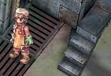
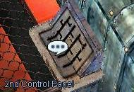
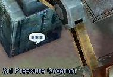
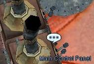
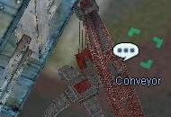
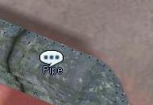
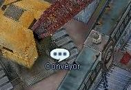
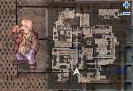

# Factory Quest

<!-- Quest info -->
- **Level requirement:** None
- **Item requirement:** 10 Rusty Screw 20 Flexible Tube 10 Used Iron Plate
- **Base EXP reward:** -------------------- * Level 1-41 = 615 * Level 41-50 = 3,075 * Level 51-60 = 6,604 * Level 61-70 = 18,508 * Level 71-80 = 32,062 * Level 81-90 = 76,026 * Level 91-99 = 290,675

1. Inside the [Einbroch](Einbroch.md) Factory (the factory is located at the center bottom of the city Einbroch 179, 70), there is a friendly factory supervisor, Zelmeto ((ein_in01): 67, 242).

He'll talks about the hardship and under staffing in the factory. After deciding to help him, he suggests inspecting parts of the factory.

2. He speaks of the parts that need examining. Check each one then return to him before checking the next.

*  2nd Control Panel: Inside Einbroch (ein_in01): 48, 231

*  3rd Pressure Governor: Inside Einbroch (ein_in01): 107, 216

*  Main Control Panel: Inside Einbroch (ein_in01): 61, 257

*  Conveyor (Small): Inside Einbroch (ein_in01): 45, 196

*  Pipe: Inside Einbroch (ein_in01): 100, 265 (to the left of these coordinates)

*  Conveyor (Large): Inside Einbroch (ein_in01): 95, 234

3. Zelmeto will talk to the manager and request that the parts be fixed. Head out the back entrance to the factory to find the big fat ugly Liotzburg ((einbroch): 132, 84).

He is the factory manager, and reveals he's too stingy to use his money for the factory.

4. Go inside and find Zelmeto again. Zelmeto can fix the broken parts if he has 20 Flexible Tube (Metaling), 10 Rusty Screw (Juperos, Teddy Bear or Metaling) and 10 Used Iron Plate (Old Stove or Remover in Biolabs).

5. Give him the materials. After he fixes the part, he thanks the player and rewards them with some experience.

*  [Gained Experience]
  * Level 1-40 = 615 Exp
  * Level 41-50 = 3,075 Exp
  * Level 51-60 = 6,604 Exp
  * Level 61-70 = 18,508 Exp
  * Level 71-80 = 32,062 Exp
  * Level 81-90 = 76,026 Exp
  * Level 91-99 = 290,675 Exp

---
**Categories:** [Base Experience Reward](categories/Base_Experience_Reward.md), [Einbroch Quests](categories/Einbroch_Quests.md), [Quests](categories/Quests.md)
*Source: [iRO Wiki Classic](https://irowiki.org/classic/Factory_Quest) — GFDL 1.3+*
