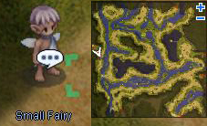
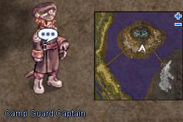
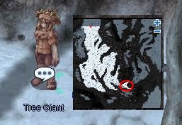

# Finding a Fairy

<!-- Quest info -->
- **Level requirement:** 70
- **Quests required:** [Onward to the New World Quest](Onward_to_the_New_World_Quest.md)
- **Base EXP reward:** 1,400,000
- **Window:** yes

1. In Splendide Field 2, talk to the **Small Fairy** (spl fild02 34,223).

2. Back at the Midgard Camp, talk to the **Camp Guard Captain** (mid camp 212,237).

*  Receive 700,000 [Base EXP](Base_EXP_Chart.md)

3. In Manuk Field 3, talk to the **Tree Giant** (man fild03 236, 105).

4. Return to the **Camp Guard Captain** to tell him of the giant.

*  Receive 700,000 [Base EXP](Base_EXP_Chart.md)

---
**Categories:** [Ash Vacuum Quests](categories/Ash_Vacuum_Quests.md), [Base Experience Reward](categories/Base_Experience_Reward.md), [New World Quests](categories/New_World_Quests.md), [Quest Window Quests](categories/Quest_Window_Quests.md)
*Source: [iRO Wiki Classic](https://irowiki.org/classic/Finding_a_Fairy) — GFDL 1.3+*
