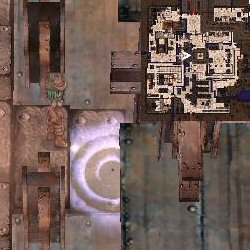
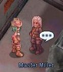
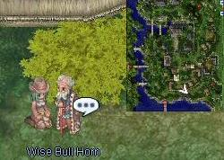
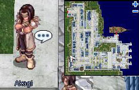
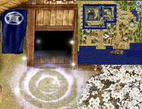
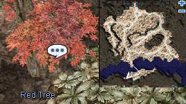

# First Expanded Job Change Guides

## TaeKwon Kid

<!-- Quest info -->
- **Level requirement:** None
- **Job level requirement:** 10
- **Class requirement:** Novice
- **Item reward:** Varies
- **Quest reward:** Jobchange to [TaeKwon Kid](TaeKwon_Kid.md)

1.  Travel to [Payon](Payon.md). Speak to the [NPC](NPC.md) named Phoenix at (158, 140). He will ask the player to gain 1 more base level.
1.  Return with the level and become a TaeKwon Kid after giving the following answers to Phoenix's questions;
  1. I face it head on.
  1. Accept differences and learn from them.
  1. Yes.
1.  You will be rewarded with a Guard &#91;0&#93;. *(Some servers require gaining more than 1 base level during the quest for this reward.)*

* **Note**: if your Base Level is 20 or higher, you will not be asked to gain another level.

**Related pages:**

* [TaeKwon Kid](TaeKwon_Kid.md)
* [Skills](Skills.md)
* [Counter Kick](Counter_Kick.md)
* [Counter Kick Stance](Counter_Kick_Stance.md)
* [Flying Kick](Flying_Kick.md)
* [Happy Break](Happy_Break.md)
* [Heel Drop](Heel_Drop.md)
* [Heel Drop Stance](Heel_Drop_Stance.md)
* [Kihop](Kihop.md)
* [Leap](Leap.md)
* [Mild Wind](Mild_Wind.md)
* [Peaceful Break](Peaceful_Break.md)
* [Roundhouse](Roundhouse.md)
* [Roundhouse Stance](Roundhouse_Stance.md)
* [Sprint](Sprint.md)
* [TaeKwon Mission](Taekwon_Mission.md)
* [Tornado Kick](Tornado_Kick.md)
* [Tornado Stance](Tornado_Stance.md)
* [Tumbling](Tumbling.md)
* [Quests](Quests.md)
* [First Expanded Job Change Guides](First_Expanded_Job_Change_Guides.md)

## Gunslinger

<!-- Quest info -->
- **Level requirement:** None
- **Job level requirement:** 10
- **Class requirement:** Novice
- **Item requirement:** 10 Shell, 3 Fluff, 1 Trunk, 3 Zargon, 3 Green Herb, 3 Rainbow Shell, 1 Milk
- **Item reward:** Six Shooter or Branch
- **Quest reward:** Jobchange to [Gunslinger](Gunslinger.md)

1. After reaching Job Level 10 as a Novice and allocating all your skill points, go to the Gunslinger's guild at at the left side of the [Einbroch](Einbroch.md) Tower (134,199).

2. Talk to the Guild Master and he will have you fill out an application.

3. You will then be sent to [Payon](Payon.md) to talk to Wise Bull Horn (184,65) (in the 5 o'clock direction outside the city wall).

4. Wise Bull Horn will ask you to collect the following items:
* **iRO:**
10 Shell
3 Fluff
1 Trunk
3 Mushroom Spore
3 Green Herb
3 Clover
* **Other servers:**
10 Shell
3 Fluff
1 Trunk
3 Zargon
3 Green Herb
3 Rainbow Shell
5. When you return he will also ask for: 1 Milk
6. Afterwards, return to talk to the Guild Master in Einbroch and he will change you into a Gunslinger.  You will receive either: Six ShooterorBranch

**Related pages:**

* [Gunslinger](Gunslinger.md)
* [Skills](Skills.md)
* [Bull's Eye](Bull's_Eye.md)
* [Chain Action](Chain_Action.md)
* [Coin Fling](Coin_Fling.md)
* [Coin Flip](Coin_Flip.md)
* [Cracker](Cracker.md)
* [Crowd Control Shot](Crowd_Control_Shot.md)
* [Desperado](Desperado.md)
* [Disarm](Disarm.md)
* [Full Blast](Full_Blast.md)
* [Gatling Fever](Gatling_Fever.md)
* [Gunslinger Mine](Gunslinger_Mine.md)
* [Gunslinger's Panic](Gunslinger's_Panic.md)
* [Increase Accuracy](Increase_Accuracy.md)
* [Last Stand](Last_Stand.md)
* [Magical Bullet](Magical_Bullet.md)
* [Single Action](Single_Action.md)
* [Snake Eyes](Snake_Eyes.md)
* [Spread Shot](Spread_Shot.md)
* [Tracking](Tracking.md)
* [Trigger Happy Shot](Trigger_Happy_Shot.md)
* [Triple Action](Triple_Action.md)
* [Wounding Shot](Wounding_Shot.md)
* [Quests](Quests.md)
* [First Expanded Job Change Guides](First_Expanded_Job_Change_Guides.md)
* [Gunslinger Weapon Quests](Gunslinger_Weapon_Quests.md)
* [Weapons](Weapons.md)
* [Bullets](Bullets.md)
* [Gun](Gun.md)

## Ninja

<!-- Quest info -->
- **Level requirement:** None
- **Job level requirement:** 10
- **Class requirement:** Novice
- **Item requirement:** 5 Iron Ore and a Phracon (**iRO Only**) OR 10 Cyfar and 2 Phracon (Others)
- **Zeny requirement:** 20
- **Item reward:** [Asura \[2\]](Guillotine_Fist.md)
- **Quest reward:** Jobchange to [Ninja](Ninja.md)

1. Once the player is Job Level 10 and has [Basic Skill](Basic_Skill.md)s maxed, make your way to Amatsu by speaking to the [NPC](NPC.md) named Akagi located at (30,63) in [Alberta](Alberta.md).

2. Akagi will warp Job Level 10 [Novice](Novice.md)s to [Amatsu](Amatsu.md) for free. Note that the location in Amatsu that he warps to appears to be random and does include an unwalkable area at (178,167). If stuck in this location re-logging will fix the problem.

3. Find the house located at (147,136) and enter. The house will appear to look empty. However, if you move to the back of the room, you will see a path. Follow this to a portal.

4. Once inside, talk to Cougar near the portal (que_ng 30,65). He will blab on and requires you to find Wildcat Joe in [Einbroch](Einbroch.md).

5. (**iRO Only**) Talk to Cougar again and he will warp you to [Einbroch](Einbroch.md). This will require 2,000 [Zeny](Zeny.md) or a Free Ticket for Kafra Transportation.

6. In Einbroch, find the tower somewhere in the middle of the town. A man in front (einbroch 176,172), or in back (einbroch 173, 229), will warp you up to the top for 10 [Zeny](Zeny.md). The NPC that the player needs to find is sitting near the bottom right of the tower (einbroch 181,196).

7. Help him and he will ask you to either:
  (**iRO Only**) Find a seal under the Red Tree one map south of Einbroch and at the bottom (on the left side of the small area at the bottom of the map or "ein_fild08 137,45"). It may take a number of attempts in order to find the seal.

  (**Others**) Collect 5 Cyfar and a Phracon (for making a Kunai).

8. Upon returning to him after completing the task, he will reveal himself as Wildcat Joe. He will give you a reply, and warp you to Amatsu. At this point return to Couger in the ninja guild.

9. Talk to Cougar and he will request 5 Iron Ore and a Phracon (**iRO Only**) **OR** 5 Cyfar and and a Phracon (**Others**). (these will not be removed from the player's inventory). The player will then become a Ninja after finishing talking to the NPC.  You will receive an [Asura \[2\]](Guillotine_Fist.md).

**Related pages:**

* [Ninja](Ninja.md)
* [Skills](Skills.md)
* [Blaze Shield](Blaze_Shield.md)
* [Cicada Skin Shed](Cicada_Skin_Shed.md)
* [Dagger Throwing Practice](Dagger_Throwing_Practice.md)
* [Exploding Dragon](Exploding_Dragon.md)
* [First Wind](First_Wind.md)
* [Flaming Petals](Flaming_Petals.md)
* [Flip Tatami](Flip_Tatami.md)
* [Freezing Spear](Freezing_Spear.md)
* [Haze Slasher](Haze_Slasher.md)
* [Killing Stroke](Killing_Stroke.md)
* [Lightning Jolt](Lightning_Jolt.md)
* [Mirror Image](Mirror_Image.md)
* [Ninja Aura](Ninja_Aura.md)
* [Ninja Mastery](Ninja_Mastery.md)
* [Shadow Leap](Shadow_Leap.md)
* [Shadow Slash](Shadow_Slash.md)
* [Snow Flake Draft](Snow_Flake_Draft.md)
* [Throw Coins](Throw_Coins.md)
* [Throw Huuma Shuriken](Throw_Huuma_Shuriken.md)
* [Throw Kunai](Throw_Kunai.md)
* [Throw Shuriken](Throw_Shuriken.md)
* [Watery Evasion](Watery_Evasion.md)
* [Wind Blade](Wind_Blade.md)
* [Quests](Quests.md)
* [Ninja Equipment Quests](Ninja_Equipment_Quests.md)
* [First Expanded Job Change Guides](First_Expanded_Job_Change_Guides.md)
* [Ninja Weapon Quests](Ninja_Weapon_Quests.md)
* [Weapons](Weapons.md)
* [Kunai](Kunai.md)
* [Shuriken](Shuriken.md)
* [Huuma Shuriken](Huuma_Shuriken.md)

---
**Categories:** [Gunslinger](categories/Gunslinger.md), [Job Change Guide](categories/Job_Change_Guide.md), [Ninja](categories/Ninja.md), [Novice](categories/Novice.md), [Quests](categories/Quests.md), [TaeKwon Kid](categories/TaeKwon_Kid.md)
*Source: [iRO Wiki Classic](https://irowiki.org/classic/First_Expanded_Job_Change_Guides) — GFDL 1.3+*
