# Fishing Quest (08/12/2015)

<!-- Quest info -->
- **Level requirement:** None
- **Item requirement:** Iron, Cobweb, Barren Trunk
- **Item reward:** Egir Armor, Egir Helm, Egir Manteau (current descriptions reflect renewal effects)

## Note

This article is based on Pika's post in warpportal forums you can find here : <https://forums.warpportal.com/index.php?/topic/161157-classic-talk-like-a-pirate-day-event-2014-tattered-map-quest-link-fishing-guide/>

## Quest

1. To begin the quest, travel to the port city of Alberta. Head over to the docks area and you'll see a man clad in strange robes together with his ~~donkey~~ fine steed, a horse.

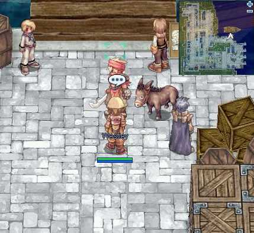

2. Speak with the man, Westley and choose the first option from the list when you're prompted.

3. Westley will be glad to hear about your enthusiasm and will require you to bring him some materials so he can make a Fishing Rod for you.

4. After bringing him the required materials, he will then ask if you would like him to craft you a regular Fishing Rod or a Small Fishing Rod, choosing either options will give you a pole for you to fish.

## Fishing

1. You will then have to travel to different places around the world and visit spots named Ripple in Water in order to start fishing.

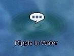

**Note :** Though the fishing rods are by themselves Accessories, you should not equip them, you must have them in your inventory for the options to appear when you choose to fish in the ripple spots.

2. When you are done selecting your fishing rods, another option will appear asking you what bait do you fancy in using to lure you potential catch.

3. A mini window with nice little cute paintings will appear after you choose your rods and baits.

4. A multiple choice menu will pop up, just choose whatever option you feel like it and hope to get lucky with your catch.

## Fishing spots

| Town | Map Location |
| --- | --- |
| Prontera | 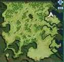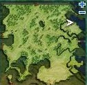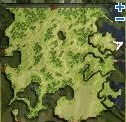 |
| Nifflheim | 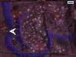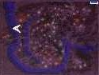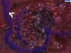 |
| Izlude | 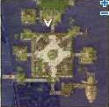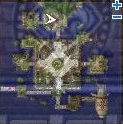 |
| Hugel | 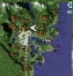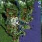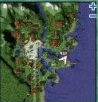 |
| Glast Heim | 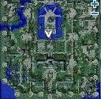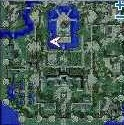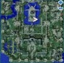 |
| Comodo | 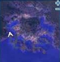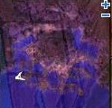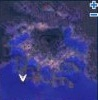 |
| Byalan | 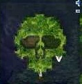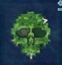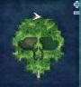 |
| Ayothaya | 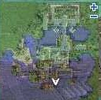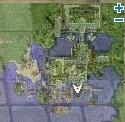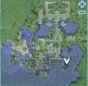 |
| Alberta | 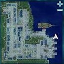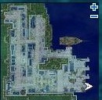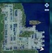 |

## Fish List

*  Piranha : 15 Pt.
*  Tuna : 10 Pt.
*  Shark : 10 Pt.
*  Octopus : 10 Pt.
*  Snapper : 10 Pt.
*  King Shrimp : 7 Pt.
*  Sturgeon : 5 Pt.
*  Salmon : 4 Pt.
*  Squid : 3 Pt.

**Note: getting a giant fish rewards you with 30 Pt.**

## Reward

*  Egir Armor : 500 Pt.
*  Egir Helm : 300 Pt.
*  Egir Manteau : 300 Pt.

---
*Source: [iRO Wiki Classic](https://irowiki.org/classic/Fishing_Quest_%2808/12/2015%29) — GFDL 1.3+*
