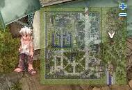
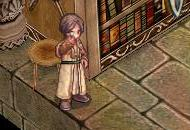
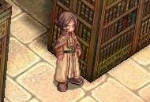
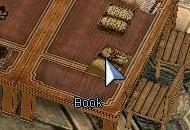
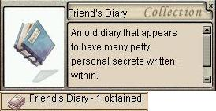
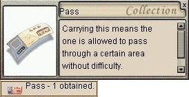

# Friendship Quest

<!-- Quest info -->
- **Level requirement:** 50
- **Base EXP reward:** -------------------- * Level 50-75 = 400,000 EXP * Level 75-90 = 800,000 EXP * Level 91-99 = 1,400,000 EXP [EXP is given in two parts]
- **Item reward:** Pass, Knife \[3\]
- **Window:** yes

1. Find Maku ([Lighthalzen](Lighthalzen.md) 337, 232) and talk to him. To get to the "slums" you need to talk to the guard at (lighthalzen 267, 200) repeatedly, you'll eventually get through. He'll ask you to go to the place where wealthy people live.

2. Go inside the Hotel ([Lighthalzen](Lighthalzen.md) 158, 131) and walk upstairs. In the 1st room on your left (lhz_in02 237, 200) (walk down) resides Digotz (lhz_in02 201, 210). Talk to him and you'll notice he talks like Maku as well.

3. Return to talk to Maku again. He'll talk about their past.

4. After that, go find Digotz. He'll curse Maku. '*Take down the words that Digotz wants you to relay to Maku. It is case sensitive,*word for word and punctuations!***Hopeless bastard!*

*You're still a stubborn jerk!*

*You owe me at least 3 lunches!*

*Not to mention an apology!*

*But who cares what you think?!*

*I'm so goddamn happy without you!*

5. Return to Maku and pass along Digotz's words, one line at a time. Maku almost breaks down after hearing it. Talk to Maku again and you'll lose 50% [HP](Max_HP.md). Try to calm him down. He'll tell you about his other friend Benkaistein.

6. Go back to the Hotel and tell Digotz you have a message for him and tell him exactly what Maku mentioned. He'll mention Benkaistein as well.

From listening to both of them, Benkaistein seems to like to read books. So you need to head to the Juno Library.

7. In the [Juno](Juno.md) Library (yuno 340, 203) you need to find Student (yuno_in04 107 14) in the room to your south when you enter second hall of the library, and ask for Benkaistein. Student will tell you he's in the north side/opposite room.

8. Talk to Benkaistein ([NPC](NPC.md) is named "Passionate Student" at yuno_in04 96, 106) about Maku and Digotz. He says he'll help to resolve their issue but is busy. He'll trying to find a book that will help resolve the miss-understanding. So you help him out.

9. The book is at (yuno_in04 167, 115) on the table. You'll obtain Friend's Diary.

10. Tell Benkaistein you found his diary. He'll tell you to**show this diary to both of them'''.

11. Head back to [Lighthalzen](Lighthalzen.md)'s Hotel and find Digotz, then show him the diary. Digotz wishes to visit Maku.

12. Then go show the diary to Maku. You'll get some experience depending on your base level.

*  [Gained Experience]
  * Level 50-75 = 200,000 [EXP](Experience.md)
  * Level 75-90 = 400,000 [EXP](Experience.md)
  * Level 91-99 = 700,000 [EXP](Experience.md)

13. Go back and visit Digotz. Unfortunately he gets ambushed and killed, you will then pull out the dagger that killed him. You'll obtain Knife \[3\] and it's over with both Digotz and Maku.

14. Finally, go back to Juno and tell Benkaistein you did what he asked. You'll get some [EXP](Experience.md) depending on your [Base Level](Levels.md) and a Pass.

*  [Gained Experience]
  * Level 50-75 = 200,000 [EXP](Experience.md)
  * Level 75-90 = 400,000 [EXP](Experience.md)
  * Level 91-99 = 700,000 [EXP](Experience.md)

*  The Pass allows you access to the Lighthalzen Slums regardless of there being an alert or not.

---
**Categories:** [Base Experience Reward](categories/Base_Experience_Reward.md), [Lighthalzen Quests](categories/Lighthalzen_Quests.md), [Quest Window Quests](categories/Quest_Window_Quests.md), [Quests](categories/Quests.md)
*Source: [iRO Wiki Classic](https://irowiki.org/classic/Friendship_Quest) — GFDL 1.3+*
