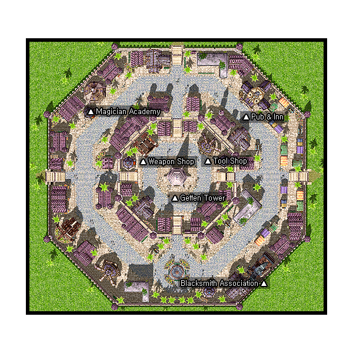

# Geffen

## About Geffen

Geffen is the city of magic. It is home to the [Mage](Mage.md) and [Wizard](Wizard.md) guilds. Its most prominent feature is the looming Geffen tower, in the middle of town.

## Story

Geffen is located on the west side of the Mt. Mjolnir range. Word has it that the city was built by great Wizards of the past as they believed and in magic. The Wizard Magic Academy is located at the center and the Mage Guild is located on the outskirts of the city. It is an ideal place to gather all different sorts of magic equipment. Even until now, the city`s lights are always on as there are many who research and develop more magic. It is also near the Glast Heim Castle where it is said to have housed gods a long time ago.

## Guide

**Notes:**

* The Tool Shop location listed here is incorrect. The correct building is at the lower left corner.

## Structures

## Buildings

* 1 - Forge Shop (180,61)
* 2 - Geffen Tower (120,113)
* 3 - Inn (170,172)
* 4 - Magic Academy (64,177)
* 5 - Pub (137,137)
* 6 - Tool Shop (45,87)
* 7 - Weapon Shop (100,139)

## Billboards and Signs

* Bulletin Board - Geffen: The City of Magic (124,65) - Gives background information on Geffen
* Geffen Bulletin (116,58) - Flavor Text
* Sign (61,174) - Flavor Text
* Sign (183,61) - Flavor Text
* Sign (168,175) - Flavor Text
* Billboard (113,104) - Flavor Text
* Sign Post (119,190) - Gives general directions

## Guild Flags

* Repherion Guild Flag (109,123)
* Eeyorbriggar Guild Flag (112,129)
* Yesnelph Guild Flag (120,132)
* Bergel Guild Flag (127,130)
* Mersetzdeitz Guild Flag (131,123)

## NPCs

## Regulars

Guides - Geffen Guide are at (118,62) and (203,116)
  Shows Magic Academy, Forge Shop, Weapon Shop, Tool Shop, Pub, Inn, Geffen Tower on minimap
Kafra Employees are at (120,62) and (203,123)
  Save, Kafra storage (30z), Teleport service, Rent cart, Reserve points, Kafra location
At Ifrit (Inn, first floor, south middle room)
Inn Employee - Employee Cena - Save, Rest (5000z)
  PVP Narrator
  Gate Keeper
At the Forge (Forge Shop, first floor)
  Level 1/2 metal NPC - Christopher - Christopher Guillenrow
  Level 3/4 metal NPC - Christopher - Christopher Guillenrow
At the Weapon Shop
  Repair NPC - Repairman

## Store NPCs

Pet Merchant (193,152)
  Pet Food, Pet Incubator, Backpack, Rocker Glasses
Weapon Dealer (Weapon shop)
  Arrow, Silver Arrow, Sword, Bow, Knife, Cutter, Main Gauche, Dirk, Dagger, Stiletto, Rod, Wand, Staff, Arc Wand
Armor Dealer (Weapon shop)
  Novice Armlet, Guard, Mirror Shield, Sandals, Hood, Gemmed Sallet, Cotton Shirts, Jacket, Adventurer's Suit, Silk Robe, Silver Robe
Tool Dealer (Tool shop, north room)
Arrow, Magnifier, Red Potion, Orange Potion, Yellow Potion, White Potion, Green Potion, Concentration Potion, Awakening Potion, Fly Wing, Butterfly Wing, Grampa Beard
Magic Tool Dealer (Tool shop, north room)
  Blue Gemstone, Rod, Wand, Staff, Arc Wand, Circlet, Silk Robe, Silver Robe
Seller (Tool Shop, south room)
  Jellopy, Scell, Garlet, Zargon
Mage Assistant (Magic Academy)
  Empty Test Tube, Empty Potion Bottle

## Trade NPCs

Smile Assistance - Smile Girl (119,107)
  Mr. Smile for 10 Clover, 10 Fluff, 10 Jellopy
Argen (129,148)
  Flower Hairpin for 1 Romantic Flower, 10 Steel and 20,000 Zeny
  Giant Band Aid for 1 Alcohol, 500 Rotten Bandage
  X Hairpin for 1 Stellar, 400 Ectoplasm
Seth (83,189)
  Tulip Hairpin for 1 Scarlet Dyestuffs, 1 Mr. Smile
Ipore (67,87)
  Decorative Mushroom for 300 Mushroom Spore
Merchant (173,88)
  *Amount traded is selectable*
  Red Potion for 5 Shell
  Red Potion for 6 Chrysalis
  Red Potion for 10 Jellopy
Blacksmith (Forge Shop, second floor, north room)
  Welding Mask for 50 Steel, and 2,000 Zeny
Eric (Inn, first floor, west room)
  Headset for 40 Steel, 1 Coal, 1 Alcohol, 1 Oridecon
Christopher - Christopher Guillenrow (Forge Shop)
  *Amount traded is selectable for Mini-Furnaces*
  Anvil for 30,000 Zeny
  Oridecon Anvil for 120,000 Zeny
  Golden Anvil for 300,000 Zeny
  Mini-Furnace for 150 Zeny
  Iron Hammer for 1,000 Zeny
  Golden Hammer for 3,000 Zeny
  Oridecon Hammer for 5,000 Zeny
Suspicious Guy (146,148)
  Scammer
  *Amount traded is selectable*
  Red Potion for 500 Zeny
  Main Gauche for 9,400 Zeny
  Hood for 930 Zeny
Molgenstein - Chemist Molgenstein (Forge Shop, second floor, south room)
  Counteragent for 1 Detrimindexta, 1 Alcohol, 1 Empty Bottle, 3,000 Zeny
  Mixture for 1 Karvodailnilrol, 1 Alcohol, 1 Empty Bottle, 4,000 Zeny

## Quest NPCs

* Aure Dupon (181,114) : Part of [Hair Styling/Dye Quests](Hair_Styling_Dye_Quests.md)
* Molgenstein - Chemist Molgenstein (Forge Shop, second floor, south room) : Part of [Hair Styling/Dye Quests](Hair_Styling_Dye_Quests.md)
* Bard - Errende (132,38) - [Geffen Bard Quest](Geffen_Bard_Quest.md)
* Mage Guildsman (Magic Academy) - [Mage](Mage.md) job change NPC
* Blacksmith - Aumgarl (Inn, first floor, north room) - [Chief's Quest](Chief's_Quest.md)
* Girl - Lyroo (Inn, second floor, north room) - Chief's Quest
* Baisulist (46,164) - Part of Blacksmith job change quest
* Guild Staff (Magic Academy) - Part of [Merchant](Merchant.md) job change quest
* Great Wizard - BLIZZARDRISS (Magic Academy) - Teaches [Energy Coat](Energy_Coat.md)
* Bookshelf - Guide Book (Magic Academy) - Part of Mage job change quest
* Mixing Machine (Magic Academy) - Part of Mage job change quest
* Wizard Guildsman (Geffen Tower, top floor) - [Wizard](Wizard.md) job change NPC
* White Dog - Dog (Geffen Tower, top floor) - Part of Wizard job change quest
* Gloomy Wizard - Raulel (Geffen Tower, top floor) - Part of Wizard job change quest

## Travel NPCs

Kafra Employee (120,62) and (203,123)
  [Prontera](Prontera.md) - 1200z
  [Al De Baran](Al_De_Baran.md) - 1200z
  Orc Dungeon - 1700z
  [Mt. Mjolnir Dead Pit](Mt._Mjolnir_Dead_Pit.md) - 1700z

## Background NPCs

* Stacey (111,48) - Talks about Orc Village
* Meera (59,143) - Talks about Royal Jelly
* Orwalk (156,190) - Talks about Yggdrasil and Yggdrasil related items
* Theodore (Weapon Shop) - Rants about [Mage](Mage.md) frailty.
* Crumpler (Pub) - Drunk Mage hater.
* Waitress - Elenore (Pub) - Talks about the Pub's customers and gossip. (gossip option has five sets of conversation) Plus: Booze teh outlawed :(
* Psychic Advisor (Pub) - Tells your fortune.
* Skyler (Inn, first floor, south middle room) - Talks about Eric
* Merchant Daven (Inn, first floor, south middle room) - Talks about Geffen's [Mage](Mage.md), [Wizard](Wizard.md) and [Blacksmith](Blacksmith.md) population. Also, "the world's most prettiest street merchant".
* Waitress - Elisa (Inn, first floor, south middle room) - Booze teh oulawed. If prompted, gives "gossip". (gossip option has five sets of conversation)
* Monster Scholar - Estheres (Inn, first floor, east room) - talks about [Monsters](Monster.md)
* Hadenheim - Hans Hadenheim (Inn, first floor, east room) - Talks about the Schwarzwald Republic
* Ralphie (147,26) - talks about Mighty Staff
* Wizard Stanza - Stanza (Magic Academy) - talks about Gemstones.
* Citizen (203,146) - talks about a weaponsmith who was the sole survivor of an attempt with his four sons to create a great weapon. quest?
* Crusader - Zan.Huadoku (Forge Shop, first floor) - talks about the importance of supplies or the effect of [DEX](Stats.md) and [LUK](Stats.md) on creation skills.

## Dungeons

* [Geffen Tower Dungeon](http://ro.amesani.org/db/map-info/gef_dun00/)
A medium-sized dungeon of four maps lies below Geffen. It can be accessed by going down the stairs in Geffen Tower, in the center of the city.

* [Orc Dungeon](http://ro.amesani.org/db/map-info/orcsdun01/)
A small dungeon South of Geffen that is rabidly infested with undead Orcs. It is located in the Northwest corner of (-4,-1) on the world map. There is also a second entrance (which leads to level B2 of the Orc Dungeon) slightly north-east of the center of the same map.  The Geffen [Kafra](Kafra.md) employees will teleport you there for 1700z.

* Glast Heim
Known as the Forbidden City, Glast Heim is located (-7,2) on the world map, one world map square north and three squares west of Geffen. Consisting of a massive sixteen maps, it is the largest dungeon in the game. Based off the Norse Mythology: Glaðsheimr.  If Cool Corp. has won the [Dungeon Teleport Election](Kafra.md), then Cool Corp. employees can teleport you to the entrance for a ???z fee.

* Geffenia
Geffenia is a subterranean dungeon sealed by the magic of the Geffen Tower and Geffen Fountain. This new dungeon is composed of 4 maps, each with its own beautiful and enchanting scenery. Within it resides a vast array of powerful monsters, some of which are found only there. In order to gain access to the dungeon, one must first acquire [Lucifer's Lament](http://ro.amesani.org/db/item-info/7025/), a gem that can be obtained through the [Sign Quest](Sign_Quest.md).

**Related pages:**

* [Towns](Towns.md)
* [Rune-Midgarts Kingdom](Rune-Midgarts_Kingdom.md)
* [Alberta](Alberta.md)
* [Al De Baran](Al_De_Baran.md)
* [Archer Village](Archer_Village.md)
* [Comodo](Comodo.md)
* [Geffen](Geffen.md)
* [Izlude](Izlude.md)
* [Morroc](Morroc.md)
* [Payon](Payon.md)
* [Prontera](Prontera.md)
* [Umbala](Umbala.md)
* [Republic of Schwartzvald](Republic_of_Schwartzvald.md)
* [Einbech](Einbech.md)
* [Einbroch](Einbroch.md)
* [Hugel](Hugel.md)
* [Juno](Juno.md)
* [Lighthalzen](Lighthalzen.md)
* [Arunafeltz States](Arunafeltz_States.md)
* [Rachel](Rachel.md)
* [Veins](Veins.md)
* [Manuk](Manuk.md)
* [Amatsu](Amatsu.md)
* [Ayothaya](Ayothaya.md)
* [Kunlun](Kunlun.md)
* [Jawaii](Jawaii.md)
* [Louyang](Louyang.md)
* [Moscovia](Moscovia.md)
* [Nifflheim](Nifflheim.md)
* [Lutie](Lutie.md)

---
*Source: [iRO Wiki Classic](https://irowiki.org/classic/Geffen) — GFDL 1.3+*
