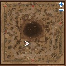
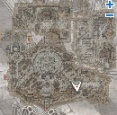

# Geffen Bard Quest

<!-- Quest info -->
- **Level requirement:** N/A (50-60+?)
- **Item requirement:** 1 Magnifier
- **Base EXP reward:** Varies

1. Go to the bard in [Geffen](Geffen.md), just east of the spawn point (132, 38). Ask him to play a song. When he asks what kind, choose upbeat song. He'll sing the song, but then will say that he forgot one line (Note: you may have to ask him many times since it is random). Eventually, he'll ask you for help. Choose "Sure, no problem." He'll tell you to find Gunther Doubleharmony and tell him that Minty Errende forgot the line of the song "At One, I Fall in Love," and the line is called the "Eighth Love." Talk to him again and he'll tell you that he's lost his heart to sing.

2. Go to [Payon](Payon.md) town and find Gunther Doubleharmony at (180, 172). He'll ask you to type in the name of the song exactly (At One, I Fall in Love) and who sent you to ask (Minty Errende). He'll then scribble something on your back.

3. Go back to Minty Errende in Geffen, and he'll say the lyric was changed, and can't remember who changed it. He'll ask you for the lyric, but you don't have it yet. (When prompted to answer who changed the lyrics, you can answer Kino Kitty. By doing this, instead of directing you back to Doubleharmony, he'll direct you to Kino Kitty and you can skip to step 6).

4. Go back to Gunther Doubleharmony in Payon, and he'll tell you that the song was changed by Kino Kitty.

5. Go back to Minty Errende, and type in the name of the person who changed the lyrics (Kino Kitty). He'll ask for your help again, choose "I can, so stop crying." He'll then tell you that someone in [Juno](Juno.md) can help you find Kino Kitty.

6. Go to Juno (93, 180) west of the central circle and enter the building there. Speak to "Representative" and he'll tell you that Kino Kitty is in [Morroc](Morroc.md).

7. Go to Morroc and Kino Kitty is at (134, 110), standing next to a little girl. Talk to him, and choose "Sorry for interrupting," then "I'm looking for Kino Kitty." He'll tell you that you need a old book of edda for the original lyrics, and that the bookstore is in Juno.

8. Go back to Minty Errende in Geffen, and he'll give you a Seal of Friendship mark on your LEFT hand, and then tell you to go to Mr. Sketzi's bookstore in Juno.

9. Go to Juno and Mr Sketzi's bookstore is at (264, 87) a little west of the southeast kafra. Talk to the man behind the counter, and show him your LEFT hand. He'll then let you read the books in the shop. You can have two choices now: read the old book and go to Minty Errende or visit Kino Kitty after talking to Mr Sketzi.

**Option A : Read the book.**

1. Look for the Old Book in the corner and read it. You might want to repeat attempt to read it several times.
Upon success, it will tell you the 8th line is "At Eight, we're both in love." Your character will make a note of this.

*  Note: You may need to drop the Magnifier/s in your inventory so that you can read the Old Book.

2. Go back to Minty Errende in Geffen, and he'll go through his song and give you EXP in exchange for completing the quest.

**Option B : Visit Kino Kitty.**

1. After Mr Sketzi let you to see the book, just go back to Morroc and talk to Kino Kitty. He will replace Mint Errende's friendship mark with his own and then ask you to deliever letter for Errende.

2. Upon visiting Minty Errende again, you will learn the letter contains correct lyrics. After that Minty will sing the song for you and give you EXP reward.

*  BaseLevel < 56 = 4500
*  BaseLevel > 55 and BaseLevel < 61 = 5500
*  BaseLevel > 60 and BaseLevel < 66 = 9684
*  BaseLevel > 65 and BaseLevel < 71 = 13411
*  BaseLevel > 70 and BaseLevel < 76 = 35757
*  BaseLevel > 75 and BaseLevel < 81 = 60246
*  BaseLevel > 80 and BaseLevel < 86 = 70340
*  BaseLevel > 85 and BaseLevel < 91 = 92052
*  BaseLevel > 90 = 156786

---
**Categories:** [Base Experience Reward](categories/Base_Experience_Reward.md), [Quests](categories/Quests.md)
*Source: [iRO Wiki Classic](https://irowiki.org/classic/Geffen_Bard_Quest) — GFDL 1.3+*
