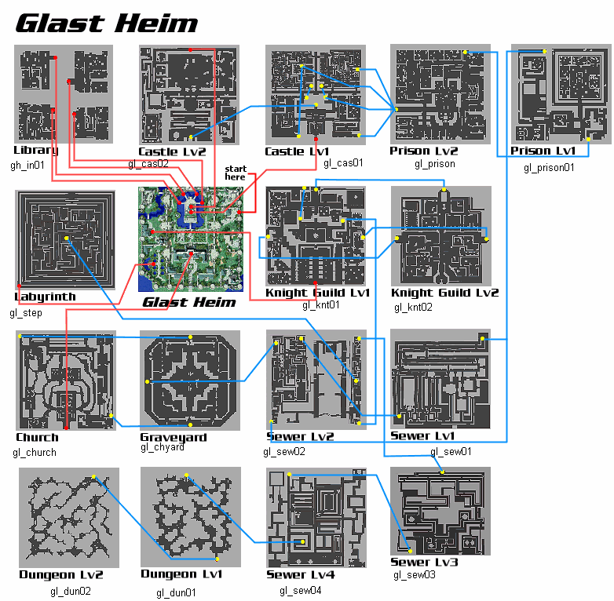

# Glast Heim Spotlight

<!-- Quest info -->
- **Level requirement:** 50
- **Item requirement:** 20 Worn Out Page
- **Hunting:** 1 Majoruros
- **Quests required:** [Lost Spirits](Nifflheim_Spotlight.md)
- **Base EXP reward:** 750,000 (VIP) 500,000 (Non-VIP)
- **Job EXP reward:** 450,000 (VIP) 300,000 (Non-VIP)
- **External:** <http://www.playragnarok.com/news/eventdetail.aspx?id=216>
- **Window:** yes

1. Find **Anvian** upstairs in the Geffen Inn at (geffen_in 107 39), who tells you that **Orovan** has yet to return from Glast Heim. He asks you look around the castle grounds for him.
1. Find **Orovan** at Glast Heim (glast_01 201, 335). He asks you to look around the castle grounds for his pocket watch.
1. Check the various locations at:
  * Glast Heim (glast_01 339,51) = Southeast Corner
  * Glast Heim (glast_01 324,376) = Northeast Corner
  * Glast Heim (glast_01 40,69) = Southwest Corner
  * Glast Heim (glast_01 28,327) = Northwest Corner
1. Once you’ve found it, return to **Orovan**, who thanks you and tells you about a strange group of statues he found inside.
1. Find the statues around Glast Heim 2F (gl_cas02 91 89).
  * Mini-game: Every few minutes the statues will have a different sequence in which they glow. The player needs to repeat the sequence. Once the last statue is talked to, the player finds a small key and a tattered page.
1. Go back to **Orovan** who tells you a bit about the castle’s history. He suggests you look for the lock the key opens on the same floor as where you found it.
1. Find the box at Glast Heim 2F (gl_cas02 168 12). Using the key, you open it and find a tattered note as well as a page out of a book. The note instructs you to find the bull.
1. Find the **Bull’s head** at Glast Heim 2F (gl_cas02 12, 8). You must test your strength by challenging it.
  * Spawn 1 Majoruros nearby. It must be defeated to continue.
1. Once it is defeated, talk to the bull again and the hand opens to reveal another page and a key marked “Fire”.
1. Return to **Orovan**, who tells you about the four values of Glast Heim: Wisdom, Strength, Humility and Courage. Since you have already completed the first two, there must be two more challenges left to complete. He tells you he’ll meet you down further in the dungeon, but suggests you check out the first level of the **Underprison** for anything that might show humility towards the prisoners who were kept there.
1. Find the bucket of water by the **guillotine** at Glast Heim Underprison (gl_prison 109 92), where you find another key (Water) but no page. You hear a lion roar in the distance. Since **Orovan** was checking the lower level of the Underprison, you decide to check the first level of the sewer.
1. Talk to the **Lion Heads** in order:
  * Glast Heim Culvert 1 (gl_sew01 47,207) = lion head (top left)
  * Glast Heim Culvert 1 (gl_sew01 159,206) = lion head (top center)
  * Glast Heim Culvert 1 (gl_sew01 223,170) = lion head (right)
  * Glast Heim Culvert 1 (gl_sew01 148,170) = lion head (center)
1. They tell you a story about the castle’s fall. When you talk to the last one, you hear a much louder roar from the next floor. You are instructed to talk to the **large head** in the top left corner of the second floor of the sewer.
1. Find the **Lion Head** at Glast Heim Culvert 2 (gl_sew02 82,251), who wishes to test your courage by reaching into its mouth. Reaching in slowly or quickly cause you to lose health, while reaching in confidently allows you to proceed.
1. Once you are successful, you receive another key (Earth), but once again there is no page. The lion tells you that he saw an old man pass by earlier, and that he is still on that floor.
1. Find **Orovan** at Glast Heim Culvert (gl_sew02 199,40). He asks you if you hear anything coming from the water.
1. Talk to the **Lost Spirit** at Glast Heim Culvert (gl_sew02 210,40) (**Note: This NPC is underwater**). It tells you more about the downfall of Glast Heim.
1. Talk to **Orovan** again, who suggests you continue down to the lowest level of the dungeon.
1. Make your way down to Glast Heim Cave (gl_dun02 52,269) where **Orovan** is waiting. He speculates that this must be the “Tome of the Dark Lord”, but tells you many of its pages are missing. You determine the ones you have collected are just some of the missing pages. **Orovan** asks you to look around the cave a bit more.
1. Talk to these NPCs (in no particular order):
  * Glast Heim Cave (gl_dun02 55,268) = The Book
  * Glast Heim Cave (gl_dun02 80,193) = The Book 2
  * Glast Heim Cave (gl_dun02 49,250) = The Sword
  * Glast Heim Cave (gl_dun02 33,163) = Tent
1. Walk near the following locations (in no particular order):
  * Glast Heim Cave (gl_dun02 167,35) = Tunnel 1 (Fire)
  * Glast Heim Cave (gl_dun02 275,100) = Tunnel 2 (Earth)
  * Glast Heim Cave (gl_dun02 20,27) = Tunnel 3 (Water)
1. Return to **Orovan** (on the same floor), who speculates that the scattered pages you’ve seen throughout Glast Heim probably belong in the book. He is worried about the pages that weren’t with the puzzles as well as the gates and tent you’ve found, but suggests that you speak to **Kazien** about them before taking more action. He asks you to return to **Anvian** to tell him what you’ve found.
1. Collect 20 Worn Out Pages and talk to **Orovan** back outside of Glast Heim.
1. Return to **Anvian**. You fill him in on the events at Glast Heim, and he thanks you and rewards you with Experience.

---
**Categories:** [Base Experience Reward](categories/Base_Experience_Reward.md), [Job Experience Reward](categories/Job_Experience_Reward.md), [Quest Window Quests](categories/Quest_Window_Quests.md)
*Source: [iRO Wiki Classic](https://irowiki.org/classic/Glast_Heim_Spotlight) — GFDL 1.3+*
