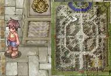
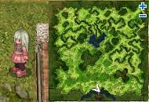
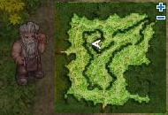
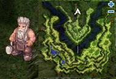
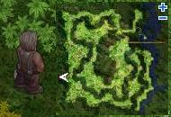
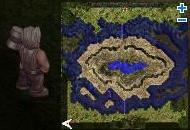

# God Items Quest

<big>**For information on Seal status and a list of God Item owners, see this

> **Thread** — id: 49925 thread

.**</big>

<!-- Quest info -->
- **Level requirement:** 70 - 60 - 70 - 70
- **Item requirement:** 15 Types of Fish/Water Items (9 of each Type), Lantern x 1 *OR* Magnifier x 1, Slick Paper x 2, Oil Paper x 1, Squid Ink x 3, Feather of Bird x 3, Blue Gemstone x 20, 2 Alcohol, Weapon upgraded to the server's safe limit (or higher) Level 4 Equipable Weapon, Oridecon x 1, Red Potions x 5 to 10, Rough Oridecon x 50, Rough Elunium x 50
- **Items required:** 1 Type of Doll, Green Herb x 1, Hammer of Blacksmith x 1
- **Base EXP reward:** 3,600,000, 1,200,000
- **Job EXP reward:** 2,700,000
- **Item reward:** 10 Yellow Gemstones or 5 Blue Gemstones, 1 Random Equipment, Old Blue Box,Ancient Card Album, Level 4 Weapon

## Note

* Items/Rewards are color-coded based on which Seal they are used in/come from.
* Players can check the global status of the seals and any of their character's current status by visiting the sign post located in upper-mid [Prontera](Prontera.md) (prontera 113, 293).
* On Classic Loki, players will receive a Token after completing each of the four Seal quests. For information about the use of Seal Tokens refer to [God Item Creation](God_Item_Creation.md) quest specific to Classic server.

## Quest Progress

This quest is composed of four smaller quests; in each quest, when 50 players complete it, the seal of the next quest will "opened", and all players on the server have access to that next subquest. When 100 players complete it, a seal is "closed" and that particular subquest cannot cannot be started/completed. Basically, each quest needs to be completed 50 times for the general quest to progress; the remaining 50 times before the quest is closed is simply for those who would like the rewards. When the final seal is opened, a God Item can be created. When that is accomplished everything returns to zero. Serverwide broadcasts notify players when a seal is opened or closed.

*On the iRO Premium Server Ymir, only 25 players need to complete each subquest to open the next, and only 50 people are needed to close it.*

## Seal of Sleipnir

*  Note: Players must be lvl 70 and above to complete this quest. At least 50 players need to complete this quest before the seal of Megingjard will become available. After 100 players have completed this quest, it will close.

*  Note 2: You can start with any room you want, but then the order of rooms change. If the NPC doesn't ask you to do something then move to another one of them should interact with you.

1. Talk to Noyee, resident of Juno (161,200) to activate the quest .

2. Proceed to the building in [Juno](Juno.md) at (217,176).

3. Talk to Cukure, at the counter.

4. Acquire the temporary pass for the laboratory.

5. Enter through the portal at the left of the room.

6. You will find 4 rooms when you enter:

## 1st room (Upper Left Room)

1. Talk to Hallandaute.

2. Proceed to the item shop in [Juno](Juno.md) and talk to the NPC Wagan (193,141).

3. Wagan will ask for your help in solving a problem with the Mad Scientist Metto.

4. Proceed to the room in [Juno](Juno.md) to find Metto (277,287).

5. Talk to Metto and stop him from making his experiments.

6. Go and find Stangekle (51,151) and stop his experiment.

7. Go back to Metto (277,287).

8. Go and find Kato, (51,105) and stop him too.

9. Go back to Metto (277,287).

10. Find CiCi in the Sage Test building (323,280). He will be in the second little enclosure on your right.

11. Return to Metto (277,287), and he will claim that he won't do any research again.

12. Return to Wagan (193,141). Wagan will hand out 10 Yellow Gemstones or 5 Blue Gemstones (Random Gemstones?) as a reward.

13. Return to Hallandaute. Talk to him repeatedly until he speaks about Sleipnir. This ends the process for this part.

## 2nd room (Lower Right Room)

1. Talk to Pavel.

2. Examine the stone tablet near Pavel.

3. Talk to Pavel to learn that the trigger on the stone tablet has to be activated.

4. Examine every word and you will find something strange about it.

5. There will be a keyword in the strange spot of the sentences. Find it and type it in.

6. After you've done so, you'll find the complete content of the stone tablet.

*  You will be prompted to write the key words.
  * 1st Word: "dirdnl," then press ok.
  * 2nd Word: "tkaryf," then press ok.
  * 3rd Word: "ghswka," then press ok.

*  All 3 words must be written without quitting the chat or you must enter them again. Once you're done reading the stone tablet, talk to Pavel.

7. After the conversation ends, Pavel will thank you. This ends this stage of the quest.

## 3rd room (Upper Right Room)

1. Talk to Kurdt and you'll be requested to collect materials from 15 types of fish/water element creatures. 9 units are required for each type.

More easily, bring 9 each, of any 15 items in the list below:

Items that work:

*  Ancient Lips
*  Ancient Tooth
*  Clam Flesh
*  Clam Shell
*  Conch
*  Coral Reef
*  Crab Shell
*  Detonator
*  Fin
*  Fish Tail
*  Gill
*  Heart of Mermaid
*  Nipper
*  Sharp Scale
*  Single Cell
*  Squid Ink
*  Sticky Webfoot
*  Stinky Scale
*  Tendon
*  Tentacle

Note: Even though the NPC asks for 10 of each type, they take 9.

2. After everything is collected, talk to Kurdt to give the items. He will thank you the players. This ends the current stage.

## 4th room (Lower Left Room)

1. Talk to Aadin. He will ask for help investigating a story in [Payon](Payon.md).

2. Look for Lania (The NPC appears as "Friar") in [Payon](Payon.md) 81,171) and talk to him. Select "Umm...", then "Sleipnir's Story". Whenever he asks if you want to take a break, tell him to keep going, though "take notes" is also acceptable.

3. Listen to everything Lania says, then return to Aadin.

4. During the conversation, you discover some parts of the story are missing, and you need to find Lania. Repeat the previous procedure to listen to all of the story.

5. Go back to Aadin and choose either option. He will thank the player for gathering all of the story and this will end this part of the quest.

## Unlocking the Seal of Sleipnir

After all the quests in the 4 rooms have been solved, return to the counter and talk to Cukure. The player will receive a random equipment.

## Seal of Megingjard

*  Note: Players must be lvl 60 and above to complete this quest. At least 50 players need to complete this quest before the seal of Brisingamen will become available. After 100 players have completed this quest, it will close.

Items necessary for this quest :
*  2 Slick Paper
*  1 Oil Paper
*  3 Squid Ink
*  3 Feather of Bird
*  20 Blue Gemstone
*  2 Alcohol
*  1 Lantern ***OR*** 1 Magnifier
Other items necessary (will not be consumed):
*  1 Green Herb
*  1 Doll

1. Talk to Rebarev Doug in [Prontera](Prontera.md) castle (prt_castle 44, 151). Agree to help him, then talk to him again and choose "I am about to leave" until a third option appears. Choose this option and do not talk to him again.

2. Go to the Library (prontera 120, 266) and speak to the Librarian.
*  What kind of files are you looking for?
*  Input: "**the 1st squad's final mission**"

3. Talk to Librarian Jekan again with 1 Lantern (from Skel Worker) or Magnifier in your inventory.
* Select in this order:
  * "Let me help you find those files...,"
  * "You have bad eyes?"
  * "No, I don't mind!" to lend him the Lantern.
  * "I want to read some documents."

* Note: If these steps do not work and the reply is "maybe yes maybe no", try returning to Rebarev Doug in the castle and repeat until the third option is obtained.

4. Search for documents on the wall. Keep clicking on any of the files until you find "The 3rd Platoon Records".

5. He will ask the player to collect the following so that he can create a copy of the record:

* **Slick Paper x 2**
* **Oil Paper x 1**
* **Squid Ink x 3**
* **Feather of Bird x 3**
* **Blue Gemstone x 20**

6. He will ask the player to wait for him to create the copy of the record. Keep clicking him until he hands over the records.

7. Talk to the librarian again and select "Record Search."

8. Enter "**crusader 3rd_company 3rd_platoon 1st_squad record**" as the search keyword. You will receive some information for your search.

9. Go to Geffen Blacksmith Shop at (179,62) (geffen_in 109, 161) and talk to Zan Huadoku. Choose option 1 ("1st Squad"), then option 3 ("last mission").

10. Keep talking to this NPC until he speaks about the unknown fragment. After that, talk to him again until he repeats himself.

11. Move to [Morroc](Morroc.md) (272,269)(morocc_in 146, 179) and talk to the Inn Employee in the [PvP](PvP~d29d2.md) House in the top right of Morroc. then, enter "**Donon**".

12. Select any of the options until you receive a clue that says "Aragham never hoarded upgrade items."

* Note: There is a chance you might be killed by this NPC. If this happens, simply return and talk to her again. Alternatively, if you get the text that says she will knock you out, you can log out to avoid death.

13. Go to Fortress Saint Darmain (South) (cmd_fild09 106, 195) and enter the clue the Inn Keeper told you. If you enter the clue correctly, you will be allowed to enter the rogue guild.

14. Find a Suspicious Man at (in_rogue 243, 61).

* Note: You must bring a doll with you before you talk to this NPC. Any doll is accepted.

15. Talk to him and select option 2 ("how he's been doing"), then option 1 ("about the Inn Maid"), then option 3 ("1st Squad's final mission").

  When the option "Megingjard" appears, select the "Listen to him quietly" option. This option is actually camouflaged. You must highlight it to obtain it. If you accidentally miss this option you can talk to his sister again (steps 11 and 12) to reset it.

* Note: Even if you think you've successfully completed step 15, it's possible you made a mistake without knowing it.  Be absolutely sure you've completed it correctly, or you won't be able to proceed later on.

16. Go to [Alberta](Alberta.md) and talk to Jack O' at (alberta 196, 146). Select option 3 ("1st Squad's final mission"), then option 1 ("Rebarev Doug"). Keep talking to him until you get a message that says he's chewing green herbs.

17. Go to [Aldebaran](Al_De_Baran.md) and talk to Emma Searth who can be found at (aldebaran 66 213). Please take note that you must bring a Green Herb before you start the conversation with her. Ask her about memories she can remember.

18. Go to [Jawaii](Jawaii.md) by talking to SoloHan at the [Prontera](Prontera.md) Pub (prontera 205, 157).  Married people must pay 100,000 Zeny from the NPC near the [Izlude](Izlude.md) Dock (173,185). The bar on Jawaii is at (192,220).

* Note: You can't leave the bar if you are not married, and can either bring a butterfly wing or drink until the bartender kills you.

19. Talk to The Nineball a Crusader Officer in Jawaii's bar (jawaii_in 44, 110). Repeat talking to him until you can't get any further information from him.

20. Go to [Comodo](Comodo.md)'s casino (144,113) and bring 2 Alcohol, and go to the NPC called 'Man' (cmd_in02 190, 94). Select the option "Ask him about Rebarev Doug" first. Then, select the option "Discuss hobbies" and repeat this twice, using all of the Alcohol.

Note: If this NPC doesn't interact, talk to the Geffen Crusader Zan Huadoku again to fix it. Sometimes the quest messes up, but it can be fixed.

21. Talk to him again and choose "talk about gambling."

22. Go and find Rebarev Doug. You **must** select the option "Act Unsuspicious."

23. Move to [Nifflheim](Nifflheim.md) (niflheim 109, 254) and find Egnigem. Select the last option ("I've heard enough").
* Note: You do not have to listen to his long and boring story.

24. Go back to the Prontera castle and finish the conversation with Rebarev Doug, then talk to Max Von Shedough at (prt_castle 48, 164) until getting a message about documentation. He is behind the wall next to Rebarev Doug.

**THIS IS THE 'FINAL' NPC.** The completion count for the second seal will increase by 1 after you speak to the Judge, Max Von Shedough. The final 3 steps can be delayed indefinitely.

25. Return to Egnigem and talk to him. He will convert his life force to some experience points for you.
*  Obtain 1,200,000 base EXP and 900,000 job EXP.

26. Return to [Aldebaran](Al_De_Baran.md) and find Emma Searth. Talk to her and you can receive an Old Blue Box and some experience.
*  Obtain 1,200,000 base EXP and 900,000 job EXP.

* Added for iRO, those that have previously completed this seal can still get this final step.
27. Speak to Max Von Shedough in Prontera Castle once more for additional Exp reward
*  Obtain 1,200,000 base and 900,000 job EXP.

*(Non-iRO servers give a different EXP reward that scales by player level.)*

## Seal of Brisingamen

*  Note: Players must be lvl 70 and above to complete this quest. At least 50 players need to complete this quest before the seal of Mjolnir will become available. After 100 players have completed this quest, it will close.

*  Important: At step 10, **do not talk to the Library guard at all.** Doing so will reset the player back to step 5. Just talk to the bookshelf until the guard will not let you, then continue on.

1. Go to the South of [Prontera](Prontera.md) and Talk to Nelliorde (prt_fild08 175, 374). Select "Wee I want to hear!," then select "Sure! Sounds good."

2. Go to Juno and talk to Enrico Kaili in [Juno](Juno.md) (95,184) (yuno_in04 47, 113). Then select "I can do that!"

3. Go to the Prontera Church (prt_church 112, 105) and talk to Hermite Charles. Select "Give him Kaili's Letter."

4. Spam enter

5. At the back of Prontera Church you will find Rosa Ellenen (prontera 258, 352). She will tell you that Lowen is dead.

6. Tell Hermite Charles about Lowen.

7. Go to Geffen Dungeon (gef_dun01 91, 192) and click the tree there. Then select "What are you talking about?"

8. You'll find an NPC. Ask her "What are you?!" and she will tell you she is Lowen.

9. Find Rosa again and talk to her.

10. Go to the Prontera Castle (prt_castle 80, 52) and click on "Crusader Personnel Records." While checking, a soldier will chase you away from there. Return there and search until there is no further information to acquire.

*  In case you missed it before, **do not talk to the Library guard at all.**

11. Return to Geffen Dungeon (gef_dun01 91, 192) and summon Lowen by entering the keyword "Lowen". Lowen will ask you to go deeper and she will show you something.

12. Move to Geffen Dungeon (gef_dun01 203, 48) and summon Lowen again by entering the "Lowen". Now, she will tell you a story and your background will change.

13. In this new background, Lowen Ellenen will materialize. Talk to her and listen to her story until the end. Then, select "You still have something to do." then select "I can help you!"

*  **Note:** This part of the quest can only be done one player at a time. You will have to wait until the person before you talks to the valkyrie and exit the quest map before you can enter through the soldier.

14. You'll find a soldier behind Lowen. Talk to Lowen again. Proceed to the lower level through the ladder guarded by the soldier.

15. After you ascend the ladder, you find Lowen preparing for a battle.

16. It seems that this is the Lowen of the past and she is preparing for an important battle. Talk to her and convince her to accept this test. Her spirit will possess you to relive this past experience.

17. To pass this test, you need to eliminate all the monsters you see. There will be Mummies, Ghouls, and Zombies.

18. After you've completed the test and come to a dead end, a Valkyrie will appear. Talk to her and select either option.

19. Now, talk to Hermite Charles.

20. Talk to Enrico Kaili. Select either option.

21. Finish the conversation with him, then talk to him again.

22. Proceed to [Lutie](Lutie.md) (xmas 40, 108) and click on the dialogue target nearby. Select "Sweep the snow away with your hands," and then "Adjust the puzzle."

23. Arrange the writing in order of:

*  The beauty of the stars
*  Wanes in comparison
*  We lost our hearts
*  To that golden hair
*  And those dazzling eyes

24. After you've arranged the writing correctly, Alfrik will appear. Talk to him and select "It was a Valkyrie." After that, he will ask you to wake up his brother Dvalin.

25. He will disappear after you have finished the conversation. Wake him up again and ask him for the location of Dvalin.

26. Search for the location mentioned (prt_fild02 183, 267) and click the Dialogue target nearby and choose the option "Scratch the surface." In order to summon Dvalin, follow this sequence:

*  Her lovely scent
*  Still lingers in the wind
*  We surrendered our hearts
*  To those tender teardrops
*  Those seductive red lips

27. Dvalin will appear after being summoned. Select "Alfrik sent me to wake you up!" and he will tell you to wake up his brother Berling and the location he fell asleep at.

28. Go to Mt.Mjolnir (mjolnir_09 85, 129). Someone there will ask you a question and the answer is 42!

29. Berling will appear after you've given him the correct answer. Talk to him and select "Dvalin wants you to wake up!" He will tell you the location of Grer. He will also give some clues in blue colour, you must remember the clues given.

30. Go to the Coal Mines (mjolnir_02 79, 363) and go into the dungeon (mjo_dun02 126, 37) and you will be prompted with a message. Select "I am sent by Berling," and he will ask you to prove it.

31. You will be asked to enter the clues just as Berling told you:

*  No jewel in the world can compare.
*  Our masterpiece made from love.
*  She wanted the dazzling necklace.
*  We wanted the goddess of beauty.
*  Our happiest times were with her.

*  Note: The periods at the end of each sentence are needed.

32. Grer will appear and you must finish the conversation with him.

33. Talk to Enrico Kaili, choose either option.

36. Return to [Lutie](Lutie.md) and wake up Alfrik. Ask him about the materials required for Brisingamen.

37. Return to find Enrico. You will receive an Ancient Card Album and 600,000 Base Experience. (Players on [Servers](Servers.md) other than iRO will receive a random card instead of an Old Card Album.)

## Seal of Mjolnir

*  Note: After 100 players have completed this quest, it will close.

*  Note: This quest can only be completed if the Seal of Brisingamen has opened.

1. Start the conversation with Tiafli in [Prontera](Prontera.md) (prontera 124, 297), and select "Accept the request."

2. Proceed north of Prontera and Valkyrie Realm and find Roskva (prt_fild01 196, 47). Talk to her to get the Blacksmith's order, and 4 cardinal points.

*  Note: If Roskva says visit the blacksmiths starting in the East and ending in the North, then visit the blacksmiths in the order listed in this guide. If she says start from the North and end in the East, then start backwards from this guide.

*  Note 2: If for some reason you make the Dwarf mad, then none of them will talk to you. You will have to talk to Tiafli and then to Roskva to fix it.

3. Move east (mjolnir_11 149, 247 which is 2 North, 1 East of Prontera) and find Austri. You must bring along a Hammer of Blacksmith. Select "Oh, my apologies for intruding in the conversation."

4. Austri will ask you about what you want to know. You have to select the option of "About the Mjolnir." After that he will tell you a story, and you must select "Yes!" (there will be a few dialogues where you will be asked questions. Just keep selecting yes)

5. After the story ends, move to (mjolnir_09 209, 341 which is 1 West, 1 North of Prontera) and talk to Sudri. Then select "My apologies for disturbing you."

6. Sudri will challenge you to fight with him and you must select "Yes, let's begin."

7. After you have accepted his challenge, start the duel with him. You must defeat him if you are to proceed.

*  Note: This part is random and can get frustrating. A tactic to use is to keep hitting his head and then counter. If the first counter fails, start over.

8. Once you defeat him, go to (mjolnir_01 35, 136 which is 2 North of [Geffen](Geffen.md)). Find and talk to Vestri. Then select "My apologies for interrupting you."

9. He will ask you to bring a Level 4 weapon (must be equipable) that is upgraded the the server's safe limit and an Oridecon. The refining process may fail.

*  Note: [TaeKwon Kid](TaeKwon_Kid.md)s can complete this step by giving Vestri an Oridecon. (This is an iRO specific change)

*  Note 2: While the weapon may break, you can still proceed.

10. Now look for Nordri (mjolnir_12 18, 18 which is 1 South of Aldebaran). Talk to him, and select "My apologies for interrupting you."

11. Before talking to him, you should bring along a few Red Potions (5 ~ 10).

12. Red potions will be removed by 1 unit after you've talked to him. After hearing his story, he will ask you some questions. There are two versions to the story. The answers to the second version are in parentheses.

*  Answer 1: Blaze (Earth)
*  Answer 2: Thoughts (High House)
*  Answer 3: Old Age (False Sun)

13. Find Tiafli in [Prontera](Prontera.md) again, and he will ask you to bring 50 Rough Oridecon and 50 Rough Elunium to get a reward from him.

**Note: At this point the Seal's count has gone up by one. You do not need to hand in the Rough Oridecon and Rough Elunium should you not wish to do so.**

14. After you have gathered the items, talk to him. Depending on your class, if you choose an item useful to yourself you will get:

*  [Knight](Knight.md) - Hellfire
*  [Crusader](Crusader.md) - Immaterial Sword
*  [Priest](Priest.md) - Slash
*  [Monk](Monk.md) - Kaiser Knuckle
*  [Assassin](Assassin.md) - [Ice Pick](Ice_Pick.md)
*  [Rogue](Rogue.md) - Weeder Knife
*  [Hunter](Hunter.md) - Ballista
*  [Dancer](Dancer.md) - Rapture Rose
*  [Bard](Bard.md) - Electric Guitar
*  [Blacksmith](Blacksmith.md) - Slaughter
*  [Alchemist](Alchemist.md) - Azoth
*  [Wizard](Wizard.md) - Bazerald
*  [Sage](Sage.md) - Book of the Apocalypse

*  Note: If you choose an item for a friend, you get a random weapon from the above list.

*  Note 2: Any class not on the above list will receive a random weapon from the list. (This includes high first classes.)

*  Note 3: Gunslingers previously can't finish this quest due to a lack of equippable Level 4 weapon to be upgraded, but now they can, due to the Gatekeeper-DD being made into a level 4 weapon.

## Making the God Items

*  Note: You must be a Guild Leader with Guild Dungeon access to complete this quest. Alternately you may enter the Guild Dungeon via a currently occupying guild and create your own guild once inside the Dungeon.

1. When the 4 Seals are all Released, a Server Message says "All the Seals have been Released" or "The [Some Seal] Seal along with all the Seals have been released."

2. There is a Dwarf NPC in each Guild Dungeon named Granburti. Talk to him.

3. Choose option 3 about Weapon Creation and then he will assume which item you would like to make based on the items in your inventory.

3. You're teleported to a long blue hall with a door at the end and a waiting room chat-sign. Enter the chat to be taken to the final room.

4. You have 10 minutes to walk about 30 paces, find the NPC in the center and talk to him. Make sure you have all the items on you, or you cannot make the god item. Making the god item involves saying yes on a menu and just having the items in your inventory, no typing, quest, or input-item menu involved.

5. Receive Item, log out. Seals reset. You can also stay for the entire duration of 10 minutes inside the room after creating the item, you merely get kicked out to north Prontera near the [Kafra](Kafra.md).

*  Note: If you happen to get to the waiting room and someone is already in there, you can go in to see the Dwarf in the center of the next room after the person already inside leaves. If they made a God Item, you cannot. If they didn't, you get 10 minutes to try.

*  Note 2: Leaders won't be allowed inside the creation room if they do not have all the items needed to make an item.

*  Note 3: If you're making a megingjard, you must first assemble your pieces into a gleipnir. To do so, speak to the first NPC of the Seal of Megingjard quest, Rebarev Doug in Prontera castle (prt_castle 44, 151).  He will be surprised to see your set and offer to put it together for you.

## God Item Ingredients

| Sleipnir | Megingjard | Gleipnir | Brisingamen | Mjolnir |
| --- | --- | --- | --- | --- |
| 5 x Feather of Angel Wing | 1 x Gleipnir | 4 x Cat Tread | 4 x Freyja's Jewel | 2 x Thor's Gauntlet |
| 4 x Amblem of the Sun God | 20 x Gold | 5 x Woman's Moustache | 4 x Silver Ornament | 4 x Iron Maiden |
| 3 x Wheel of the Unknown | 10 x Sapphire | 4 x Root of Stone | 3 x Drifting Air | 5 x Wrath of Valkyrie |
| 3 x Breath of Spirit | 10 x Oridecon | 3 x Sputum of Bird | 3 x Ripple | 5 x Billow |
| 3 x Spirit of Fish | 1 x Belt \[1\] | 3 x Sinew of Bear | 3 x Snow Crystal | 5 x Omen of Tempest |
| 20 x Gold | - | - | 20 x Gold | 40 x Gold |
| 10 x Elunium | - | - | 2 x Sapphire | 5 x Elunium |
| 1 x Boots \[1\] | - | - | 5 x Cursed Ruby | 20 x Oridecon |
| - | - | - | 10 x Opal | 1 x Stunner |
| - | - | - | 3 x Pearl | - |
| - | - | - | 1 x Necklace | - |

## Announcement Meanings

| Appearing Message | Description |
| --- | --- |
| The 1st seal of [Sleipnir] has appeared. | Half of the people have completed the Sleipnir quest, the Megingjard quest is now open. |
| The seal of [Sleipnir] has been released. | All of the people have completed the Sleipnir quest, people can no longer start/continue/finish it. |
| The 2nd seal of [Megingjard] has appeared. | Half of the people have completed the Megingjard quest, the Brisingamen quest is now open. |
| The seal of [Megingjard] has been released. | All of the people have completed the Megingjard quest, people can no longer start/continue/finish it. |
| The 3rd seal of [Brisingamen] has appeared. | Half of the people have completed the Brisingamen quest, Mjolnir quest is now open. |
| A Seal of [Brisingamen] has been released. | All of the people have completed the Brisingamen quest, people can no longer start/continue/finish it. |
| The 4th seal of [Mjolnir] has appeared. | Half of the people have completed the Mjolnir quest, NPCs in Guild Dungeon reveal the components needed to make god items to guild leaders. |
| The seal of [Mjolnir] has been released. | All of the people have completed the Mjolnir quest, people can no longer start/continue/finish it. |
| The four seals have been released at the same time with the seals of [*<sealname>*]. | All seals released, a Godly Item can now be created. |
| [*<goditemname>*] has been bestowed to [*<guildleadername>*], the master of the [*<guildname>*] guild.   OR   [*<goditemname>*] has come into the hands of [*<guildleadername>*], the master of the [*<guildname>*] guild. | A Godly item has been created, the Sleipnir quest is now open. |

**Related pages:**

* [Battlegrounds](Battlegrounds.md)
* [Castle Treasure Drops](Castle_Treasure_Drops.md)
* [Poring War](Poring_War.md)
* [PvP](PvP~d29d2.md)
* [USRC](USRC.md)
* [War of Emperium](War_of_Emperium.md)
* [WoE Point System](WoE_Point_System.md)
* [God Items Quest](God_Items_Quest.md)
* [War of Emperium 2](War_of_Emperium_2.md)
* [God Items Quest 2](God_Items_Quest_2.md)

**Related pages:**

* [Guild System](Guild_System.md)
* [Skills](Skills.md)
* [Battle Command](Battle_Command.md)
* [Charisma](Charisma.md)
* [Cold Heart](Cold_Heart.md)
* [Contract with Kafra](Contract_with_Kafra.md)
* [Glorious Wounds](Glorious_Wounds.md)
* [Glory of Guild](Glory_of_Guild.md)
* [Great Leadership](Great_Leadership.md)
* [Guardian Research](Guardian_Research.md)
* [Guild Extension](Guild_Extension.md)
* [Official Guild Approval](Official_Guild_Approval.md)
* [Permanent Development](Permanent_Development.md)
* [Regeneration](Regeneration.md)
* [Restoration](Restoration.md)
* [Sharp Gaze](Sharp_Gaze.md)
* [Strengthen Guardians](Strengthen_Guardians.md)
* [Urgent Call](Urgent_Call.md)
* [War of Emperium](War_of_Emperium.md)
* [WoE Point System](WoE_Point_System.md)
* [God Items Quest](God_Items_Quest.md)
* [War of Emperium 2](War_of_Emperium_2.md)
* [God Items Quest 2](God_Items_Quest_2.md)

---
**Categories:** [Base Experience Reward](categories/Base_Experience_Reward.md), [Job Experience Reward](categories/Job_Experience_Reward.md), [Quests](categories/Quests.md), [Transcendent Update Quests](categories/Transcendent_Update_Quests.md)
*Source: [iRO Wiki Classic](https://irowiki.org/classic/God_Items_Quest) — GFDL 1.3+*
