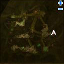
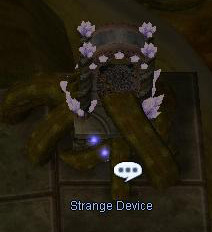
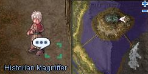

# Guardian of Yggdrasil

<!-- Quest info -->
- **Level requirement:** 70
- **Quests required:** Finished [Report from the New World](Report_from_the_New_World.md), Started [Two Tribes](Two_Tribes.md) (To the point where you enter the Dungeon)
- **Base EXP reward:** 1,500,000
- **Job EXP reward:** 35,000
- **Item reward:** 10 Manuk Coins **-OR-** 10 Splendide Coins

1.  Talk to the Yggdrasil Gatekeeper at (nyd_dun02 99, 199).
  * How to reach the gatekeeper:
1.   1. Enter Yggdrasil Dungeon at (spl_fld01 368, 112).
1.   1. Enter the portal located at 3 o'clock of the map (nyd_dun01 252, 144) (not shown on minimap). The portal markings on the minimap are exits only.

1.   1. * 

1.   1. Once in level 2, walk right until you've reached a cliff. Control the "Strange Device" at (nyd_dun02 137, 274), and cross the canyon by stepping on the circles. Stepping anywhere outside the shown circles will return you to the bottom right corner of the previous map.

1.   1. * 

1.   1. After crossing the cliff, follow the path consisting of stairs and roots until you've arrived at a gate at (nyd_dun02 99, 199).
1.  Tell Commander Agip (mid_campin 90, 121) about the cave you found, he tells you to find Historian Magnifier.
1.  Ask Historian Magnifier (mid_camp 271, 299) for help. He tells you to visit his assistant in the [Prontera](Prontera.md) library.

  * 

1.  In the west [Prontera](Prontera.md) Library (prontera 120, 264), talk to Assistant Naomi (prt_in 171, 94), and she will give you several papers to read.
1.  Return to Magnifier, he tells you to go investigate what the Laphine and Sapha know.  Chose to go to either the Laphine or Sapha.
  * Laphine:
1.   1.  Talk to the Grumbling Soldier in the Splendide (splendide 198, 178), and ask him about the tree.
1.   1.  Inside the central building (splendide 197, 191), speak to the Laphine Commander (spl_in01 110, 60).
  * Sapha:
1.   1.  Inside the building in the far right of [Manuk](Manuk.md) (309, 142), talk to the Laphine Prisoner (man_in01 291, 62).
1.   1.  Talk to Neat Etorr (man_in01 311, 57) in the same building.
1.  Return to Magnifier, he tells you to speak to Commander Agip to get his opinion.
1.  Commander Agip decides to ask both tribes for help exploring the cave. This will force each to help you to prevent you from getting help from their enemy.
1.  You are presented with a choice of which tribe to go to in order to seek assistance.
  * Laphine Branch:
1.   1. Speak to the Laphine Commander, and threaten to ask the Sapha's help if she refuses hers. She will agree to help and ask you to talk to Aide Arioss.
1.   1. Aide Arioss (spl_in01 104, 56) will give you a token to mark you as a guardian of the yggdrasil and tell you the password to get past the door.
  * Sapha Branch:
1.   1.  Return to the building in [Manuk](Manuk.md) and talk to Neat Etorr again.
1.   1.  Talk to the Laphine Prisoner twice.
1.  At this step you can now enter the [Nidhoggur's Nest](Nidhoggur's_Nest.md) Instance.  After you clear the instance, talk to Yggdrasiliad in the final room.
  * Note: The instance is very difficult and will require a strong party to complete.
  * **Note 2: This quest can not currently be completed on iRO**, the Yggdrasilid in the instance does not appear to set a needed quest variable.
1.  Chose if you want to go to Splendide or [Manuk](Manuk.md) for your reward.
  * Splendide: Talk to the Laphine Commander, and then Arioss.  You will receive 1,500,000 [Base EXP](Base_EXP_Chart.md), 35,000 [Job EXP](Job_EXP_Chart.md), and 10 Splendide Coins.
  * Manuk: Talk to Etol, and then with the Laphine Prisoner.  You will receive 1,500,000 [Base EXP](Base_EXP_Chart.md), 35,000 [Job EXP](Job_EXP_Chart.md), and 10 Manuk Coins.

---
**Categories:** [Base Experience Reward](categories/Base_Experience_Reward.md), [Into the Unknown Quests](categories/Into_the_Unknown_Quests.md), [Job Experience Reward](categories/Job_Experience_Reward.md), [New World Quests](categories/New_World_Quests.md)
*Source: [iRO Wiki Classic](https://irowiki.org/classic/Guardian_of_Yggdrasil) — GFDL 1.3+*
