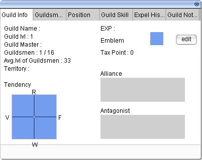

# Guild System

## Overview

The guild system of Ragnarok Online was made to allow the formation of communities with guild members and to form the basis to prepare for the War of Emperium.

## Guild Creation

To make a guild, you will need an '[Emperium](War_of_Emperium.md).' (When you use an [Emperium](War_of_Emperium.md) to create a guild, you will not be able to get one back if you decide to break the guild.)

If you have obtained an [Emperium](War_of_Emperium.md), and have it on the character you want to make the guild on, create a guild by typing /guild "guild name". The character you made the guild on is now the "Guild Master." Once you have made a guild, the name and who leads it cannot be changed (Unless there's something that goes against the TOS, in which case Gravity may either change the name and ask you to come up with a new one, or disband it).

## Guild Window

The guild window is accessed in-game, by pressing alt+G. This window is the interface used to change anything related to the guild, (that can be changed) and to view information such as who is currently online, the amount of people on, and the amount of people the guild can hold vs. the amount of people currently in the guild.

## Guild Info Tab

General guild information, such as the current number of members, number of online members, leader, and guild level, is displayed here. Alliances are also listed here and the guild leader can remove alliances by right clicking an allied guild name. The tendency feature currently does not work.

## Guildsmen Tab

All guild members are listed here. The leader is always first, with other members being ordered according to their title. Online members will be highlighted here. Members who have been taxed to provide the guild with experience can show the amount contributed as well. For the guild leader, titles of each member can be modified from this tab. Leaving the guild is also available by right clicking a member; guild members and members given the right to do so (via title) can kick anyone, while others can only kick themselves.

## Position Tab

A total of 20 titles are available and can be set here by the guild leader. The order of titles here will influence the order of members in the Guildsmen tab. Rights to invite and kick users are also given via titles.

## Guild Skills

Available guild skills are displayed here. On obtaining a new guild level, the extra skill point is allocated via this tab. Using active guild skills is also done here.

## Expel History

A list of recently kicked members are displayed here.

## Guild Notice

The guild leader may write a two-line guild notice (one short and one long) that will be displayed to each member upon logging in or switching maps. Note that the second line is often overlapped by the chat box scroll bar, so a short and concise notice is preferable.

## Guild Master

Guild masters can manage members' positions and set experience tax levels through Guild Titles. When being taxed in a guild, only your [Base Experience](Base_EXP_Chart.md) is taxed. Your [Job Experience](Job_EXP_Chart.md) will be unchanged by it. Taxes can only be set up to 50% of your Base Experience. Guild masters can also write messages, which are displayed when members log on/off, [Teleport](Teleport.md)/flywing, or change maps.

* Note: For people who do not wish to see messages, (such as when teleporting/changing maps often) the /li or /loginout command will disable these messages, as well as "Guildsman _____ has dis/connected" messages.

Currently there is no way to change guild leaders on iRO.  If the leader of a guild quits playing the game or their account becomes otherwise inaccessible, (such as via being permenantly banned) there is no way to let another guild member take ownership of the guild, and a new guild will have to be created.

## Guild Titles

Guild Titles are set by the Guild Master.  They are used to set Guild Tax levels, and special names which can be entered in after a character's name.  They also allow the Master to delegate various powers to other members such as inviting new members into the guild and kicking out members.

## Emblems

Guilds can also have their own personalizied "emblem." An emblem is a small picture which can make it easy to identify members, especially in WoE. Emblem Creation:

* Select a design for the Emblem.
* Emblems must be 24X24 pixels in BMP format using 256 colors, the hot pink color (Red: 255 Green: 0 Blue: 255) will appear transparent ingame.
* Create a folder named Emblem inside the ragnarok online folder (C:\Program Files\Gravity\RagnarokOnline), copy the emblem file into the Emblem folder. If you do not already have this folder, you will have to make it.

## Guild Size

The amount of members a guild can hold is 16 (including the Master) by default.  This limit can be increased via the [Guild Extension](Guild_Extension.md) skill up to a maximum of 56 members on iRO. Note that there are only 20 Guild Title slots, so grouping members into one or more "default" titles may be necessary with larger guilds.

## Guild Levels

Guilds, like characters, have levels. Guilds gain levels by members who donate their base experience through taxes. After a guild gains a level, one skill point is obtained, which can then be used on a variety of guild skills.

## Guild Experience Chart

| Column 1 | Column 2 | Column 3 | Column 4 |
| --- | --- | --- | --- |
| **Current Level** | **Total EXP** | **EXP to next Level** | **Rise %** |
| 1 | 0 | 2,000,000 |   |
| 2 | 2,000,000 | 4,000,000 | 100.0% |
| 3 | 6,000,000 | 8,000,000 | 100.0% |
| 4 | 14,000,000 | 14,000,000 | 75.0% |
| 5 | 28,000,000 | 22,000,000 | 57.1% |
| 6 | 50,000,000 | 32,000,000 | 45.5% |
| 7 | 82,000,000 | 44,000,000 | 37.5% |
| 8 | 126,000,000 | 58,000,000 | 31.8% |
| 9 | 184,000,000 | 74,000,000 | 27.6% |
| 10 | 258,000,000 | 92,000,000 | 24.3% |
| 11 | 350,000,000 | 112,000,000 | 21.7% |
| 12 | 462,000,000 | 134,000,000 | 19.6% |
| 13 | 596,000,000 | 158,000,000 | 17.9% |
| 14 | 754,000,000 | 184,000,000 | 16.5% |
| 15 | 938,000,000 | 212,000,000 | 15.2% |
| 16 | 1,150,000,000 | 242,000,000 | 14.2% |
| 17 | 1,392,000,000 | 274,000,000 | 13.2% |
| 18 | 1,666,000,000 | 308,000,000 | 12.4% |
| 19 | 1,974,000,000 | 344,000,000 | 11.7% |
| 20 | 2,318,000,000 | 382,000,000 | 11.0% |
| 21 | 2,700,000,000 | 422,000,000 | 10.5% |
| 22 | 3,122,000,000 | 464,000,000 | 10.0% |
| 23 | 3,586,000,000 | 508,000,000 | 9.5% |
| 24 | 4,094,000,000 | 554,000,000 | 9.1% |
| 25 | 4,648,000,000 | 602,000,000 | 8.7% |
| 26 | 5,250,000,000 | 652,000,000 | 8.3% |
| 27 | 5,902,000,000 | 704,000,000 | 8.0% |
| 28 | 6,606,000,000 | 758,000,000 | 7.7% |
| 29 | 7,364,000,000 | 814,000,000 | 7.4% |
| 30 | 8,178,000,000 | 872,000,000 | 7.1% |
| 31 | 9,050,000,000 | 932,000,000 | 6.9% |
| 32 | 9,982,000,000 | 994,000,000 | 6.7% |
| 33 | 10,976,000,000 | 1,058,000,000 | 6.4% |
| 34 | 12,034,000,000 | 1,124,000,000 | 6.2% |
| 35 | 13,158,000,000 | 1,192,000,000 | 6.0% |
| 36 | 14,350,000,000 | 1,262,000,000 | 5.9% |
| 37 | 15,612,000,000 | 1,334,000,000 | 5.7% |
| 38 | 16,946,000,000 | 1,408,000,000 | 5.5% |
| 39 | 18,354,000,000 | 1,484,000,000 | 5.4% |
| 40 | 19,838,000,000 | 1,562,000,000 | 5.3% |
| 41 | 21,400,000,000 | 1,642,000,000 | 5.1% |
| 42 | 23,042,000,000 | 1,724,000,000 | 5.0% |
| 43 | 24,766,000,000 | 1,808,000,000 | 4.9% |
| 44 | 26,574,000,000 | 1,894,000,000 | 4.8% |
| 45 | 28,468,000,000 | 1,999,999,999 | 5.6% |
| 46 | 30,467,999,999 | 1,999,999,999 | 0.0% |
| 47 | 32,467,999,998 | 1,999,999,999 | 0.0% |
| 48 | 34,467,999,997 | 1,999,999,999 | 0.0% |
| 49 | 36,467,999,996 | 1,999,999,999 | 0.0% |
| 50 | 38,467,999,995 |   |   |

## Skills

Guilds have certain skills which can be used in or outside of [WoE](War_of_Emperium.md). All "Active" skills can only be used by the Guild Master.

| Skill | Description | Levels | Type |
| --- | --- | --- | --- |
| [Battle Command](Battle_Command.md) | All guild members and allies visible on the Guild Leader's screen will receive a +5 bonus to [STR](Stats.md), [DEX](Stats.md) and [INT](Stats.md) for 180 seconds. | 1 | Supportive |
| [Charisma](Charisma.md) | Guild members near the guild master gain increased [HIT](Stats.md) and [FLEE](FLEE.md) rate. Unimplemented | ? | Passive |
| [Cold Heart](Cold_Heart.md) | All guild members in a 5x5 area around the Guild Leader will receive a (1*SkillLV) [AGI](Stats.md)  bonus. | 5 | Passive |
| [Contract with Kafra](Contract_with_Kafra.md) | Allows the hiring of a [Kafra](Kafra.md) employee enabling teleportation and storage access when owning a castle. | 1 | Passive |
| [Glorious Wounds](Glorious_Wounds.md) | All guild members within 5x5 cells of the guild master receives (1*Skill Level) [VIT](Stats.md) bonus. | 5 | Passive |
| [Glory of Guild](Glory_of_Guild.md) | Permits the use of a guild emblem. Unimplemented | 1 | Passive |
| [Great Leadership](Great_Leadership.md) | All guild members within 5x5 cells of the guild master receives (1*Skill Level) [STR](Stats.md) bonus. | 5 | Passive |
| [Guardian Research](Guardian_Research.md) | Enables guardians to be hired in defense of [War of Emperium](War_of_Emperium.md) castles. | 1 | Passive |
| [Guild Extension](Guild_Extension.md) | Adds up to 40 guildsmen to a guild's capacity, for 56 total. | 10 | Passive |
| [Official Guild Approval](Official_Guild_Approval.md) | Allows a guild to participate in the [War of Emperium](War_of_Emperium.md) and [War of Emperium 2](War_of_Emperium_2.md). | 1 | Passive |
| [Permanent Development](Permanent_Development.md) | While [investing](War_of_Emperium.md), adds a 50% chance of getting an extra point for free. | 1 | Passive |
| [Regeneration](Regeneration.md) | All guild members visible on the Guild Leader's screen increase their HP and SP regeneration rate. | 3 | Supportive |
| [Restoration](Restoration.md) | All guild members visible on the Guild Master's screen will have their [HP](Max_HP.md) and [SP](SP.md) restored to 90% of the respective maximum. | 1 | Supportive |
| [Sharp Gaze](Sharp_Gaze.md) | All guild members in a 5x5 area around the Guild Leader will receive a (1*Skill Level) [DEX](Stats.md) bonus. | 5 | Passive |
| [Strengthen Guardians](Strengthen_Guardians.md) | Enhance the [Attack Strength](Stats.md) and [speed](ASPD.md) of Guardians that are protecting [War of Emperium](War_of_Emperium.md) ([WoE 2](War_of_Emperium_2.md) excluded) Guild Castles in your Guild's possession. | 3 | Passive |
| [Urgent Call](Urgent_Call.md) | All guild members will be teleported next to the Guild Master. | 1 | Active |

**Related pages:**

* [Guild System](Guild_System.md)
* [Skills](Skills.md)
* [Battle Command](Battle_Command.md)
* [Charisma](Charisma.md)
* [Cold Heart](Cold_Heart.md)
* [Contract with Kafra](Contract_with_Kafra.md)
* [Glorious Wounds](Glorious_Wounds.md)
* [Glory of Guild](Glory_of_Guild.md)
* [Great Leadership](Great_Leadership.md)
* [Guardian Research](Guardian_Research.md)
* [Guild Extension](Guild_Extension.md)
* [Official Guild Approval](Official_Guild_Approval.md)
* [Permanent Development](Permanent_Development.md)
* [Regeneration](Regeneration.md)
* [Restoration](Restoration.md)
* [Sharp Gaze](Sharp_Gaze.md)
* [Strengthen Guardians](Strengthen_Guardians.md)
* [Urgent Call](Urgent_Call.md)
* [War of Emperium](War_of_Emperium.md)
* [WoE Point System](WoE_Point_System.md)
* [God Items Quest](God_Items_Quest.md)
* [War of Emperium 2](War_of_Emperium_2.md)
* [God Items Quest 2](God_Items_Quest_2.md)

**Related pages:**

* [Levels](Levels.md)
* [Experience](Experience.md)
* [Quest Table](Quest_Table.md)
* [Base EXP Chart](Base_EXP_Chart.md)
* [Job EXP Chart](Job_EXP_Chart.md)
* [Party](Party.md)
* [Guild System](Guild_System.md)
* [Homunculus System](Homunculus_System.md)
* [Leveling Spots](Leveling_Spots.md)
* [Mage Leveling](Mage_Leveling.md)
* [Crusader Leveling](Crusader_Leveling.md)
* [Rogue Leveling](Rogue_Leveling.md)
* [Stalker Leveling](Stalker_Leveling.md)
* [Wizard Leveling](Wizard_Leveling.md)

---
**Categories:** [General Information](categories/General_Information.md), [Guild](categories/Guild.md)
*Source: [iRO Wiki Classic](https://irowiki.org/classic/Guild_System) — GFDL 1.3+*
