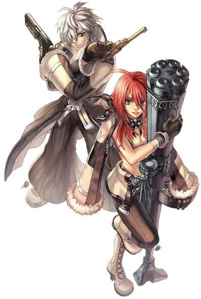

# Gunslinger

<!-- Job info -->
- **Job name:** Gunslinger
- **Job base:** Novice
- **Job type:** Extended
- **Changes at:** [Einbroch](Einbroch.md)
- **Skills:** 22
- **Skill points:** 133
- **Quest skills:** 0
- **STR:** 4
- **AGI:** 1
- **VIT:** 1
- **INT:** 2
- **DEX:** 9
- **LUK:** 7

## Overview

Gunslingers are flashy and confident New Age warriors that rely on a wide array of guns and powerful skills to deal as much damage as possible in a short amount of time to their enemies.  Gunslingers are always looking for a chance to show off their talent.

Bored with only target practice in smoggy [Einbroch](Einbroch.md), gunslingers have decided to take up adventuring, like so many from the Rune-Midgarts Kingdom, in order to live a life of excitement and fame.

Unlike traditional classes, Gunslingers do not have a second class to change to (As of yet), but instead are allowed 70 job levels.  This can allow for a range of very unique (hybrid and specialized) skill sets in the Gunslinger tree.

## Jobchange Guide

*See [Gunslinger Job Change Guide](First_Expanded_Job_Change_Guides.md) for information.*

## Builds

## DEX/AGI

*  STR: 1
*  AGI: 99 (Base)
*  VIT: 1
*  INT: 9
*  DEX: 120-140 (99 Base)
*  LUK: 1

These gunslingers typically use revolvers to gain a higher [ASPD](ASPD.md). They deal a limited amount of damage due to the handguns' lower attack power, but with the higher ASPD they can still kill enemies faster (and aided by the skill Chain Action). Another good thing about Dex/Agi builds is that they have a high [Flee](Stats.md) rate.

## DEX/VIT/INT Desperado

This build is a very similar in the play style to a [Grand Cross](Grand_Cross.md) [Crusader](Crusader.md).  Their goal is to gather a mob and quickly kill it with Desperado.  Advantages over GC Saders include: no problem with stacked monsters (the mob can be as big as you can safely make it), the potential damage output is far higher with the properly carded weapon (2s Garrison), and access to endows and different weapons that can be used to level almost anywhere that is mobby (Niff2, GH maps, CT HOs, Geffen Dungeon, Geffenia, Thanatos, etc).  Disadvantages include a much lower HP modifier (VIT is needed to survive as mobs swarm), lack of a Heal skill (a full support is very much needed at harder maps), and no peco (mobbing on foot w/o [Endure](Endure.md) is not as easy).

A pure build will have base stats that look something like this:
* STR:1
* AGI:1
* VIT:80-100
* INT:40-60
* DEX:120-140
* LUK:9

Gear for this build would include:
* Immune Muffler
* Increased SP Boots (Superior/Soul Enchanted)
* HP Armor (Pupa/Peco Peco/Goibne's Armor)
* Status Armor (Rybio for stun or Disguise for silence)

An Ulle's Cap and Odin's Blessing may be useful for their 10% reduction in the SP cost of skills, lowering the cost of Desperado from 50 down to 45.

*untested: damage increase by using Last Stand right before using Desperado on a mob for 100 more base attack*

## Triple Action Launcher

* STR: 1
* AGI: 80+
* VIT: 40+
* INT: 20 - 30
* DEX: 99+
* LUK: 1

An awkward build who's role is reliant on actual luck. This build makes use of the skill [Triple Action](Triple_Action.md) with the Grenade Launcher type guns. This is similar to [Monk](Monk.md)s and [Champion](Champion.md)s using their skill [Throw Spirit Sphere](Throw_Spirit_Sphere.md) but instead it deals three hits with each coin. Benefits of this build is the ability to bypass ammunition restriction (Ex. able to shot silver bullet with launcher which also carrying the holy property to the shot) and dealing 10 rows of massive damage with each that is roughly 2/3 from the skill [Trigger Happy Shot](Trigger_Happy_Shot.md) (damage can also be further increased by using the skill [Last Stand](Last_Stand.md)). The drawback is that the DPS (Damage Per Second) is not very stable, as you require actual luck to get coins back with the skill [Coin Flip](Coin_Flip.md). To make things easier, since the coin flip cast delay is [ASPD](ASPD.md) based, it is wise to use a berserk potion and equip a shield to speed up the process of getting 10 coins back. (The shield can be hotkeyed to quickly de-equip the slow ASPD gun.)
*NOTE: only through using triple action can bypass the ammunition restriction, if you want to use the skill [Gunslinger Mine](Gunslinger_Mine.md) you MUST switch your ammunition back to grenade type, vise versa to the other guns with their corresponding skills*

## Lever Action

*  STR: 1
*  AGI: 70+
*  VIT: 50+
*  INT: 1
*  DEX: 99+
*  LUK: 25 to 40 (total)

As the named suggests this build makes use of the weapon Lever Action Rifle to maximize damage and critical shots, combined with 2 Drosera Cards and sometimes with the skill [Last Stand](Last_Stand.md) through requiring as little [Luk](Stats.md) as possible (with a result of roughly 90 ~ 95 base critical ratio). As a critical attack build, active skill usage is not recommended as the critical attack usually does not carry over to the skill damage itself, thus int can remain as low as it can. Due to the rifle having a -5% ASPD penalty, it would be wise to use berserk potion, and to either invest in some ASPD boosting equipments or AGI to make up for it. Although ultimately the -5% will not have a hefty effect on your overall lethality, due to the potential high single hit damage of the lever action build.

## Equipment

Gunslingers can use five different types of guns in order to attack and defeat their enemies.  While any Gunslinger can use any type of gun, only certain skills can be used with each type of gun available.  All guns are two-handed, so Gunslingers can't make use of shields unless they remove their weapon.  Their selection of weapons is considered to be the worst in the game, having no options for a 1-handed weapon, no 4-slotted weapons, and only a single 3-slotted weapon, which is not usable with their most damaging skills.

## Weapons

## Pistols

Normally the defacto weapon for Gunslingers, the pistol allows for faster attack speed at a cost of lower Hit and Attack.  Available pistols include the following:
* [Six Shooter[1]](http://db.irowiki.org/classic/item-info/13100/)
* [Six Shooter[2]](http://db.irowiki.org/classic/item-info/13101/)
* [Crimson Bolt[1]](http://db.irowiki.org/classic/item-info/13102/)
* [Crimson Bolt[2]](http://db.irowiki.org/classic/item-info/13103/)
* [Garrison[1]](http://db.irowiki.org/classic/item-info/13104/)
* [Garrison[2]](http://db.irowiki.org/classic/item-info/13105/)
* [Gold Lux](http://db.irowiki.org/classic/item-info/13106/)
* [Wasteland's Outlaw[2]](http://db.irowiki.org/classic/item-info/13107/)
* [Soldier Handgun](http://db.irowiki.org/classic/item-info/13108/)

## Rifles

Rifles are stronger than pistols and can come with a Hit and Crit bonuses.  However, they are slower and are limited in the skills they can work with.  Available rifles include the following:
* [Branch[3]](http://db.irowiki.org/classic/item-info/13150/)
* [Cyclone[1]](http://db.irowiki.org/classic/item-info/13151/)
* [Cyclone[2]](http://db.irowiki.org/classic/item-info/13152/)
* [Dusk[1]](http://db.irowiki.org/classic/item-info/13153/)
* [Long Barrel](http://db.irowiki.org/classic/item-info/13163/)
* [Long Barrel[1]](http://db.irowiki.org/classic/item-info/13164/)
* [Jungle Carbine](http://db.irowiki.org/classic/item-info/13165/)
* [Jungle Carbine[1]](http://db.irowiki.org/classic/item-info/13166/)
* [Lever Action Rifle[2]](http://db.irowiki.org/classic/item-info/13170/)
* [Soldier Rifle](http://db.irowiki.org/classic/item-info/13171/)

## Gatling Guns

In theory, these electro-mechanical weapons are nearly the same in comparison to pistols.  But with the right combination of skills, AGI, and DEX, the elusive attack speed of 190 can be reached along with a much higher attack.  Available gatling guns include the following:
* [Drifter[1]](http://db.irowiki.org/classic/item-info/13157/)
* [Butcher](http://db.irowiki.org/classic/item-info/13158/)
* [Butcher[1]](http://db.irowiki.org/classic/item-info/13159/)
* [Soldier Gatling Gun](http://db.irowiki.org/classic/item-info/13172/)

## Shotguns

Shotguns are powerful, pump action weapons that provide splash damage on normal attacks, but at the cost of a very slow attack speed.  Available shotguns include the following:
* [Rolling Stone[1]](http://db.irowiki.org/classic/item-info/13154/)
* [Black Rose[1]](http://db.irowiki.org/classic/item-info/13155/)
* [Gatekeeper](http://db.irowiki.org/classic/item-info/13156/)
* [Gatekeeper-DD](http://db.irowiki.org/classic/item-info/13167/)
* [Thunder-P[1]](http://db.irowiki.org/classic/item-info/13168/)
* [Thunder-P[2]](http://db.irowiki.org/classic/item-info/13169/)
* [Soldier Shotgun](http://db.irowiki.org/classic/item-info/13173/)

## Grenade Launchers

These monsters pack some of the highest base attack in the game, and allow the use of elemental bullets called "spheres".  They have the same slow attack speed of shotguns and have only one specialized skill available to them, but they can break armor at close range.  Available grenade launchers include the following:
* [Destroyer](http://db.irowiki.org/classic/item-info/13160/)
* [Destroyer[1]](http://db.irowiki.org/classic/item-info/13161/)
* [Inferno[1]](http://db.irowiki.org/classic/item-info/13162/)
* [Soldier Grenade Launcher](http://db.irowiki.org/classic/item-info/13174/)

## Armor

Gunslingers can only wear armor that states that it can be worn by all, or all except novice.  With Battlegrounds, Gunslingers also get exclusive use of the following:
* [Elite Shooter's Suit[1]](http://db.irowiki.org/classic/item-info/2382/)

## Headgear

Currently, Gunslingers can wear any headgear that is wearable by archer class characters, with the exception of caps, goggles, and binoculars.

## Shields

Gunslingers cannot use shields while equipped with guns, but if they wish, they can remove the weapon and wear a guard.

## Footwear

Gunslingers can use any footwear equippable by archer class characters.  With Battlegrounds, Gunslingers also get exclusive use of the following:
* [Battle Boots[1]](http://db.irowiki.org/classic/item-info/2437/)

## Garments

Gunslingers can use any garment that can be worn by archer characters.  With Battlegrounds, Gunslingers also get exclusive use of the following:
* [Sheriff's Manteau[1]](http://db.irowiki.org/classic/item-info/2540/)

## Accessories

Gunslingers can use any accessory that can be worn by non-trans characters.  With Battlegrounds, Gunslingers also get exclusive use of the following:
* Sheriff's Badge[1]

## Skills

| Skill | Description | Levels | Type |
| --- | --- | --- | --- |
| [Single Action](Single_Action.md) | The most basic Gunslinger skill. Increases [HIT](Stats.md) and [ASPD](ASPD.md) when equipped with a gun. | 10 | Passive |
| [Snake Eyes](Snake_Eyes.md) | Increases [HIT](Stats.md) and attack range when using guns. | 10 | Passive |
| [Coin Flip](Coin_Flip.md) | Flips a coin, and upon success, the user will gain a coin. Upon failure, the user loses a coin. | 5 | Supportive |
| [Increase Accuracy](Increase_Accuracy.md) | Consumes 4 coins to boost the caster's [HIT](Stats.md) by 20, as well as [DEX](Stats.md) and [AGI](Stats.md) by 4 for one minute. | 1 | Supportive |
| [Last Stand](Last_Stand.md) | Consumes 4 coins to increase the caster's [ATK](Stats.md) by 100, and [ASPD](ASPD.md) by 15% for one minute. | 1 | Supportive |
| [Gunslinger's Panic](Gunslinger's_Panic.md) | A buff skill that consumes 2 coins. Reduces [HIT](Stats.md) by 30, damage dealt by long-range attacks by 20% and increases [FLEE](FLEE.md) by 30. Lasts 20 seconds. | 1 | Supportive |
| [Bull's Eye](Bull's_Eye.md) | Uses 1 Coin to deal 500% damage to [Demi Human](Demi_Human.md) and [Brute](Brute.md) enemies. Has a 0.1% chance to inflict [Coma](Status_Effects.md) status. | 1 | Offensive |
| [Triple Action](Triple_Action.md) | Uses 1 coin to shoot an enemy three times, dealing 450% total damage. | 1 | Offensive |
| [Magical Bullet](Magical_Bullet.md) | Uses 1 coin to launch a Ghost-property attack that does not consume any bullets. | 1 | Offensive |
| [Cracker](Cracker.md) | Uses a single coin to [Stun](Status_Effects.md) an enemy. The closer the enemy, the higher the success rate. | 1 | Supportive |
| [Coin Fling](Coin_Fling.md) | Use up to 5 coins to deal damage to an enemy while reducing the target's [DEF](DEF.md) stat. | 1 | Supportive |
| [Chain Action](Chain_Action.md) | When normally attacking, adds the chance of dealing double damage. | 10 | Passive |
| [Trigger Happy Shot](Trigger_Happy_Shot.md) | Rapidly fires 5 bullets at an enemy. | 10 | Offensive |
| [Desperado](Desperado.md) | Sprays a surrounding area full of lead, hitting enemies anywhere from 0 to 10 times. | 10 | Offensive |
| [Gatling Fever](Gatling_Fever.md) | Greatly boosts ASPD when casted, at the cost of movement speed and Flee. Must be used with a Gatling-type weapon. | 1 | Supportive |
| [Tracking](Tracking.md) | Take aim with a Pistol or Rifle on a target to deal significant target. | 10 | Offensive |
| [Disarm](Disarm.md) | Aim at an enemy's appendages to reduce their offensive capabilities. | 5 | Supportive |
| [Wounding Shot](Wounding_Shot.md) | Fires a bullet that is capable of piercing defenses while causing the Bleeding status. | 5 | Offensive |
| [Crowd Control Shot](Crowd_Control_Shot.md) | Fires a blast strong enough to knock back a target 5 cells. | 10 | Offensive |
| [Full Blast](Full_Blast.md) | Sprays a round of 10 bullets at a single target. | 10 | Offensive |
| [Spread Shot](Spread_Shot.md) | Cover an area with intense fire. Uses 5 bullets. | 10 | Offensive |
| [Gunslinger Mine](Gunslinger_Mine.md) | Launches a grenade onto the ground that acts like a mine. | 10 | Offensive |

## Job Bonuses

The bonus to stats given for each job level are listen in the below table.

**Job Bonus**

| Stat\Amount | +1 | +2 | +3 | +4 | +5 | +6 | +7 | +8 | +9 |
| --- | --- | --- | --- | --- | --- | --- | --- | --- | --- |
| STR | 32 | 41 | 50 | 64 |   |   |   |   |   |
| AGI | 59 |   |   |   |   |   |   |   |   |
| VIT | 60 |   |   |   |   |   |   |   |   |
| INT | 52 | 61 |   |   |   |   |   |   |   |
| DEX | 1 | 6 | 11 | 17 | 25 | 36 | 45 | 55 | 62 |
| LUK | 2 | 4 | 12 | 21 | 31 | 51 | 63 |   |   |

## ASPD

## HP (With 1 VIT)

| Column 1 | Column 2 |
| --- | --- |
| **Level** | **HP** |
| 1 | 40 |
| 2 | 47 |
| 3 | 54 |
| 4 | 61 |
| 5 | 69 |
| 6 | 77 |
| 7 | 85 |
| 8 | 94 |
| 9 | 103 |
| 10 | 202 |
| 11 | 212 |
| 12 | 222 |
| 13 | 232 |
| 14 | 243 |
| 15 | 254 |
| 16 | 265 |
| 17 | 277 |
| 18 | 289 |
| 19 | 301 |
| 20 | 316 |

| Column 1 | Column 2 |
| --- | --- |
| **Level** | **HP** |
| 21 | 331 |
| 22 | 346 |
| 23 | 364 |
| 24 | 382 |
| 25 | 400 |
| 26 | 420 |
| 27 | 440 |
| 28 | 460 |
| 29 | 490 |
| 30 | 520 |
| 31 | 550 |
| 32 | 580 |
| 33 | 610 |
| 34 | 650 |
| 35 | 680 |
| 36 | 710 |
| 37 | 740 |
| 38 | 770 |
| 39 | 800 |
| 40 | 830 |

| Column 1 | Column 2 |
| --- | --- |
| **Level** | **HP** |
| 41 | 865 |
| 42 | 890 |
| 43 | 925 |
| 44 | 955 |
| 45 | 990 |
| 46 | 1,025 |
| 47 | 1,050 |
| 48 | 1,080 |
| 49 | 1,110 |
| 50 | 1,145 |
| 51 | 1,180 |
| 52 | 1,215 |
| 53 | 1,275 |
| 54 | 1,335 |
| 55 | 1,395 |
| 56 | 1,455 |
| 57 | 1,515 |
| 58 | 1,575 |
| 59 | 1,635 |
| 60 | 1,695 |

| Column 1 | Column 2 |
| --- | --- |
| **Level** | **HP** |
| 61 | 1,760 |
| 62 | 1,820 |
| 63 | 1,885 |
| 64 | 1,950 |
| 65 | 2,015 |
| 66 | 2,080 |
| 67 | 2,145 |
| 68 | 2,210 |
| 69 | 2,275 |
| 70 | 2,340 |
| 71 | 2,410 |
| 72 | 2,480 |
| 73 | 2,550 |
| 74 | 2,620 |
| 75 | 2,690 |
| 76 | 2,760 |
| 77 | 2,830 |
| 78 | 2,900 |
| 79 | 2,970 |
| 80 | 3,040 |

| Column 1 | Column 2 |
| --- | --- |
| **Level** | **HP** |
| 81 | 3,115 |
| 82 | 3,190 |
| 83 | 3,265 |
| 84 | 3,340 |
| 85 | 3,415 |
| 86 | 3,490 |
| 87 | 3,565 |
| 88 | 3,640 |
| 89 | 3,715 |
| 90 | 3,790 |
| 91 | 3,870 |
| 92 | 3,950 |
| 93 | 4,030 |
| 94 | 4,110 |
| 95 | 4,190 |
| 96 | 4,270 |
| 97 | 4,350 |
| 98 | 4,430 |
| 99 | 4,510 |

## External Links

**Related pages:**

* [Gunslinger](Gunslinger.md)
* [Skills](Skills.md)
* [Bull's Eye](Bull's_Eye.md)
* [Chain Action](Chain_Action.md)
* [Coin Fling](Coin_Fling.md)
* [Coin Flip](Coin_Flip.md)
* [Cracker](Cracker.md)
* [Crowd Control Shot](Crowd_Control_Shot.md)
* [Desperado](Desperado.md)
* [Disarm](Disarm.md)
* [Full Blast](Full_Blast.md)
* [Gatling Fever](Gatling_Fever.md)
* [Gunslinger Mine](Gunslinger_Mine.md)
* [Gunslinger's Panic](Gunslinger's_Panic.md)
* [Increase Accuracy](Increase_Accuracy.md)
* [Last Stand](Last_Stand.md)
* [Magical Bullet](Magical_Bullet.md)
* [Single Action](Single_Action.md)
* [Snake Eyes](Snake_Eyes.md)
* [Spread Shot](Spread_Shot.md)
* [Tracking](Tracking.md)
* [Trigger Happy Shot](Trigger_Happy_Shot.md)
* [Triple Action](Triple_Action.md)
* [Wounding Shot](Wounding_Shot.md)
* [Quests](Quests.md)
* [First Expanded Job Change Guides](First_Expanded_Job_Change_Guides.md)
* [Gunslinger Weapon Quests](Gunslinger_Weapon_Quests.md)
* [Weapons](Weapons.md)
* [Bullets](Bullets.md)
* [Gun](Gun.md)

**Related pages:**

* [Classes](Classes.md)
* [Novice](Novice.md)
* [High Novice](High_Novice.md)
* [Super Novice](Super_Novice.md)
* [Acolyte](Acolyte.md)
* [Archer](Archer.md)
* [High First Class](High_First_Class.md)
* [Mage](Mage.md)
* [Merchant](Merchant.md)
* [Swordman](Swordman.md)
* [Thief](Thief.md)
* [Priest](Priest.md)
* [Monk](Monk.md)
* [Hunter](Hunter.md)
* [Bard](Bard.md)
* [Dancer](Dancer.md)
* [Wizard](Wizard.md)
* [Sage](Sage.md)
* [Blacksmith](Blacksmith.md)
* [Alchemist](Alchemist.md)
* [Knight](Knight.md)
* [Crusader](Crusader.md)
* [Assassin](Assassin.md)
* [Rogue](Rogue.md)
* [Transcendent](Transcendent.md)
* [High Priest](High_Priest.md)
* [Champion](Champion.md)
* [Sniper](Sniper.md)
* [Minstrel](Minstrel.md)
* [Gypsy](Gypsy.md)
* [High Wizard](High_Wizard.md)
* [Scholar](Scholar.md)
* [Mastersmith](Mastersmith.md)
* [Biochemist](Biochemist.md)
* [Lord Knight](Lord_Knight.md)
* [Paladin](Paladin.md)
* [Assassin Cross](Assassin_Cross.md)
* [Stalker](Stalker.md)
* [Gunslinger](Gunslinger.md)
* [Ninja](Ninja.md)
* [TaeKwon Kid](TaeKwon_Kid.md)
* [TaeKwon Master](TaeKwon_Master.md)
* [Soul Linker](Soul_Linker.md)

---
**Categories:** [Classes](categories/Classes.md), [Gunslinger](categories/Gunslinger.md)
*Source: [iRO Wiki Classic](https://irowiki.org/classic/Gunslinger) — GFDL 1.3+*
